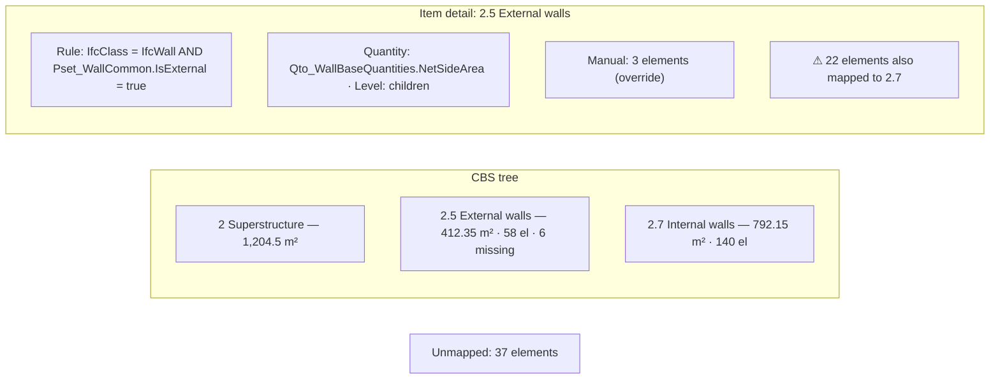
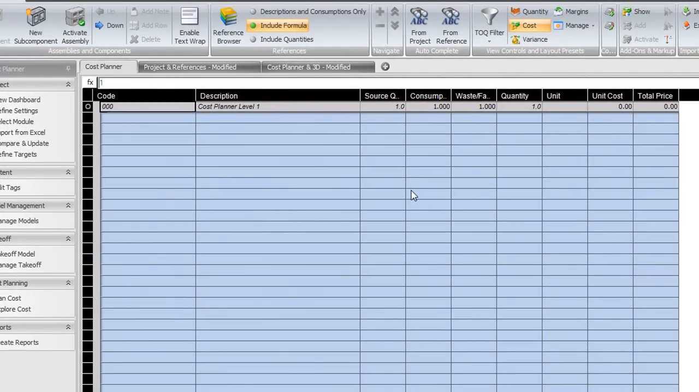
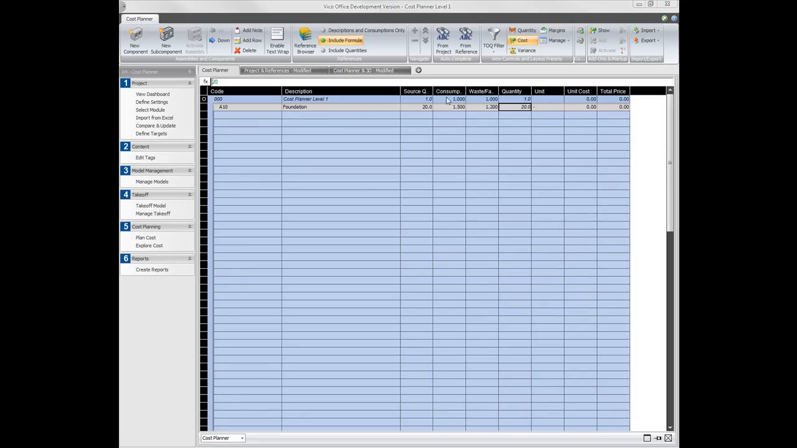
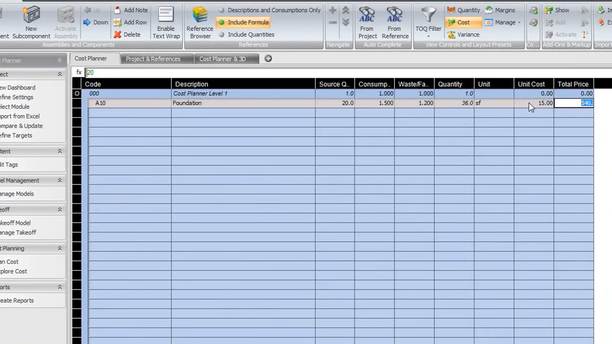
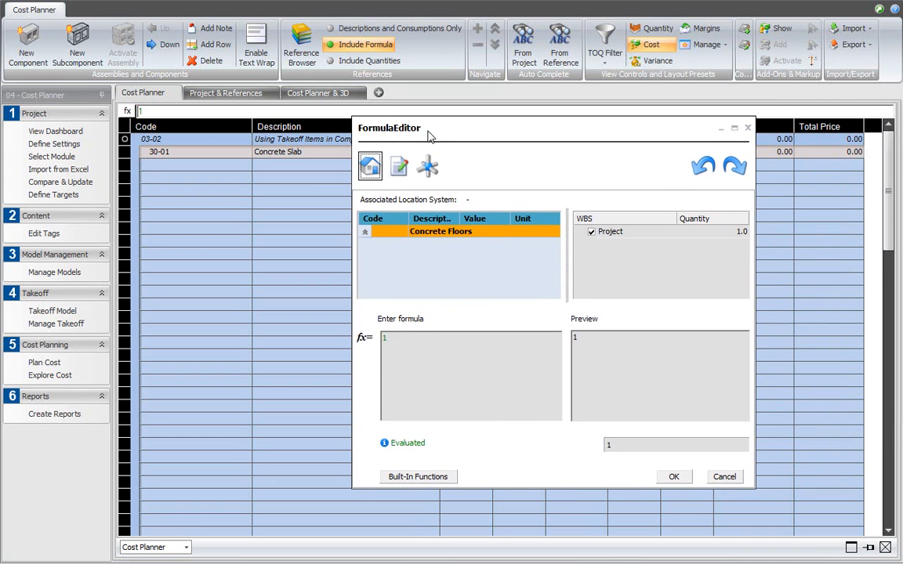
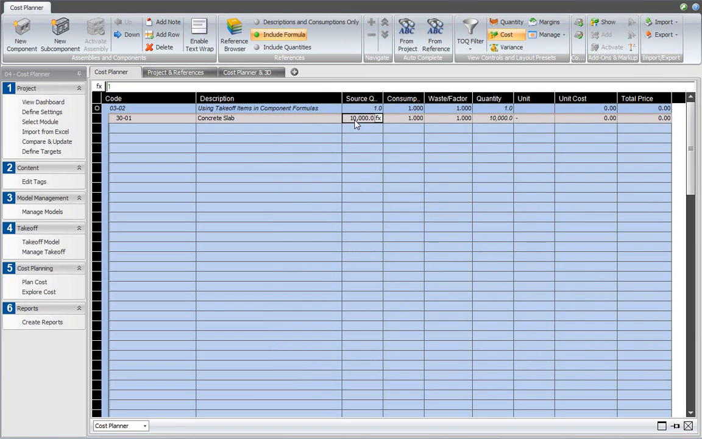

# Cost Breakdown Structure and Element Mapping

Status: In progress locally (Phase 1C). The current UI accepts a flat, comma-separated list of CBS item names, lists every element with a per-element dropdown and a manual quantity override, and reports mapped/unmapped counts (`src/core/cost-breakdown.ts`, 5 unit tests passing). There is no hierarchy, no rule-based mapping, no many-to-many mapping (one CBS item per element), no link to a takeoff quantity (each mapping contributes `override ?? 1`), no location breakdown, and no aggregate-level control. Market basis: [Phase 1C research](../research/phase-1c-cost-estimation-market-research.md).

## Summary

Let users build a hierarchical cost breakdown structure (CBS) — code, name, parent — and map IFC elements to CBS items mainly by **rules** over IFC fields (class, type, property values, classification references) using the shared predicate contract, with manual assignment of a selection, filter result, or takeoff row as a visible override. Each mapping draws a **named takeoff quantity** (for example `Qto_WallBaseQuantities.NetSideArea`), not a count of 1. An element may belong to several CBS items (wall → masonry, plaster, paint), with a visible "mapped to N items" warning. A location breakdown (site → building → storey) is available as a second grouping. Unmapped elements and elements missing the chosen quantity are always listed. All data is session-only unless exported [A1].

**Recommendation.** Mirror the estimator workflow seen in Vico Office Cost Planner: CBS items are identified by unique codes and take their source quantity from a takeoff item/quantity via a link, not a typed number [S1, S2]. Keep the link as `(rule or manual) → quantity name`, so quantities update when models change, which is the exact problem a buildingSMART developer raised for IFC cost items [S3].

---

# Detailed Specification

## Problem

Estimators organise costs by a breakdown (elemental, trade, or classification) and need each item to pull its quantity from the model. Mapping thousands of elements one by one through dropdowns is impractical; a flat list cannot represent an elemental hierarchy; and a count of 1 per element is not a quantity. When models change, typed quantities silently go stale [A1, S3].

## Users

- Estimators and quantity surveyors structuring a cost plan from IFC takeoff.

## Goals

- Build or import a hierarchical CBS with unique codes.
- Map elements to CBS items in bulk by rules, with explicit manual overrides.
- Feed each CBS item from a named takeoff quantity that updates with the models.
- Make unmapped elements, missing quantities, and repeated (multi-mapped) quantities visible.

## Comparable Products (Research)

| Product | Feature name | Docs | Video | Notes |
|---|---|---|---|---|
| Trimble Vico Office | Cost Planner components, takeoff-linked formulas | Phase 1C research | [Adding a Cost Line Item](https://www.youtube.com/watch?v=D_p7Jc89n5Q), [Takeoff items in component formulas](https://www.youtube.com/watch?v=CuWS48MrzoQ) | Unique code; source quantity × consumption × waste; source quantity linked to takeoff via formula [S1, S2]. |
| Autodesk Assemble | Model Inventory grouping | Phase 1C research | n/a | Grouping by bid package, location, phase, work activity code [S4]. |
| RIB CostX | Multiple breakdown structures | [RIB CostX](https://www.rib-software.com/en/rib-costx) | n/a | Estimates in multiple breakdown structures, live-linked to model data [S4]. |
| IFC | `IfcCostItem`, `IfcRelAssignsToControl` | buildingSMART forum | n/a | Cost items control products and reference quantity set/name [S3]. |

## What Good Looks Like (Findings)

- **Codes make items unique.** "We'll add a component by entering a code which is what makes the component unique in the project" (00:50–00:56); "the code is what makes a component unique" (01:37–01:41) [S1]. → R1: CBS code is required and unique.
- **Linked source quantity.** "The takeoff item and takeoff quantity … can be used as a variable in cost component source quantity field"; the formula editor lists takeoff quantities and inserts a reference (00:26–01:28) [S2]. → R4: CBS items reference a named takeoff quantity.
- **Quantity build-up stays separate from rates.** Vico computes quantity = source quantity × consumption × waste factor, then total = quantity × unit cost (02:12–02:59) [S1]. → consumption/waste and rates belong to [Unit rates and costing](unit-rates-costing.md).
- **Multiple structures and location.** Assemble groups by location and work activity code; CostX supports multiple breakdown structures [S4]. → R6 location breakdown.

## User Feedback (Forums)

- **Links must survive model changes.** moult asked how a cost item "retain[s] a link to the types of IfcElementQuantities it is interested in": a user selects a quantity set name (`Qto_WallBaseQuantities`) and quantity name (`NetVolume`) for a cost item, then "the model changes" (Apr 2021) [S3]. → R4/R8: store the quantity name and rule, re-evaluate on model change, never copy a number.
- **Inconsistent exports.** The quantity-takeoff research found IFC exports with missing base quantities and inconsistent mappings [S5]. → R7: per-item "missing quantity" counts.
- **Re-evaluation.** The existing scope (rules, many-to-many, manual overrides, location breakdown, unmapped listing) holds; research confirms code uniqueness and linked quantities.

## User Flow

1. **Entry point.** The user opens **Cost breakdown**. With no CBS: "Create a CBS item or import a CBS file."
2. **Build CBS.** The user adds items (code, name, parent) in a tree, or imports a file via [Estimate data files](estimate-data-files.md).
3. **Add mapping rules.** On a CBS item, **Add rule** opens the shared condition editor (e.g. `IfcClass equals IfcWall` AND `Pset_WallCommon.IsExternal equals true`), a **Quantity** picker from takeoff quantity names (e.g. `Qto_WallBaseQuantities.NetSideArea`), and a counting level for aggregates (parent or children).
4. **Manual assign.** The user selects elements, a filter result, or a takeoff row and chooses **Assign to CBS item…**; these show a "Manual" badge and override rule mappings for that element/item pair.
5. **Review.** Each CBS item shows element count, quantity total (metric), missing-quantity count, and rule/manual breakdown; parents roll up children. **Unmapped** lists elements matched by no item. A banner warns when elements are mapped to more than one item.
6. **Location view.** Toggle **Group by location** to see each CBS item split by site/building/storey.
7. **Model changes.** Loading/removing models re-evaluates rules; removing a model with manual assignments asks for confirmation.
- **Error / edge paths:** duplicate code → rejected inline; deleting a parent → asks to delete or re-parent children; rule with a quantity absent on matched elements → counted as missing, not zero; aggregate parent and child both matched → warning and the chosen counting level applied.

## Wireframe / Sketch

## Requirements

- **R1 — Hierarchical CBS.** Items have a required, unique code, a name, and an optional parent; codes from any classification are user data; nothing is bundled [S1, A1].
- **R2 — Rule mapping.** Each CBS item may have rules built from the shared predicate contract (AND within a rule, OR across rules of the same item); all matching items apply (no first-match) [A1].
- **R3 — Manual assignment.** Assign a selection, filter result, or takeoff row to an item; manual assignments are badged, listed separately, clearable, and override rule results for the same element/item pair [A1].
- **R4 — Linked quantity.** Each rule and manual assignment names a takeoff quantity (`QsetName.QuantityName` or `count`); item totals sum that quantity from [Quantity takeoff](quantity-takeoff.md) in metric units; nothing is typed in as a copied number [S2, S3].
- **R5 — Many-to-many.** An element may map to several items; the full quantity is shown on each, with a visible "mapped to N items" warning; no allocation shares in Phase 1C [A1].
- **R6 — Location breakdown.** Group any item by site/building/storey from [Model hierarchy](model-hierarchy.md); elements without spatial containment go to "Unassigned location" [S4, A1].
- **R7 — Completeness.** Per item: element count, quantity total, missing-quantity count, unknown-unit count; global "Unmapped" list and count [S5, A1].
- **R8 — Re-evaluation.** Rules re-evaluate on model load/removal; manual assignments for a removed model are discarded after confirmation [S3, A1].
- **R9 — Aggregates.** Each rule chooses counting at parent or child level; when both a parent and its children are matched by the same item, a warning appears and only the chosen level counts [A1].
- **R10 — Selection.** Selecting an item, rule, or the Unmapped list highlights its elements.
- **R11 — Persistence boundary.** CBS, rules, and assignments live in memory and leave the app only through explicit export [A1].

## Acceptance Criteria

- [x] AC1: Given mappings, then mapped/unmapped counts never go negative and only exact model-scoped elements match. *(Proven by `tests/unit/cost-breakdown.test.ts`, 5 tests passing locally on 2026-11-08.)*
- [ ] AC2: Given a CBS with parent and child items, then parent totals roll up children and duplicate codes are rejected.
- [ ] AC3: Given a rule `IfcClass = IfcWall` with quantity `NetSideArea` on the multistorey fixture, then the item total equals the fixture's summed `NetSideArea` and missing counts are reported.
- [ ] AC4: Given a wall mapped to two items, then both show its full quantity and the multi-mapping warning appears.
- [ ] AC5: Given a manual assignment on an element also matched by a rule for the same item, then the manual entry overrides and is badged.
- [ ] AC6: Given location grouping, then item totals split by storey and unassigned elements are listed.
- [ ] AC7: Given the aggregate fixture with parent and child both matched, then only the chosen level counts and a warning shows.
- [ ] AC8: Given a model is removed, then rules re-evaluate and manual assignments for it are discarded after confirmation.
- [ ] AC9: Given reload, then no CBS or mapping data persists.

## Test Cases (for developers)

| ID | Type | Precondition | Steps | Expected result |
|---|---|---|---|---|
| T1 | Unit | CBS tree | Add/move/delete; duplicate code | Valid tree; duplicate rejected. |
| T2 | Unit | Takeoff rows + rules | Evaluate | Item totals = sums of linked quantity; missing counted. |
| T3 | Unit | Multi-matching rules | Evaluate | Element on all matching items; warning count. |
| T4 | Unit | Manual + rule | Evaluate | Manual overrides; badged. |
| T5 | Unit | Aggregate fixture | Parent vs children level | No double count. |
| T6 | Unit | Spatial hierarchy | Location grouping | Correct split; unassigned bucket. |
| T7 | Chrome E2E | Fixtures loaded | Build CBS, add rule, select item | Elements highlighted; totals shown. |
| T8 | Chrome E2E | Manual assignments | Remove model | Confirmation; discarded. |

## Module Contract

- Public entrypoint: `mountCostBreakdown` in `src/features/cost-breakdown/index.ts` (present); pure model in `src/core/cost-breakdown.ts` extended with `CbsItem {code, name, parentCode?}`, `MappingRule {itemCode, conditions, quantity, level}`, and `ManualAssignment {itemCode, identities, quantity}`.
- Consumes `TakeoffRow`/per-element quantities from [Quantity takeoff](quantity-takeoff.md), predicate evaluation from `src/core/predicate.ts`, and spatial structure from the IFC adapter. Exposes `CbsItemTotal[]` to [Unit rates and costing](unit-rates-costing.md) and [Estimate Excel export](estimate-excel-export.md).

## Dependencies

- [Quantity takeoff](quantity-takeoff.md), [cross-cutting contracts](cross-cutting-contracts.md), [model filtering](model-filtering.md), [model hierarchy](model-hierarchy.md), [element selection](element-selection.md), [estimate data files](estimate-data-files.md), and [unit rates and costing](unit-rates-costing.md).

## Assumptions

- Only one CBS is active per session; multiple parallel breakdowns are represented by location grouping plus import/export of alternative CBS files.
- OR across an item's rules is the natural reading of "add another rule"; this matches the predicate contract's statement that rule semantics are defined per feature.

## Out of Scope

- Quantity allocation shares across multiple items, consumption/waste factors (handled in costing), and writing `IfcCostItem` back to IFC [S1, S3].
- Bundled classification libraries.

## Open Questions

- None. Rule-based many-to-many mapping without allocation shares, manual overrides, and location breakdown are approved [A1].

## Sources

- **[S1]** FridaysWithVico (presented by Vico Software's director of product management, per captions 00:01–00:05) — "CP L1 01 Adding a Cost Line Item to Vico Office Cost Planner" — https://www.youtube.com/watch?v=D_p7Jc89n5Q. Published 2011-04-21, 3:33. Captions: 00:11–00:31 components have description, quantity, cost per unit; assemblies contain components; 00:50–00:56 and 01:37–01:41 code makes a component unique; 02:12–02:59 quantity = source quantity × consumption × waste factor; total = quantity × unit cost.
- **[S2]** FridaysWithVico — "CP-L3-02 Using Takeoff Items in Component Formulas in Vico Office Cost Planner" — https://www.youtube.com/watch?v=CuWS48MrzoQ. Published 2011-04-26, 1:49. Captions: 00:14–00:32 takeoff item and quantity used as a variable in the component source quantity; 01:00–01:28 formula editor lists takeoff quantities and inserts the reference.
- **[S3]** buildingSMART forum — "How does a cost item retain a link to the types of IfcElementQuantities it is interested in?" — listed at https://forums.buildingsmart.org/search?q=How%20does%20a%20cost%20item%20retain%20a%20link. moult, Apr 2021: cost item controls products via `IfcRelAssignsToControl`; user selects `Qto_WallBaseQuantities` / `NetVolume`; then "the model changes". Accessed 2026-11-08 (search snippet).
- **[S4]** Project research — [Phase 1C cost estimation market research](../research/phase-1c-cost-estimation-market-research.md) (Assemble grouping by bid package/location/phase/work activity; CostX multiple breakdown structures). Marketing-level evidence.
- **[S5]** [Quantity takeoff](quantity-takeoff.md) research — buildingSMART forum evidence of inconsistent or missing exported quantities.
- **[S6]** Capture commands — `cost-breakdown-mapping/assets/_capture_video.py`; downloads [S1] and [S2] (720p cap) without subtitles and extracts frames at the timestamps in the script; English auto-caption VTTs were fetched separately with `yt-dlp --skip-download --write-auto-subs` because of earlier HTTP 429 rate limits. Full MP4s were held in a temporary directory and deleted. Frames were checked for nonblank pixels with Pillow and matched to caption timestamps; in-tool image viewing was unavailable.
- **[A1]** Approved decisions and local implementation (not external evidence): [Phase 1 MVP](../plans/Phase_1_MVP.md) (Phase 1C scope, file-export-only persistence), [cross-cutting contracts](cross-cutting-contracts.md), `src/features/cost-breakdown/index.ts`, `src/core/cost-breakdown.ts`, and `tests/unit/cost-breakdown.test.ts`.

---

# Research

## Trimble Vico Office

- Unique codes, quantity build-up, and takeoff-linked source quantities (00:11–02:59; 00:14–01:28) [S1, S2]; basis for R1 and R4.
- Transcripts: [vico-cost-component-transcript.en.vtt](cost-breakdown-mapping/assets/vico-cost-component-transcript.en.vtt), [vico-takeoff-formula-transcript.en.vtt](cost-breakdown-mapping/assets/vico-takeoff-formula-transcript.en.vtt).

## buildingSMART community

- Cost items must keep a link to quantity set/name across model changes [S3]; basis for R4 and R8.
