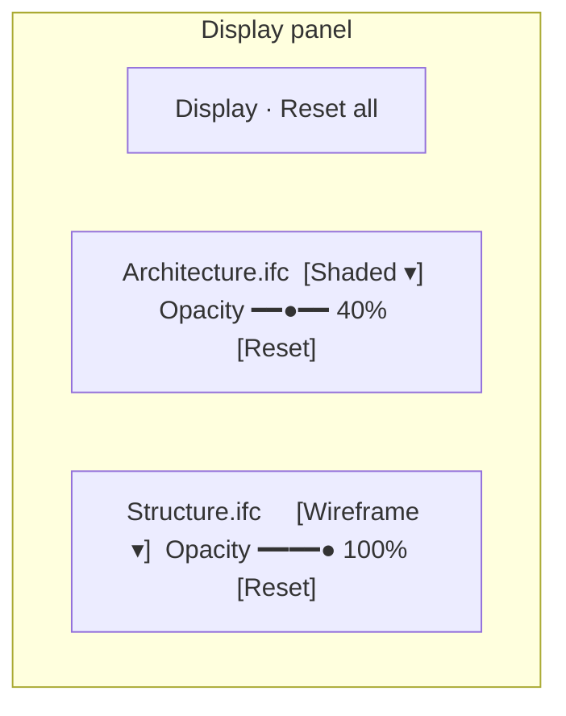
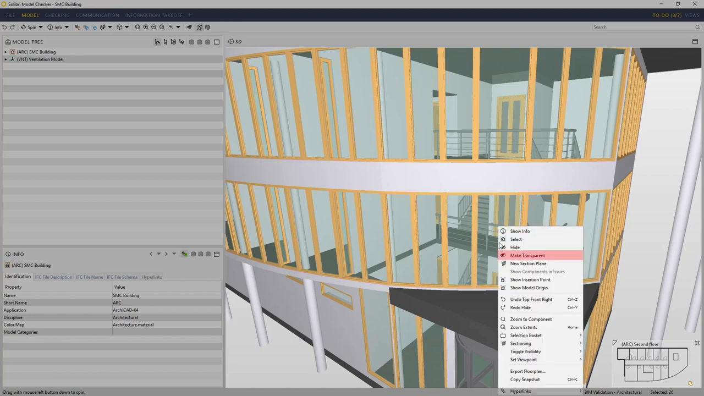
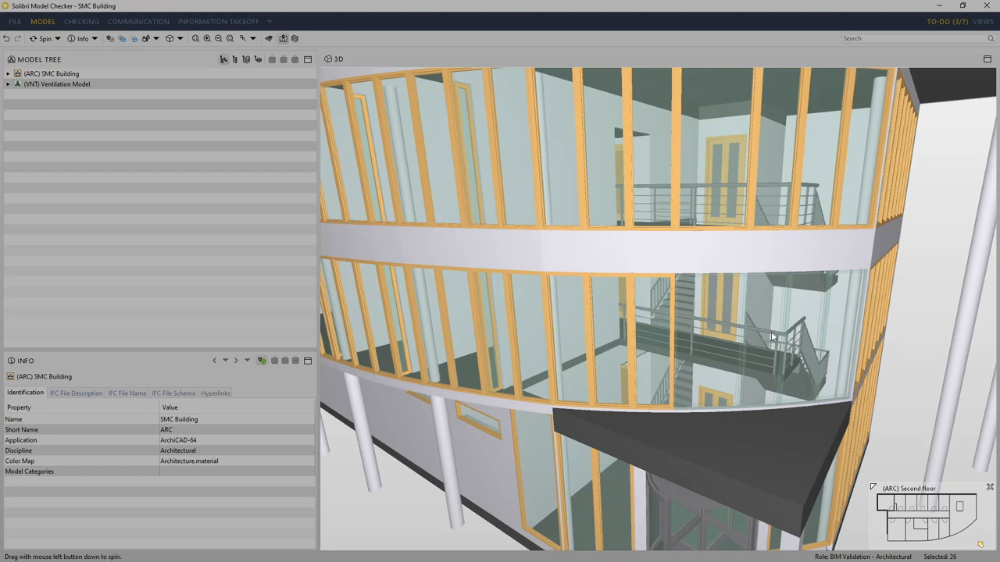
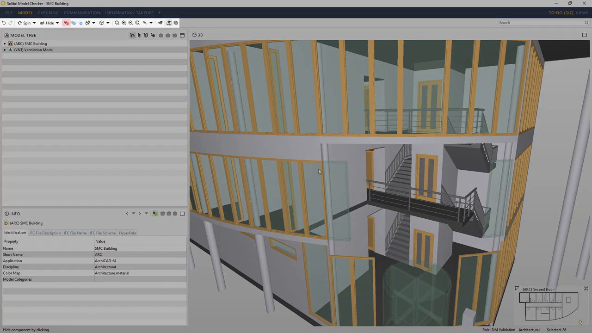
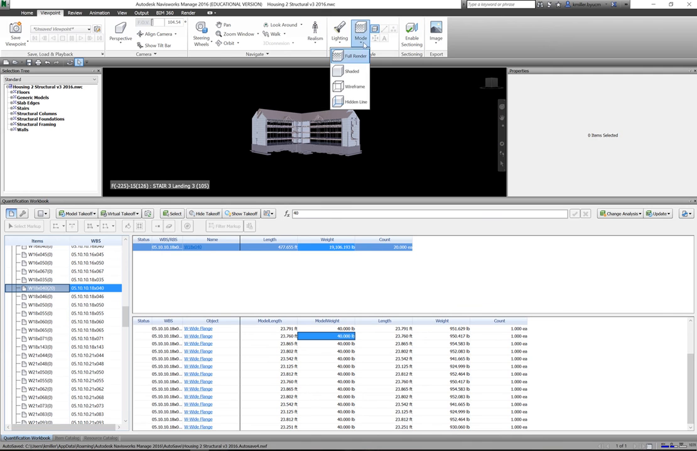
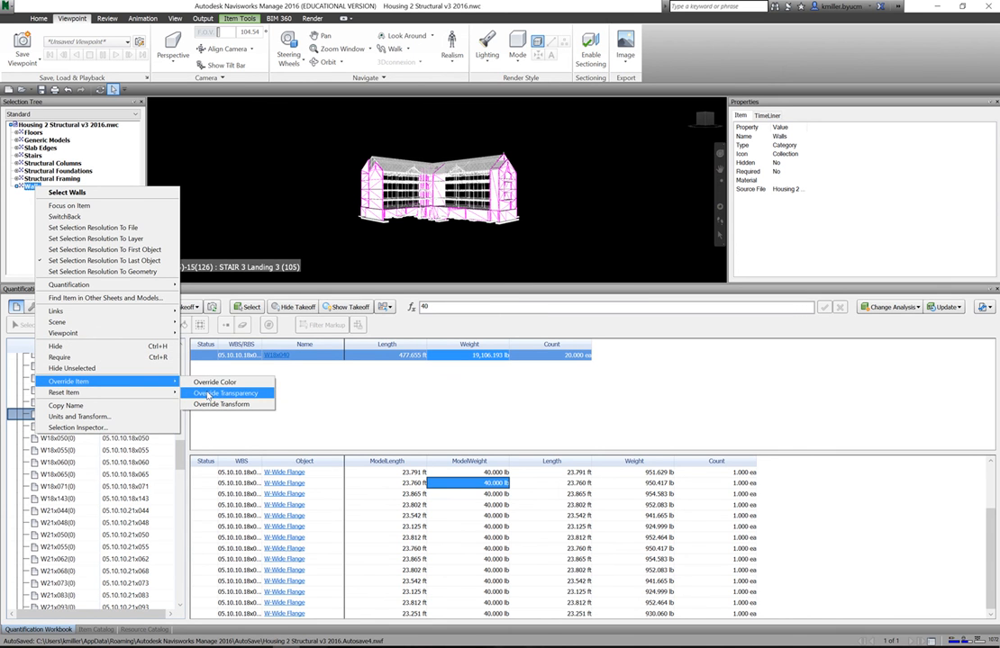
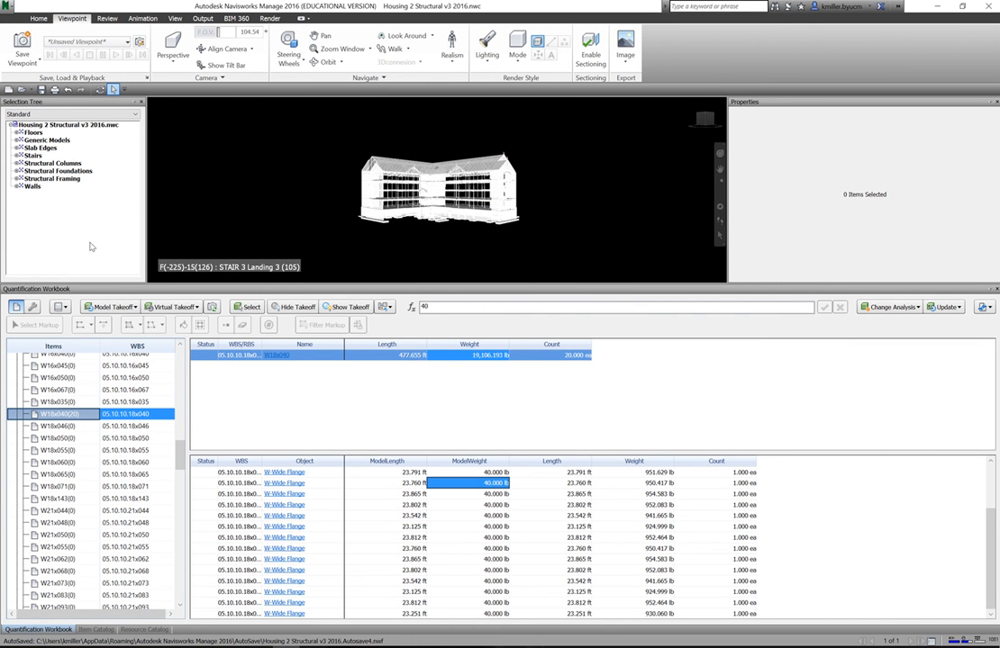

# Feature: Display Controls

Status: Phase 1A, in progress locally. `mountDisplayControls` renders one row per loaded model with a Fluent wireframe checkbox and an opacity slider (0.1–1), and calls `setModelDisplay`; unit tests cover wiring, one row per loaded model, and disposal. The adapter overwrites material opacity directly, so authored transparency (e.g. glazing) is lost when opacity returns to 1, and there is no reset control. Browser and overlay acceptance are not verified.

## Summary

Give each loaded model a transient display mode (Shaded, Wireframe) and an opacity factor (10–100%), plus a Reset that restores the authored appearance. The opacity factor multiplies each material's authored opacity instead of replacing it, so glass stays glass. Selection highlight, measurement, clipping caps, and colour rules stay legible on top. Nothing is persisted and no IFC data is modified [A1].

**Recommendation.** Keep model-level opacity and wireframe as approved, following the "override transparency" workflow estimators already use in Navisworks to see through walls during takeoff [S2]. Solibri and Navisworks also offer element-level transparency and hide [S1, S2]; that belongs to selection/hierarchy and is out of scope here. Use a multiplicative opacity factor and render-order safeguards, because three.js transparency sorting is a known source of artifacts with dynamically changed opacity [S5, S6].

---

# Detailed Specification

## Problem

Users need to see through one model (for example, the architectural model) to inspect another (structure or MEP) without hiding it entirely. The current implementation works per model but writes absolute opacity onto source materials: an authored 0.3-opacity window becomes opaque after moving the slider back to 100%, and there is no one-click reset to the original look [A1].

## Users

- Estimators and reviewers federating architectural, structural, and services models who need context while inspecting one discipline.

## Goals

- Change one model's opacity and wireframe without affecting others.
- Return to the exact authored appearance with one action.
- Keep overlays (selection, measurement, clipping, colour rules) understandable.
- Keep all display state transient.

## Comparable Products (Research)

| Product | Feature name | Docs | Video | Notes |
|---|---|---|---|---|
| Solibri | Make transparent / Hide (component handling) | Help page did not load | [#GetToGrips 05](https://www.youtube.com/watch?v=anNq5hZfAEk) | Per-component transparent/hide; "Show" returns to default visualization [S1]. |
| Autodesk Navisworks | Override item → transparency/colour; render modes | Help page did not load | [Changing Model Color & Transparency](https://www.youtube.com/watch?v=NSb8O7ZePNk) | Shaded mode; override transparency on selected walls for takeoff [S2]. |
| xeokit SDK | `SceneModelEntity.opacity`, `xrayed`, `edges` | [SceneModelEntity](https://xeokit.github.io/xeokit-sdk/docs/class/src/viewer/scene/model/SceneModelEntity.js~SceneModelEntity.html) | n/a | Opacity is a factor "which multiplies by the rendered fragment alphas"; X-ray and edges per entity [S3]. |
| OpenProject BIM | X-Ray mode | [IFC viewer](https://www.openproject.org/docs/bim-guide/ifc-viewer/) | Docs GIF only | X-ray via context menu shows "disturbing elements … in the context of other elements without covering them" [S4]. |

## What Good Looks Like (Findings)

- **Reversible, non-destructive appearance.** Solibri: "we're only changing the appearance and visibility of the components", and "press the show button to return the model to its default visualization state" (01:51–02:03, 02:55–02:59) [S1].
- **Transparency for takeoff.** Navisworks user: "override transparency … that way as I'm walking through the model I can see through the walls" (00:37–00:51), after switching to shaded mode (00:13–00:15) [S2].
- **Opacity as a multiplier.** xeokit defines entity opacity as a factor that multiplies rendered alphas, preserving authored transparency [S3].
- **X-ray as an alternative.** OpenProject and xeokit offer X-ray to see through context [S3, S4]; the app's opacity slider at low values covers this need without a separate mode.

## User Feedback (Forums)

- **Transparency ordering artifacts.** A three.js forum thread (Apr 2021) reports wrong rendering order after changing opacity dynamically; the reply notes three.js sorts transparent objects automatically and suggests setting render order [S5]. A Nov 2025 resources post calls overlapping transparent objects "some of the most problematic things to render" [S6]. → R5: set per-model render order and `depthWrite` rules; document residual artifacts as a known limitation.
- **Highlight with transparency.** xeokit issue #1335 "Opacity broken for VBO-based batched Highlight, Select and X-Ray rendering - shows as opaque white" (closed 2 Feb 2024) [S7]. → R6: test selection highlight on a transparent model.
- **Re-evaluation.** The original model-level scope holds. Research adds multiplicative opacity, an explicit Reset, and overlay legibility tests.

## User Flow

1. **Entry point.** The user opens **Display** in the feature dock. Each loaded model appears as a row labelled with its name (duplicate names disambiguated as in Model Controls).
2. **Wireframe.** The user switches a model to Wireframe; only that model renders as edges.
3. **Opacity.** The user drags the opacity slider (10–100%, step 5%). The value label updates; the model's authored opacity is multiplied by the factor.
4. **Inspect.** Selection highlight, measurements, clipping caps, and colour rules remain visible and readable.
5. **Reset.** The user clicks **Reset** on the row (or **Reset all**). Shaded mode and 100% factor return; authored appearance is exactly restored.
- **Error / edge paths:** model removed → its row disappears and its display state is discarded; new model → default row; hidden model → row remains but is marked hidden and controls stay usable; reload → all defaults.

## Wireframe / Sketch

## Requirements

- **R1 — Per-model controls.** One row per loaded model, keyed by model ID (not file name), with display mode (Shaded/Wireframe) and opacity factor (10–100%, step 5%) using Fluent controls. Other models are unaffected [A1].
- **R2 — Multiplicative opacity.** Effective material opacity = authored opacity × factor. `transparent` is true when the effective opacity < 1 or the authored material was transparent [S3].
- **R3 — Exact reset.** Per-row Reset and Reset all restore Shaded mode, factor 100%, and every material's authored `opacity`, `transparent`, `wireframe`, and `depthWrite` values [S1].
- **R4 — Viewer-owned state.** Authored material values are captured by the adapter at load; display changes are applied by the adapter and never alter IFC data or parser output [A1].
- **R5 — Render order.** Models with factor < 100% render after opaque models with `depthWrite` disabled for their transparent materials, so opaque geometry behind them is visible. Residual intra-model sorting artifacts are a documented limitation [S5, S6].
- **R6 — Overlay legibility.** Selection highlight, measurement lines/labels, clipping caps, and colour rules render on top of or composed with the display state and stay visible at 10% opacity and in wireframe [S7, A1].
- **R7 — Visibility independence.** Display state is separate from model/element visibility; hiding and showing a model preserves its display settings.
- **R8 — Lifecycle and privacy.** Display state is in memory only; removing a model discards its state and releases any cloned materials; nothing is persisted [A1].
- **R9 — Accessibility.** Controls have model-specific accessible names using the display name (not the numeric ID) and announce the current value.

## Acceptance Criteria

- [ ] AC1: Given two models, when model A is set to wireframe and 40%, then model B's materials are unchanged. *(Partial: `tests/unit/display-controls.test.ts` proves the command is called with model A's ID; no adapter/render assertion.)*
- [ ] AC2: Given a material with authored opacity 0.3, when the factor is set to 50% then 100%, then effective opacity is 0.15 then 0.3.
- [ ] AC3: Given a changed model, when Reset is clicked, then every material's opacity, transparent, wireframe, and depthWrite equal the values captured at load.
- [ ] AC4: Given model A at 20% in front of opaque model B, then B is visible through A in a rendered screenshot.
- [ ] AC5: Given model A at 10% or wireframe, when an element of A is selected and a measurement is made, then highlight and measurement remain visible.
- [ ] AC6: Given a changed model, when it is hidden and shown, then its display settings persist; when removed, its row and state are discarded.
- [ ] AC7: Given display changes, when the page is reloaded, then all models load with defaults and no display state exists in storage.
- [ ] AC8: Given keyboard use, each control has an accessible name containing the model display name and announces its value. *(Partial: controls exist with ID-based names; names use the numeric ID.)*
- [ ] AC9: Given disposal, then the panel, listeners, and subscriptions are removed. *(Proven by `tests/unit/display-controls.test.ts` "wires per-model … and cleans up", 2 tests passing locally on 2026-11-08; adapter reset on disposal is not covered.)*

## Test Cases (for developers)

| ID | Type | Precondition | Steps | Expected result |
|---|---|---|---|---|
| T1 | Unit/adapter | Materials with authored opacity 1 and 0.3 | Apply factor 0.5, then 1 | 0.5/0.15, then 1/0.3; transparent flags correct. |
| T2 | Unit/adapter | Changed materials | Reset | Captured authored values restored exactly. |
| T3 | Unit/adapter | Two models | Change A | B unchanged. |
| T4 | Chrome E2E | Two overlapping models | Set A to 20%; screenshot | Pixels behind A show B. |
| T5 | Chrome E2E | A at 10% and wireframe | Select element; measure | Highlight and measurement visible. |
| T6 | Chrome E2E | Changed model | Hide/show; remove | Settings persist; then discarded. |
| T7 | Chrome E2E | Changed display | Reload; inspect storage | Defaults; nothing stored. |
| T8 | Unit | Duplicate file names | Render panel | Distinct accessible names. |

## Module Contract

- Public entrypoint: `mountDisplayControls(target, session, viewer)` in `src/features/display-controls/index.ts` (present locally).
- Adapter command: `setModelDisplay(modelId, { mode?: 'shaded' | 'wireframe'; opacityFactor?: number })` and `resetModelDisplay(modelId?)`; the adapter captures authored material state at load and owns render order.
- Disposal removes the panel, listeners, and subscriptions and calls `resetModelDisplay()` for feature-applied state.

## Dependencies

- [Model controls](model-controls.md) (identity, names, visibility), [element selection](element-selection.md), [model measurement](model-measurement.md), [section clipping](section-clipping.md), [property coloring](property-coloring.md), and [Fluent 2 design system](fluent2-design-system.md).

## Assumptions

- The opacity minimum stays at 10% (current slider) so a model never becomes invisible through display controls; hiding is Model Controls' job.
- Colour rules change colour only; display controls change opacity/wireframe only; both compose.

## Out of Scope

- Element-level transparency, X-ray mode, hide by click, and override colour [S1, S2, S4]; covered by selection, hierarchy, or property coloring.
- Edges/outline mode, lighting, background, and section-cap styling.
- Saved display profiles.

## Open Questions

- None. Model-level wireframe/opacity is the approved Phase 1A baseline [A1].

## Sources

- **[S1]** Solibri UK Ltd — "#GetToGrips 05: Transparent and Hide Tools" — https://www.youtube.com/watch?v=anNq5hZfAEk. Published 2019-02-15, 3:10. Captions: 00:53–01:07 right-click "make transparent"; 01:51–02:03 "press the show button to return the model to its default visualization states … we're only changing the appearance and visibility"; 02:55–02:59 Show returns to default.
- **[S2]** Stuart Lange (CWD) — "Navisworks - Changing Model Color & Transparency" — https://www.youtube.com/watch?v=NSb8O7ZePNk. Published 2016-05-18, 0:59. Captions: 00:01–00:07 before takeoff, change model colour and make walls transparent; 00:13–00:15 shaded mode; 00:37–00:51 override transparency to see through walls while walking.
- **[S3]** xeokit SDK — `SceneModelEntity` — https://xeokit.github.io/xeokit-sdk/docs/class/src/viewer/scene/model/SceneModelEntity.js~SceneModelEntity.html. `opacity` is "a factor in range [0..1] which multiplies by the rendered fragment alphas"; `xrayed`, `edges`, `colorize`. Accessed 2026-11-08.
- **[S4]** OpenProject — IFC viewer, X-Ray mode — https://www.openproject.org/docs/bim-guide/ifc-viewer/. X-ray via context menu displays disturbing elements in context without covering others. Accessed 2026-11-08.
- **[S5]** three.js forum — "Easiest way to set rendering order for transparent objects" (Apr 2021), listed in search https://discourse.threejs.org/search?q=transparent%20sorting%20artifacts%20opacity. Dynamic opacity changes caused wrong order; reply: three.js sorts transparent objects automatically, set render order. Accessed 2026-11-08.
- **[S6]** three.js forum — "Demo: Order Independent Transparency with Depth Peeling" (Nov 2025), same search page: overlapping transparent objects are "some of the most problematic things to render". Accessed 2026-11-08.
- **[S7]** xeokit-sdk issue #1335 — "Opacity broken for VBO-based batched Highlight, Select and X-Ray rendering - shows as opaque white" — listed in https://github.com/xeokit/xeokit-sdk/issues?q=xray+transparent; closed 2 Feb 2024. Accessed 2026-11-08.
- **[S8]** Capture commands — `display-controls/assets/_capture_video.py`; runs `yt-dlp` (720p cap, English auto-captions) and `ffmpeg` frame extraction at the timestamps in the script for [S1] and [S2]. Full MP4s were held in a temporary directory and deleted; VTT transcripts and stills are retained. Frames were checked for nonblank pixels with Pillow and matched to caption timestamps; in-tool image viewing was unavailable in this session.
- **[A1]** Approved Phase 1 decisions and local implementation (not external evidence): [Phase 1 MVP](../plans/Phase_1_MVP.md) (per-model wireframe/opacity display), `src/features/display-controls/index.ts`, `src/adapters/viewer/index.ts` (`setModelDisplay` overwrites `material.opacity`), and `tests/unit/display-controls.test.ts`.

---

# Research

## Solibri

- Element-level transparency and hide with a single Show to return to default (00:53–02:03) [S1]; supports R3 (exact reset) and the out-of-scope element-level note.
- Transcript: [solibri-transparent-hide-transcript.en.vtt](display-controls/assets/solibri-transparent-hide-transcript.en.vtt).

## Autodesk Navisworks

- An estimator makes walls transparent before takeoff to see through them (00:01–00:51) [S2]; supports the problem statement and R1/R2.
- Transcript: [navisworks-override-transparency-transcript.en.vtt](display-controls/assets/navisworks-override-transparency-transcript.en.vtt).

## xeokit SDK and OpenProject

- xeokit defines opacity as a multiplier and offers X-ray/edges; its highlight-with-opacity bug informs R6 [S3, S7]. OpenProject documents X-ray [S4]. No videos were captured for these.
