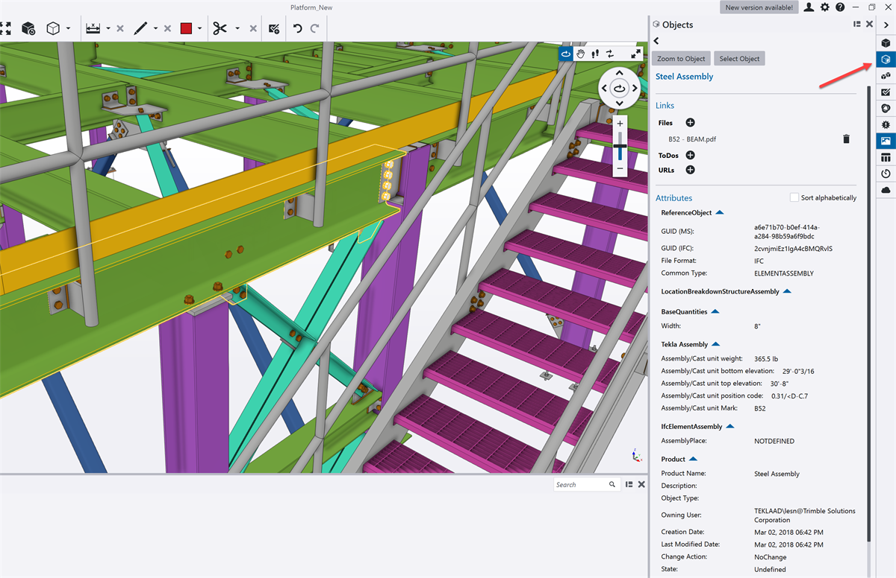
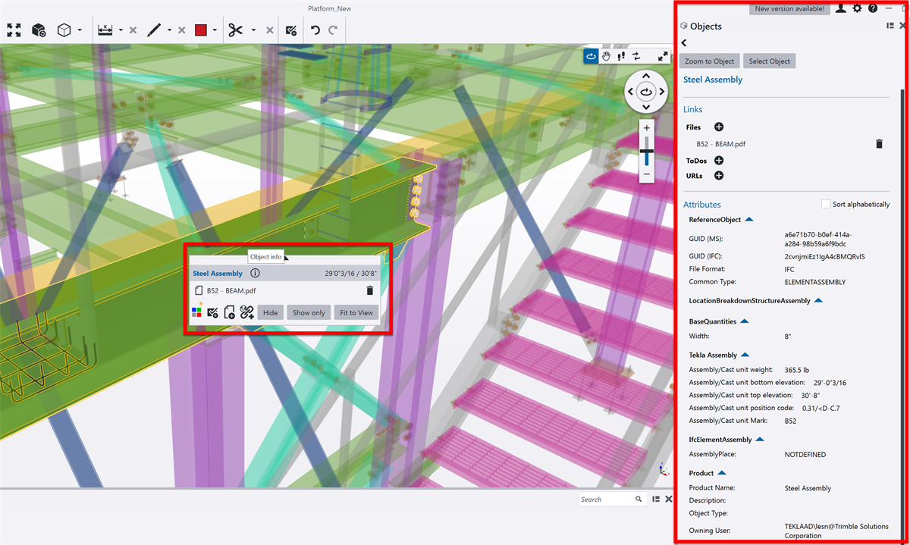
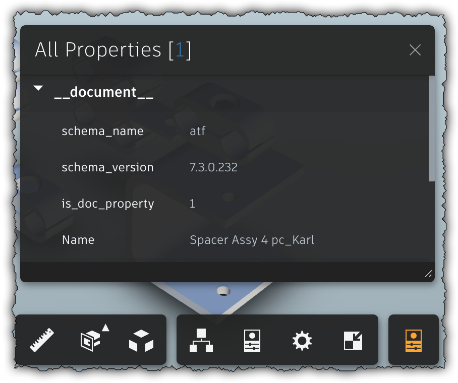

# Feature: Element Properties

Status: Implemented locally with selection-driven, categorized property inspection in a scrollable, right-side pane that can be resized or closed independently of the left tool pane. Pane interactions are verified in Chrome E2E; deployed verification remains pending.

## Summary

Let an estimator inspect the read-only IFC identity, property sets, and source-provided quantity sets for the currently selected element. The pane must stay synchronized with the shared model-scoped selection, show where each property comes from, preserve value types and units, and clearly distinguish no selection, no available property data, and explicit IFC unset values.

Keep the approved Phase 1A layout: an independently shown, scrollable, categorized pane on the right, with a discoverable rail toggle, a close control, and keyboard/pointer resizing within the specified bounds. Do not add property editing, multi-element comparison, calculated takeoff, persistence, or export to this feature.

---

# Detailed Specification

## Problem

IFC models carry element identity, descriptive properties, type-level properties, and source quantity sets in different groups. Users need to understand which model and occurrence a value belongs to, whether a number is a source quantity or a computed takeoff, and whether a value is absent or explicitly unset. A panel that loses its selection context, hides units, or makes its entry point hard to find undermines trust in model inspection.

## Users

- Estimators and construction professionals inspecting IFC model elements.
- Users who select an element in the 3D scene, search results, filters, or hierarchy and need its properties in a stable side-by-side view.

## Goals

- Show the selected model element's identity and relevant source IFC properties and quantities.
- Preserve model scope, source grouping, data types, units, and unset semantics.
- Keep the panel discoverable and usable without disrupting the 3D scene or the separate left tool pane.
- Keep model-derived data local and session-only.

## Comparable Products (Research)

| Product | Feature name | Docs | Video | Notes |
| --- | --- | --- | --- | --- |
| Trimble Connect for Browser | Properties Panel / View Properties | [View Properties](https://help.trimble.com/doc/trimble-connect/trimble-connect/connect-for-browsers-3d-viewer/properties-panel/view-properties); [View a Selection's Properties](https://help.trimble.com/doc/trimble-connect/trimble-connect/connect-for-browsers-3d-viewer/work-in-3d/selection-controls/view-a-selections-properties) | No feature-specific video could be verified in this research pass. Search results included broad walkthroughs without captions; the “Geometry Properties” result was unrelated CAD elevation editing and was excluded. | Official guide says select objects, then use the selection toolbar at the bottom of the viewer to open the properties panel; it describes the panel as containing available object details. |
| Autodesk Platform Services Viewer | PropertyPanel / model property queries | [PropertyPanel API](https://aps.autodesk.com/en/docs/viewer/v7/reference/UI/PropertyPanel/); [Model API](https://aps.autodesk.com/en/docs/viewer/v7/reference/Viewing/Model/); [PropertyResult](https://aps.autodesk.com/en/docs/viewer/v7/reference/globals/TypeDefs/PropertyResult/); [Property Inspector for the Viewer](https://aps.autodesk.com/blog/property-inspector-viewer) | No property-inspection video was verified. | The API exposes display label, category, value, units, precision, hidden flag, and type. The 2018 inspector example adds reference navigation and breadcrumbs because standard property display omitted some database details. |

## What Good Looks Like (Findings)

- The selected object is the entry point, with an explicit command to open the property panel. Trimble's browser guide places that action on a selection toolbar at the bottom of the viewer [S1, S2].
- The panel identifies the owning model and element. APS queries properties by model object and database ID; this project uses the shared `(modelId, expressId)` identity rather than a viewer-local ID [S3, S4].
- Properties retain a category/group, a readable name, a display value, and available unit and precision metadata. APS documents these as separate fields, so units should not be guessed from a display string [S3].
- A robust empty state distinguishes an unselected scene from a selected element whose properties are unavailable. This follows the feature's local selection-driven contract and the property database's asynchronous, potentially unavailable query behavior [S4, A1].
- Large or specialized property databases may contain hidden or reference-valued fields. APS's extension example exposes additional references and breadcrumbs beyond the default panel; this is evidence for clear source boundaries, not a requirement to expose every internal database field or navigate references [S5].
- Property review and quantity takeoff are different jobs. The app must label model-authored `IfcElementQuantity` values as source quantities and keep calculated/aggregated takeoff in Phase 1C [A1].

## User Feedback (Forums)

- A Trimble Connect forum user said they could not find the properties panel in the desktop app and contrasted it with the browser's selection toolbar. Two later replies said they had the same question; a response described double-clicking an object or using Object Info in the desktop app [S6]. This is a small, cross-version thread, not representative evidence. It supports keeping the app's right-rail toggle and selection context clearly named and independently reachable.
- No recurring feature-specific complaints about IFC units, unset values, or missing property sets were found in the accessible public threads. Search results were sparse and several search pages were blocked by an anti-bot challenge; this is an evidence gap, not evidence that these issues do not occur.

## User Flow

1. The user selects an element in the scene or from another selection-aware feature. The properties pane tracks that shared model-scoped identity.
2. If the pane is closed, the user opens it with the always-available Element properties rail toggle. In products that use an explicit selection toolbar, the selected-object toolbar also leads to View properties [S1, S2].
3. The pane shows an element summary (model, IFC type, express ID, and available name/GUID/type/storey fields), then an Identity category and collapsible source property/quantity categories.
4. The user scans readable name/value rows. Numeric values show their source units; enums, booleans, lists, and explicit `Unset` values remain distinguishable. Type-level groups are labeled separately from occurrence-level groups [A1].
5. On selection change, the pane replaces the old result. On clear, it shows “Select an element…”; if the selection exists but has no resolvable data, it shows a distinct no-properties message [A1].
6. The user closes or resizes the pane. The left tool pane, selection, model visibility, camera pose, and displayed property data remain unchanged [A1].
- Error / edge paths: duplicate model names/express IDs use a visible disambiguator; unavailable asset/property query does not leave stale values; absent properties are not rendered as explicit `Unset`; long or untrusted values wrap/scroll safely and render as text; empty quantity sets remain distinguishable from a calculated zero.

## Wireframe / Sketch

```text
+-----------------+---------------------------+----------------------+
| Models / tools  | 3D scene                  | Element properties   |
|                 |                           | Building A · IfcWall |
|                 |      [selected wall]      | ID 42  |  Storey 1    |
|                 |                           | v Identity Data      |
|                 |                           | v Pset_WallCommon    |
|                 |                           |   FireRating | 2 hr  |
|                 |                           | v Qto_WallBase...    |
|                 |                           |   Length | 3.2 m     |
+-----------------+---------------------------+----------------------+
											[rail toggle] [close]
```

## Requirements

- R1: The pane reads the shared current `ElementIdentity` and requests data from the selected identity's model-scoped property capability. It never uses express ID or filename alone to resolve data [S3, S4].
- R2: The panel is an independently visible, scrollable right-side pane, separate from the left tool pane. A keyboard-accessible, named rail toggle remains available when the pane is closed; the close action reclaims scene space without closing the left pane [S1, S2, S6].
- R3: Show a compact identity summary with the owning model, IFC class, express ID, and available name, GlobalId, type name, and storey. If model names collide, include a disambiguator such as the session model ID [S3, A1].
- R4: Group identity, occurrence properties, type properties, and source quantity sets into collapsible categories. Label each group with its source and kind; each row has a readable name and value [S3, S5, A1].
- R5: Preserve the shared typed value distinctions: text, number plus source unit where present, boolean, enumeration, list, and explicit `unset`. Do not invent a value for an absent property or normalize an unknown unit to zero or an assumed unit [S3, A1].
- R6: Label `IfcElementQuantity` values as source IFC quantities. Do not calculate, aggregate, compare across elements, edit, or export quantities in this feature; calculated takeoff belongs to [Quantity takeoff](quantity-takeoff.md) [A1].
- R7: On selection change, clear stale content before displaying the new result. Show separate empty states for no selection, selected element with no available property data, and empty source quantity/property groups [S4, A1].
- R8: Render IFC-sourced names and values as text, not markup. Long values must remain inspectable without escaping the pane or making its controls unreachable [S3, A1].
- R9: Resize by pointer and keyboard; constrain the right pane to 260–560 px and the left tool pane to 240–520 px. Widths remain session-local and are not persisted. Hiding, showing, or resizing preserves selection, model visibility, camera pose, and property content [A1].
- R10: Keep property records in memory and obtain them through the typed adapter capability. Do not import `web-ifc` in the feature, send model-derived data over the network, or persist it [S4, A1].

## Acceptance Criteria

- [ ] AC1: Given two loaded models with the same express ID and possibly the same filename, when each element is selected, then the panel shows data and a model label that unambiguously identify the correct model-element pair.
- [ ] AC2: Given an element with occurrence and type property sets, when its panel is opened, then each source is separately categorized and labeled, and its identity fields are visible.
- [ ] AC3: Given numeric values with and without units, enums, booleans, lists, an explicit unset value, a missing property, and empty sets, when displayed, then each case remains distinguishable and units are never silently dropped or inferred.
- [ ] AC4: Given selection changes or clears, when the panel re-renders, then old values are removed and the correct no-selection/no-data state appears.
- [ ] AC5: Given long or hostile IFC text, when rendered, then it remains readable within the pane and cannot create executable or structural markup.
- [ ] AC6: Given the right pane is closed or open and the left pane is independently open or closed, when the user toggles, closes, or resizes either pane, then the panes remain independent and camera, selection, visibility, and property data remain unchanged.
- [ ] AC7: Given pointer and keyboard resizing, when widths reach either bound, then the right pane remains within 260–560 px and left pane within 240–520 px; width changes do not persist across reload.
- [ ] AC8: Given property inspection is used, when network and storage are observed, then no IFC data or derived properties are sent or persisted.

## Test Cases (for developers)

| ID | Type | Precondition | Steps | Expected result |
| --- | --- | --- | --- | --- |
| T1 | Adapter/contract | Two models contain an element with the same express ID | Select each identity and open properties | Results and visible model disambiguator match the selected model only |
| T2 | Unit/integration | Fixture contains occurrence/type Psets, IFC2x3/IFC4 quantity set names, units, enum/list/bool, unset and absent fields | Render the selected element | Categories identify source and kind; values preserve unit/type; unset differs from absent |
| T3 | Unit/browser | No selection, selected element with no query result, and selected element with empty sets are available | Exercise each state | Distinct empty/no-data content; no stale values |
| T4 | Browser/security | Property name/value contains long text and markup-like strings | Inspect and resize the pane | Content remains text, wraps/scrolls, and cannot escape pane or create markup |
| T5 | Browser/layout | Both left and right panes are available | Toggle, close, pointer-resize, and keyboard-resize each pane to bounds | Independent pane state; scene and controls remain usable; session-only width |
| T6 | Integration | Model visible, camera pose known, selected element properties rendered | Hide/show model and resize/hide/show pane | Selection and content remain; camera and model visibility are unchanged |
| T7 | Privacy/reload | IFC is loaded and properties are displayed | Inspect requests/storage, then reload | No upload or model-derived persistence; reload clears selection/data |
| T8 | Resource | Property pane is subscribed to selection and session | Dispose pane and then change selection/session | No detached UI update or retained property result |

## Assumptions

- A1: The approved [Phase 1 baseline](../plans/Phase_1_MVP.md) and [cross-cutting property contract](cross-cutting-contracts.md) define supported IFC property/quantity sources, value kinds, model identity, units, privacy, and session-local behavior.
- When a property source does not provide an explicit unit or precision, the inspector shows the provided value without inferring one; unit normalization for calculations belongs to the shared metric contract, not this read-only display feature [S3, A1].
- The current pane position and width bounds are approved product decisions and are not changed by competitor differences [A1].

## Out of Scope

- Editing/authoring IFC properties or custom property sets.
- Calculated or aggregated takeoff, bulk comparison, multi-selection aggregation, and quantity export; see [Quantity takeoff](quantity-takeoff.md).
- Persistent property caches, saved selections, cloud lookup, and model-derived network requests.
- Arbitrary traversal of internal database references; APS's reference/breadcrumb extension is a comparison, not a requirement [S5].

## Open Questions

- None for the approved Phase 1A single-element inspection scope.

## Dependencies

- [Element selection](element-selection.md), [IFC loading](ifc-loading.md), [cross-cutting contracts](cross-cutting-contracts.md), and [overall architecture](../architecture.md).
- IFC adapter exposes `IfcPropertySet` and `IfcElementQuantity` values by model-scoped identity. Large-model lazy retrieval remains an implementation consideration; the feature consumes only the typed capability.
- The application shell owns dock placement, visibility, and resizing; the property feature owns rendering and selection/session subscriptions.

## Module Contract

- Public entrypoint: `mountElementProperties` in [src/features/element-properties/index.ts](../../src/features/element-properties/index.ts).
- Owns categorized property rendering and selection/session subscriptions. The shell owns dock position, visibility, and resizing; the adapter owns parsing/query handles; the feature owns no parser state.
- Disposal removes DOM and subscriptions and releases references to the last property result.

## Sources

1. Trimble Help, “View Properties” — https://help.trimble.com/doc/trimble-connect/trimble-connect/connect-for-browsers-3d-viewer/properties-panel/view-properties (modified 4 Nov 2026; all available object details; select object, then open the panel from the bottom selection toolbar).
2. Trimble Help, “View a Selection's Properties” — https://help.trimble.com/doc/trimble-connect/trimble-connect/connect-for-browsers-3d-viewer/work-in-3d/selection-controls/view-a-selections-properties (modified 4 Nov 2026; selection-to-panel flow).
3. Autodesk Platform Services, “PropertyResult” — https://aps.autodesk.com/en/docs/viewer/v7/reference/globals/TypeDefs/PropertyResult/ (display name/category/value, type, units, precision, and hidden flag).
4. Autodesk Platform Services, “Model API” — https://aps.autodesk.com/en/docs/viewer/v7/reference/Viewing/Model/ (asynchronous per-element and bulk property queries; property hashes and categories; property databases may be unavailable).
5. Autodesk Platform Services, “Property Inspector for the Viewer” — https://aps.autodesk.com/blog/property-inspector-viewer (13 May 2018; states that the default viewer did not show all database details in that version; extension adds reference navigation and dbId breadcrumbs).
6. Trimble Connect User Forum, “Properties Panel” — https://community.trimble.com/discussion/properties-panel (17 Oct 2019; repeated question in 2025 about finding desktop properties; reply describes double-click/Object Info for desktop; browser flow differs).
7. Video search: `yt-dlp` searches for Trimble Connect Browser property panel and Autodesk Viewer property inspection returned broad walkthroughs but no verifiable property-panel segment. The Trimble Connect and Open IFC Viewer candidates reported no captions with `yt-dlp --list-subs`; a title-matched “Geometry Properties” video was excluded after its description showed unrelated CAD elevation editing. No video was downloaded or cited as feature evidence.
8. Capture command: `python docs/feature/element-properties/assets/_capture.py`; all retained images are under `docs/feature/element-properties/assets/`.

---

# Research

## Trimble Connect for Browser





- The current Browser help is text-only. It says all available object details appear in the properties panel and directs users to select an object, then choose View properties panel from the selection toolbar at the bottom of the 3D viewer [S1, S2].
- The screenshots above are from a forum reply about the separate desktop app, not the browser panel. They support the user-feedback finding about discoverability across platforms, not claims about the Browser UI [S6].
- No feature-specific video with a verifiable properties-panel demonstration was available in this research pass; broad or unrelated candidates were excluded.

## Autodesk Platform Services Viewer



- The Model API provides asynchronous single-element and bulk queries. `PropertyResult` exposes a user-facing display name, category, display value, type, units, precision, and whether the field is hidden [S3, S4].
- `PropertyPanel` is a docking panel for properties of a model or selected parts. The official extension example adds database-reference links and breadcrumbs because its 2018 article notes some database details were not shown by the then-default inspector [S5].
- No property-inspection video was verified for APS Viewer; the official article image and API docs are the visual/behavioral evidence used here.
