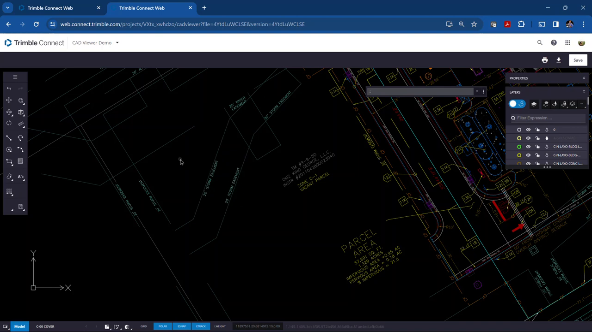
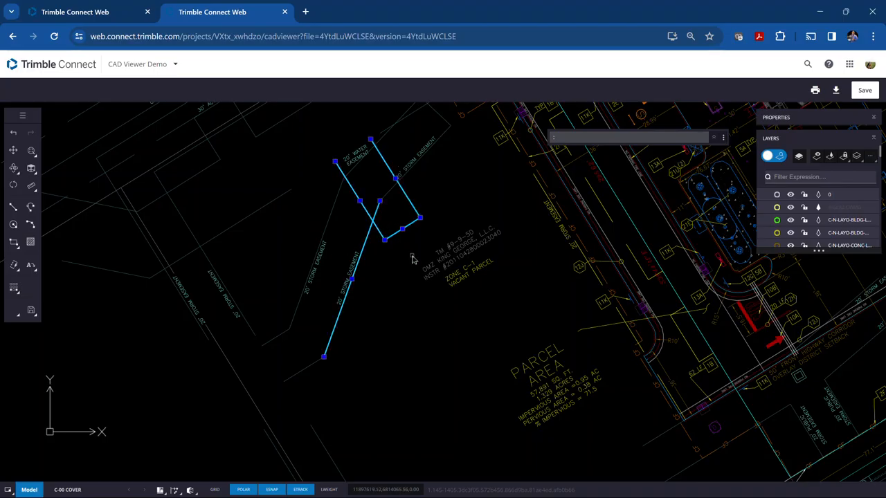
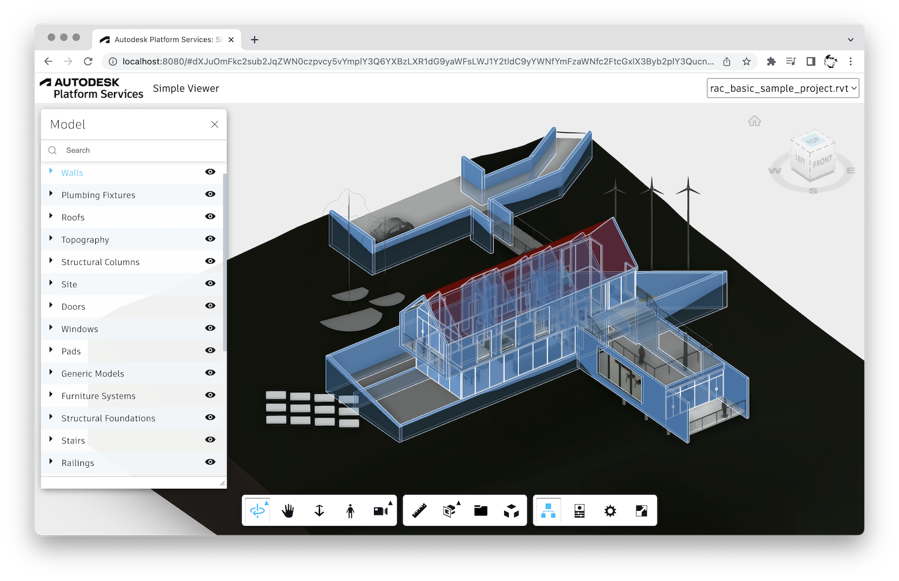
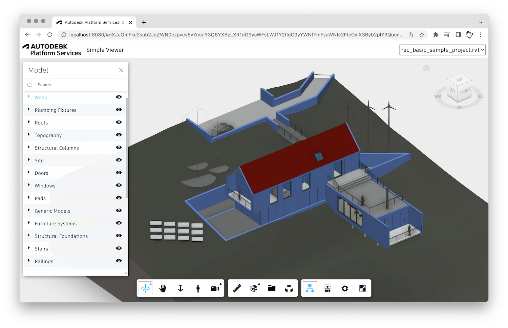
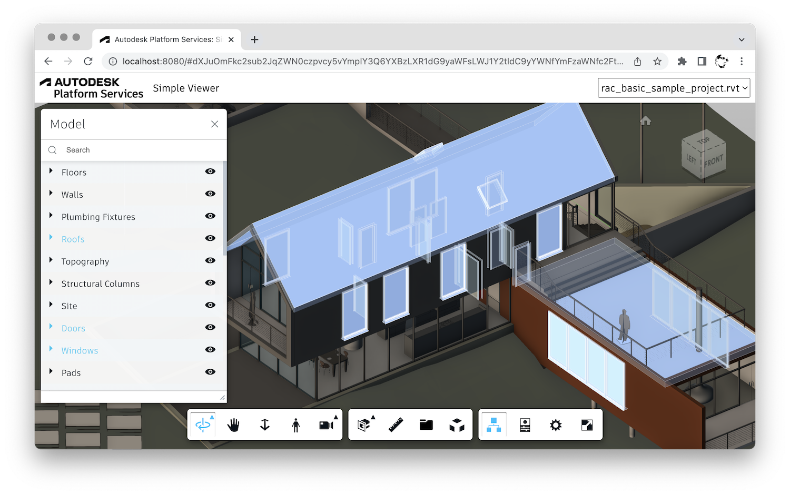

# Feature: Element Selection

Status: Selection implementation exists locally. The selection store has focused unit coverage; pointer picking, rendered highlight, and integrated browser acceptance are not yet evidenced.

## Summary

Enable a user inspecting one or more local IFC models to identify one visible element at a time by clicking its rendered geometry. Keep identity scoped to `(modelId, expressId)`, apply a reversible selected-state highlight, and publish selection through the shared typed capability so related tools can act on the same element. Clear selection by clicking empty scene space, pressing Escape, or using the visible Clear selection action.

The Phase 1A baseline is deliberately single-select and session-local. Do not add area, assembly, modifier-key, or persistent selection in this feature. Picking must remain consistent with rendered state, including transparent and wireframe geometry and the feature's separately specified clipping pick geometry.

---

# Detailed Specification

## Problem

Users need to identify an IFC occurrence in the shared scene and have that exact occurrence recognized by property inspection, search, filtering, and hierarchy tools. A raw IFC express ID is not globally unique across loaded files, and temporary visual feedback must not damage the model's source appearance. This feature therefore needs both a predictable pick/clear interaction and a model-scoped shared identity contract.

## Users

- Estimators and construction professionals inspecting one or more local IFC models in the browser.
- Users of property, search, filter, and hierarchy panels that need a common selected-element target.

## Goals

- Select the rendered IFC element under the pointer and identify its owning model.
- Make the current selection visually unambiguous and reversible.
- Keep one shared selection state across cooperating features without exposing parser or renderer internals.
- Preserve the approved single-select behavior and avoid selection side effects on model data or visibility.

## Comparable Products (Research)

| Product | Feature name | Docs | Video | Notes |
| --- | --- | --- | --- | --- |
| Trimble Connect for Browser | Single, area, assembly, and multi-selection modes | [Select an Object](https://help.trimble.com/doc/trimble-connect/trimble-connect/connect-for-browsers-3d-viewer/work-in-3d/make-selections/select-an-object); [Make Selections](https://help.trimble.com/doc/trimble-connect/trimble-connect/connect-for-browsers-3d-viewer/work-in-3d/make-selections) | [Trimble Connect CAD Viewer: Select Objects](https://www.youtube.com/watch?v=x6kIqOpZA-Y) | Current help says single-select is the default; Shift adds and Ctrl removes objects. The video is a third-party 2024 CAD Viewer walkthrough, used only as visual evidence, not as the source for current browser behavior. |
| Autodesk Platform Services Viewer | Component selection and highlighting | [Viewer3D API](https://aps.autodesk.com/en/docs/viewer/v7/reference/Viewing/Viewer3D/); [Viewer Selection Highlighting](https://aps.autodesk.com/blog/viewer-selection-highlighting) | No selection-specific public video was located in this research pass. | API selection calls carry a model argument; highlight can use regular, overlayed, or mixed rendering. Autodesk documents a performance trade-off for large selections. |

## What Good Looks Like (Findings)

- A direct click selects a model object; selection and clearing are explicit, not inferred from unrelated visibility actions. Trimble's browser guide documents Single Selection Mode as the default and describes click, Shift-add, and Ctrl-remove behavior [S1, S2].
- The selected occurrence is identified with its model, not only its element number. APS selection APIs accept the model instance and provide aggregate selection across models [S3].
- Highlighting is perceptible but temporary. APS documents regular tint and overlayed highlight, and explains that rendering a see-through overlay for large selections can cost performance [S4]. The requirement specifies the outcome and cleanup, not a particular shader or color.
- Pick behavior must have explicit limits. APS hit testing exposes a transparent-object option and returns a hit or no hit; Trimble documents separate visibility and selection tools [S3]. For this app, the nearest rendered hit is selected; this does not add an X-ray or occluded-object cycling mode [A1].
- Keep selection mode simple for this release. Comparable products offer additional modes, but they add persistent-mode state and selection-set semantics that conflict with the approved single-selection baseline [S1, S2, S5].

## User Feedback (Forums)

- A Trimble Connect web user reported that Area Selection Mode reverted to single selection after one area pick and asked for a way to keep the mode active. This supports avoiding hidden mode switches; area-selection mode remains out of scope [S5].
- A Trimble Connect user reported a stale black selection box that returned after several selections and obstructed zoom and other work. Require clear/dispose cleanup and repeated select-clear tests; the report is anecdotal and does not establish a general product defect [S6].
- A 2025 Trimble Connect for Windows thread reported that individual components stopped selecting after an update; the reporter initially said the web app worked, then separately observed missing objects in a web NWC model. Treat this as a reminder to test geometry-to-element mapping and distinguish picker errors from incomplete model data, not as evidence of a current browser defect [S7].
- No recurring feature-specific praise or accessibility feedback was found in the reviewed public threads. Forum search was limited and is not representative user research.

## User Flow

1. The user loads an IFC model and leaves other pointer tools inactive. The scene is in its default selection state; no extra mode toggle is required [S1, A2].
2. The user clicks visible geometry. The viewer adapter resolves the hit to `(modelId, expressId)`, the shared selection capability publishes it, and the viewer applies a temporary highlight. Cooperating property/search/filter/hierarchy panels observe the same identity [S3].
3. The user clicks another element. The prior selection is replaced, and its original visual state is restored before the new element is highlighted.
4. The user clears selection by clicking empty scene space, pressing Escape, or activating Clear selection. The capability publishes `null`, the highlight is removed, and dependent panels return to their no-selection state.
5. If the selected model is hidden, the selection identity may remain but is not shown as a visible selected element. Removing that model clears its selection. Reopening the page does not restore selection [A2].
- Error / edge paths: a click with no rendered hit clears selection; hidden elements are reached through hierarchy/search/filter rather than pointer picking; transparent or wireframe elements remain pickable while rendered; clipped geometry is resolved through the clipping feature's separate pick geometry; failed or stale identities must not highlight a different model's element.

## Wireframe / Sketch

```text
+--------------------------------------+--------------------------+
| 3D scene                             | Properties               |
|                                      |                          |
|  [unselected model geometry]        | Selected element         |
|  [selected element: temporary glow] | Model: Building A        |
|                                      | Express ID: 42           |
|                                      | [Clear selection]        |
+--------------------------------------+--------------------------+
```

## Requirements

- R1: Pointer picking returns the identity of the hit element as `(modelId, expressId)`. Express IDs and file names are not globally unique [S3].
- R2: Pick the nearest rendered geometry at the pointer. Rendered elements remain pickable in wireframe mode and at any opacity above zero, including rendered `IfcSpace` and opening geometry. Hidden elements are not pointer-picked; use hierarchy, search, or filter to reach them [S1, S3, A1].
- R3: Clipping uses separate pick geometry so a clipped element and its cap face resolve to the owning element. A hit must never resolve to an element in another model [A2].
- R4: Selection is single-select. A new hit replaces the old selection. Empty-scene click, Escape, and the Clear selection command publish `null`; multi-select and modifier-key selection are excluded [S1, S2, S5].
- R5: The viewer displays a perceptible selected state without mutating IFC data or permanently changing source material/color state. Clearing, replacement, hiding/removal, and disposal restore the prior appearance. Selection remains visually above property-coloring overrides per [property-coloring](property-coloring.md) [S4, A2].
- R6: Hiding a model may preserve its selected identity but must not present it as visible. Removing the owning model clears selection [A2].
- R7: Selection is shared only through `SelectionCapability`; features do not reach into one another, the IFC parser, or renderer internals [S3, A2].
- R8: Selection input follows the shared one-active-pointer-tool and Escape contracts in [cross-cutting contracts](cross-cutting-contracts.md). Disposing the feature removes handlers/subscriptions/UI and clears only selection effects it owns [A2].

## Acceptance Criteria

- [ ] AC1: Given two loaded models with the same express ID, when the user clicks each model's element in turn, then selection and highlight identify the correct model-element pair each time.
- [ ] AC2: Given rendered opaque, transparent, wireframe, `IfcSpace`, and opening geometry, when each is clicked, then the hit resolves to that element; a hidden element is not pointer-picked.
- [ ] AC3: Given clipping is active, when the user clicks a clipped surface or cap, then the owning element is selected and no other model's geometry is returned.
- [ ] AC4: Given an element is selected, when another element is clicked, the previous highlight restores and only the new element remains selected.
- [ ] AC5: Given an element is selected, when the user clicks empty scene space, presses Escape, or activates Clear selection, then selection becomes `null` and the original appearance is restored.
- [ ] AC6: Given selection and property coloring are both active, then selection feedback remains perceptible and clearing selection restores the property color rather than overwriting it.
- [ ] AC7: Given a selected model is hidden and then removed, then its selection is not presented as visible while hidden and is cleared on removal.
- [ ] AC8: Given repeated select/replace/clear cycles and feature disposal, then no stale highlight or overlay remains, navigation continues to work, and no unrelated model or shared resource is changed.
- [ ] AC9: Given a selection change, then properties, search, filtering, and hierarchy consumers receive the same typed identity without renderer/parser access; selection does not persist after reload.

## Test Cases (for developers)

| ID | Type | Precondition | Steps | Expected result |
| --- | --- | --- | --- | --- |
| T1 | Unit/contract | Two model fixtures reuse an express ID | Select each identity and observe subscribers | Correct `(modelId, expressId)` replacement; duplicate identity does not notify twice; clear publishes `null` |
| T2 | Adapter/browser | Opaque, transparent, wireframe, space, and opening meshes are rendered | Click representative geometry; repeat with it hidden | Rendered hits return owning identity; hidden hit returns no element |
| T3 | Adapter/browser | Two models and clipping are active | Click each model's clipped surface and cap | Pick geometry resolves to the owning model and element only |
| T4 | Browser | One element is selected | Select another; click empty scene; press Escape; use Clear selection | Replacement and all clear paths update the shared capability and restore appearance |
| T5 | Adapter/browser | Property color is active on a selectable element | Select and then clear the element | Highlight wins while selected; configured property color returns after clear |
| T6 | Integration | A selected model has dependent panels open | Hide the model, then remove it | Identity may remain while hidden but is not shown as visible; removal clears all consumers |
| T7 | Browser/resource | Renderer has multiple models loaded | Repeat selection and clearing, then dispose the feature | No stale highlight/overlay, navigation still responds, no unrelated model resources are disposed |
| T8 | Privacy/reload | An element is selected | Inspect network/storage, then reload | No model-derived data is transmitted or persisted; selection is empty after reload |

## Assumptions

- A1: Pointer picking selects the nearest rendered surface. Selecting through an occluding object or cycling through depth is not part of this feature; use visibility controls or clipping to expose geometry. This is consistent with ordinary hit-testing and avoids introducing an unrequested X-ray interaction [S3].
- A2: The approved Phase 1 baseline is authoritative for single selection, model-scoped identity, clipping ownership, visibility behavior, and session-local state [phase plan](../plans/Phase_1_MVP.md).
- The selected appearance is implementation-defined, subject to perceptibility, reversibility, property-coloring precedence, and performance constraints [S4].

## Out of Scope

- Multi-select, Shift/Ctrl selection, area/window selection, assembly selection, and selection-mode persistence.
- Selecting hidden or occluded objects through an X-ray, depth-cycling, or pick-through mode.
- IFC authoring/editing, selection persistence across reloads, cross-session identity, cloud collaboration, or model-derived network requests.

## Open Questions

- None for the approved Phase 1A single-selection baseline.

## Dependencies

- [Overall architecture](../architecture.md), [IFC loading](ifc-loading.md), [model controls](model-controls.md), [property coloring](property-coloring.md), and [cross-cutting contracts](cross-cutting-contracts.md).
- IFC adapter maps rendered geometry to `(modelId, expressId)`; the feature must not import `web-ifc` directly.
- Viewer adapter owns picking and temporary highlight resources.

## Module Contract

- Public entrypoint: `mountElementSelection` in [src/features/element-selection/index.ts](../../src/features/element-selection/index.ts).
- Owns selection input handling and Clear selection UI. Selection identity is shared through `SelectionCapability`; render objects and highlight resources remain adapter-owned.
- Disposing removes handlers, subscriptions, and owned UI and clears only feature-owned transient selection effects.

## Sources

1. Trimble Help, “Select an Object” — https://help.trimble.com/doc/trimble-connect/trimble-connect/connect-for-browsers-3d-viewer/work-in-3d/make-selections/select-an-object (modified 4 Nov 2026; default single-selection mode, click selection, Shift-add, Ctrl-remove).
2. Trimble Help, “Make Selections” — https://help.trimble.com/doc/trimble-connect/trimble-connect/connect-for-browsers-3d-viewer/work-in-3d/make-selections (modified 4 Nov 2026; single, area, assembly, and multi-selection modes; single-select is default).
3. Autodesk Platform Services, “Viewer3D API” — https://aps.autodesk.com/en/docs/viewer/v7/reference/Viewing/Viewer3D/ (selection APIs accept a model, support clearing and aggregate selection, expose transparent hit-test behavior and highlight modes).
4. Autodesk Platform Services, “Viewer Selection Highlighting” — https://aps.autodesk.com/blog/viewer-selection-highlighting (21 Nov 2022; hierarchy-dependent highlight modes and performance rationale; includes before/after images).
5. Trimble Connect User Forum, “Area Selection Mode” — https://community.trimble.com/discussion/area-selection-mode (22 Feb 2024; request to keep area mode active after a selection).
6. Trimble Connect User Forum, “Black selection box” — https://community.trimble.com/question/black-selection-box (29 Sep 2023; stale selection box reportedly obstructed zoom/navigation after repeated selections).
7. Trimble Connect User Forum, “Trimble connect for windows application does not let me select individual components” — https://community.trimble.com/discussion/trimble-connect-for-windows-application-does-not-let-me-select-individual-components (28 Mar 2025; desktop selection regression report, with separate web-viewer model-content concern).
8. AEC Software Technology, “Trimble Connect CAD Viewer-Select Objects” — https://www.youtube.com/watch?v=x6kIqOpZA-Y (8 Nov 2024; 2:02; third-party video used for stills only; no captions available according to `yt-dlp --list-subs`).
9. Capture command: `python docs/feature/element-selection/assets/_capture.py`; video downloaded temporarily for frame extraction and removed afterward. All retained images are under `docs/feature/element-selection/assets/`.

---

# Research

## Trimble Connect for Browser






- The current official help page was opened and read in the browser. It says Single Selection Mode is the default, picking a visible object by click; Shift adds another object and Ctrl removes an individual object from the selection [S1].
- The broader current help page lists Single, Area, Assembly, and Multi-Selection modes. Other tools temporarily disable default picking and restore it when the tool is deactivated [S2].
- The linked third-party video is titled “Trimble Connect CAD Viewer-Select Objects,” not the current browser help flow. Frames above are timestamped visual references only; current behavior claims come from official browser documentation. Transcript/captions were unavailable.

## Autodesk Platform Services Viewer







- The API supports single or multiple IDs, clear-selection, model-scoped selection, aggregate selection, selection tint/overlay modes, and hit testing with an option to ignore transparent geometry [S3].
- Autodesk explains that selected leaf objects use see-through highlighting while inner hierarchy nodes use tinting to avoid duplicate rendering costs for large selections [S4]. The images are from the official APS article and illustrate the documented highlight alternatives.
- No selection-specific public APS Viewer video was located in this research pass; official API documentation and the article's stills were used instead.
