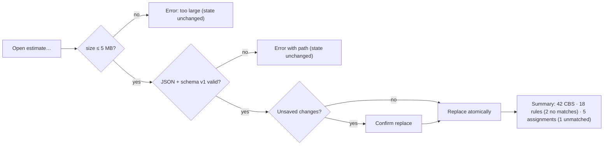
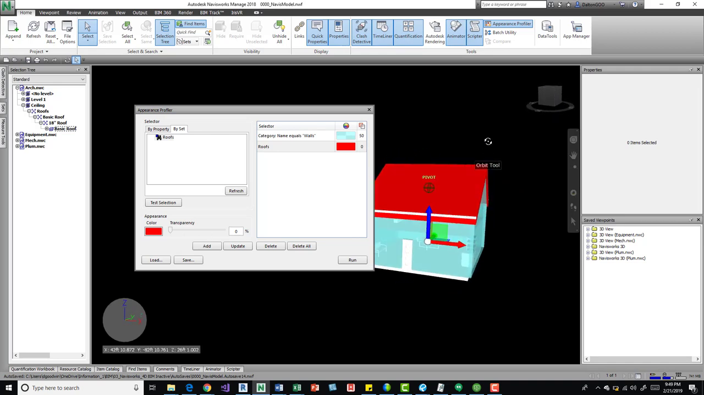

# Estimate Data Files (Import and Export)

Status: In progress locally (Phase 1C). `src/core/estimate-data.ts` defines `EstimateDefinition` v1 (`currency`, `units`, `cbs`, `mappings`, `rates`, `assemblies`), `serializeEstimate`, `parseEstimate` (5,000,000-character limit, version and top-level array checks), CSV export with `= + - @` neutralisation; `tests/unit/phase1c.test.ts` "round-trips versioned estimate definitions and neutralizes CSV injection" passes. Gaps: the size check runs **after** `file.text()` reads the whole file and counts UTF-16 characters, not bytes; array items are untyped `Record<string, unknown>` with no schema validation or prototype-key rejection; the import handler applies **only the currency** and discards CBS, mappings, rates, and assemblies; CSV import, manual-assignment identity matching, and the unsaved-changes warning (`beforeunload`) are not implemented. Market basis: [Phase 1C research](../research/phase-1c-cost-estimation-market-research.md).

## Summary

Because the app never stores estimate work, users save and reload it as local files. **Export** writes a versioned JSON file containing the CBS, mapping rules, manual assignments (by model-disambiguated identity), rates, assemblies, currency label, and units — never model data. **Import** checks the file size before reading, validates it fully against the schema, and replaces the current definition atomically, or rejects it with a clear error and leaves state unchanged. CSV import/export covers the CBS and rate tables. Imported text is always data. The app warns before reload or close when estimate data changed since the last export [A1].

**Recommendation.** Keep JSON as the lossless format and CSV for spreadsheet editing of CBS and rates, mirroring how Navisworks Appearance Profiler saves and loads profiles as files for reuse across projects [S1]. Validate with an allow-list schema, reject `__proto__`/`constructor`/`prototype` keys, and use `File.size` before reading [S2, S3]. Implement the unsaved-work guard with `beforeunload` only while changes are unexported, accepting that browsers show a generic message and need prior user interaction [S4].

---

# Detailed Specification

## Problem

Without app persistence, a reload loses hours of mapping and pricing work. Today, importing a file restores only the currency, so a user who reloads and re-imports believes their estimate is back when it is not. Large or malformed files are fully read before rejection, and untyped items could carry unexpected keys into application state [A1, S2, S3].

## Users

- Estimators who save, share, and reuse CBS structures, rate libraries, and mapping rules across sessions and projects.

## Goals

- Lossless JSON round-trip of the full estimate definition.
- Spreadsheet-friendly CSV for CBS and rates.
- Safe, all-or-nothing import with clear errors.
- A warning before losing unexported work.

## Comparable Products (Research)

| Product / reference | Feature | Docs | Video | Notes |
|---|---|---|---|---|
| Autodesk Navisworks | Appearance Profiler save/load `.dat` | n/a | [Navisworks Appearance Profiler](https://www.youtube.com/watch?v=3z2PuJUD3W0) | Save a profile to a file and load it on other projects as a standard (07:56–08:38) [S1]. Frames retained under [property coloring assets](property-coloring/assets/). |
| Vico / CostX / Assemble | Estimate import/export | Phase 1C research | n/a | Excel export of inventories and estimates [S5]. |
| OWASP | Prototype pollution, CSV injection | [Prototype Pollution Cheat Sheet](https://cheatsheetseries.owasp.org/cheatsheets/Prototype_Pollution_Prevention_Cheat_Sheet.html), [CSV Injection](https://community.owasp.org/attacks/CSV_Injection) | n/a | Use `Map`/`Object.create(null)`; neutralise formula-start characters [S2, S6]. |
| MDN | `Blob.size`, `beforeunload` | [Blob.size](https://developer.mozilla.org/en-US/docs/Web/API/Blob/size), [beforeunload](https://developer.mozilla.org/en-US/docs/Web/API/Window/beforeunload_event) | n/a | Size in bytes before reading; unsaved-changes dialog rules [S3, S4]. |

## What Good Looks Like (Findings)

- **Reusable files.** The Navisworks presenter saves the profile to "a DAT file that you can save and then reload … if you have other projects then you can easily save this somewhere where everybody can access it and then you can run this AP as a standard" (07:56–08:32) [S1].
- **Check size before reading.** `File.size` returns "the size of the Blob or File in bytes" [S3]. → R5.
- **Don't merge untrusted keys into objects.** OWASP recommends `Map`/`Set` or `Object.create(null)` to avoid prototype pollution [S2]. → R4.
- **Unsaved-changes dialog rules.** Browsers require sticky activation, show only a generic string, and MDN recommends adding the listener only while there are unsaved changes; `beforeunload` is not reliable on mobile [S4]. → R9.
- **Neutralise CSV text.** OWASP lists `=`, `+`, `-`, `@`, tab, CR, LF, and full-width variants [S6]. → R7.

## User Feedback (Forums)

- **Shared standards across projects.** The Navisworks presenter recommends keeping saved profile files "where everybody can access it" and running them "as a standard" on other projects (08:19–08:28) [S1]. → R1: files are portable and model-independent.
- **Excel may undo escaping.** OWASP notes Excel "may remove quotes or escape characters from CSV cells when a file is saved and re-opened" [S6]. → R7: re-neutralise on CSV import as well as export.
- **Re-evaluation.** The existing scope holds. Research adds pre-read size checks, schema allow-listing, prototype-key rejection, atomic replace, and a precise `beforeunload` contract.

## User Flow

1. **Export.** In **Estimate**, the user clicks **Save estimate (.json)**; the browser downloads `estimate-YYYYMMDD-HHMM.json`. The "unsaved changes" marker clears.
2. **Import.** The user clicks **Open estimate…** and picks a JSON file. If the current estimate has unexported changes, a dialog asks "Replace the current estimate? Unsaved changes will be lost."
3. **Validate.** The app checks size (≤ 5 MB) before reading, parses, validates against the schema, and on success replaces CBS, rules, assignments, rates, assemblies, currency, and units at once.
4. **Report.** A summary shows counts imported, rules with "no matches" in the loaded models, and manual assignments that were unmatched or ambiguous.
5. **CSV.** **Export CBS (.csv)** / **Export rates (.csv)** and the matching imports update only that table after validation.
6. **Leaving.** Reloading or closing with unexported changes triggers the browser's generic leave-site dialog.
- **Error / edge paths:** file > 5 MB → "File is too large (max 5 MB)" without reading; invalid JSON → "Not valid JSON"; wrong version → "Unsupported estimate version N (expected 1)"; schema violation → first error path (e.g. `cbs[3].code is required`); forbidden keys → rejected; any failure → current state unchanged; import with no models → accepted, rules evaluate when models load.

## Wireframe / Sketch

## Requirements

- **R1 — Content.** The JSON file contains `version`, `currency`, `units`, `cbs[]`, `rules[]`, `assignments[]`, `rates[]`, `assemblies[]`, and `exportedAt`; it never contains IFC contents, geometry, properties, file names, or paths [S1, A1].
- **R2 — Versioning.** `version` is an integer; v1 is current; other versions are rejected with the found and expected numbers; future migrations are explicit [A1].
- **R3 — Schema validation.** Every item is validated against an allow-list schema (required fields, types, ranges, unique CBS codes, parent references); unknown fields are ignored; the first error path is reported [A1].
- **R4 — Safe parsing.** Reject any object key `__proto__`, `constructor`, or `prototype`; build state from validated values (Maps or null-prototype objects), never by spreading parsed objects [S2].
- **R5 — Size before read.** Reject files with `File.size` > 5,000,000 bytes before calling `text()` [S3, A1].
- **R6 — Atomic replace.** A valid import replaces the full definition at once; any error leaves current state unchanged; replacing unexported work asks for confirmation [A1].
- **R7 — CSV.** CBS (`code,name,parentCode`) and rates (`code,unit,rate,markup`) CSV import/export; RFC 4180 quoting; formula-start characters (incl. tab, CR, LF, full-width) neutralised on export and treated as text on import [S6, A1].
- **R8 — Identity matching.** Manual assignments store GlobalId + model label + load order; on import they match loaded models; unmatched and ambiguous (duplicate GlobalId) entries are reported and not applied; rules with no matches are kept and flagged [A1].
- **R9 — Unsaved-work guard.** Track a dirty flag since the last export; add a `beforeunload` handler that calls `preventDefault()` only while dirty, remove it when clean; accept the browser's generic message [S4, A1].
- **R10 — Local only.** Files are read via the file picker and written via download; no network, IndexedDB, OPFS, or Web Storage [A1].

## Acceptance Criteria

- [ ] AC1: Given a full definition, when exported and re-imported, then CBS, rules, assignments, rates, assemblies, currency, and units are identical. *(Partial: `tests/unit/phase1c.test.ts` "round-trips versioned estimate definitions and neutralizes CSV injection" proves the serialise/parse round trip, 5 tests passing locally on 2026-11-08; the UI import applies only the currency.)*
- [ ] AC2: Given a 6 MB file, then it is rejected before reading and state is unchanged.
- [ ] AC3: Given invalid JSON, wrong version, a missing CBS code, or a duplicate code, then a specific error is shown and state is unchanged.
- [ ] AC4: Given a file containing `"__proto__"` or `"constructor"` keys, then it is rejected.
- [ ] AC5: Given unexported changes, when importing, then a replace confirmation appears; when reloading, then the browser leave dialog appears; after export, neither appears.
- [ ] AC6: Given manual assignments with a GlobalId missing from the loaded models, then they are reported as unmatched and not applied.
- [ ] AC7: Given CSV with cells starting `=`, tab, or `＝`, then export neutralises them and import keeps them as text.
- [ ] AC8: Given import/export, then no network requests and no storage writes occur.

## Test Cases (for developers)

| ID | Type | Precondition | Steps | Expected result |
|---|---|---|---|---|
| T1 | Unit | Full definition | Serialise → parse | Deep-equal. |
| T2 | Unit | Malformed inputs (JSON, version, schema, duplicates) | Parse | Specific error; no partial result. |
| T3 | Unit | `__proto__`/`constructor` keys | Parse | Rejected; `Object.prototype` unchanged. |
| T4 | Unit | `File` with size 6 MB | Import | Rejected without reading. |
| T5 | Unit | Assignments vs loaded GlobalIds | Match | Matched/unmatched/ambiguous counts. |
| T6 | Unit | CSV injection strings | Export/import | Neutralised; text on import. |
| T7 | Chrome E2E | Dirty estimate | Reload | `beforeunload` dialog event observed; after export none. |
| T8 | Chrome E2E | Import valid file | Inspect UI | CBS, rates, rules visible; summary shown. |

## Module Contract

- `serializeEstimate`, `parseEstimate`, `exportCsv` in `src/core/estimate-data.ts` (present), extended with typed v1 schema validation, CSV parsing, and identity matching; `src/features/estimate/index.ts` owns the file picker, download, dirty flag, and `beforeunload` registration.

## Dependencies

- [Cost breakdown and mapping](cost-breakdown-mapping.md), [unit rates and costing](unit-rates-costing.md), [estimate Excel export](estimate-excel-export.md) (shared neutralisation), [cross-cutting contracts](cross-cutting-contracts.md) §9 (unsaved work), and the approved [file picker component](../../src/components/file-picker-button.ts).

## Assumptions

- 5 MB is ample for CBS, rules, and rates; manual assignments for very large selections are stored compactly by GlobalId.
- Model labels are the in-session labels shown in Model Controls (no file paths).

## Out of Scope

- Merging two estimate files, cloud sync, BCF/IFC cost-item export, and import of edited Excel workbooks.

## Open Questions

- None. JSON + CSV, schema versioning, file-only persistence, and the reload warning are approved [A1].

## Sources

- **[S1]** The BIM Coordinator — "Navisworks Appearance Profiler" — https://www.youtube.com/watch?v=3z2PuJUD3W0. Published 2019-02-22. Captions 07:56–08:38: save the profile as a `.dat` file, keep it where everyone can access it, load it on other projects as a standard. Transcript and frames retained under [property coloring assets](property-coloring/assets/).
- **[S2]** OWASP — "Prototype Pollution Prevention Cheat Sheet" — https://cheatsheetseries.owasp.org/cheatsheets/Prototype_Pollution_Prevention_Cheat_Sheet.html. Use `Map`/`Set` or `Object.create(null)`; avoid inheriting from `Object.prototype`. Accessed 2026-11-08.
- **[S3]** MDN — "Blob: size property" — https://developer.mozilla.org/en-US/docs/Web/API/Blob/size. Returns size in bytes for `Blob`/`File`. Last modified 2 Dec 2023; accessed 2026-11-08.
- **[S4]** MDN — "Window: beforeunload event" — https://developer.mozilla.org/en-US/docs/Web/API/Window/beforeunload_event. Requires sticky activation; generic browser string; call `preventDefault()`; add the listener only while there are unsaved changes; unreliable on mobile. Last modified 26 Oct 2026; accessed 2026-11-08.
- **[S5]** Project research — [Phase 1C cost estimation market research](../research/phase-1c-cost-estimation-market-research.md). Marketing-level evidence.
- **[S6]** OWASP — "CSV Injection" — https://community.owasp.org/attacks/CSV_Injection. Formula-start characters incl. tab, CR, LF, full-width; Excel may remove escaping on save/re-open. Accessed 2026-11-08.
- **[S7]** Capture note — no new video captured: the verified comparator video for saving/loading definition files is [S1], already captured for property coloring; further caption requests were rate-limited (HTTP 429). `estimate-data-files/assets/README.md` records this.
- **[A1]** Approved decisions and local implementation (not external evidence): [Phase 1 MVP](../plans/Phase_1_MVP.md) (estimate schema authority, file-export boundary), [cross-cutting contracts](cross-cutting-contracts.md) §9, `src/core/estimate-data.ts`, `src/features/estimate/index.ts`, and `tests/unit/phase1c.test.ts`.

---

# Research

## Autodesk Navisworks

- Saving and loading definition files for reuse across projects (07:56–08:38) [S1]; supports R1 and the portability goal.

## OWASP and MDN

- Prototype-pollution prevention [S2], size-before-read [S3], `beforeunload` behaviour [S4], and CSV neutralisation [S6] define R4, R5, R7, and R9.
