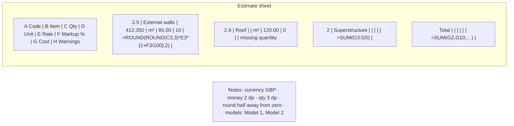
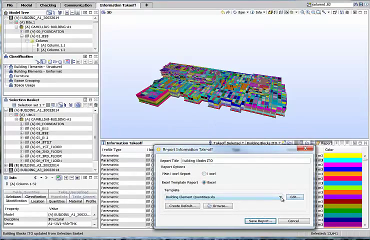

# Estimate Excel Export

Status: In progress locally (Phase 1C). `buildEstimateWorkbook` writes a hand-built SpreadsheetML ZIP with five sheets (`takeoff`, `element-list`, `cbs-estimate`, `assemblies`, `notes`); `tests/unit/phase1c.test.ts` "creates a downloadable workbook with required sheets and formulas" checks the MIME type and ZIP signature. Gaps: `cbs-estimate` contains one placeholder row (`1, 0, 0, ROUND(A2*B2*(1+C2/100),2)`), not CBS items; formula cells cache `<v>0</v>` instead of the computed value and the workbook does not request recalculation on open, so viewers that do not recalculate show 0; no SUM roll-ups; text neutralisation covers `= + - @` only; no headless recalculation test; no row-limit handling. ExcelJS was not added (`package.json` has no dependency), consistent with the hand-written fallback. Market basis: [Phase 1C research](../research/phase-1c-cost-estimation-market-research.md).

## Summary

Export takeoff and estimate to an `.xlsx` workbook generated in the browser, whose cost cells are live formulas that reproduce the app's totals, so estimators can check and adjust prices in Excel. Sheets: **Estimate** (CBS hierarchy with quantity, unit, rate, markup, cost formula, SUM roll-ups, warnings), **Takeoff** (grouped quantities with counts and missing counts), **Elements** (model label, express ID, GlobalId, CBS codes, quantities), **Assemblies** (components with `ROUND()` rate formulas), and **Notes** (currency label, units, rounding rules, generation time, model labels — never file paths). Formula cells carry correct cached values and the workbook asks Excel to recalculate on open. Text is neutralised against formula injection. No upload, no persistence [A1].

**Recommendation.** Match the "regular Excel document" output estimators expect from Solibri Information Takeoff [S1], but go further than a static report: inputs are values, costs are formulas wrapped in `ROUND(…, 2)` as specified in [Unit rates and costing](unit-rates-costing.md), with cached values written per the Open XML rule that `<v>` holds the last calculated result [S2]. Neutralise the full OWASP character set, including tab, CR, LF, and full-width variants [S3]. Keep the hand-written writer unless ExcelJS passes the `1C_01` licence and bundle check [A1].

---

# Detailed Specification

## Problem

Estimators review and adjust estimates in Excel. A workbook whose costs are static numbers cannot be checked; one whose formulas cache 0 shows wrong totals in previewers and mobile viewers that do not recalculate; and unescaped element names from third-party IFC files can execute as formulas [S2, S3, A1].

## Users

- Estimators and reviewers who audit and adjust the estimate in Excel or another spreadsheet tool.

## Goals

- A workbook that opens cleanly, recalculates to the app's totals, and shows correct cached values.
- Traceability from every estimate line to takeoff rows and elements.
- Safe text cells and no leakage of local file paths.

## Comparable Products (Research)

| Product / reference | Feature | Docs | Video | Notes |
|---|---|---|---|---|
| Solibri | Information Takeoff → Excel | n/a | [Solibri ITO](https://www.youtube.com/watch?v=jzQf8GaicdY) | Report is "a regular Excel document" with editable templates [S1]. Frames retained under [quantity takeoff assets](quantity-takeoff/assets/). |
| Autodesk Assemble / Vico / CostX | Excel export of inventory and estimate | Phase 1C research | n/a | Excel export with filtering, grouping, column choice [S4]. |
| Microsoft Open XML | Formulas in SpreadsheetML | [Working with formulas](https://learn.microsoft.com/en-us/office/open-xml/spreadsheet/working-with-formulas) | n/a | `<f>` holds the formula; `<v>` caches the last calculated value; if omitted, the reader must compute it [S2]. |
| Microsoft Excel | Specifications and limits | [Excel limits](https://support.microsoft.com/en-us/office/excel-specifications-and-limits-1672b34d-7043-467e-8e27-269d656771c3) | n/a | 1,048,576 rows × 16,384 columns; 32,767 characters per cell; 15-digit precision; 8,192-character formulas [S5]. |
| OWASP | CSV/formula injection | [CSV Injection](https://community.owasp.org/attacks/CSV_Injection) | n/a | Neutralise cells starting with `= + - @`, tab, CR, LF, and full-width variants [S3]. |

## What Good Looks Like (Findings)

- **Readable, editable output.** Solibri's ITO report "is a regular Excel document which can easily be opened and used by others"; users can edit it into their own templates (01:34–01:49) [S1].
- **Cached values matter.** Open XML stores the formula in `<f>` and "the cached formula value based on the last time the formula was calculated" in `<v>`; omitting it makes the reader responsible for computing the value [S2]. → R5: write computed values, not 0.
- **Hard limits.** 1,048,576 rows per sheet, 32,767 characters per cell, 15 digits of precision [S5]. → R7, R8.
- **Injection is broader than `=`.** OWASP lists `=`, `+`, `-`, `@`, tab, CR, LF, and full-width variants such as `＝` [S3]. → R6.

## User Feedback (Forums)

- **Excel is the expected deliverable.** lucapfeiffer on the buildingSMART forum valued that Solibri "could also export it to Excel" (28 Feb 2024) [S6]. → confirms the feature's purpose.
- **Excel may undo escaping.** OWASP warns that Excel "may remove quotes or escape characters from CSV cells when a file is saved and re-opened", so escaped formulas can become active again [S3]. → R6: in XLSX, write untrusted text as `inlineStr`/shared strings (never as `<f>`), in addition to prefix neutralisation.
- **Re-evaluation.** The existing requirements hold; research adds correct cached values, a recalculation request, the full injection character set, and cell-length limits.

## User Flow

1. **Entry point.** In **Estimate**, the user clicks **Export Excel**. If no CBS is priced, the workbook still exports Takeoff and Elements, and Estimate shows "No priced items".
2. **Generate.** A progress indicator runs for large models; the user may cancel.
3. **Download.** The browser saves `estimate-YYYYMMDD-HHMM.xlsx` locally.
4. **Use in Excel.** Opening shows the Estimate sheet with codes, names, quantities, rates, markup, and cost formulas; changing a rate updates the line cost and the parent and project SUMs.
- **Error / edge paths:** element list exceeds 1,048,576 rows → truncated with a notice on Notes and in the app; a text over 32,767 characters → truncated with an ellipsis and a Notes entry; generation cancelled → no file; warnings (missing rate/quantity, unit mismatch) appear in a Warnings column and the line has no cost formula.

## Wireframe / Sketch

## Requirements

- **R1 — Local generation.** The workbook is built in the browser and downloaded; no network requests and no persistence [A1].
- **R2 — Sheets.** Estimate, Takeoff, Elements, Assemblies, Notes, with header rows, frozen panes, and column widths [S1, S4].
- **R3 — Formulas.** Inputs (quantities, rates, markup, assembly components) are values; each line cost is `ROUND(ROUND(qty,3)*rate*(1+markup/100),2)`; assembly rates are `ROUND(SUM(...),2)`; parent and project totals are `SUM` over children; lump sums are values [A1].
- **R4 — Parity.** Recalculated workbook values equal the app's decimal totals at displayed precision, verified by headless recalculation in tests [A1].
- **R5 — Cached values and recalculation.** Every formula cell writes its computed value in `<v>`; `workbook.xml` sets `<calcPr fullCalcOnLoad="1"/>` [S2].
- **R6 — Injection safety.** Untrusted text is written as strings (never as formulas) and prefixed with `'` when it starts with `=`, `+`, `-`, `@`, tab, CR, LF, or full-width `＝ ＋ － ＠` [S3, A1].
- **R7 — Limits.** Rows capped at 1,048,576 per sheet with a truncation notice; text capped at 32,767 characters; formulas under 8,192 characters [S5].
- **R8 — Precision note.** Notes records that Excel uses 15-digit double precision and that `ROUND()` reproduces app totals at displayed precision [S5, A1].
- **R9 — Privacy.** Notes lists in-session model labels, never local file names or paths [A1].
- **R10 — Warnings.** Lines with missing inputs or unit mismatches carry a Warnings cell and no cost formula, and are excluded from SUMs [A1].
- **R11 — Large models.** Generation is chunked and cancellable with progress.
- **R12 — Library gate.** ExcelJS only if MIT-licensed with acceptable bundle size at `1C_01`; otherwise the hand-written writer [A1].

## Acceptance Criteria

- [ ] AC1: Given an exported workbook, then it is a valid ZIP with the five sheets. *(Partial: `tests/unit/phase1c.test.ts` proves MIME type and ZIP signature, 5 tests passing locally on 2026-11-08; sheet contents are placeholders.)*
- [ ] AC2: Given the worked estimate in [Unit rates and costing](unit-rates-costing.md), when the workbook is recalculated headlessly, then every line and total equals the app (38,554.73; 63,570.04; 15,000.00; 117,124.77).
- [ ] AC3: Given the workbook unrecalculated, then cached `<v>` values equal the app's values.
- [ ] AC4: Given a rate cell edited in the workbook, then the line cost and parent/project totals update.
- [ ] AC5: Given element names starting with `=`, `+`, `-`, `@`, tab, CR, LF, or `＝`, then cells are strings and display literally. *(Partial: `neutralizeSpreadsheetText` covers `= + - @`; round-trip test "neutralizes CSV injection" covers CSV.)*
- [ ] AC6: Given a line with a missing rate, then it shows a warning and no cost formula and is excluded from totals.
- [ ] AC7: Given the Notes sheet, then it contains currency, rounding rules, and model labels but no file names or paths.
- [ ] AC8: Given export, then no network requests occur and nothing is persisted.
- [ ] AC9: Given a synthetic row count over the limit, then output is truncated with a notice.

## Test Cases (for developers)

| ID | Type | Precondition | Steps | Expected result |
|---|---|---|---|---|
| T1 | Unit | Worked estimate | Build workbook; parse XML | Formulas per R3; cached values per R5; `fullCalcOnLoad`. |
| T2 | Integration | Workbook | Headless recalculation (e.g. a formula engine in tests) | Equal to app totals. |
| T3 | Unit | Injection strings incl. tab/CR/LF/full-width | Build | Strings, prefixed, never `<f>`. |
| T4 | Unit | Missing-rate line | Build | Warning; no formula; excluded from SUM. |
| T5 | Unit | Notes | Build | No file names/paths. |
| T6 | Unit | > 1,048,576 rows (synthetic) | Build | Truncated; notice. |
| T7 | Chrome E2E | Priced estimate | Export | Download; zero network requests; no storage. |

## Module Contract

- `buildEstimateWorkbook(dataset)` in `src/core/estimate-xlsx.ts` (present), taking typed estimate, takeoff, element, assembly, and notes data from the costing and mapping features; `src/features/estimate/index.ts` triggers download.

## Dependencies

- [Quantity takeoff](quantity-takeoff.md), [cost breakdown and mapping](cost-breakdown-mapping.md), [unit rates and costing](unit-rates-costing.md), [estimate data files](estimate-data-files.md) (shared neutralisation), and [Phase 1 MVP](../plans/Phase_1_MVP.md) (`1C_01` ExcelJS gate).

## Assumptions

- A JavaScript formula engine used only in tests (not shipped) is acceptable for headless recalculation.
- English-locale number formats (`#,##0.00`, `0.000`) are applied as cell styles.

## Out of Scope

- Charts, pivot tables, macros, templates, and importing edited workbooks back into the app (data round-trip uses [estimate data files](estimate-data-files.md)).

## Open Questions

- None. Formula export, rounding, and the library gate are approved [A1].

## Sources

- **[S1]** Solibri Inc. — "Solibri Snapshot Video - Information Takeoff" — https://www.youtube.com/watch?v=jzQf8GaicdY. Published 2014-06-03. Captions 01:34–01:49: report is "a regular Excel document … you also have the opportunity to edit the Excel and create your own template". Frames and transcript retained under [quantity takeoff assets](quantity-takeoff/assets/).
- **[S2]** Microsoft Learn — "Working with formulas" (Open XML SDK) — https://learn.microsoft.com/en-us/office/open-xml/spreadsheet/working-with-formulas. `<f>` formula text; `<v>` cached value from the last calculation; reader computes if omitted. Updated 2025-01-21; accessed 2026-11-08.
- **[S3]** OWASP — "CSV Injection" — https://community.owasp.org/attacks/CSV_Injection. Characters `=`, `+`, `-`, `@`, tab, CR, LF, full-width variants; Excel may remove escaping on save and re-open. Accessed 2026-11-08.
- **[S4]** Project research — [Phase 1C cost estimation market research](../research/phase-1c-cost-estimation-market-research.md) (Assemble, Vico, CostX Excel export). Marketing-level evidence.
- **[S5]** Microsoft Support — "Excel specifications and limits" — https://support.microsoft.com/en-us/office/excel-specifications-and-limits-1672b34d-7043-467e-8e27-269d656771c3. 1,048,576 × 16,384; 32,767 characters per cell; 15-digit precision; 8,192-character formulas. Accessed 2026-11-08.
- **[S6]** buildingSMART forum — "Which Software to create lists of quantities of the used building materials" — https://forums.buildingsmart.org/t/which-software-to-create-lists-of-quantities-of-the-used-building-materials/5181. lucapfeiffer, 28 Feb 2024.
- **[S7]** Capture note — no new video captured: the only verified comparator video showing Excel output is [S1], already captured for quantity takeoff; further caption requests were rate-limited (HTTP 429). `estimate-excel-export/assets/README.md` records this.
- **[A1]** Approved decisions and local implementation (not external evidence): [Phase 1 MVP](../plans/Phase_1_MVP.md) (ExcelJS gate, file-export boundary), [unit rates and costing](unit-rates-costing.md), `src/core/estimate-xlsx.ts`, `src/core/estimate-data.ts` (`neutralizeSpreadsheetText`), `src/features/estimate/index.ts`, `tests/unit/phase1c.test.ts`, and `package.json`.

---

# Research

## Solibri

- Excel output that users can open, share, and template (01:34–01:49) [S1].

## Microsoft and OWASP references

- Open XML cached-value semantics [S2], Excel limits [S5], and the injection character set [S3] define R5–R8.
