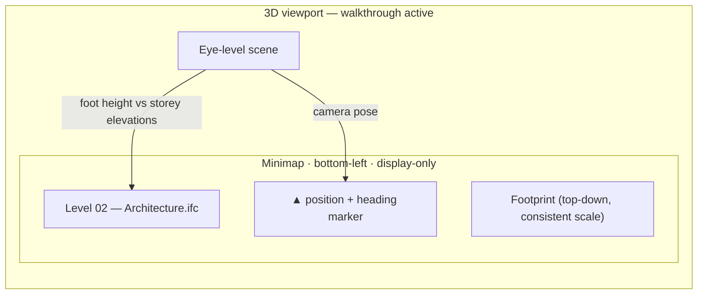
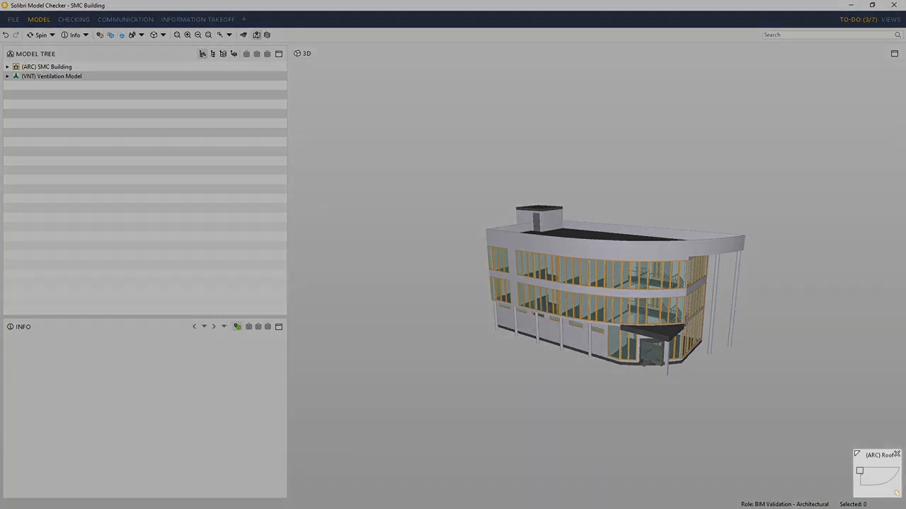
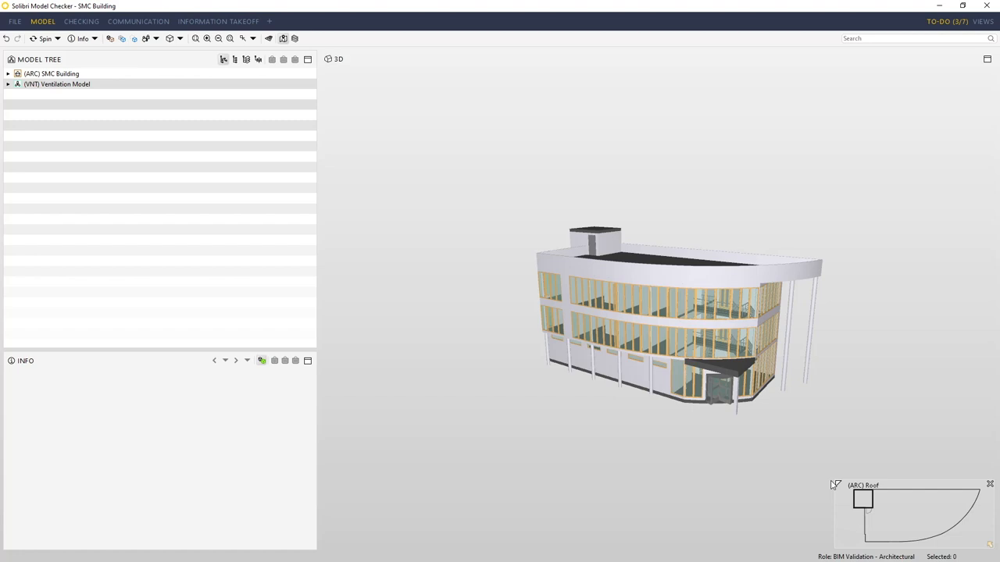
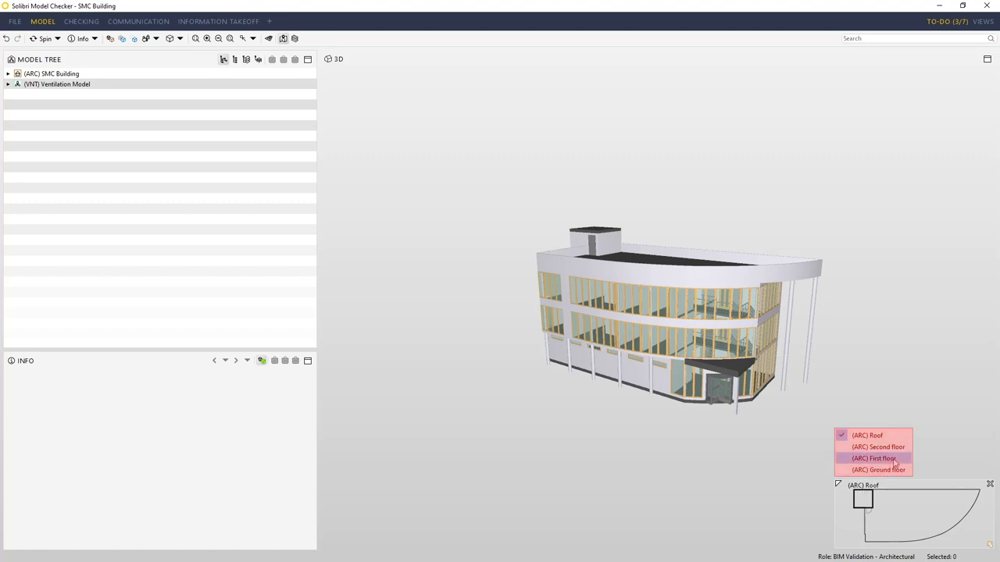
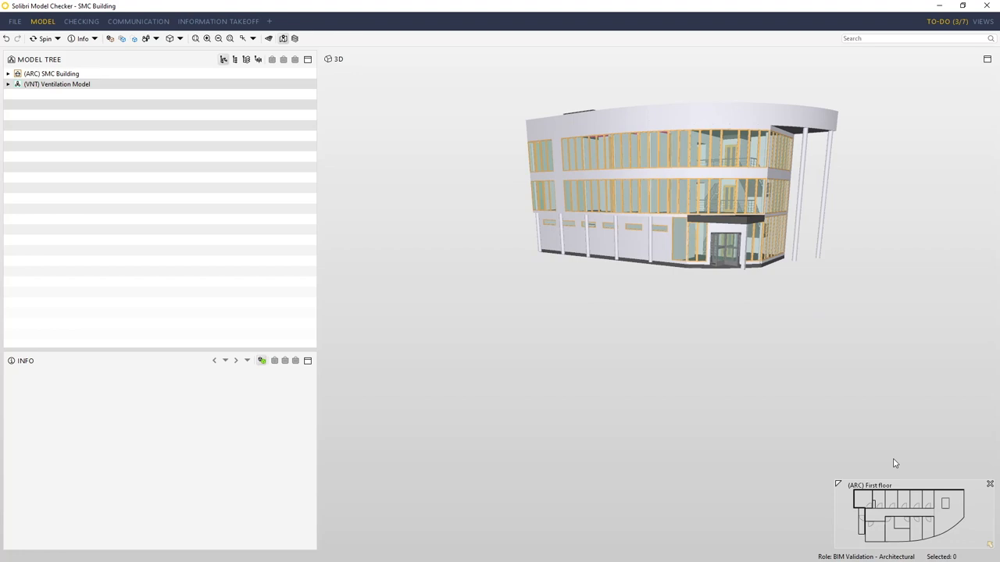

# Feature: First-Person Minimap

Status: Phase 1A, in progress locally. A `.first-person-minimap` overlay with a rotating marker is created by `src/features/first-person/index.ts` and shown only while walkthrough is active (Chrome E2E covers visibility). It has no footprint, no storey detection, and maps position with a fixed `50 + x·2` percentage clamp, so its marker is not tied to model extents. Deployed verification is pending.

## Summary

While walkthrough is active, show a small display-only map in a viewport corner: a simplified top-down footprint of the storey the camera is on, a position marker with heading, and the storey name. Storey choice uses `IfcBuildingStorey` elevations across visible models; when no storey data exists, a labelled combined footprint of all visible geometry is shown. The footprint is generated independently of the Phase 1B plan view. When a reliable footprint or position cannot be shown, the map says so rather than showing a misleading marker [A1].

**Recommendation.** Match Solibri's navigation map (footprint, storey switch, position arrow) for orientation only [S3]. Choose storeys by authored elevation rather than geometry bounds, because xeokit had to switch to elevation sorting after stairwells and overlapping elements broke bounds-based ordering [S4, S5]. Do not adopt click-to-relocate, storey picking, or entity picking from the map in Phase 1: the approved baseline is display-only [S2, S3, A1].

---

# Detailed Specification

## Problem

In first person, users lose track of where they are in a large building. The current marker moves on a fixed scale unrelated to the model, so it saturates at the edge for most real models and shows no floor plan or storey, which is misleading [A1].

## Users

- Estimators and reviewers walking through local IFC models who need to know which storey and room area they are in.

## Goals

- Show the current storey footprint, position, and heading accurately while walking.
- Follow storey changes automatically and label the storey.
- Never show a misleading position; degrade to an explicit unavailable state.
- Stay small, readable, and out of the way of navigation input.

## Comparable Products (Research)

| Product | Feature name | Docs | Video | Notes |
|---|---|---|---|---|
| Solibri | Navigation map | Help page did not load | [#GetToGrips 04](https://www.youtube.com/watch?v=I30WFdEDCfw) | Bottom-corner footprint, storey list, yellow position arrow, double-click to relocate [S3]. |
| xeokit SDK | `StoreyViewsPlugin` storey maps | [StoreyViewsPlugin](https://xeokit.github.io/xeokit-sdk/docs/class/src/plugins/StoreyViewsPlugin/StoreyViewsPlugin.js~StoreyViewsPlugin.html) | n/a | Plan image per `IfcBuildingStorey`, world↔map conversion, storey containing a position, `fitStoreyMaps` consistent-scale option [S1]. |
| Autodesk Platform Services Viewer | `MinimapExtension` | [MinimapExtension](https://aps.autodesk.com/en/docs/viewer/v7/reference/Extensions/MinimapExtension/) | n/a | "2d Minimap to show the view of the current document"; updates on camera change [S2]. |

## What Good Looks Like (Findings)

- **Corner overlay, reopenable and resizable.** Solibri's map sits "in the bottom corner of the screen", can be reopened if closed, and resized from its corner (02:03–02:16) [S3].
- **Storey-aware footprint.** Solibri shows "a footprint plan of the building" and a list of storeys; "as I go between floors the map automatically redraws" (02:20–02:39) [S3]. xeokit creates one plan per `IfcBuildingStorey` and can find "the storey that contains the given 3D World-space position" [S1].
- **Position and direction.** Solibri shows position "by the yellow arrow" (02:39–02:43); xeokit offers `worldPosToStoreyMap` and `worldDirToStoreyMap` [S1, S3].
- **Camera-driven updates.** APS updates the minimap on camera change [S2].
- **Interaction is optional.** Solibri relocates the camera on double-click and xeokit can pick entities from a map image [S1, S3]; the approved app baseline is display-only [A1].
- **Consistent scale.** xeokit's `fitStoreyMaps=false` keeps the model's extents on every storey so scale is consistent across storeys [S1].

## User Feedback (Forums)

- **Wrong objects per storey.** perssam42 reported storey images showing "too much or not enough objects", shifted by one storey, often involving `IfcSlab` (6 Mar 2024). The maintainer said the plugin depends on correct `IfcBuildingStorey` containment and that elements such as stairwells can overlap storeys [S4]. → R3/R4: build each storey footprint from contained elements, and fall back explicitly when containment is missing.
- **Ordering by bounds fails.** xeolabs changed storey sorting to use `IfcBuildingStorey.Elevation` because overlapping elements such as stairwells or drainpipes made bounds-based ordering unclear (PR #1710, 24 Oct 2024) [S5]. → R3: determine the current storey from authored elevations, with bounds only as a fallback.
- **Re-evaluation.** The existing requirements hold. Research adds elevation-based storey selection, consistent scale across storeys, an explicit unavailable state for missing or bad containment, and a fixed relationship between marker coordinates and model extents.

## User Flow

1. **Entry point.** The user enters walkthrough. The minimap appears in the reserved bottom-left viewport corner, clear of the floating toolbar, view cube, and walkthrough hint.
2. **Storey selection.** The map picks the storey whose elevation is the highest one at or below the camera's foot height (eye − eye height), across visible models, and shows its name and model name.
3. **Footprint and marker.** The storey's footprint is drawn from a top-down projection of its contained, visible elements. The marker shows position and heading at the same scale.
4. **Walking.** As the user moves, the marker updates within one frame of the camera change. Crossing a storey elevation switches the footprint and label.
5. **Exit.** Leaving walkthrough hides the minimap.
- **Error / edge paths:** no storeys in any visible model → combined footprint labelled "All visible geometry (no storeys)"; storey with no contained geometry, or camera outside the footprint's padded bounds → "Position outside mapped area" and no marker; footprint generation fails or exceeds its budget → "Map unavailable"; models hidden or removed → footprint regenerates or the map shows the unavailable state; resize → the map keeps its fixed CSS size and stays in its corner.

## Wireframe / Sketch

## Requirements

- **R1 — Display-only overlay.** Shown only while walkthrough is active, in a reserved viewport corner, at a fixed compact size (≈ 200 × 200 CSS px, never more than 30% of viewport width). It does not intercept pointer or keyboard input (`pointer-events: none` except an optional collapse control) and never changes camera, visibility, or selection [S3, A1].
- **R2 — Footprint independence.** The footprint is a simplified top-down projection (e.g. rasterised XZ triangles or convex/outline polygons) of visible model geometry, generated without the Phase 1B plan-view linework [A1].
- **R3 — Storey selection.** The current storey is the one whose `IfcBuildingStorey.Elevation` (converted to scene metres, per model) is the highest at or below the camera foot height across visible models. When elevation is missing, the storey's contained-geometry minimum Y is used. Ties across models prefer the model whose bounds contain the camera's X/Z [S1, S5].
- **R4 — Storey footprint content.** A storey footprint contains only elements spatially contained in that storey (`IfcRelContainedInSpatialStructure`, including aggregated children). No storeys at all → combined footprint labelled as such [S1, S4].
- **R5 — Consistent coordinates.** Map scale and origin come from the union of visible model X/Z bounds, so every storey uses the same scale and authored coordinates are preserved. The marker uses the same transform; heading is the camera yaw [S1].
- **R6 — Honest states.** When the camera is outside the padded footprint bounds, the storey has no geometry, or generation fails, the marker is hidden and a text state is shown instead. A clamped edge marker is never shown [A1].
- **R7 — Label.** The map shows the storey name (or "All visible geometry (no storeys)") and the source model name; the text is exposed to assistive technology.
- **R8 — Performance.** Footprints are generated once per storey and visibility set, off the per-frame path, and cached until model load/removal or visibility changes. Per-frame work is only the marker transform.
- **R9 — Lifecycle.** Disposal removes the overlay, cached footprints, subscriptions, and resize observers.
- **R10 — Contract.** The minimap consumes the walkthrough's read-only pose subscription and a storey/footprint query from the viewer/IFC adapters; it owns no camera or model state [A1].

## Acceptance Criteria

- [ ] AC1: Given walkthrough is toggled on and off, then the minimap is visible only while active. *(Partial: Chrome E2E "first person is a floating-toolbar toggle that shows the minimap only while active" covers visibility; not re-run in this session.)*
- [ ] AC2: Given a multi-storey fixture, when the camera moves from storey 1 to storey 2 elevation, then the footprint and label switch to storey 2 within one frame.
- [ ] AC3: Given a storey whose stairwell overlaps the storey above, when the camera stands on the lower storey, then the lower storey is selected (elevation-based).
- [ ] AC4: Given a model without storeys, then the combined footprint is shown and labelled "All visible geometry (no storeys)".
- [ ] AC5: Given the camera at a known X/Z, then the marker centre is within 2 px of the expected map position and its rotation equals the camera yaw.
- [ ] AC6: Given the camera outside the padded footprint bounds, then no marker is drawn and "Position outside mapped area" is shown.
- [ ] AC7: Given two storeys with different extents, then both use the same map scale.
- [ ] AC8: Given pointer input over the minimap during walkthrough, then mouse look and movement continue unaffected.
- [ ] AC9: Given Plan View is not mounted, then the minimap still renders footprints.
- [ ] AC10: Given viewport resize from 1280×720 to 800×600, then the map keeps its size, stays in its corner, and does not overlap the toolbar, view cube, or walkthrough hint.
- [ ] AC11: Given disposal, then the overlay, caches, subscriptions, and observers are removed.

## Test Cases (for developers)

| ID | Type | Precondition | Steps | Expected result |
|---|---|---|---|---|
| T1 | Unit | Storeys with elevations 0, 3, 6 m | Query storey for foot heights −1, 0, 2.9, 3, 7 | None/fallback, 0, 0, 3, 6. |
| T2 | Unit | Storey without elevation | Query | Uses contained-geometry min Y. |
| T3 | Unit | Bounds and map size | Map world X/Z to pixels and back | Round trip within 0.5 px; same transform for all storeys. |
| T4 | Unit | Camera outside padded bounds | Compute marker | Returns "outside" state, not a clamped point. |
| T5 | Unit/adapter | Fixture with containment | Build footprint for storey 2 | Only storey-2 elements contribute. |
| T6 | Chrome E2E | Multi-storey synthetic fixture | Walk across a storey elevation | Label/footprint switch. |
| T7 | Chrome E2E | No-storey fixture | Enter walkthrough | Labelled combined footprint. |
| T8 | Chrome E2E | Walkthrough active | Move mouse over map; hold W | Look and movement unaffected. |
| T9 | Chrome E2E | Resize | Change viewport size | No overlap; fixed size. |
| T10 | Unit/E2E | Mounted minimap | Dispose | No overlay, observers, or listeners remain. |

## Module Contract

- Proposed public entrypoint: `mountFirstPersonMinimap` under `src/features/first-person-minimap/`. The current overlay inside `src/features/first-person/index.ts` moves there.
- Inputs: the walkthrough pose subscription `{x, y, z, yaw, active}`, visible-model summaries, and an adapter query `storeyFootprints(visibleModels)` returning per-storey `{modelId, storeyId, name, elevation, footprint}` plus a combined fallback. Outputs: none (display-only).
- Disposal removes the overlay and releases subscriptions, caches, and resize observers.

## Dependencies

- [First-person walkthrough](first-person-walkthrough.md) (pose, mode), [IFC loading](ifc-loading.md) and [model hierarchy](model-hierarchy.md) (spatial containment and storeys), [model controls](model-controls.md) (visibility), [cross-cutting contracts](cross-cutting-contracts.md) (overlay corners, coordinates, units). It does not depend on [plan view](plan-view.md).

## Assumptions

- Foot height = camera eye Y − configured eye height (default 1.7 m) [A1].
- North-up map orientation follows the scene/standard-view convention (Front at the bottom) rather than rotating with the camera; heading is shown by the marker.
- "Padded bounds" means footprint bounds expanded by 5% on each side.

## Out of Scope

- Click/double-click to relocate the camera, storey picker, entity picking, or zoom/pan inside the map [S1, S3].
- Rooms/space labels, measurements, or plan-view linework on the map.
- Persisting map size or position.

## Open Questions

- None. Display-only scope, storey-footprint behaviour, and independence from plan view are fixed by the approved Phase 1A baseline [A1].

## Sources

- **[S1]** xeokit SDK — `StoreyViewsPlugin` — https://xeokit.github.io/xeokit-sdk/docs/class/src/plugins/StoreyViewsPlugin/StoreyViewsPlugin.js~StoreyViewsPlugin.html. Per-`IfcBuildingStorey` plan images (`createStoreyMap`), `getStoreyContainingWorldPos`, `worldPosToStoreyMap`/`worldDirToStoreyMap`, `pickStoreyMap`, `fitStoreyMaps` (consistent scale when false), and `storeysList` sorted on the vertical axis. Accessed 2026-11-08.
- **[S2]** Autodesk Platform Services Viewer v7 — `MinimapExtension` — https://aps.autodesk.com/en/docs/viewer/v7/reference/Extensions/MinimapExtension/. "Provides a 2d Minimap to show the view of the current document"; `onCameraChange`. Accessed 2026-11-08.
- **[S3]** Solibri UK Ltd — "#GetToGrips 04: Basic Model Navigation" — https://www.youtube.com/watch?v=I30WFdEDCfw. Published 2019-02-08, 3:35. Captions: 02:03–02:16 navigation map in the bottom corner, reopenable, resizable; 02:20–02:39 footprint plan, storey list, automatic redraw between floors; 02:39–02:51 yellow position arrow, double-click to move to a new point with direction unchanged.
- **[S4]** xeokit-sdk issue #1400 — "storeyViewPlugin images display too much or not enough objects" — https://github.com/xeokit/xeokit-sdk/issues/1400. perssam42, 6 Mar 2024: storey images shifted by one storey, often `IfcSlab`; xeolabs: depends on correct `IfcBuildingStorey` containment, stairwells may overlap; closed 19 Apr 2024.
- **[S5]** xeokit-sdk PR #1710 — "StoreyViewsPlugin sort on IfcBuildingStorey elevation" — https://github.com/xeokit/xeokit-sdk/pull/1710. xeolabs, merged 24 Oct 2024: sorting by bounds fails when stairwells/drainpipes overlap storeys; sorts on the `elevation` attribute with a bounds fallback.
- **[S6]** Capture commands — `first-person-minimap/assets/_capture_video.py`; runs `yt-dlp` (720p cap, English auto-captions) and `ffmpeg` frame extraction at 02:07, 02:22, 02:33, and 02:43 for [S3]. The full MP4 was held in a temporary directory and deleted; the VTT transcript and stills are retained. Frames were checked for nonblank pixels with Pillow and matched to caption timestamps; in-tool image viewing was unavailable in this session. No second comparator video showing a minimap was found in searches for Revizto, Navisworks, and Dalux.
- **[A1]** Approved Phase 1 decisions and local implementation (not external evidence): [Phase 1 MVP](../plans/Phase_1_MVP.md) ("the minimap uses an independent, display-only footprint of the camera's containing storey"), [cross-cutting contracts](cross-cutting-contracts.md), `src/features/first-person/index.ts`, `src/core/first-person.ts` (`minimapMarker`), `tests/unit/first-person.test.ts`, and `tests/e2e/viewer.spec.ts`.

---

# Research

## Solibri

- Corner placement, reopen/resize, footprint, storey list, automatic redraw, and position arrow (02:03–02:43) [S3]; supports R1, R3, R5, R7.
- Double-click relocation (02:43–02:51) is excluded as interactive behaviour [S3].
- Transcript: [solibri-navigation-map-transcript.en.vtt](first-person-minimap/assets/solibri-navigation-map-transcript.en.vtt).

## xeokit SDK

- `StoreyViewsPlugin` documents per-storey maps, world↔map transforms, and consistent scaling [S1]. Issue #1400 and PR #1710 show containment and ordering problems that drive R3/R4 [S4, S5]. No video was captured.

## Autodesk Platform Services Viewer

- `MinimapExtension` provides a camera-driven 2D minimap [S2]. No video was captured.
