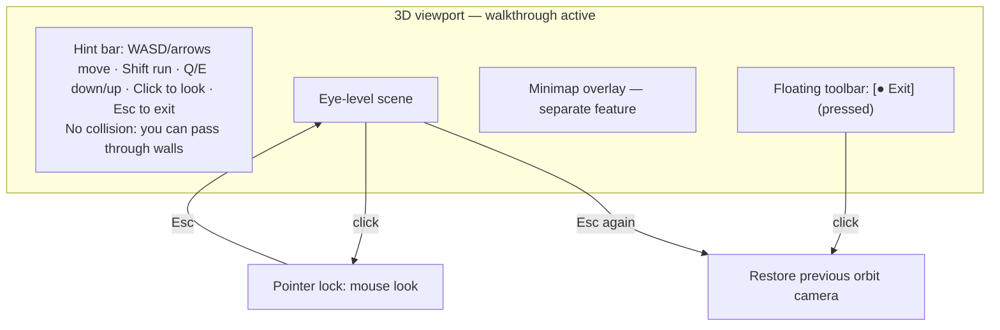
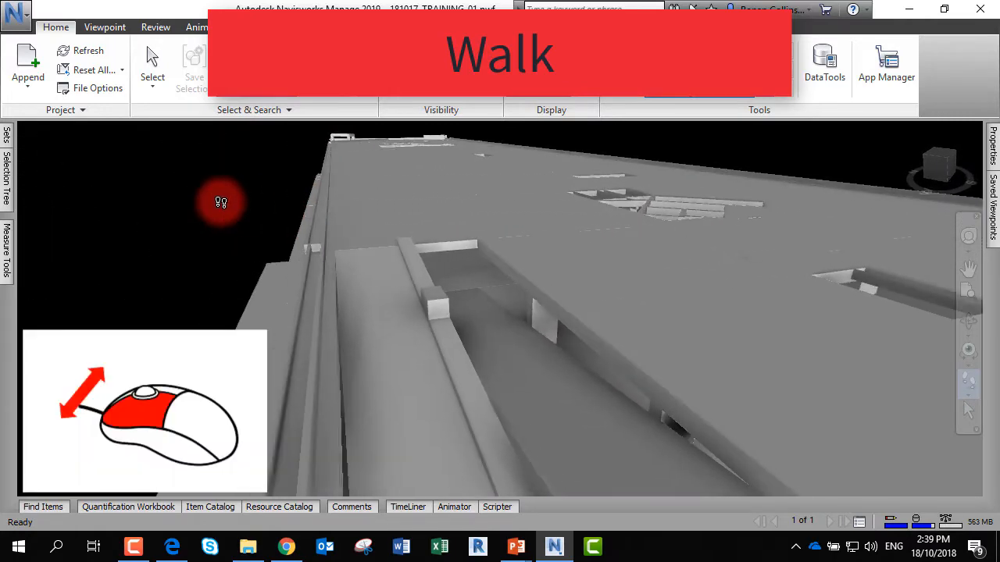
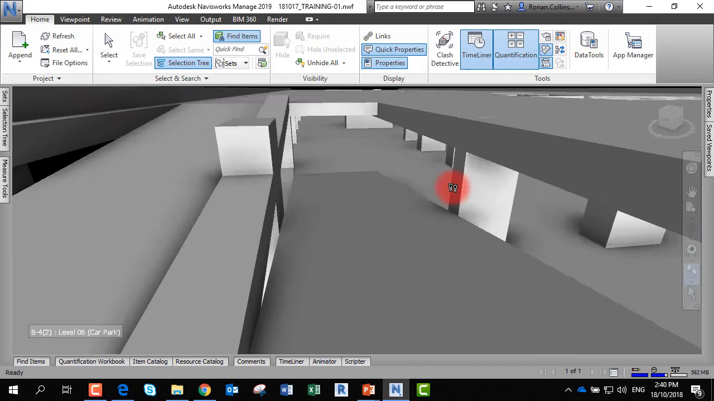
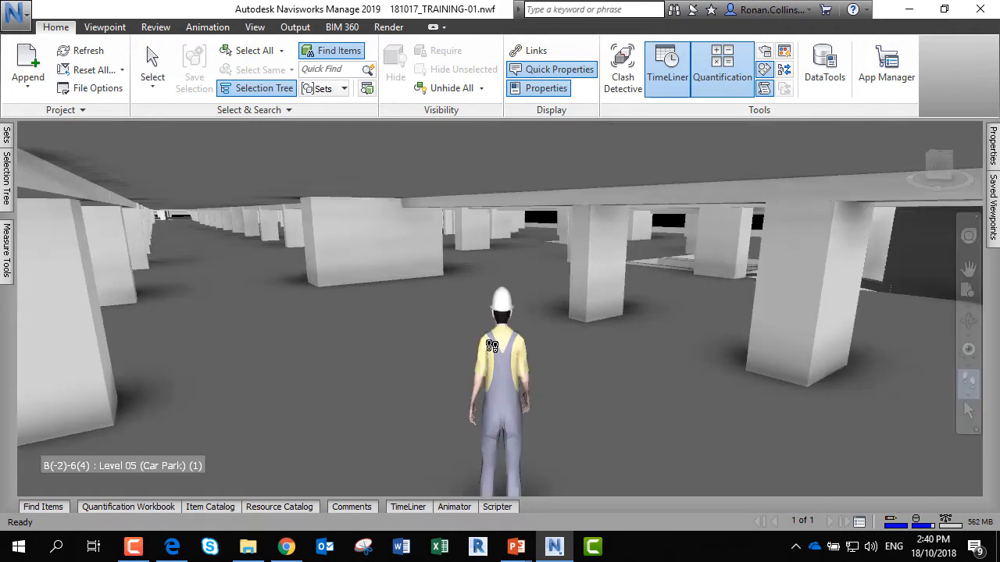
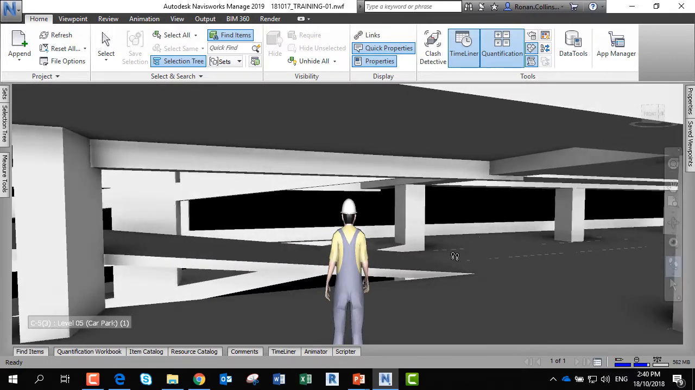
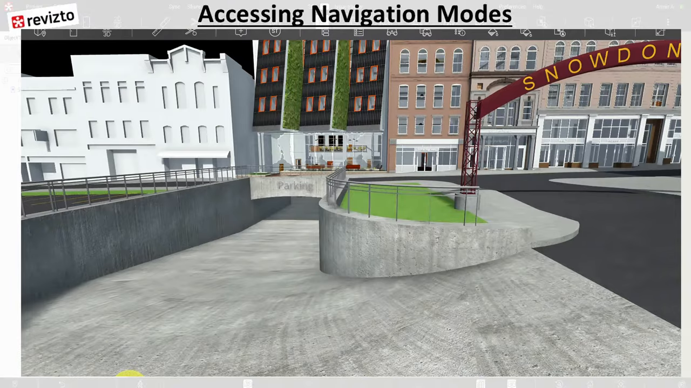
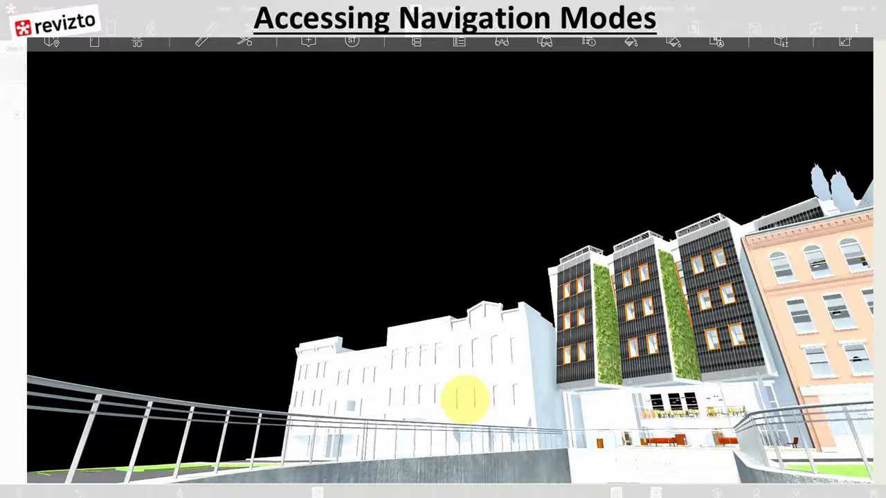
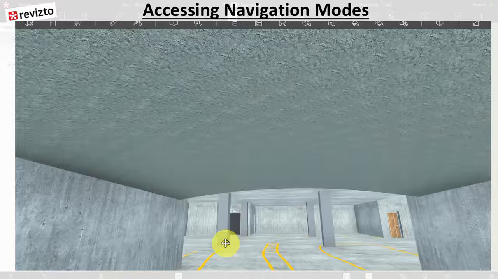
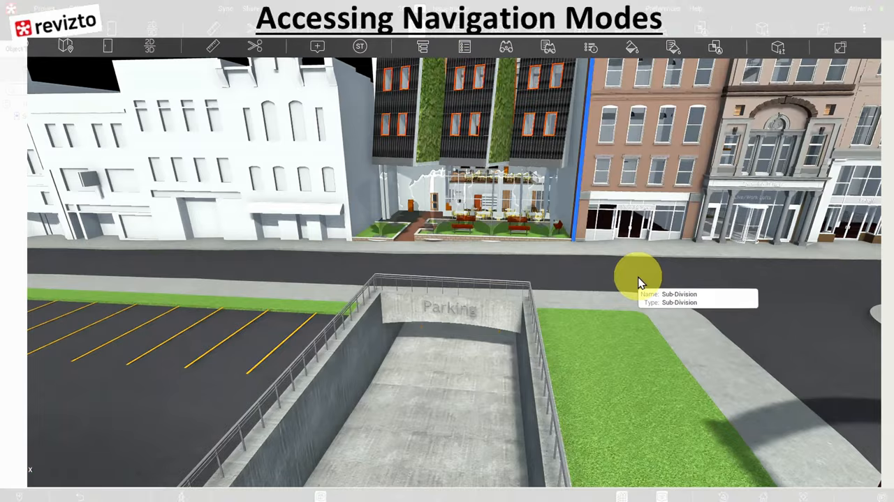

# Feature: First-Person Walkthrough

Status: Phase 1A, in progress locally. A floating-toolbar toggle, WASD/arrow movement, Shift sprint, and pointer-locked yaw exist; Chrome E2E covers the toggle and minimap visibility, and unit tests cover movement math. Exit-restore, eye-height placement, pitch, time-based speed, Escape/focus/pointer-lock-loss handling, and the in-mode limitation notice are not implemented. Deployed verification is pending.

## Summary

Let users enter an eye-level first-person mode to inspect interiors with familiar game-style controls: W/A/S/D or arrow keys to move horizontally, mouse look (pointer lock after a click), Shift to run, and Q/E to change height. Entry places the eye 1.7 m above the floor under the current view; speed defaults to 3 m/s; both are user settings. Exit (toolbar toggle or Escape) restores the exact previous orbit camera. The mode guarantees no collision, gravity, or stair-following, says so on screen, and can never trap the user [A1].

**Recommendation.** Follow the Revizto/Navisworks pattern: a toolbar toggle that drops the camera to eye level with keyboard movement plus mouse look [S4, S5], and use the browser Pointer Lock API with its built-in Escape release [S6, S3]. Do not add Navisworks-style gravity, collision, crouch, or third-person avatar in Phase 1; these require geometry queries and are excluded by the approved baseline ("walkthrough does not guarantee collision detection") [S4, A1]. Because a Revizto tutorial presenter loses mouse control in walk mode on camera, an always-visible hint states the active controls and how to exit [S5].

---

# Detailed Specification

## Problem

Orbit navigation is poor for interiors: users overshoot rooms, lose orientation, and cannot judge spaces at human scale. The local walkthrough moves a fixed 0.05 scene units per frame (frame-rate dependent), only rotates yaw, never restores the previous camera on exit, places the eye at "max(current y, 1.6)" rather than 1.7 m above a floor, and does not stop movement when focus or pointer lock is lost [A1].

## Users

- Estimators and reviewers walking through one or more local IFC models to inspect rooms, ceilings, and fit-out at eye level on a desktop browser.

## Goals

- Enter and leave eye-level navigation in one action without losing the previous view.
- Move predictably at human-scale speeds regardless of frame rate.
- Never leave the user stuck: movement stops on focus loss; Escape always works.
- State the no-collision limitation honestly.

## Comparable Products (Research)

| Product | Feature name | Docs | Video | Notes |
|---|---|---|---|---|
| Autodesk Navisworks | Walk (Realism: gravity, collision, crouch, third person) | Help page did not load | [Navisworks walk, run & fly](https://www.youtube.com/watch?v=ts6_llecMfg) | Mouse-drag walk; optional gravity, collision, crouch, avatar [S4]. |
| Revizto | Walk mode, Game mode | Not loaded | [Revizto navigation fully explained](https://www.youtube.com/watch?v=MDQ-DIoz8rc) | Walk drops to eye level; game mode is WASD + mouse [S5]. |
| Autodesk Platform Services Viewer | `BimWalkExtension` | [BimWalk](https://aps.autodesk.com/en/docs/viewer/v7/reference/Extensions/BimWalkExtension/) | None found | "First Person navigation tool, similar to those found in videogames", keyboard and mouse, activate/deactivate [S1]. |
| OpenProject BIM | First person perspective | [IFC viewer](https://www.openproject.org/docs/bim-guide/ifc-viewer/) | Docs GIF only | Toolbar toggle; camera behaves like head movement [S2]. |
| three.js | `PointerLockControls` | [PointerLockControls](https://threejs.org/docs/#examples/en/controls/PointerLockControls) | n/a | Lock/unlock events, pitch limits, move parallel to the XZ plane [S3]. |
| xeokit SDK | `CameraControl` first-person + pointer lock | Issues/PRs | n/a | Pointer lock added so the cursor is not lost in a screen corner [S7]. |

## What Good Looks Like (Findings)

- **Explicit mode with eye-level drop.** Revizto's walk toggle "dropped me to the floor … at the eye level" (03:59–04:25); OpenProject and APS expose first person as a toolbar mode with activate/deactivate [S1, S2, S5].
- **Game-style keys plus mouse look.** Revizto game mode: "use W and D a keyboard … and then you can use the mouse" (06:43–06:51); APS BimWalk supports keyboard and mouse [S1, S5].
- **Horizontal movement independent of pitch.** `PointerLockControls.moveForward` moves "parallel to the xz-plane" and supports pitch limits [S3].
- **Pointer lock for look.** Pointer lock hides the cursor, gives unbounded `movementX/Y`, requires an engagement gesture, and the user agent's default unlock gesture (Escape) fires `pointerlockchange` [S6]. xeokit adopted it to avoid "losing [the pointer] in a corner of the screen" [S7].
- **Realism is optional and heavy.** Navisworks offers gravity ("elevation will change depending on the terrain", 02:03–02:10), collision, crouch, and a third-person avatar (02:20–02:48) as toggles [S4]. These depend on geometry queries.

## User Feedback (Forums)

- **Losing control in walk mode.** In the Revizto walkthrough the presenter says "right now my mouse doesn't work anymore … I have to use the keyboard keys" and that vertical pan is blocked until walk mode is turned off (04:14–04:56) [S5]. → R7, R8: show active controls and the exit path at all times; Q/E vertical movement.
- **Cursor escaping the viewport.** xeokit PR #1445 (Kurtil, 18 Apr 2024) added pointer lock so look does not stop at screen edges [S7]. → R5.
- **Mode-specific mouse buttons.** xeokit issue #1432 (Candy-u, 9 Apr 2024) asked to disable right-drag pan in first-person mode; the maintainer said it is intentional and not configurable [S8]. → R5: in walkthrough, orbit/pan controls are disabled; only look and keyboard movement apply.
- **Unwanted rotations.** xeokit PR #2061 (paireks, merged 27 May 2025) removed tiny extra rotations that broke pitch limits and caused a 180° flip [S9]. → R6: clamp pitch to ±85° and keep roll zero.
- **Re-evaluation.** The existing requirements hold. Research adds a visible controls hint, vertical Q/E movement, pitch clamping, frame-rate-independent speed, and pointer-lock-loss handling. Gravity/collision are confirmed non-goals for Phase 1.

## User Flow

1. **Entry point.** With at least one visible model, the user clicks **First person** on the floating toolbar (pressed state, label "Exit"). Any other pointer tool is cancelled. With no visible model the toggle is disabled.
2. **Placement.** The camera keeps its horizontal heading; pitch is levelled; the eye moves to 1.7 m above the floor under the camera (top of the visible geometry hit by a downward ray at the camera's X/Z), or 1.7 m above the visible bounds' minimum Y if no floor is hit. Orbit/pan controls are disabled (see Revizto eye-level frame).
3. **Hint.** A non-modal hint shows "WASD/arrows move · Shift run · Q/E down/up · Click to look · Esc to exit" and "No collision: you can pass through walls".
4. **Look.** The user clicks the canvas; pointer lock engages and mouse movement changes yaw and pitch (clamped). If pointer lock is denied, drag-to-look is used instead.
5. **Move.** Held keys move horizontally relative to heading at the configured speed (×2.5 with Shift); Q/E move vertically. The minimap updates.
6. **Exit.** Escape first releases pointer lock (browser default). A second Escape, or the toolbar toggle, exits walkthrough and restores the exact pre-entry camera and projection.
- **Error / edge paths:** window blur, tab hidden, or pointer-lock loss → held keys cleared and movement stops; all models removed → walkthrough exits and restores a finite camera; resize → aspect updates, mode stays active; typing in an input field → movement keys ignored; orthographic saved view active → switches to perspective on entry and restores orthographic on exit.

## Wireframe / Sketch

## Requirements

- **R1 — Explicit mode.** A floating-toolbar toggle enters and exits walkthrough, showing pressed state and switching its accessible name between "First person" and "Exit first person". Walkthrough is an exclusive pointer tool: entering cancels select/measure/zoom-window/clip edit [A1].
- **R2 — Entry placement.** Entry preserves heading, levels pitch, and places the eye 1.7 m above the floor under the camera (downward ray against visible geometry) or above the visible-bounds minimum when no floor is found. The perspective camera is used [S5, A1].
- **R3 — Exact exit restore.** Exit by toggle, Escape, model removal, or disposal restores the pre-entry camera position, orientation, target, and projection exactly [A1].
- **R4 — Movement.** W/ArrowUp, S/ArrowDown move forward/back and A/ArrowLeft, D/ArrowRight strafe parallel to the ground plane relative to heading, independent of pitch. Q/E move down/up. Speed is time-based: default 3 m/s, Shift ×2.5, user setting range 0.5–10 m/s; diagonal movement is normalised [S3, S5, A1].
- **R5 — Look.** Clicking the canvas requests pointer lock (user gesture only); mouse movement changes yaw and pitch. If pointer lock is unavailable or denied, drag-to-look on the canvas is used. Orbit/pan/zoom controls are disabled in the mode [S3, S6, S7, S8].
- **R6 — Stable orientation.** Pitch is clamped to ±85°, roll stays zero, and camera values stay finite [S9].
- **R7 — Visible controls and limitation.** While active, a non-modal, accessible hint lists controls and the exit key and states that there is no collision, gravity, or stair-following [S5, A1].
- **R8 — Never trapped.** Escape releases pointer lock first and, on the next press, exits walkthrough, following the cross-cutting Escape order. Window blur, `visibilitychange` to hidden, and `pointerlockchange` to unlocked clear held keys. Keys typed into text inputs are ignored [S6, A1].
- **R9 — Lifecycle.** Removing all models exits the mode; resize keeps the mode with a correct aspect; disposal exits, releases pointer lock, and removes all listeners and animation frames.
- **R10 — Settings.** Eye height (default 1.7 m, range 1.0–2.5 m) and speed (default 3 m/s) are user settings in viewer settings, applied on next entry. Speeds and heights are in metres using the model's converted length unit [A1].
- **R11 — Placement invariance.** The mode never changes model placement, visibility, selection, or clipping.
- **R12 — Adapter boundary.** The feature owns UI, key state, and pointer-lock listeners; the viewer adapter owns the camera, controls enabling, floor raycast, and render loop, exposed as commands (enter/exit/move/look) and a read-only pose for the minimap [A1].

## Acceptance Criteria

- [ ] AC1: Given a loaded model, when First person is toggled on and off, then the toggle's pressed state and accessible name change. *(Partial: Chrome E2E "first person is a floating-toolbar toggle…" covers aria-pressed/label toggling and minimap visibility; not re-run in this research session.)*
- [ ] AC2: Given an orbit camera over a floor, when walkthrough is entered, then the eye is 1.7 m ± 0.05 m above the floor hit under the camera, pitch is 0, and heading is unchanged.
- [ ] AC3: Given any pre-entry camera (including an orthographic saved view), when walkthrough exits by toggle or Escape, then camera position, orientation, target, and projection equal the pre-entry values.
- [ ] AC4: Given walkthrough at 3 m/s, when W is held for 1 s at 30 fps and at 120 fps, then displacement is 3 m ± 5% in both cases and Shift gives 7.5 m ± 5%. *(Partial: `tests/unit/first-person.test.ts` proves direction, arrow/WASD equivalence, opposing-key cancel, and heading rotation for the per-frame step (5 tests passing locally on 2026-11-08); not time-based speed.)*
- [ ] AC5: Given a pitched view, when W is held, then vertical position does not change; Q/E change it.
- [ ] AC6: Given walkthrough, pointer lock is requested only after a canvas click and mouse movement changes yaw and pitch; pitch never exceeds ±85°.
- [ ] AC7: Given held movement keys, when the window blurs, the tab is hidden, or pointer lock is lost, then movement stops within one frame.
- [ ] AC8: Given pointer lock, when Escape is pressed once, then lock releases and walkthrough remains; a second Escape exits and restores the camera.
- [ ] AC9: Given walkthrough is active, the hint with controls, the exit key, and the no-collision statement is visible and exposed to assistive technology.
- [ ] AC10: Given walkthrough, when all models are removed or the viewport is resized, then the mode exits (removal) or remains active with correct aspect (resize) and camera values stay finite.
- [ ] AC11: Given a changed eye-height and speed setting, when walkthrough is next entered, then the new values apply.
- [ ] AC12: Given walkthrough, model placement, visibility, selection, and clipping are unchanged after enter, move, and exit.

## Test Cases (for developers)

| ID | Type | Precondition | Steps | Expected result |
|---|---|---|---|---|
| T1 | Unit | Held-key sets, heading, dt | Compute step for 1 s at 30 and 120 fps; with Shift; diagonal | 3 m and 7.5 m ± 5%; diagonal magnitude equals straight. |
| T2 | Unit | Pitched camera | Apply forward step | Δy = 0; Q/E change y only. |
| T3 | Unit | Look deltas | Apply large ±movementY | Pitch clamped to ±85°; roll 0; finite. |
| T4 | Unit/adapter | Synthetic floor slab at y = 3 | Enter with camera above slab; enter with no slab under camera | Eye y = 4.7; fallback = bounds min + 1.7. |
| T5 | Chrome E2E | Orbit camera (and ortho saved view) | Enter, move, exit by toggle; repeat with Escape twice | Camera/projection restored exactly. |
| T6 | Chrome E2E | Walkthrough active | Hold W; dispatch blur / visibilitychange / pointerlockchange | Position stops changing. |
| T7 | Chrome E2E | Walkthrough active | Inspect hint | Hint text and no-collision statement present with accessible name. |
| T8 | Chrome E2E | Walkthrough active | Remove all models; resize viewport | Mode exits on removal; aspect updates on resize; finite camera. |
| T9 | Chrome E2E | Settings changed | Enter walkthrough | New eye height and speed applied. |
| T10 | Chrome E2E | Measure tool active | Enter walkthrough | Measure cancelled; orbit controls disabled. |
| T11 | Chrome E2E | Text input focused | Press W | No movement. |

## Module Contract

- Public entrypoint: `mountFirstPerson` in `src/features/first-person/index.ts` (present locally; the spec previously proposed `mountFirstPersonWalkthrough`).
- Owns the toggle, hint, key state, and pointer-lock/focus listeners. The viewer adapter owns the camera, controls enabling, floor raycast, saved pre-entry camera, and render loop through injected commands: `enterWalkthrough(settings)`, `exitWalkthrough()`, `walkStep(dx, dy, dz)`, `look(dYaw, dPitch)`, and a read-only pose subscription consumed by the [minimap](first-person-minimap.md).
- Disposal exits the mode, releases pointer lock, clears held keys, and removes listeners, timers, and animation frames.

## Dependencies

- [3D navigation](viewer-navigation.md) (projection and controls), [first-person minimap](first-person-minimap.md), [viewer settings](viewer-settings.md), [IFC loading](ifc-loading.md), [model controls](model-controls.md), and [cross-cutting contracts](cross-cutting-contracts.md) (one active tool, Escape order, numeric defaults).

## Assumptions

- Scene units are metres after unit conversion, so 1.7 m eye height and 3 m/s map directly to scene units [A1].
- "Floor under the camera" means the first visible-geometry hit of a downward ray at the camera's X/Z; no storey semantics are required.
- Shift multiplier 2.5 (3 → 7.5 m/s) keeps the existing walk/sprint ratio (0.05 → 0.12 ≈ 2.4) [A1].

## Out of Scope

- Collision detection, gravity, stair/ramp following, crouch, and third-person avatar [S4, A1].
- Fly mode, VR/WebXR, gamepad, and touch joysticks.
- Saving walkthrough paths or animations.

## Open Questions

- None. Eye height, speed, user setting, and the no-collision baseline are fixed by the approved Phase 1A baseline and numeric defaults [A1].

## Sources

- **[S1]** Autodesk Platform Services Viewer v7 — `BimWalkExtension` — https://aps.autodesk.com/en/docs/viewer/v7/reference/Extensions/BimWalkExtension/. "First Person navigation tool, similar to those found in videogames. Supports keyboard and mouse input"; activate/deactivate methods. Accessed 2026-11-08.
- **[S2]** OpenProject — IFC viewer (BIM feature), "First person perspective" — https://www.openproject.org/docs/bim-guide/ifc-viewer/. Toolbar toggle; "the camera moves in a manner comparable to a head movement". Accessed 2026-11-08.
- **[S3]** three.js — `PointerLockControls` — https://threejs.org/docs/#examples/en/controls/PointerLockControls. `lock`/`unlock` events, `minPolarAngle`/`maxPolarAngle`, `moveForward` "parallel to the xz-plane". Accessed 2026-11-08.
- **[S4]** BIM for Construction — "Navisworks Course - quickly learn how to walk, run & fly in models" — https://www.youtube.com/watch?v=ts6_llecMfg. Published 2022-04-15, 3:22. Captions: 01:38–01:53 walk with left mouse look/move, middle mouse elevation; 02:03–02:10 gravity follows terrain; 02:20–02:48 third-person avatar, gravity and collision, crouch in confined spaces.
- **[S5]** BIM DESTINATION — "Revizto Tutorials | Navigation Fully Explained!" — https://www.youtube.com/watch?v=MDQ-DIoz8rc. Published 2025-11-01, 8:04. Captions: 03:56–04:25 walk toggle drops to eye level; 04:14–04:56 "my mouse doesn't work anymore", vertical pan blocked until walk is turned off; 06:33–06:51 game mode W/A/S/D plus mouse.
- **[S6]** MDN — Pointer Lock API — https://developer.mozilla.org/en-US/docs/Web/API/Pointer_Lock_API. Engagement gesture required; Escape/default unlock gesture fires `pointerlockchange`; `movementX/Y` unbounded while locked; `pointerlockerror`; no Safari on iOS support. Last modified 2025-09-18.
- **[S7]** xeokit-sdk PR #1445 — "Add support for Pointer Lock Web API" — https://github.com/xeokit/xeokit-sdk/pull/1445. Kurtil, 18 Apr 2024: locks the pointer in first-person so it is not lost "in a corner of the screen"; merged 18 Apr 2024.
- **[S8]** xeokit-sdk issue #1432 — "How to disable right mouse drag in first person mode" — https://github.com/xeokit/xeokit-sdk/issues/1432. Candy-u, 9 Apr 2024; xeolabs: intentional, not configurable; closed 19 Apr 2024.
- **[S9]** xeokit-sdk PR #2061 — "XCD-491 Unwanted additional rotations" — https://github.com/xeokit/xeokit-sdk/pull/2061. paireks, 23 May 2025: tiny extra rotations broke pitch limits and caused a 180° flip; merged 27 May 2025.
- **[S10]** Capture commands — `first-person-walkthrough/assets/_capture_video.py`; runs `yt-dlp` (720p cap, English auto-captions) and `ffmpeg` frame extraction at the timestamps listed in the script for [S4] and [S5]. Full MP4s were held in a temporary directory and deleted; VTT transcripts and stills are retained. Frames were checked for nonblank pixels with Pillow and matched to caption timestamps; in-tool image viewing was unavailable in this session. The official Revizto video (0VUA09WPfRI) returned HTTP 429 for captions and was not used.
- **[A1]** Approved Phase 1 decisions and local implementation (not external evidence): [Phase 1 MVP](../plans/Phase_1_MVP.md) ("walkthrough does not guarantee collision detection"), [cross-cutting contracts](cross-cutting-contracts.md) (one active tool, Escape order, eye height 1.7 m and speed 3 m/s with a user setting), `src/features/first-person/index.ts`, `src/core/first-person.ts`, `src/adapters/viewer/index.ts` (`setFirstPerson`), `tests/unit/first-person.test.ts`, and `tests/e2e/viewer.spec.ts`.

---

# Research

## Autodesk Navisworks

- Walk uses mouse look/move with middle-mouse elevation (01:38–01:53) [S4].
- Gravity, collision, crouch, and a third-person avatar are optional realism toggles (02:03–02:48) [S4]; excluded for Phase 1.
- Transcript: [navisworks-walk-transcript.en.vtt](first-person-walkthrough/assets/navisworks-walk-transcript.en.vtt).

## Revizto

- Walk toggle drops to eye level; the presenter loses mouse control and must turn walk off to move vertically (03:56–04:56) [S5]; supports R2, R7, R4 (Q/E).
- Game mode uses W/A/S/D with mouse look (06:33–06:51) [S5]; supports R4/R5.
- Transcript: [revizto-navigation-transcript.en.vtt](first-person-walkthrough/assets/revizto-navigation-transcript.en.vtt).

## Autodesk Platform Services, OpenProject, three.js, xeokit

- APS BimWalk and OpenProject document first person as a toolbar-activated mode [S1, S2]. No product video was captured for either.
- three.js `PointerLockControls` and MDN define the pointer-lock behaviour the app relies on [S3, S6].
- xeokit issues/PRs show pointer lock, mode-specific mouse buttons, and pitch-limit bugs as recurring concerns [S7–S9].
