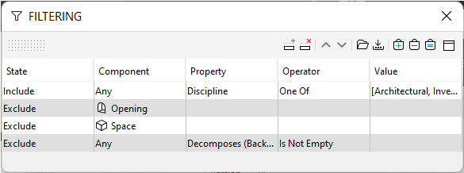
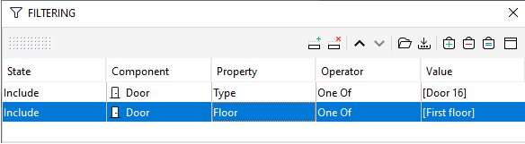
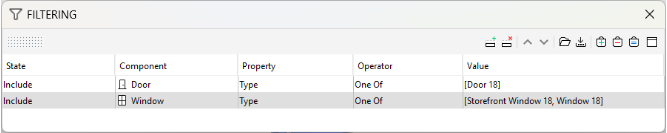
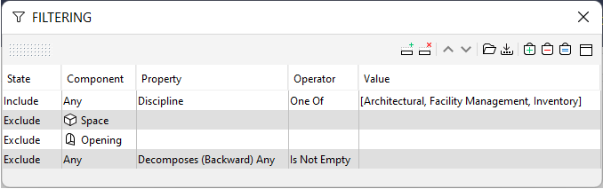
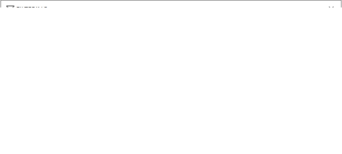
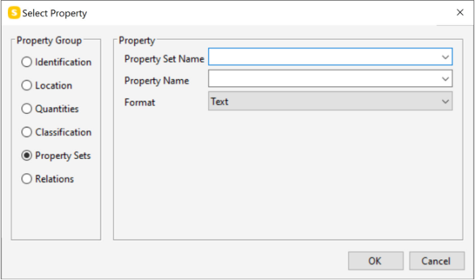
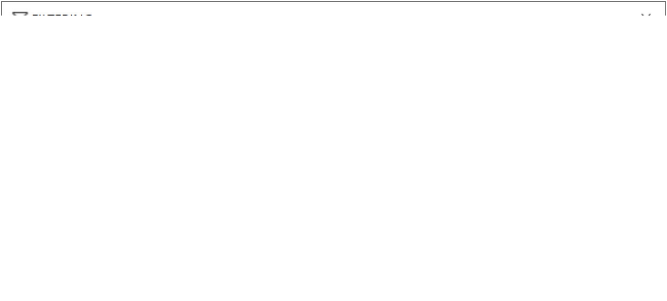
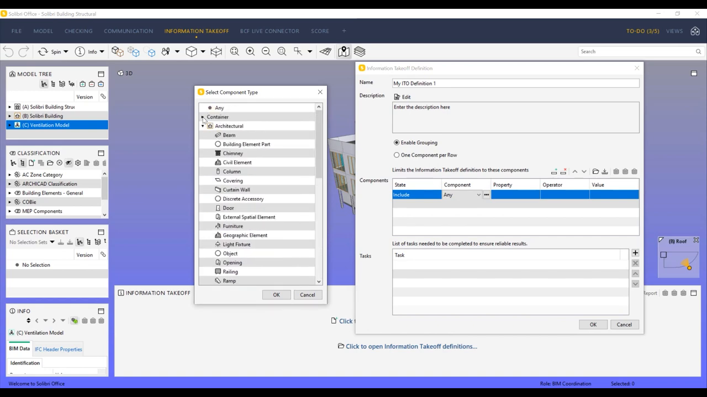
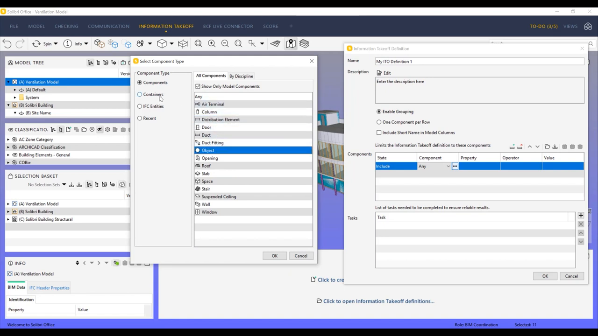
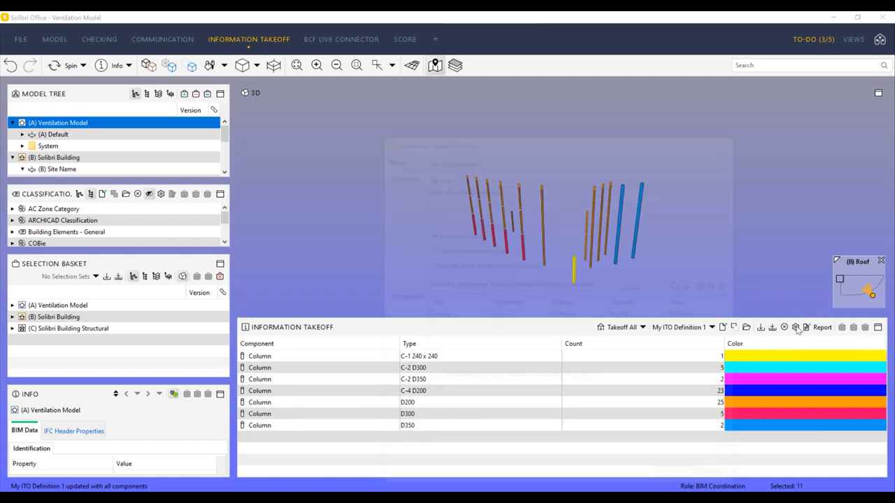

# Feature: Model Filtering

Status: Adapter filtering and transient criteria UI are implemented locally. The UI currently exposes only five built-in fields and renders at most 20 results per model; typed property-set fields, hidden-result actions, explicit continuation, and mixed-type browser acceptance remain outstanding.

## Summary

Let users narrow loaded IFC elements using explicit, typed property criteria without changing model visibility as a side effect. Apply AND across distinct criteria and OR across selected alternatives within one criterion. Results must include model-scoped identity, counts, and hidden-state information, and must distinguish absent, explicitly unset, blank, and unsupported values.

The feature is a temporary result/filter view, not a visibility tool or a saved rule system. An explicit Unhide action may change visibility for the full current result set; applying or clearing criteria alone never does.

---

# Detailed Specification

## Problem

Users need to narrow large IFC models to elements with certain classes or property values. Filter semantics must remain predictable when multiple fields, multiple values, missing data, and multiple models are involved. A property filter that conflates an absent field with an empty string, silently excludes an IFC class, or changes visibility without an explicit command is difficult to trust.

## Users

- Estimators and construction professionals identifying a set of model elements that share typed property values.
- Users who want to inspect or select filtered results while preserving the current model visibility and hierarchy state.

## Goals

- Filter element identities across all loaded models using the shared typed field/predicate contract.
- Make AND/OR behavior, result totals, model scope, and hidden state visible.
- Treat missing, unset, blank, and type-mismatched values explicitly.
- Keep filtering reversible, transient, and independent from model visibility.

## Comparable Products (Research)

| Product | Feature name | Docs | Video | Notes |
| --- | --- | --- | --- | --- |
| Solibri Office / Solibri Filtering | Filtering View and component filter rows | [Filtering Components](https://help.solibri.com/hc/en-us/articles/12771718136343-Filtering-Components); [Selecting Components for Filtering](https://help.solibri.com/hc/en-us/articles/15124419835159-Selecting-Components-for-Filtering); [Adding a New Filter](https://help.solibri.com/hc/en-us/articles/12771718174103-Adding-a-New-Filter) | [New Filtering Features in Solibri Office](https://www.youtube.com/watch?v=4e6sYZ1fM44) | Include/Exclude/Ignore states; format-dependent operators; same component-type rows use AND, different types use OR; Exclude takes precedence; filters can be saved. Containers are a selectable category in some Solibri contexts, but not in the Filtering view. |

## What Good Looks Like (Findings)

- A filter row makes its state explicit: Include, Exclude, or Ignore. Solibri defines Ignore as temporarily disabling a row, not deleting it [S1]. This app uses a narrower result-only filter and does not adopt those visibility/rule states [A1].
- Filter semantics must be visible and testable. Solibri's Include rows use AND for the same component type and OR for different component types; Exclude has precedence over Include [S1]. The approved app baseline is simpler and explicit: AND between criteria, OR among values for one criterion [A1].
- Property field selection needs a stable field identity and type-aware operator. Solibri lets users choose property groups, a property, and a format-dependent operator; its One Of operator offers existing values [S2]. This app follows the shared `PsetName.PropName` / `QsetName.QuantityName` contract instead of bare property names [A1].
- Missing-data semantics need first-class treatment. The Solibri community thread reports inconsistent results when a property is missing and a filter value is blank versus a space; a reply recommends an “is defined” operator to test existence [S3]. This app must distinguish missing, explicit IFC unset, and actual blank/whitespace text.
- Component availability should not be hidden behind a category toggle. Solibri separates component classes, containers, IFC entities, and IFC types; “Show Only Model Components” changes the available list. Current help says containers are not selectable in the Filtering view [S2]. A 2023 Solibri video describes filtering by containers, which conflicts with the current help; treat that as a version/context difference, not as the app's required behavior [S7]. The app exposes supported IFC fields directly and must report unsupported/unavailable fields rather than silently dropping matches [A1].
- Filters should make result scope and visibility effects clear. Solibri includes/excludes components for downstream checking/classification and supports saving reusable `.filter` files [S1, S2]; this app intentionally returns identities only and has no saved filters or implicit visibility mutations [A1].

## User Feedback (Forums)

- In “A filter issue with property,” a user reported that filtering on a property that did not exist returned no components when the value was blank, but returned components when the value contained one space. Another user expected both to behave the same for a missing property; a Solibri reply recommended “is defined” to test property existence [S3]. Convert this into explicit missing/unset/blank tests and a dedicated existence predicate.
- In a 2024 Rule 203 discussion, a user could not add IFC containers such as `IfcSite` to one component-type list and reported that disabling “Show Only Model Components” did not resolve it. A Solibri responder asked about that toggle and said an issue would be added [S4]. The thread concerns a rule filter and reported version 24.5, not a confirmed general Filtering View defect. Treat it as a product-specific coverage/discoverability warning, not a universal behavior claim.
- The filter guide has small article helpfulness counts (including 0/3 for the add-filter article); these are insufficient to establish broad satisfaction or pain prevalence [S2]. No recurring accessibility feedback was found in the reviewed sources.

## User Flow

1. The user opens Filter. The panel starts with no active criteria and does not affect selection or visibility [A1].
2. The user adds a criterion and selects a typed field from the available IFC class, identity, occurrence/type Pset, quantity set, material, classification, or spatial fields [S2, A1].
3. The user chooses an operator and one or more values. Multiple alternatives within this field are ORed; `missing` and explicit `unset` remain separate from blank text [S3, A1].
4. The system evaluates all criteria across loaded models using AND between criteria. It reports total matches, groups actionable identities by model, and marks hidden matches without unhiding them [A1].
5. The user may select a result to update shared selection. If results are hidden, the user may explicitly choose Unhide for the complete current result set [A1].
6. The user edits/removes a criterion or chooses Reset. Results are recomputed; model visibility and hierarchy masks remain as they were unless Unhide was explicitly invoked [A1].
- Error / edge paths: no criteria shows a neutral initial state; zero matches is distinct from unavailable property data; type mismatch contributes to an unsupported-value count and never matches as zero/empty; removing a model removes its results; rapid edits cannot allow stale results to overwrite the latest filter.

## Wireframe / Sketch

```text
+----------------------------------------+
| Filter                                 |
| [Pset_WallCommon.FireRating] [contains]|
| [ 60 min, 90 min                  ] [x]|
| [Add criterion]                [Reset] |
| 24 matches · 3 unsupported values      |
| Model A                                |
| [IfcWall #14]  60 min                  |
| [IfcWall #21]  90 min  [Hidden] [Unhide]|
| Model B                                |
| [IfcWall #9]   60 min                  |
+----------------------------------------+
```

## Requirements

- R1: Let users add, edit, remove, and reset criteria over typed fields available in loaded models: built-in identity/IFC fields, occurrence/type Psets, quantity sets, materials, classifications, and spatial fields. Field identity uses the shared `PsetName.PropName` / `QsetName.QuantityName` convention [S2, A1].
- R2: Use the shared predicate contract and its type-aware operators (equals, in-list, contains, numeric range, exists, missing). Preserve explicit unset as a value distinct from missing and blank/whitespace text. Type mismatches never match and are included in an unsupported-value count [S3, A1].
- R3: Combine distinct criteria with AND. Multiple selected alternatives for the same criterion use OR. This approved app behavior is intentionally distinct from Solibri's component-type row semantics [S1, A1].
- R4: Evaluate every loaded model independently and return exact `(modelId, expressId)` identities. A field absent from one model is missing for that model and must not match other values; field IDs and express IDs are never treated as globally unique [A1].
- R5: Show total matching counts and model-scoped result identities. Results include hidden elements and show their hidden state. If rendering is capped, expose an explicit continuation control and retain the correct total; never silently truncate results [A1].
- R6: Provide an explicit Unhide action for hidden results that unhides the complete current result set, not just the visible page. Applying, editing, resetting, or clearing criteria does not change model visibility or hierarchy isolation [A1].
- R7: Selecting a result requests selection through the shared `SelectionCapability`. Filtering and selection are separate actions [A1].
- R8: Distinguish no active criteria, zero matches, unavailable property data, and unsupported type/operator combinations [S3, A1].
- R9: Query the typed adapter capability only. Filter state is transient/in-memory; do not persist model-derived criteria/results or send them over the network [A1].
- R10: Protect against stale results when criteria change or a model is removed. Disposal unsubscribes and releases query/result references [A1].

## Acceptance Criteria

- [ ] AC1: Given multiple criteria on distinct fields, when each is applied, then results satisfy AND across criteria; given multiple values in one field, then a match to any selected value satisfies that criterion.
- [ ] AC2: Given IFC class, identity, occurrence/type Psets, Qsets, materials, classifications, and spatial fields in fixtures, when selected as criteria, then the expected model-scoped elements are returned.
- [ ] AC3: Given missing, explicit unset, blank text, whitespace text, typed values, and an incompatible operator/value type, when filtered, then these states remain distinguishable; unsupported values are counted and never treated as zero/empty. A missing property with a whitespace query does not match by accident [S3].
- [ ] AC4: Given two models with repeated express IDs and different matching values, then results and result selection resolve to the correct model-element identity.
- [ ] AC5: Given visible and hidden matches, when filtering, then both are returned and labeled; visibility and hierarchy state do not change unless the user explicitly invokes Unhide.
- [ ] AC6: Given more results than can be rendered at once, then the UI exposes continuation and the displayed total equals the full result count; Unhide applies to the full result set.
- [ ] AC7: Given zero matches, unavailable property data, or no active criteria, then the UI presents distinct states and clears stale results.
- [ ] AC8: Given rapid criteria edits or model removal during evaluation, then stale results cannot overwrite current criteria or select removed-model elements.
- [ ] AC9: Given filters are reset or the page is reloaded, then visibility is unchanged and no filter/model data persists or is transmitted.

## Test Cases (for developers)

| ID | Type | Precondition | Steps | Expected result |
| --- | --- | --- | --- | --- |
| T1 | Adapter unit | Typed fixture has two fields and several values | Apply two criteria and multiple alternatives in one criterion | AND across criteria; OR within the criterion |
| T2 | Adapter/unit | IFC4 and IFC2x3 fixtures have occurrence/type Psets, quantities, built-ins, material and storey | Filter by each field identity and value | Correct matches; bare ambiguous property name is not accepted as a field identity |
| T3 | Unit | Fixture contains missing, unset, blank, whitespace, number, boolean, enum and list values | Apply `missing`, unset equality, contains, numeric range, and incompatible operators | Missing/unset/blank stay distinct; mismatch count increments; never matches as zero |
| T4 | Browser | Two loaded models reuse express IDs; one result is hidden | Filter and select results | Model labels/IDs stay distinct; selection targets correct model; hidden result is marked |
| T5 | Browser | Matches exceed initial render capacity | Filter, load more, and Unhide | Total count remains complete; each result appears once; Unhide affects all matches |
| T6 | Browser | Existing model visibility and hierarchy mask are recorded | Apply/edit/clear/reset filters without Unhide | No visibility, hierarchy, or selection mutation |
| T7 | Browser/race | Adapter query can be delayed; model can be removed | Change criteria rapidly and remove model before completion | Stale generations and removed-model results are discarded |
| T8 | Privacy/reload | IFC data loaded and filters applied | Inspect requests/storage, then reload | No upload or persistence; active criteria/results are gone after reload |

## Assumptions

- A1: The approved [Phase 1 baseline](../plans/Phase_1_MVP.md) and [cross-cutting contracts](cross-cutting-contracts.md) define model identity, typed values, shared predicates, privacy, and the result-only default. Explicit Unhide remains the only filter-owned visibility action.
- Field availability is the union of typed fields exposed by loaded models. A model without the selected field yields a missing value for that field, not a match [A1].
- Solibri's Include/Exclude/Ignore modes and saved `.filter` files are product-specific and are not introduced into this feature [S1, A1].

## Out of Scope

- Arbitrary expressions, query languages, saved/persistent filter sets, cloud search, and model editing.
- Solibri's Include/Exclude/Ignore precedence, discipline-specific filter rows, and saving/loading `.filter` files.
- Filtering checker results or computed takeoff. This feature filters IFC element identities only.

## Open Questions

- None for the approved Phase 1A semantics. The missing typed-field UI, hidden-result actions, and result continuation are implementation gaps, not unresolved product choices.

## Dependencies

- [Element selection](element-selection.md), [element properties](element-properties.md), [IFC loading](ifc-loading.md), [model hierarchy](model-hierarchy.md), [cross-cutting contracts](cross-cutting-contracts.md), and [overall architecture](../architecture.md).
- The IFC adapter exposes the shared typed `ElementQuery` and predicate implementation; the feature never imports `web-ifc` or owns visibility state.

## Module Contract

- Public entrypoint: `mountModelFiltering` in [src/features/model-filtering/index.ts](../../src/features/model-filtering/index.ts).
- Owns criteria UI and transient filter state. It receives the typed query capability and selection capability; it does not own model visibility or parser state.
- Disposal invalidates outstanding work, unsubscribes, and removes listeners and DOM.

## Sources

1. Solibri Help Center, “Filtering Components” — https://help.solibri.com/hc/en-us/articles/12771718136343-Filtering-Components (retrieved 8 Nov 2026; Include/Exclude/Ignore; state precedence; AND/OR semantics; result-checking via Selection Basket; saved filters).
2. Solibri Help Center, “Adding a New Filter” — https://help.solibri.com/hc/en-us/articles/12771718174103-Adding-a-New-Filter (retrieved 8 Nov 2026; property-group selection, format-dependent operators/value lookups, component/IFC field selectors, saved filter behavior).
3. Solibri Society, “A filter issue with property” — https://society.solibri.com/topic/2750/a-filter-issue-with-property (6–20 Feb 2024; missing property behaves differently for blank and a single-space value; “is defined” suggested for existence; discussion says this concerns filtering in general).
4. Solibri Society, “Rule 203 can't filter Containers and other consideration about info checks” — https://society.solibri.com/topic/2965/rule-203-cant-filter-containers-and-other-consideration-about-info-checks (21 Jun–24 Jul 2024; user reports container type coverage issue in Rule 203; follow-up points to Show Only Model Components; issue was reported against v24.5.0.31).
5. Solibri Help Center, “Selecting Components for Filtering” — https://help.solibri.com/hc/en-us/articles/15124419835159-Selecting-Components-for-Filtering (retrieved 8 Nov 2026; Solibri component classes, containers, IFC entities, IFC types, version-specific lists, and current-model toggle).
6. Autodesk Help, “Work With the Find Items Window” — https://help.autodesk.com/cloudhelp/2026/ENU/Navisworks/files/GUID-8CD33E1A-780C-4C58-BC13-3AE46B1D63E5.htm (criteria/condition builder and search scope; the help page redirected in the integrated browser, so details were cross-checked against Bing's indexed excerpt).
7. Solibri Inc., “New Filtering Features in Solibri Office” — https://www.youtube.com/watch?v=4e6sYZ1fM44 (8 Jun 2023; 1:28; official channel; direct page verified in Chrome via Playwright. English auto-captions were obtained with `yt-dlp --write-auto-subs` even though `yt-dlp --list-subs` reported no subtitles. Captions describe component categories at 00:18–00:24, IFC/container filter options at 00:42–00:52, and copy/paste at 01:07; these conflict with the current help on container filtering and are cited as a version/context discrepancy).
8. Capture commands: `node docs/feature/model-filtering/assets/_capture.mjs` for official help screenshots and `python docs/feature/model-filtering/assets/_capture_video.py` for temporary video download, English auto-caption retrieval, and ffmpeg frame extraction. The full video is removed after extraction; the VTT and retained images live under `docs/feature/model-filtering/assets/`.

---

# Research

## Solibri Filtering






















- Solibri's current help describes filtering in a dedicated view and in other rule/classification workflows. Include, Exclude, and Ignore are row states; Exclude wins over Include; Include rows use AND for the same component type and OR for different component types; Exclude rows use OR; Ignore has no effect [S1].
- Users choose component, property group/property, format-dependent operator, and existing values [S2]. The current guide says containers are not selectable in the Filtering view; the video transcript says users can filter by containers and IFC entities at 00:42–00:52. The conflict is version-specific evidence and is not used to redefine the Phase 1 baseline [S2, S7].
- Official help screenshots above illustrate the view, logic examples, property/format selection, operator menu, and value picker. The 1:28 video is a release overview; its verified captions support the category and copy/paste observations, while detailed current semantics come from the updated help guide [S1, S2, S7].
