# Feature: Model Hierarchy

Status: The Fluent 2 containment tree is implemented locally. Chrome E2E covers lazy expansion, single-line rows, hover actions, hidden/mixed state, filtering, Show all, and distinct IfcSpace icons. Live-site verification remains deferred; visible disambiguation for duplicate model names and explicit keyboard-focus action coverage remain unverified.

## Summary

The implemented “Levels and hierarchy” pane presents each loaded IFC model as an indented, collapsible Fluent 2 tree. It lazily builds child rows, synchronizes selection with the 3D view, exposes per-node hide/isolate actions, shows hidden/mixed state and a live Show all count, and filters by node name/class without changing visibility.

**Recommendation.** Keep Phase 1 focused on IFC spatial containment. Solibri offers component, layer, and federated-floor hierarchy modes, but those change the grouping model and are not needed for this viewer's approved containment workflow. Keep the existing selection and composed-visibility contracts unchanged; resolve the remaining duplicate-model-label ambiguity before claiming complete integrated acceptance.

---

# Detailed Specification

## Problem

Users browse the IFC spatial structure to find, select, and temporarily show/hide parts of a model. An earlier pane revision used flat action-heavy rows and obscured parent/child relationships; the current local implementation replaces that presentation with a Fluent tree. The requirements below preserve the resulting usability goals and record the remaining evidence gaps.

- **Resolved locally:** `fluent-tree`/`fluent-tree-item` now provide indentation, expand/collapse, and lazy child construction; labels stay on one line and actions are compact icon buttons.
- **Resolved locally:** hidden/mixed state, a non-destructive filter, and a live Show all count make navigation and visibility state easier to scan.
- **Evidence still needed:** duplicate model names are keyed internally by model ID, but the root row currently displays only the model name; the user-facing disambiguator is not verified. The E2E checks hover reveal, but not keyboard-focus reveal.

## Users

- Estimators and reviewers inspecting a federated set of local IFC files who need to locate a storey or element, select it, and temporarily hide/isolate parts to see what matters — without losing or reloading geometry.

## Goals

- Present each model as an indented, collapsible tree that reads like the model browser in tools users already know.
- Keep every row to a single line with predictable, non-wrapping action affordances.
- Make hidden state, mixed state, and the hidden count obvious and reversible.
- Use the official Fluent 2 Tree components and design tokens (no bespoke tree markup).
- Stay responsive on large trees via lazy expansion and virtualization.

## Comparable Products (Research)

| Product | Feature name | Docs | Video | Notes |
|---|---|---|---|---|
| Solibri Anywhere | Model Tree View | [Model Hierarchies in the Model Tree View](https://help.solibri.com/hc/en-us/articles/1500003935741-Model-Hierarchies-in-the-Model-Tree-View) | [Solibri Anywhere 02: Model Tree and Info](https://www.youtube.com/watch?v=18Qd1DmgGtI) | Offers containment, component, layer, and federated-floor views; the app adopts containment only. The video transcript demonstrates tree/Info selection sync. |
| Trimble Connect for Browser | Model Hierarchies | [Model Hierarchies](https://help.trimble.com/doc/trimble-connect/trimble-connect/connect-for-browsers-3d-viewer/models/model-hierarchies); [Visibility Tools](https://help.trimble.com/doc/trimble-connect/trimble-connect/connect-for-browsers-3d-viewer/work-in-3d/visibility-tools) | [Working in 3D Viewer - Trimble Connect](https://www.youtube.com/watch?v=n03b3NcPLvo) (AEC Software Technology, 19:11) — visibility segments only, not a hierarchy-tree segment. | Expand arrow is before the visibility control. Tree is available in Selected Models mode and only when the model is visible [S1]. The video shows show-all/hide, a temporary ghost toggle for hidden objects (11:35–11:55), and isolate / un-isolate / show all hidden (16:06–16:28) [S12]. |
| Autodesk Platform Services Viewer | Model Structure panel (`ModelStructurePanel`, `ModelStructureExtension`) | [UI reference](https://aps.autodesk.com/en/docs/viewer/v7/reference/UI/ModelStructurePanel/); [Extension](https://aps.autodesk.com/en/docs/viewer/v7/reference/Extensions/ModelStructureExtension/) | No Model Structure panel video verified in this pass. | API says the panel explores and sets node visibility/selection; the extension opens it for 3D models [S3, S9, S10]. |
| Fluent 2 Web Components (design reference) | `fluent-tree` / `fluent-tree-item` | [Tree storybook](https://storybooks.fluentui.dev/react/?path=/docs/components-tree--docs) | Not a product comparator. | Required component and keyboard interaction reference; already registered in the app [S11]. |

## What Good Looks Like (Findings)

- **Containment is a useful default.** Solibri explicitly distinguishes containment from component, layer, and federated-floor hierarchies. This viewer needs one predictable spatial tree; alternate regroupings would change the feature's purpose and remain out of scope [S4].
- **Tree state and visibility state should be adjacent.** Trimble places the expansion arrow beside visibility controls and requires the model to be visible before expansion. APS defines its structure panel as a place to explore and set node selection/visibility [S1, S2, S3].
- **Isolate must have an obvious way back.** Trimble pairs isolate with un-isolate and "show all hidden", and lets users temporarily ghost hidden objects. This supports a reversible isolate and a global Show all; ghosting is a display mode outside this feature's scope [S12].
- **Selection should be bidirectional.** Solibri's tutorial says selecting in the tree or Info tool in the 3D view updates the other side; this app similarly synchronizes the active row and shared selection [S5].
- **Keep actions discoverable without crowding labels.** Hover/focus-revealed icon buttons and single-line truncation match the implemented Fluent 2 pattern; keyboard focus must reveal the same controls [A1].
- **Show visibility state without persistence claims.** Solibri and Trimble expose per-node visibility; user reports about saved views losing visibility are a caution to keep this feature's state session-local and accurately reversible, not to promise cross-session persistence [S6].

## User Feedback (Forums)

- A Trimble Connect for Windows user reported that saved views restored the camera but not object visibility; another user said they had the same issue. The thread is desktop-specific and may involve model format, but it reinforces that visibility state must be explicit and this feature must not promise persistence [S6].
- A Trimble Connect user asked how to hide all objects produced by an Objects filter; they reported that Hide applied to only one object at a time. This adjacent workflow highlights the need to distinguish per-node actions from set-wide commands. Here, row actions remain per-node and Show all is explicitly global [S7].
- A Solibri user reported that identically named layers from two linked IFC models appeared as separate tree branches. The issue is anecdotal and version-specific, but supports keeping model identity visible rather than merging equal labels across files [S8].
- No recurring praise or accessibility complaint specific to BIM hierarchy trees was found in the accessible threads. Forum search is limited, so this is not representative user research.

## User Flow

1. **Entry point.** User selects **Levels and hierarchy** in the tool rail; the pane opens with the title "Levels and hierarchy" and a toolbar holding a filter box and a **Show all (n)** control (see wireframe).
2. **Browse.** Each loaded model appears as a top-level tree item (model file name). Expanding it reveals project/site/building/storey/spatial containers and, under storeys, contained elements — each level indented, each parent showing a chevron.
3. **Expand/collapse.** User toggles a chevron (click, or `Right`/`Left`/`Enter` by keyboard) to reveal or hide children. Children are built lazily on first expand.
4. **Select.** User activates a row (click or `Enter`); the element becomes the current selection and is highlighted in the 3D view. Selecting in the view scrolls/opens the tree to the matching row and marks it active.
5. **Hide / show.** Hovering or focusing a row reveals a compact **hide** icon (eye) on visible rows and a **show/unhide** icon on hidden rows; activating it toggles that node's visibility. Hidden rows become dimmed with a hidden badge; ancestors with a mix of visible/hidden descendants show a **mixed ("partly hidden")** state.
6. **Isolate.** On spatial nodes (and the model root) a compact **isolate** icon hides everything outside that node's subtree; it is reversible via restore/Show all and remembers the prior hidden set.
7. **Show all.** The **Show all (n)** toolbar control clears every hierarchy hide and any isolation across all models; `n` is the live count of hierarchy-hidden elements.
8. **Success state.** The tree reflects current visibility at a glance (hidden dimmed, mixed parents marked), the selected element is highlighted, and the hidden count is accurate.
- **Error / edge paths:** A model with missing/malformed/cyclic spatial relations still lists its elements under a clearly-labelled fallback container (e.g. "Unassigned") without hanging or hiding the whole model. Model-level visibility (Model Controls) always dominates: a model hidden there stays hidden through any hierarchy isolate/restore/Show all.

## Wireframe / Sketch

Target layout (single-line rows, chevrons, indentation, hover actions, hidden/mixed state, toolbar with filter + Show all count):

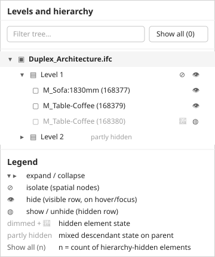

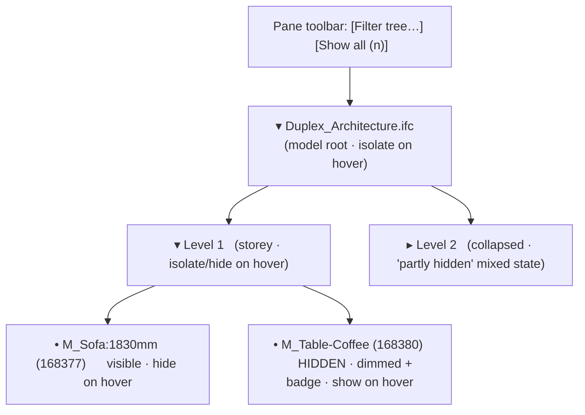

Row anatomy (left → right): `[chevron if parent] [type icon] [single-line label, ellipsis] … [hover/focus action icons: isolate for spatial, hide/show for all]`. Depth is expressed purely through Fluent tree indentation; the label never wraps.

The **type icon** distinguishes node kinds so the tree reads at a glance: `IfcSpace`/`IfcZone`/`IfcSpatialZone` use a dedicated room icon (not the layers icon used for storeys and sites), buildings use a building icon, the project and generic spatial containers use a folder icon, and contained products use a box icon. Spaces and zones are valid, expected spatial-structure entities (rooms/zones), not file errors; the distinct icon prevents them from being mistaken for storeys.

## Requirements

- **R1 — Tree structure.** Present each loaded model as a top-level node, then its available project/site/building/storey/spatial containment and contained elements, built with `fluent-tree`/`fluent-tree-item`. Depth is shown by the component's indentation; every expandable node has a chevron and supports expand/collapse by pointer and keyboard.
- **R2 — Stable identity.** Use model-scoped element identities; duplicate names and repeated express IDs across models remain distinguishable (model-scoped `{ modelId, expressId }`). If loaded models have the same display name, append a session model-ID disambiguator to their root labels.
- **R3 — Node affordances.** Provide select, hide/show, and isolate/restore for supported nodes. Spatial nodes and the model root support **isolate**; all nodes support **hide/show**. Isolation is reversible and removes no data. Model-level visibility is the outer gate; hierarchy isolation adds a reversible element-level mask and must never reveal a model hidden in Model Controls.
- **R4 — Single-line rows (fixes the defect).** Each row renders on **one line**: `[chevron?] [type icon] [label …ellipsis]`. The label is truncated with an ellipsis and exposes the full text via `title`/tooltip. Rows must not wrap at the 1280-px minimum viewport, and action controls must not push the label onto another line.
- **R5 — Hover/focus actions, not permanent text buttons.** Visibility actions are compact, focusable Fluent icon buttons shown on row hover and keyboard focus; the focused action is activated with standard button keyboard behavior. A separate context menu and always-visible checkboxes are not required. Icons carry accessible names ("Hide <node>", "Show <node>", "Isolate <node>").
- **R6 — Visible hidden & mixed state.** Hidden elements/nodes stay listed with a clear hidden state (dimmed row + hidden icon with an accessible label). A node whose descendants are partly hidden shows a **mixed ("partly hidden")** state. A live **count of hidden elements** is shown in the toolbar ("Show all (n)"). Hidden elements remain reachable through tree navigation, [search](model-search.md) and [filter](model-filtering.md) results (which must indicate hidden state) so they can be selected or unhidden. Hide adds to a hidden set; isolate temporarily hides everything outside the node and restoring returns the prior hidden set unchanged; **Show all** clears the hidden set and any isolation across all models but never reveals a model hidden in Model Controls.
- **R7 — Filter box.** A filter/search input in the pane toolbar narrows visible rows to matching nodes (and their ancestors) by name/class. Clearing it restores the full tree. Filtering is non-destructive and does not change visibility.
- **R8 — Robust relations.** Clearly handle absent, incomplete, cyclic, or unsupported spatial relationships without hanging or hiding the whole model; orphaned elements appear under a labelled fallback container.
- **R9 — Bounded DOM.** Keep hierarchy queries behind the IFC adapter and **virtualize or lazily expand** large trees so DOM work stays bounded and expansion stays responsive.
- **R10 — Fluent & tokens.** Build with the registered Fluent 2 Tree components and shared design tokens (type ramp, 4-px spacing scale, 32-px default / 24-px compact control sizes, caption/body sizes) per the [Fluent 2 design policy](fluent2-design-system.md#design-policy). Use the tree's `aside` slot for action buttons; the current implementation demonstrates that this fits without a new shared component or a recorded design-system deviation.
- **R11 — Selection sync.** Selecting a tree row sets the current selection and highlight; changing selection elsewhere marks the corresponding row active and reveals it in the tree.

## Acceptance Criteria

- [x] AC1: Given a loaded model, when the pane opens, then each model is a collapsible top-level `fluent-tree-item` with chevrons, per-level indentation, and no row wrapping at 1280×720. *(E2E "renders an indented Fluent tree …".)*
- [ ] AC2: Given two models with overlapping filenames and express IDs, when both are browsed, then their branches remain distinguishable in the UI and their nodes retain separate model-scoped identities. *(Rows are internally keyed by `{modelId, expressId}`, but the current root label shows only `model.name`; a visible disambiguator and browser assertion are still needed.)*
- [x] AC3: Given a parent node, when its chevron is toggled by pointer or keyboard (`Enter`/`Right`/`Left`), then it expands/collapses and children are built lazily on first expand. *(Partial evidence: pointer expansion and lazy build are verified in E2E; keyboard expansion relies on the Fluent tree's roving-tabindex model and is not separately asserted.)*
- [x] AC4: Given a long element label, when the row renders, then it stays on one line, is ellipsis-truncated, and shows the full text on hover (`title`). *(E2E asserts `white-space: nowrap`, `overflow: hidden`, single line, and a non-empty `title`.)*
- [ ] AC5: Given a row, when it is hovered or keyboard-focused, then compact hide/show (all nodes) and isolate (spatial/root) icon actions appear with accessible names; they are not present as permanent text buttons. *(Hover reveal and aria labels are asserted in E2E; keyboard-focus reveal is not tested, so this stays open.)*
- [x] AC6: Given several hidden elements/nodes, then they remain listed dimmed with a hidden badge, ancestors show a mixed state, and the toolbar shows an accurate "Show all (n)" count. *(E2E "hides elements …".)*
- [x] AC7: Given hidden/isolated state, when **Show all** is activated, then every hierarchy-hidden element returns and isolation clears, while a model hidden in Model Controls stays hidden. *(Hide/restore verified in E2E; the model-level guarantee is code reasoning — `ElementVisibility.showAll()` never reveals a model hidden at the model level — not a browser assertion.)*
- [x] AC8: Given a model hidden in Model Controls, when hierarchy isolation is applied and cleared, then the model stays hidden until its model-level visibility is explicitly restored. *(Code reasoning only: model-level visibility is the outer gate in the viewer adapter and the feature only drives the element-level mask; no browser test yet.)*
- [x] AC9: Given text in the filter box, then the tree narrows to matching nodes and their ancestors; clearing restores the full tree; visibility is unchanged. *(E2E filter/clear cycle.)*
- [x] AC10: Given a model with missing/malformed/cyclic spatial relations, when it loads, then elements still appear (under a labelled fallback if needed) with bounded, understandable behaviour and no hang. *(Adapter builds the `HierarchyNode` tree with fallback containment; unit-tested via `malformed-spatial.ifc`.)*
- [x] AC11: Given a large hierarchy, when it is expanded, then the UI stays responsive (lazy/virtualized) and disposal leaves no subscriptions or orphaned DOM. *(Partial evidence: lazy build is verified in E2E; disposal cleanup is code reasoning and no large-model timing is recorded.)*
- [x] AC12: Given a selection made in the tree or the 3D view, then the other side reflects it (highlight in view; active + revealed row in tree). *(Selection subscribe marks the active row and reveals it by expanding/building ancestors.)*

## Test Cases (for developers)

| ID | Type | Precondition | Steps | Expected result |
|----|------|--------------|-------|-----------------|
| T1 | E2E (Chrome) | Multi-storey fixture loaded | Open the pane | Indented tree with chevrons; no row wraps at 1280×720 (AC1, AC4) |
| T2 | Unit/E2E | Two models, duplicate express IDs | Expand both; select same express ID in each | Distinct nodes; selection targets correct `{modelId, expressId}` (AC2, AC12) |
| T3 | E2E | Collapsed parent | Toggle chevron by mouse, then by `Enter`/arrow keys | Expands/collapses; children built on first expand (AC3) |
| T4 | E2E | Element with a very long name | Inspect the row | Single line, ellipsis, full name in `title` (AC4) |
| T5 | E2E | Any row | Hover, then Tab-focus the row | Hide/show + isolate icon actions appear with aria labels; no permanent text buttons (AC5) |
| T6 | E2E | Several nodes hidden | Hide elements across storeys | Rows dimmed + badge; parents mixed; "Show all (n)" count correct (AC6) |
| T7 | E2E | Hidden + isolated state | Activate Show all | All hierarchy-hidden return; isolation cleared (AC7) |
| T8 | E2E | Model hidden in Model Controls | Apply then clear hierarchy isolate | Model stays hidden until model-level visibility restored (AC8) |
| T9 | E2E | Populated tree | Type a term in filter; clear it | Tree narrows to matches + ancestors; clearing restores; visibility unchanged (AC9) |
| T10 | Unit/E2E | Malformed/cyclic relations fixture | Load and open pane | Elements listed (fallback container if needed); no hang (AC10) |
| T11 | Perf/E2E | Large hierarchy fixture | Expand deeply; dispose feature | Responsive; lazy/virtualized; no leaked subscriptions/DOM (AC11) |
| T12 | Lint/visual | Built pane | Inspect markup/tokens | Uses `fluent-tree`/`fluent-tree-item` and shared tokens; no off-ramp sizes/spacing (R10) |

## Module Contract

- Public entrypoint: `mountModelHierarchy` under `src/features/model-hierarchy/`.
- Owns tree UI, expansion/filter state, and tree event handlers. Selection and composed visibility remain owned by their shared capabilities (`SelectionCapability`, `ElementVisibility`); the feature calls them and never mutates scene nodes directly.
- Disposal removes subscriptions and DOM and restores only temporary isolation state owned by this feature.

## Dependencies

- [IFC loading](ifc-loading.md), [Element selection](element-selection.md), [Model controls](model-controls.md), [Model search](model-search.md), [Model filtering](model-filtering.md), [Fluent 2 Design System](fluent2-design-system.md), [Viewer tool sidebar](viewer-tool-sidebar.md), and [overall architecture](../architecture.md).
- Visibility uses the single authoritative composed model/element visibility contract; features do not mutate scene nodes directly. Model-level visibility dominates element-level hierarchy isolation; [Filter](model-filtering.md) is non-visual and never writes to visibility.

## Assumptions

- The existing `HierarchyNode`/`ModelHierarchy`/`HierarchyQuery` data contracts and the `SelectionCapability`/`ElementVisibility` contracts are sufficient; only the UI layer and its wiring change.
- `fluent-tree`/`fluent-tree-item` (already registered) provide chevron, indentation, roving-tabindex keyboard model, and the `aside` slot; the current implementation hosts the hover/focus action buttons there without a new shared component or recorded deviation (R10).
- Virtualization applies within an expanded branch; collapsed branches are not built until expanded.

## Out of Scope

- Editing IFC containment, reparenting, or authoring new groups.
- Persisting expansion/visibility/selection across reloads.
- Multi-select of tree nodes (single selection only, per the selection contract) unless added by a separate spec.

## Open Questions

- Resolved: hover/focus icon buttons are sufficient; checkboxes and a context menu are not required (R5). The `aside` slot hosts the actions without a deviation (R10).
- What visible disambiguator should duplicate model names use (R2 says a session model ID; confirm wording before closing AC2)?
- Should the filter box be the hierarchy's own control or reuse the shared [search](model-search.md) input to avoid two search surfaces?

## Sources

Accessed 2026-11-08 unless noted.

- **[S1]** Trimble Connect for Browser — Model Hierarchies — https://help.trimble.com/doc/trimble-connect/trimble-connect/connect-for-browsers-3d-viewer/models/model-hierarchies. Text-only; expand arrow before the visibility control; tree in Selected Models mode, only when the model is visible.
- **[S2]** Trimble Connect for Browser — Visibility Tools — https://help.trimble.com/doc/trimble-connect/trimble-connect/connect-for-browsers-3d-viewer/work-in-3d/visibility-tools. Text-only; hide/isolate/show visibility tools.
- **[S3]** APS Viewer v7 — `ModelStructurePanel` — https://aps.autodesk.com/en/docs/viewer/v7/reference/UI/ModelStructurePanel/. Panel to explore the model and set node visibility/selection.
- **[S4]** Solibri — Model Hierarchies in the Model Tree View — https://help.solibri.com/hc/en-us/articles/1500003935741-Model-Hierarchies-in-the-Model-Tree-View. Containment, component, layer and federated-floor views; four screenshots captured.
- **[S5]** Solibri — "Solibri Anywhere 02: Model Tree and Info" — https://www.youtube.com/watch?v=18Qd1DmgGtI. Transcript cues: 00:10 containment (file → project → site → building → storeys → objects); 00:39 "Whatever you select either in the model tree or using the info tool in the 3D view will be displayed in the info panel"; 00:56 component hierarchy; 01:44 layer view from IFC representation layers; 02:28 federated floor from storey information.
- **[S6]** Trimble Community — "Trimble Connect for Windows - Saved View does not retain Object Visibility (Layer On/Off Status)" — https://community.trimble.com/discussion/trimble-connect-for-windows-saved-view-does-not-retain-object-visibility-layer-onoff-status. Posted 29 Apr 2025; replies 30 Apr 2025 (seen with the Revit plugin, not .trb/.ifc), 9 Jul 2025 (same problem), 10 Jul 2025 (reported for years, desktop-only).
- **[S7]** Trimble Community — "Hide objects by filter" — https://community.trimble.com/question/hide-objects-by-filter. 19 Sep 2025: Ctrl-A selects the list but hide/colour applies to one object.
- **[S8]** Solibri Society — "Layers in Solibri Model tree" — https://society.solibri.com/topic/671/layers-in-solibri-model-tree. 29 May 2020, build 9.10.8.29: identical layers from two linked Revit IFCs kept as separate per-model layers; no replies.
- **[S9]** APS Viewer v7 — `ModelStructureExtension` — https://aps.autodesk.com/en/docs/viewer/v7/reference/Extensions/ModelStructureExtension/. Opens the structure panel for 3D models.
- **[S10]** APS Viewer v7 — Developer's guide overview — https://aps.autodesk.com/en/docs/viewer/v7/developers_guide/overview/. General viewer context.
- **[S11]** Fluent 2 — Tree storybook — https://storybooks.fluentui.dev/react/?path=/docs/components-tree--docs. Chevrons, indentation, keyboard model; screenshot `model-hierarchy/assets/fluent-tree-default.png`.
- **[S12]** AEC Software Technology — "Working in 3D Viewer - Trimble Connect" (19:11) — https://www.youtube.com/watch?v=n03b3NcPLvo. Transcript `trimble-viewer-transcript.en.vtt` (409 cues, verified identical to a fresh download). 11:35–11:55 show all / hide and a temporary ghost toggle for hidden objects; 16:06–16:28 isolate, un-isolate, show all hidden. Visibility evidence only.
- **[S13]** Capture commands — `model-hierarchy/assets/_capture.mjs` (Playwright Chrome screenshots of [S4]) and `model-hierarchy/assets/_capture_video.py` (`yt-dlp -f "bv*[height<=720]+ba/b[height<=720]" --merge-output-format mp4 --write-auto-subs --sub-langs en --sub-format vtt`, then `ffmpeg` frames at 00:10, 00:39, 00:56, 01:44, 02:28). The full video is deleted after extraction; only stills and the transcript are kept.
- **[A1]** Approved app decisions and the local implementation in `src/features/model-hierarchy/` (not external evidence).
- Background: [Phase 1 viewer market research](../research/phase-1-viewer-market-research.md).

# Research

| Asset | Shows | Supports |
|---|---|---|
| 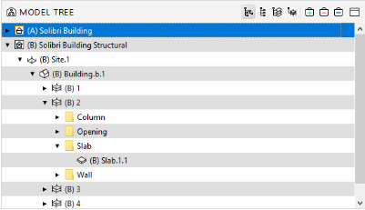 | Solibri containment tree (help) | Containment default [S4] |
| 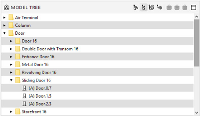 | Component (by-type) grouping | Alternate mode, out of scope [S4] |
| 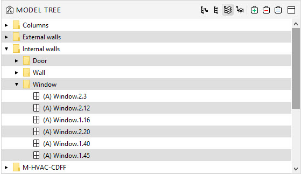 | Layer grouping | Alternate mode; per-model identity [S4, S8] |
| 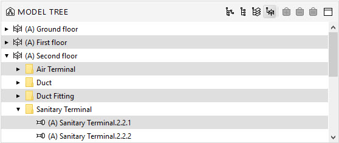 | Federated floors | Alternate mode, out of scope [S4] |
| 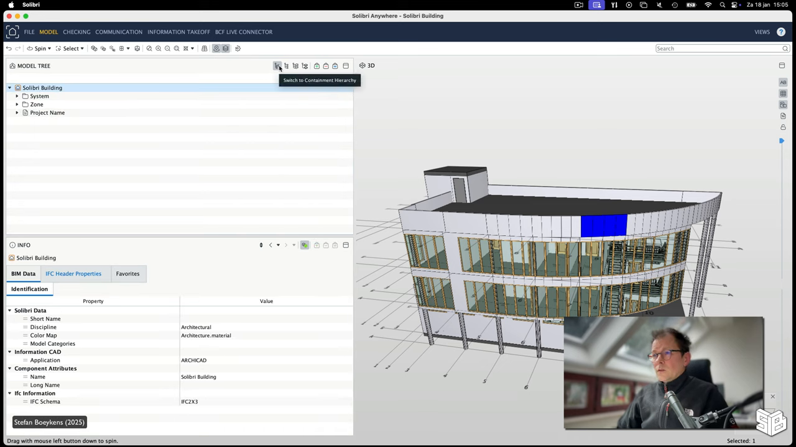 | Containment tree in the video | Containment default [S5] |
| 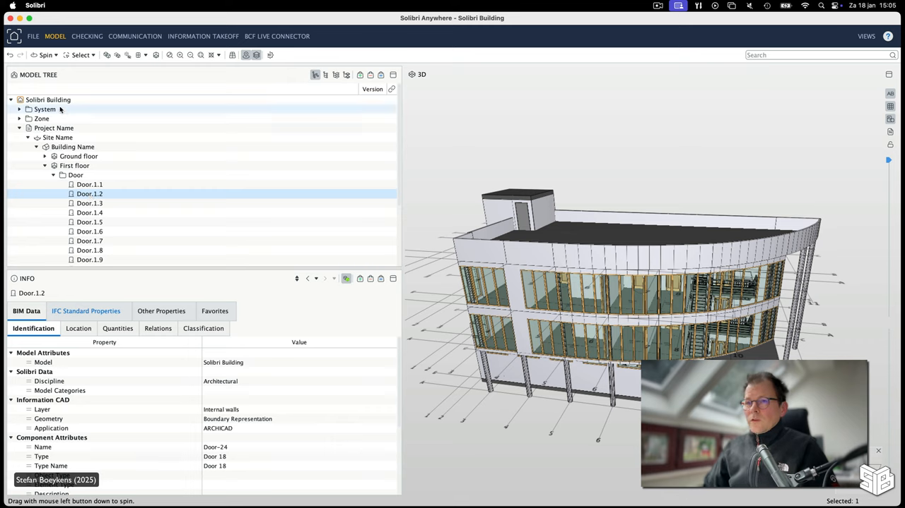 | Model tree beside Info panel | Bidirectional selection [S5] |
| 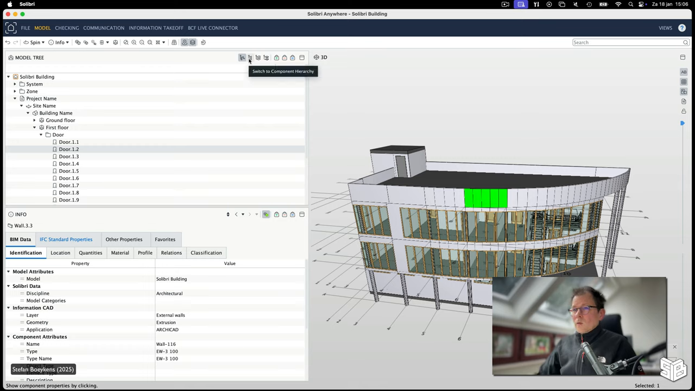 | Component hierarchy | Alternate mode [S5] |
| 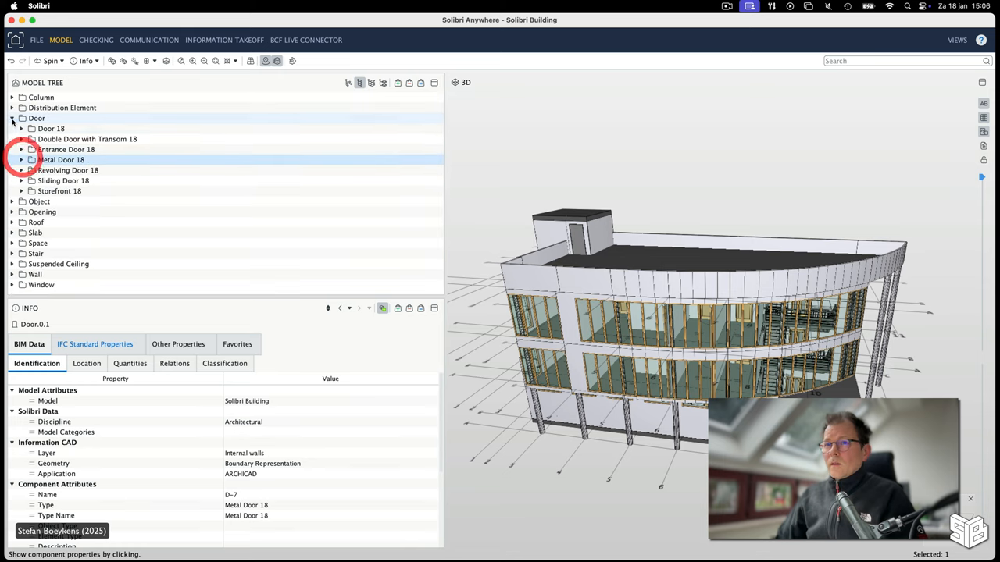 | Layer view | Alternate mode [S5] |
| 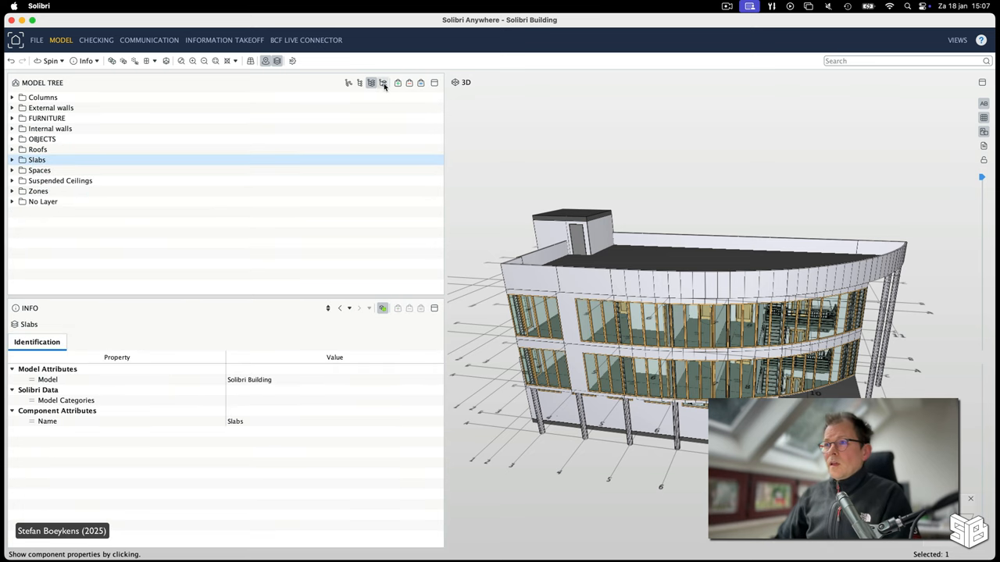 | Federated floor view | Alternate mode [S5] |
|  | Fluent 2 Tree | Component reference [S11] |
