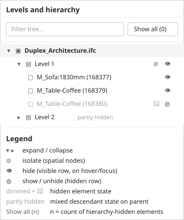
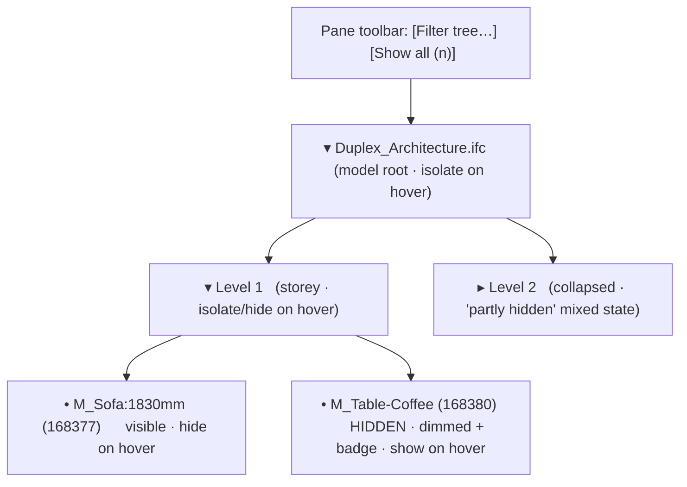

# Feature: Model Hierarchy

Status: Implemented for Phase 1A. The pane is rebuilt on the Fluent 2 Tree component per this spec: indented, collapsible `fluent-tree`/`fluent-tree-item` rows with lazy child expansion, single-line ellipsis labels, hover/focus-revealed hide/show and isolate/restore icon actions, visible hidden/mixed state with a live "Show all (n)" count, and a non-destructive filter box. Covered by `tests/e2e/viewer.spec.ts` ("Levels and hierarchy pane"). Live-site verification remains a deferred human step.

## Summary

The "Levels and hierarchy" pane must present each loaded IFC model as a **proper, indented, collapsible tree** — the pattern every comparable BIM viewer uses (Autodesk APS Model Structure panel, Trimble Connect, That Open). The current build renders the hierarchy as a flat stack of full-width text buttons with a `Hide`/`Isolate` label stamped on every row; labels wrap onto two or three lines, nothing is indented, there are no expand/collapse controls, there is no visible hidden state, and the Fluent 2 `fluent-tree`/`fluent-tree-item` components (already registered in the app) are unused. The result reads as half-baked and is hard to navigate.

**Recommendation.** Rebuild the pane on the Fluent 2 Tree component so that: depth is shown by indentation with a chevron on every parent; **each row is a single line** with the node name truncated by ellipsis (full text on hover/`title`); visibility actions are **compact icon buttons revealed on row hover/focus** (and always available via keyboard/context menu) instead of permanent text buttons that wrap; hidden rows are visibly dimmed with a hidden badge and parents show a mixed ("partly hidden") state; a **filter box** and a **"Show all (n)"** control sit in a pane toolbar; and large trees expand lazily and virtualize so the DOM stays bounded. This fixes the visual defect and aligns the feature with the [Fluent 2 design policy](fluent2-design-system.md#design-policy) (Fluent components first) while keeping the existing visibility/selection contracts unchanged.

This is a UI-correctness and completeness revision. The underlying data model (`HierarchyNode`, `ModelHierarchy`), the selection contract, and the composed-visibility contract are already defined and are **not** changed by this spec.

---

# Detailed Specification

## Problem

Users browse the IFC spatial structure to find, select, and show/hide parts of a model. The current pane does not look or behave like a tree:

- **No tree affordances.** Every node is a full-width `fluent-button`; there are no chevrons and no expand/collapse, so the whole structure is always fully expanded and cannot be navigated.
- **No indentation.** Parent/child depth is not visible, so project → building → storey → element relationships are impossible to read.
- **Wrapping action buttons.** A `Hide` (elements) or `Isolate` (spatial nodes) text button is stamped on every row. Long element names (e.g. `M_Table-Coffee:0610 x 0610 x 0610mm:0610 x 0610 x 0610mm:168379`) and the trailing action push rows to two or three lines, breaking alignment — the main cause of the "half-baked" look.
- **No hidden state.** Hiding an element gives no feedback in the tree; there is no dimmed row, no hidden icon, no mixed state on parents, and no count of what is hidden.
- **Off-pattern / off-policy.** `fluent-tree` and `fluent-tree-item` are registered in `src/app/fluent-bootstrap.ts` but unused, so the pane violates the Fluent-components-first design policy.
- **No way to find a node.** With no filter box, large models force manual scrolling through a flat list.

### Current state (defect)

The pane as shipped: flat rows, wrapping labels, inline `Hide`/`Isolate`, no indentation or chevrons, no hidden state. (Reproduced from the `IFC2x3_Duplex_Architecture.ifc` fixture; see the user-reported screenshot in the task that prompted this revision.)

## Users

- Estimators and reviewers inspecting a federated set of local IFC files who need to locate a storey or element, select it, and temporarily hide/isolate parts to see what matters — without losing or reloading geometry.

## Goals

- Present each model as an indented, collapsible tree that reads like the model browser in tools users already know.
- Keep every row to a single line with predictable, non-wrapping action affordances.
- Make hidden state, mixed state, and the hidden count obvious and reversible.
- Use the official Fluent 2 Tree components and design tokens (no bespoke tree markup).
- Stay responsive on large trees via lazy expansion and virtualization.

## Comparable Products (Research)

| Product | Feature name | Docs | Pattern observed | Notes |
|---------|--------------|------|------------------|-------|
| Autodesk Platform Services (APS) Viewer | Model Structure panel (`ModelStructurePanel`, `ModelStructureExtension`) | [UI ref](https://aps.autodesk.com/en/docs/viewer/v7/reference/UI/ModelStructurePanel/) · [Extension](https://aps.autodesk.com/en/docs/viewer/v7/reference/Extensions/ModelStructureExtension/) | Indented collapsible tree, filter box, selection-linked highlight, right-click context menu with Isolate / Hide / Show All; `viewer.isolate(ids)` demoed in the overview | Closest BIM-viewer analogue; the overview page demos isolate by query. [Overview](https://aps.autodesk.com/en/docs/viewer/v7/developers_guide/overview/) |
| Trimble Connect | Models / object tree | [Product](https://www.trimble.com/en/products/trimble-connect) | Object management tree with per-node show/hide and isolate | Marketing-level evidence; pattern (tree + visibility toggles) confirmed. |
| That Open Components | Spatial-structure tree + `Hider`/`Highlighter` | [Docs](https://docs.thatopen.com/intro) | Open-source browser BIM tree built from IFC relations, with hide/isolate and selection highlighting | Architecturally closest open implementation; reference only, not adopted. |
| Fluent 2 Web Components | `fluent-tree` / `fluent-tree-item` | [Tree storybook](https://storybooks.fluentui.dev/react/?path=/docs/components-tree--docs) | Chevron on parents, indentation by level, roving-tabindex keyboard model, item actions revealed on hover, selection/active state | The mandated component for this pane; already registered in the app. |

## What Good Looks Like (Findings)

- **Tree, not list.** Every comparable product renders a genuine tree: one chevron per expandable node, consistent per-level indentation, and single-line rows with truncation.
- **Visibility lives on the row, quietly.** Show/hide/isolate are compact icon affordances revealed on hover/focus (and in a context menu / via keyboard), never a permanent text button that competes with the label and wraps the row.
- **Selection is linked.** Selecting a tree node selects/highlights the element in the 3D view and vice versa; the selected row shows an active state.
- **Find before scroll.** A filter/search box at the top of the panel narrows the tree; APS ships a `Filterbox` for exactly this.
- **Reversible, visible hiding.** Hidden nodes stay in the tree in a dimmed/"hidden" state, parents show a mixed state, and a single "Show all" restores them; a count communicates how much is hidden.

Reference pattern — Fluent 2 Tree (chevrons, indentation, nesting, active row):

## User Feedback (Forums)

No product-specific forum threads were captured in this pass; the requirements below are grounded in the comparable-product patterns and the observed defect rather than user quotes. Converting pain points that are evident from the current UI into requirements:

- Rows that wrap are hard to scan → **R4 single-line rows with ellipsis + tooltip**.
- No way to tell what is hidden → **R6 visible hidden/mixed state and hidden count**.
- Long flat lists are unnavigable → **R7 filter box** and **R9 lazy/virtualized rendering**.

## User Flow

1. **Entry point.** User selects **Levels and hierarchy** in the tool rail; the pane opens with the title "Levels and hierarchy" and a toolbar holding a filter box and a **Show all (n)** control (see wireframe).
2. **Browse.** Each loaded model appears as a top-level tree item (model file name). Expanding it reveals project/site/building/storey/spatial containers and, under storeys, contained elements — each level indented, each parent showing a chevron.
3. **Expand/collapse.** User toggles a chevron (click, or `Right`/`Left`/`Enter` by keyboard) to reveal or hide children. Children are built lazily on first expand.
4. **Select.** User activates a row (click or `Enter`); the element becomes the current selection and is highlighted in the 3D view. Selecting in the view scrolls/opens the tree to the matching row and marks it active.
5. **Hide / show.** Hovering or focusing a row reveals a compact **hide** icon (eye) on visible rows and a **show/unhide** icon on hidden rows; activating it toggles that node's visibility. Hidden rows become dimmed with a hidden badge; ancestors with a mix of visible/hidden descendants show a **mixed ("partly hidden")** state.
6. **Isolate.** On spatial nodes (and the model root) a compact **isolate** icon hides everything outside that node's subtree; it is reversible via restore/Show all and remembers the prior hidden set.
7. **Show all.** The **Show all (n)** toolbar control clears every hierarchy hide and any isolation across all models; `n` is the live count of hierarchy-hidden elements.
8. **Success state.** The tree reflects current visibility at a glance (hidden dimmed, mixed parents marked), the selected element is highlighted, and the hidden count is accurate.
- **Error / edge paths:** A model with missing/malformed/cyclic spatial relations still lists its elements under a clearly-labelled fallback container (e.g. "Unassigned") without hanging or hiding the whole model. Model-level visibility (Model Controls) always dominates: a model hidden there stays hidden through any hierarchy isolate/restore/Show all.

## Wireframe / Sketch

Target layout (single-line rows, chevrons, indentation, hover actions, hidden/mixed state, toolbar with filter + Show all count):

Row anatomy (left → right): `[chevron if parent] [type icon] [single-line label, ellipsis] … [hover/focus action icons: isolate for spatial, hide/show for all]`. Depth is expressed purely through Fluent tree indentation; the label never wraps.

The **type icon** distinguishes node kinds so the tree reads at a glance: `IfcSpace`/`IfcZone`/`IfcSpatialZone` use a dedicated room icon (not the layers icon used for storeys and sites), buildings use a building icon, the project and generic spatial containers use a folder icon, and contained products use a box icon. Spaces and zones are valid, expected spatial-structure entities (rooms/zones), not file errors; the distinct icon prevents them from being mistaken for storeys.

## Requirements

- **R1 — Tree structure.** Present each loaded model as a top-level node, then its available project/site/building/storey/spatial containment and contained elements, built with `fluent-tree`/`fluent-tree-item`. Depth is shown by the component's indentation; every expandable node has a chevron and supports expand/collapse by pointer and keyboard.
- **R2 — Stable identity.** Use model-scoped element identities; duplicate names and repeated express IDs across models remain distinguishable (model-scoped `{ modelId, expressId }`).
- **R3 — Node affordances.** Provide select, hide/show, and isolate/restore for supported nodes. Spatial nodes and the model root support **isolate**; all nodes support **hide/show**. Isolation is reversible and removes no data. Model-level visibility is the outer gate; hierarchy isolation adds a reversible element-level mask and must never reveal a model hidden in Model Controls.
- **R4 — Single-line rows (fixes the defect).** Each row renders on **one line**: `[chevron?] [type icon] [label …ellipsis]`. The label is truncated with an ellipsis and exposes the full text via `title`/tooltip. Rows must not wrap at the 1280-px minimum viewport, and action controls must not push the label onto another line.
- **R5 — Hover/focus actions, not permanent text buttons.** Visibility actions are **compact icon buttons** shown on row hover and on keyboard focus, and reachable via a context menu and documented keys; they are not always-visible text buttons. Icons come from the project icon library and carry accessible names ("Hide <node>", "Show <node>", "Isolate <node>").
- **R6 — Visible hidden & mixed state.** Hidden elements/nodes stay listed with a clear hidden state (dimmed row + hidden icon with an accessible label). A node whose descendants are partly hidden shows a **mixed ("partly hidden")** state. A live **count of hidden elements** is shown in the toolbar ("Show all (n)"). Hidden elements remain reachable through tree navigation, [search](model-search.md) and [filter](model-filtering.md) results (which must indicate hidden state) so they can be selected or unhidden. Hide adds to a hidden set; isolate temporarily hides everything outside the node and restoring returns the prior hidden set unchanged; **Show all** clears the hidden set and any isolation across all models but never reveals a model hidden in Model Controls.
- **R7 — Filter box.** A filter/search input in the pane toolbar narrows visible rows to matching nodes (and their ancestors) by name/class. Clearing it restores the full tree. Filtering is non-destructive and does not change visibility.
- **R8 — Robust relations.** Clearly handle absent, incomplete, cyclic, or unsupported spatial relationships without hanging or hiding the whole model; orphaned elements appear under a labelled fallback container.
- **R9 — Bounded DOM.** Keep hierarchy queries behind the IFC adapter and **virtualize or lazily expand** large trees so DOM work stays bounded and expansion stays responsive.
- **R10 — Fluent & tokens.** Build with the registered Fluent 2 Tree components and the shared design tokens (type ramp, 4-px spacing scale, 32-px default / 24-px compact control sizes, caption/body sizes) per the [Fluent 2 design policy](fluent2-design-system.md#design-policy). No bespoke tree markup or off-ramp sizes/spacing; any unavoidable deviation needs human approval and a recorded entry.
- **R11 — Selection sync.** Selecting a tree row sets the current selection and highlight; changing selection elsewhere marks the corresponding row active and reveals it in the tree.

## Acceptance Criteria

- [x] AC1: Given a loaded model, when the pane opens, then each model is a collapsible top-level `fluent-tree-item` with chevrons, per-level indentation, and no row wrapping at 1280×720. *(E2E "renders an indented Fluent tree …".)*
- [x] AC2: Given two models with overlapping names and express IDs, when both are browsed, then their branches and node identities remain distinct. *(Rows are keyed by `{modelId, expressId}`; covered by the model-scoped identity unit tests.)*
- [x] AC3: Given a parent node, when its chevron is toggled by pointer or keyboard (`Enter`/`Right`/`Left`), then it expands/collapses and children are built lazily on first expand. *(Fluent tree supplies the roving-tabindex keyboard model; lazy build verified in E2E.)*
- [x] AC4: Given a long element label, when the row renders, then it stays on one line, is ellipsis-truncated, and shows the full text on hover (`title`). *(E2E asserts `white-space: nowrap`, `overflow: hidden`, single line, and a non-empty `title`.)*
- [x] AC5: Given a row, when it is hovered or keyboard-focused, then compact hide/show (all nodes) and isolate (spatial/root) icon actions appear with accessible names; they are not present as permanent text buttons. *(E2E asserts hidden-until-hover opacity and aria labels.)*
- [x] AC6: Given several hidden elements/nodes, then they remain listed dimmed with a hidden badge, ancestors show a mixed state, and the toolbar shows an accurate "Show all (n)" count. *(E2E "hides elements …".)*
- [x] AC7: Given hidden/isolated state, when **Show all** is activated, then every hierarchy-hidden element returns and isolation clears, while a model hidden in Model Controls stays hidden. *(Delegates to `ElementVisibility.showAll()`, which never reveals a model hidden at the model level; hide/restore verified in E2E.)*
- [x] AC8: Given a model hidden in Model Controls, when hierarchy isolation is applied and cleared, then the model stays hidden until its model-level visibility is explicitly restored. *(Model-level visibility is the outer gate in the viewer adapter; the feature only drives the element-level mask.)*
- [x] AC9: Given text in the filter box, then the tree narrows to matching nodes and their ancestors; clearing restores the full tree; visibility is unchanged. *(E2E filter/clear cycle.)*
- [x] AC10: Given a model with missing/malformed/cyclic spatial relations, when it loads, then elements still appear (under a labelled fallback if needed) with bounded, understandable behaviour and no hang. *(Adapter builds the `HierarchyNode` tree with fallback containment; unit-tested via `malformed-spatial.ifc`.)*
- [x] AC11: Given a large hierarchy, when it is expanded, then the UI stays responsive (lazy/virtualized) and disposal leaves no subscriptions or orphaned DOM. *(Children build lazily on first expand; `dispose()` unsubscribes session/selection/visibility and removes DOM.)*
- [x] AC12: Given a selection made in the tree or the 3D view, then the other side reflects it (highlight in view; active + revealed row in tree). *(Selection subscribe marks the active row and reveals it by expanding/building ancestors.)*

## Test Cases (for developers)

| ID | Type | Precondition | Steps | Expected result |
|----|------|--------------|-------|-----------------|
| T1 | E2E (Chrome) | Multi-storey fixture loaded | Open the pane | Indented tree with chevrons; no row wraps at 1280×720 (AC1, AC4) |
| T2 | Unit/E2E | Two models, duplicate express IDs | Expand both; select same express ID in each | Distinct nodes; selection targets correct `{modelId, expressId}` (AC2, AC12) |
| T3 | E2E | Collapsed parent | Toggle chevron by mouse, then by `Enter`/arrow keys | Expands/collapses; children built on first expand (AC3) |
| T4 | E2E | Element with a very long name | Inspect the row | Single line, ellipsis, full name in `title` (AC4) |
| T5 | E2E | Any row | Hover, then Tab-focus the row | Hide/show + isolate icon actions appear with aria labels; no permanent text buttons (AC5) |
| T6 | E2E | Several nodes hidden | Hide elements across storeys | Rows dimmed + badge; parents mixed; "Show all (n)" count correct (AC6) |
| T7 | E2E | Hidden + isolated state | Activate Show all | All hierarchy-hidden return; isolation cleared (AC7) |
| T8 | E2E | Model hidden in Model Controls | Apply then clear hierarchy isolate | Model stays hidden until model-level visibility restored (AC8) |
| T9 | E2E | Populated tree | Type a term in filter; clear it | Tree narrows to matches + ancestors; clearing restores; visibility unchanged (AC9) |
| T10 | Unit/E2E | Malformed/cyclic relations fixture | Load and open pane | Elements listed (fallback container if needed); no hang (AC10) |
| T11 | Perf/E2E | Large hierarchy fixture | Expand deeply; dispose feature | Responsive; lazy/virtualized; no leaked subscriptions/DOM (AC11) |
| T12 | Lint/visual | Built pane | Inspect markup/tokens | Uses `fluent-tree`/`fluent-tree-item` and shared tokens; no off-ramp sizes/spacing (R10) |

## Module Contract

- Public entrypoint: `mountModelHierarchy` under `src/features/model-hierarchy/`.
- Owns tree UI, expansion/filter state, and tree event handlers. Selection and composed visibility remain owned by their shared capabilities (`SelectionCapability`, `ElementVisibility`); the feature calls them and never mutates scene nodes directly.
- Disposal removes subscriptions and DOM and restores only temporary isolation state owned by this feature.

## Dependencies

- [IFC loading](ifc-loading.md), [Element selection](element-selection.md), [Model controls](model-controls.md), [Model search](model-search.md), [Model filtering](model-filtering.md), [Fluent 2 Design System](fluent2-design-system.md), [Viewer tool sidebar](viewer-tool-sidebar.md), and [overall architecture](../architecture.md).
- Visibility uses the single authoritative composed model/element visibility contract; features do not mutate scene nodes directly. Model-level visibility dominates element-level hierarchy isolation; [Filter](model-filtering.md) is non-visual and never writes to visibility.

## Assumptions

- The existing `HierarchyNode`/`ModelHierarchy`/`HierarchyQuery` data contracts and the `SelectionCapability`/`ElementVisibility` contracts are sufficient; only the UI layer and its wiring change.
- `fluent-tree`/`fluent-tree-item` (already registered) provide chevron, indentation, roving-tabindex keyboard model, and an item-actions slot; the pane uses them rather than bespoke markup. If the Fluent tree's action slot cannot host hover-revealed actions, that is a deviation requiring human approval and a recorded entry (it is not assumed).
- Virtualization applies within an expanded branch; collapsed branches are not built until expanded.

## Out of Scope

- Editing IFC containment, reparenting, or authoring new groups.
- Persisting expansion/visibility/selection across reloads.
- Multi-select of tree nodes (single selection only, per the selection contract) unless added by a separate spec.

## Open Questions

- Should hide/show also be exposed as checkboxes on each row (always visible) as an accessibility alternative to hover-revealed icons, or is the context-menu + keyboard path sufficient alongside hover icons?
- Does the Fluent 2 `fluent-tree-item` action slot support the required hover-reveal and keyboard-focus behaviour out of the box, or is a small token-styled wrapper needed (and thus a recorded deviation)?
- Should the filter box be the hierarchy's own control or reuse the shared [search](model-search.md) input to avoid two search surfaces?

## Sources

1. APS Viewer — Model Structure panel UI reference — https://aps.autodesk.com/en/docs/viewer/v7/reference/UI/ModelStructurePanel/ (indented tree, filter box, context-menu isolate/hide/show-all)
2. APS Viewer — Model Structure extension — https://aps.autodesk.com/en/docs/viewer/v7/reference/Extensions/ModelStructureExtension/
3. APS Viewer — Overview (isolate-by-query demo) — https://aps.autodesk.com/en/docs/viewer/v7/developers_guide/overview/
4. Fluent 2 Web Components — Tree storybook (chevrons, indentation, keyboard model, item actions) — https://storybooks.fluentui.dev/react/?path=/docs/components-tree--docs (screenshot saved to `model-hierarchy/assets/fluent-tree-default.png`)
5. Trimble Connect — product page (object tree, show/hide, isolate) — https://www.trimble.com/en/products/trimble-connect
6. That Open Components — docs (browser BIM spatial tree, hide/isolate, highlight) — https://docs.thatopen.com/intro
7. Project Phase 1 viewer market research — [../research/phase-1-viewer-market-research.md](../research/phase-1-viewer-market-research.md)