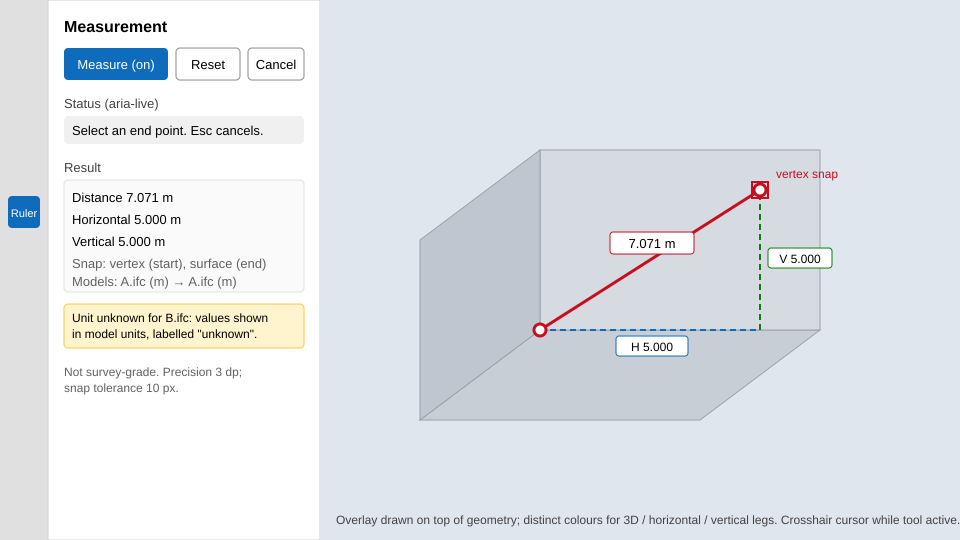
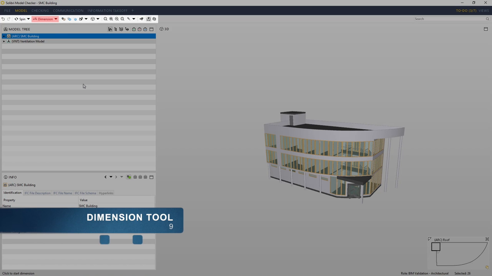
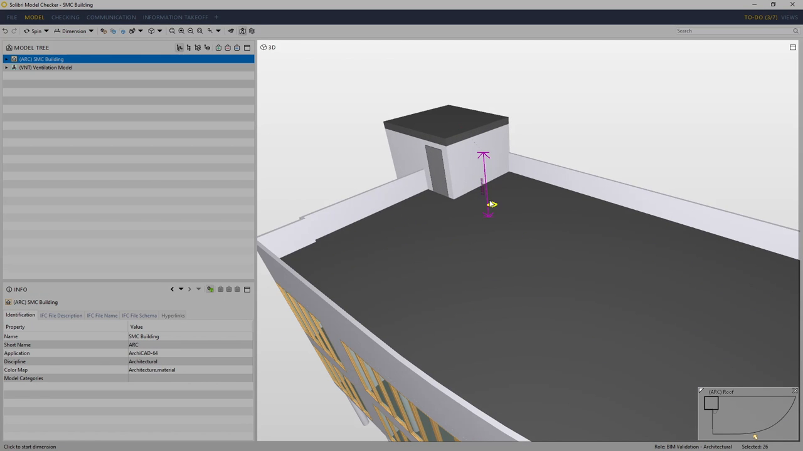
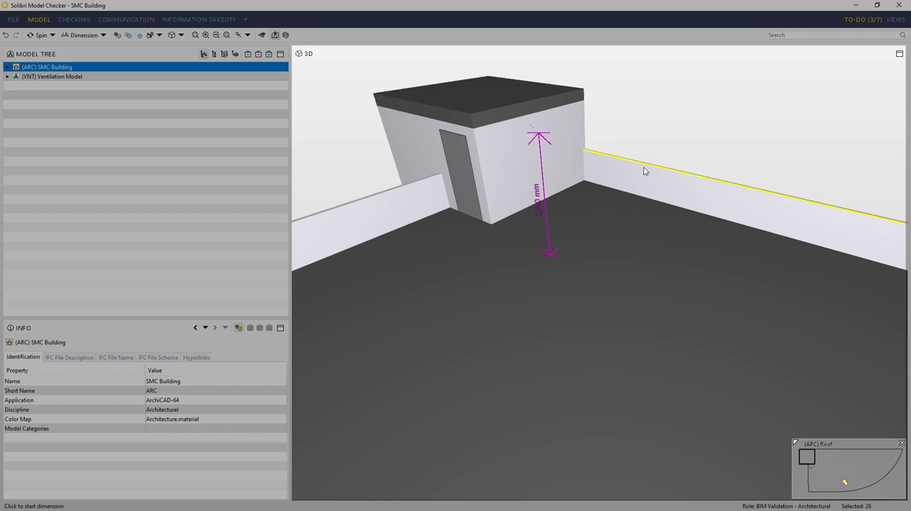
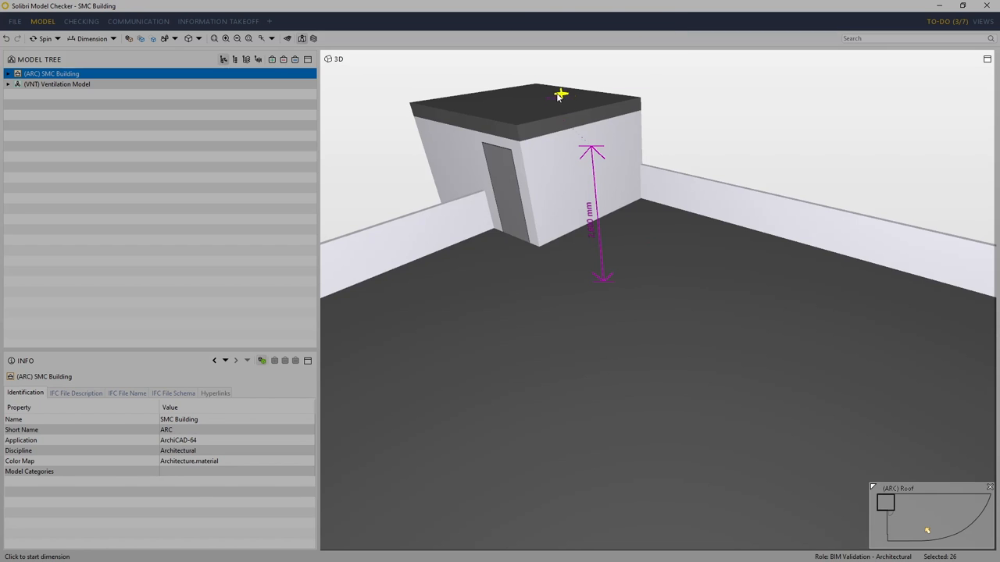
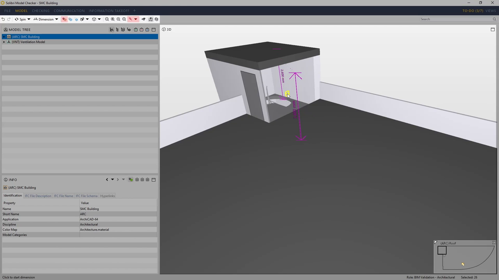
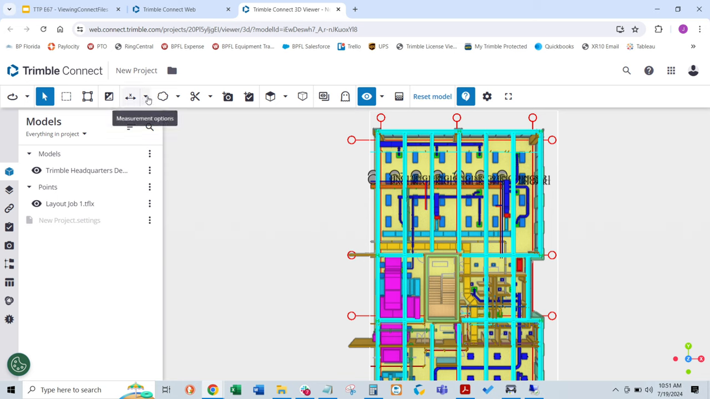
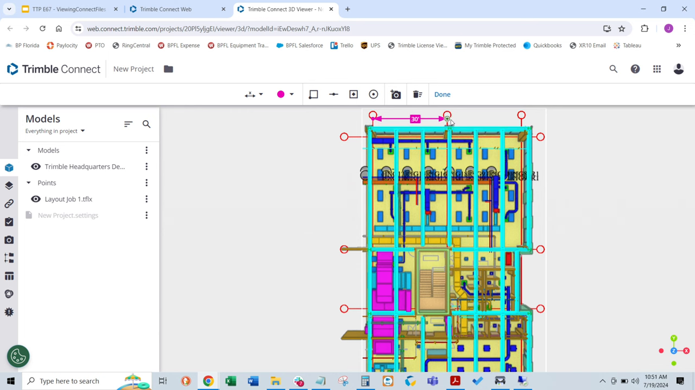
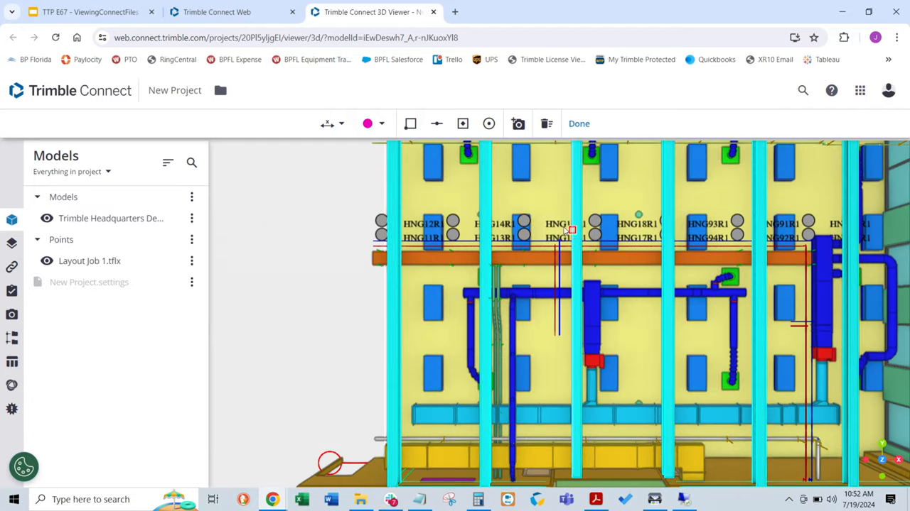
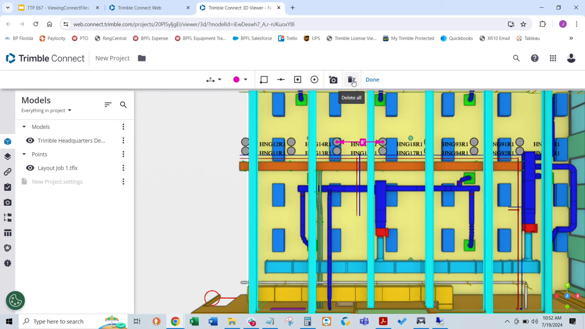

# Feature: Model Measurement

Status: Planned for Phase 1A. The distance-calculation helper is implemented locally; geometry picking, unit-aware UI, snapping, overlays, lifecycle behavior, and browser acceptance remain incomplete.

## Summary

Provide a transient point-to-point measurement tool for eligible loaded IFC geometry. Models with missing or unsupported length units cannot be measured. A completed measurement reports 3D distance and horizontal and vertical components, normalized to metres. Picking uses the viewer's geometry adapter and separate clip-pick geometry where reliable; display precision is three decimals and snap tolerance is 10 screen pixels [A1, A2].

**Recommendation.** Keep Phase 1 to two-point distance with horizontal and vertical components. Solibri and Autodesk expose richer tool suites, but angle, area, volume, paths, and persisted annotations are outside the approved Phase 1 scope. Disable measurement on any model whose length unit is missing or unsupported; this avoids silently presenting incomparable coordinates as metric values [A1, A2].

---

# Detailed Specification

## Problem

Estimators and reviewers need quick geometric checks while inspecting local IFC models. A usable result must identify the endpoints, report a meaningful metric value and components, remain legible against the model, and avoid implying precision unsupported by mesh geometry or snapping. The current feature has a pure distance helper and basic two-point UI, but does not yet satisfy the approved unit, adapter-picking, snapping, overlay, or cleanup requirements [A1].

## Users

- Estimators and reviewers inspecting one or more loaded IFC models who need to check clearances, spans, or vertical offsets during model review.

## Goals

- Measure between two picked points on model geometry.
- Report 3D distance plus horizontal and vertical components in metric units when known.
- Make tool state, snap behavior, and result units understandable.
- Keep measurements transient and compliant with the local-only, no-model-derived-persistence boundary.

## Comparable Products (Research)

| Product | Feature name | Docs | Video | Notes |
|---|---|---|---|---|
| Solibri Desktop | Measurement Tool (v25.3+) | [The Measurement Tool](https://help.solibri.com/hc/en-us/articles/30962601006871-The-Measurement-Tool); [Measurement Settings](https://help.solibri.com/hc/en-us/articles/30962586953495-Measurement-Settings) | [#GetToGrips 08: Dimension and Markup Tools](https://www.youtube.com/watch?v=Itl4Kn8M2ZA), legacy Dimension tool | Current docs cover length, path, angle, area, volume, coordinate tools, snapping, a measurement list, visibility, deletion, and issue-based saving. The 2019 video predates the current Measurement View. |
| Trimble Connect | 3D Viewer measurements | Measurement workflow shown in video; browser help page did not yield readable content in this pass | [That's The Point - How To View & Measure Models In Trimble Connect](https://www.youtube.com/watch?v=Q8eu60g_i_4) | Video demonstrates perpendicular measurement, point selection, locking a result with Done, and deletion. |
| Autodesk Platform Services Viewer | `Autodesk.Measure` extension | [MeasureExtension API](https://aps.autodesk.com/en/docs/viewer/v7/reference/Extensions/MeasureExtension/) | No feature-specific video verified in this pass | API supports distance and angle in 2D/3D, unit/precision choices, snapped or free measurement, listing/restoring current measurements, activation/deactivation, and deletion. |

## What Good Looks Like (Findings)

- **Two-point workflow with clear endpoint feedback.** Solibri's video describes selecting a start and end point, visible snap candidates for edges, corners, intersections, and midpoints, and placement on the second click [S4].
- **Expose the measurement type and value.** Solibri's current Measurement View lists type and value and supports per-measurement visibility and deletion; double-click focuses the measurement in the model [S2]. Its settings also cover label/line appearance, auto-hide, and live preview [S3].
- **Snapping must be distinguishable from free picking.** Solibri documents edge, face, and point snaps plus a keyboard override for free points; APS separately exposes free-measure mode [S1, S2]. This app uses the approved 10-screen-pixel tolerance and must not imply a snap when no reliable candidate was hit [A1].
- **A result needs an explicit lifecycle.** Trimble's video uses Done to keep a measurement and a trash action to delete it (02:47–02:56); the app's approved contract instead keeps results transient and supports reset/cancel [S5, A1].
- **Do not copy the full comparator scope.** Solibri and APS provide angle, area, or additional measurement modes; Phase 1 assigns only distance and its horizontal/vertical components [S1, S2, A1].
- **Avoid false precision.** The app's approved display precision is three decimals, but rounded display precision is not an accuracy guarantee [A1].

## User Feedback (Forums)

- No measurement-specific request or complaint could be verified in the accessible forum results during this pass. Solibri Society's search page loaded but did not apply the query (it reported 452 results matching an empty term) [S6]; the attempted Trimble community thread was not found. Treat feedback as unavailable, not as evidence that users have no issues.

## User Flow

1. **Enter measurement mode.** User opens the Measurement tool and activates **Measure**. It becomes the one active pointer tool; starting it cancels the previous pointer tool [A1].
2. **Pick the start.** User clicks model geometry. A valid hit records the first point and the UI prompts for an endpoint; a miss leaves the tool waiting without creating a result.
3. **Pick the endpoint.** User clicks a second valid point. The adapter resolves a reliable snap candidate within 10 screen pixels or reports the unsnapped surface hit. A separate clip-pick mesh is used where available, so a visually clipped portion remains measurable only when that source geometry supports reliable picking [A1].
4. **Review result.** Show 3D distance, horizontal component, and vertical component in metres. Only points from models with supported length units can be measured. If a pick resolves to a model with a missing or unsupported unit, reject that pick and explain why; if no eligible model is loaded, disable Measure and explain why [A2].
5. **Continue or exit.** Reset clears points and result and starts another measurement. Escape cancels the active measurement mode; activating another pointer tool also cancels it. Hiding/removing a model or disposing the feature removes affected measurement state and overlays [A1].
- **Success state:** an in-memory measurement result with legible endpoint/line overlay and explicitly labeled values.
- **Error / edge paths:** invalid screen-space pick does not advance state; picks on models with missing or unsupported units are rejected with an explanation; unavailable snap candidates are not represented as snapped; model removal or feature disposal clears owned state; the model is never uploaded and coordinates are not persisted.

## Wireframe / Sketch

## Requirements

- **R1 — Tool arbitration.** Measurement is the sole active pointer tool. Starting it cancels the previous pointer tool; Escape cancels measurement before unwinding to other interaction modes [A1].
- **R2 — Two-point distance.** Pick two points from model geometry and report 3D Euclidean distance, horizontal component, and absolute vertical component. Values use scene coordinates mapped by the viewer adapter and must pass known-value tests [A1].
- **R3 — Units and eligibility.** Normalize supported source length units to metres. A model with missing or unsupported length units is ineligible for measurement: do not accept either endpoint from it, including same-model measurement. If no eligible models are loaded, disable the Measure control and explain the unit limitation. Never silently treat unknown coordinates as metres. Show three decimals without implying survey-grade accuracy [A1, A2].
- **R4 — Picking and snapping.** Use adapter-owned ray picking and snap to reliable geometry candidates within the approved 10-pixel screen-space tolerance. Communicate whether the point snapped; do not fabricate a snap when no candidate is available [A1].
- **R5 — Clipping.** Use separate clip-pick geometry. A visually clipped-away portion remains measurable only where its source mesh supports reliable picking; do not guarantee this for unsupported geometry [A1].
- **R6 — Transient overlay and controls.** Render measurement marks separately from model geometry; expose clear start, first-point, completed, reset, and cancel states. Reset starts a new measurement; Escape cancels the active mode [A1].
- **R7 — Privacy and cleanup.** Keep results in memory only. Do not persist, export, or transmit model-derived points. On reset, cancellation, model removal, or disposal, remove owned overlays and event handlers without disposing shared renderer resources [A1].

## Acceptance Criteria

- [x] AC1: Given points `(0,0,0)` and `(3,4,12)`, when `measurePoints` is called, then it returns distance `13`, horizontal `5`, and vertical `12`. *(Verified by `tests/unit/phase1c.test.ts`; this proves only the pure helper calculation.)*
- [ ] AC2: Given metre and millimetre source models, when points are measured, then both results are normalized to metres and shown to three decimals. *(No unit conversion/UI test found.)*
- [ ] AC3: Given an IFC with missing or unsupported length units, when the user attempts to measure it, then picks from that model are rejected and no measurement is created; when no eligible model is loaded, Measure is disabled with an explanation. *(Policy approved [A2]; implementation and tests not yet verified.)*
- [ ] AC4: Given geometry with a known snap candidate within 10 screen pixels and another point outside tolerance, when the user picks both, then the first is identified as snapped and the second is not falsely marked as snapped. *(No snapping test found.)*
- [ ] AC5: Given an active measurement, when the user picks two points, resets, or presses Escape, then the UI transitions through the correct states and removes or clears the result as specified. *(No browser interaction test found.)*
- [ ] AC6: Given clipped geometry with a supported source mesh, when the user picks a visually clipped portion, then separate clip-pick geometry can return the source point; unsupported geometry is not promised. *(No browser geometry test found.)*
- [ ] AC7: Given model removal or feature disposal while a measurement exists, then owned overlays, listeners, and measurement state are cleaned up without removing shared renderer resources. *(No lifecycle test found.)*
- [ ] AC8: Given a completed measurement, when storage and network activity are inspected, then no model-derived coordinates are persisted or sent. *(No privacy E2E evidence found.)*

## Test Cases (for developers)

| ID | Type | Precondition | Steps | Expected result |
|---|---|---|---|---|
| T1 | Unit | Two `Point3` coordinates | Measure `(0,0,0)` to `(3,4,12)` | Distance 13, horizontal 5, vertical 12; existing coverage for this calculation. |
| T2 | Unit/adapter | Synthetic metre and millimetre models | Measure known points in each | Correct conversion to metres and three-decimal display. |
| T3 | Adapter/browser | IFC fixtures with missing and unsupported length units | Attempt start/end picks on each model; repeat with no eligible model loaded | Picks are rejected and no result is created; Measure is disabled with an explanation when no eligible model exists. |
| T4 | Adapter/browser | Known snap geometry; 10-pixel tolerance | Pick inside and outside tolerance | Reliable candidate used inside tolerance; outside is unsnapped and labeled accordingly. |
| T5 | Chrome E2E | Model rendered in viewer | Start, pick one point, pick second point, reset, Escape | Correct state prompts, result and overlay; reset clears; Escape exits mode. |
| T6 | Chrome E2E | Clipping active and supported pick mesh present | Pick visually clipped source geometry | Adapter returns a valid source point; unsupported pick path reports no hit. |
| T7 | Unit/E2E | Measurement active during model removal/disposal | Remove model or dispose feature | Listeners and owned overlays are removed; shared renderer remains usable. |
| T8 | Chrome E2E | Completed measurement | Inspect storage and network requests | No measurement coordinates in storage or outbound requests. |

## Module Contract

- Entrypoint: `mountModelMeasurement` in `src/features/model-measurement/` (already present locally).
- The feature owns active measurement state and feature UI. The viewer adapter owns raycasting, unit metadata, snap resolution, clip-pick geometry, and renderer resources.
- The feature disposes its event handlers and overlays; it does not dispose shared viewer resources or write model-derived data to storage/network.

## Dependencies

- [IFC loading](ifc-loading.md), [3D navigation](viewer-navigation.md), [3D section and clipping](section-clipping.md), [cross-cutting contracts](cross-cutting-contracts.md), and [overall architecture](../architecture.md).
- Adapter picking and model unit metadata; active-tool arbitration; separate clip-pick geometry; owned overlay lifecycle.

## Assumptions

- Phase 1 uses the approved metric-normalization policy, 10-screen-pixel snap tolerance, and three-decimal display precision [A1]. Models with missing or unsupported length units are not measurable [A2].
- Geometry-derived values are approximate model inspection measurements, not survey or construction set-out values.
- The accepted synthetic fixtures are sufficient for unit conversion and known-distance tests; local-only Duplex fixtures are optional and their absence is a skip [A1].

## Out of Scope

- Angle, area, volume, path length, coordinate inspection, calibration, markup, saved measurement annotations/issues, and export of measurements.
- Survey-grade accuracy guarantees, editing IFC geometry, and cross-session persistence.

## Open Questions

- None. The unknown-unit policy was resolved by the user on 2026-11-08 [A2].

## Sources

Accessed 2026-11-08 unless otherwise noted.

- **[S1]** Autodesk Platform Services Viewer v7 — `MeasureExtension` — https://aps.autodesk.com/en/docs/viewer/v7/reference/Extensions/MeasureExtension/. API for distance/angle modes, unit and precision options, free-measure mode, listing/restoring/deleting current measurements, and activation/deactivation.
- **[S2]** Solibri — The Measurement Tool — https://help.solibri.com/hc/en-us/articles/30962601006871-The-Measurement-Tool. Current docs identify version 25.3+, length/path/angle/area/volume/coordinate types, snapping, measurement list visibility/deletion, and issue association; page also notes updates through 26.4.
- **[S3]** Solibri — Measurement Settings — https://help.solibri.com/hc/en-us/articles/30962586953495-Measurement-Settings. Text/line appearance, auto-hide, placement, and live-preview settings.
- **[S4]** Solibri UK Ltd — “#GetToGrips 08: Dimension and Markup Tools” — https://www.youtube.com/watch?v=Itl4Kn8M2ZA. Published 2019-02-22. Transcript at 00:52–01:31: activate dimensioning, pick two endpoints, observe edge/corner/intersection/midpoint snaps, place on the second click, and expose an interior dimension through transparency. This is legacy Dimension-tool evidence, not the current v25.3 UI.
- **[S5]** BuildingPoint Support — “That's The Point - How To View & Measure Models In Trimble Connect” — https://www.youtube.com/watch?v=Q8eu60g_i_4. Published 2024-07-25. Transcript at 02:13–02:30: choose perpendicular measurement, pick points, and lock the result; at 02:47–02:56: Done retains it while trash deletes it.
- **[S6]** Solibri Society — measurement search — https://society.solibri.com/search?q=measurement. Accessed 2026-11-08; page loaded but ignored the query (452 results matching an empty term), so no measurement-specific feedback could be substantiated from it.
- **[S7]** Capture commands — `model-measurement/assets/_capture_video.py`; uses `yt-dlp` capped at 720p with English auto-captions, then `ffmpeg` extracts timestamped frames. Full MP4s are held in a temporary directory and deleted after extraction; only VTT transcripts, stills, and the script remain in the feature assets directory.
- **[A1]** Approved Phase 1 decisions and local implementation: [Phase 1 MVP](../plans/Phase_1_MVP.md), [cross-cutting contracts](cross-cutting-contracts.md), `src/core/measurement.ts`, and `src/features/model-measurement/` (not external evidence).
- **[A2]** User-approved decision (2026-11-08): disable measurement entirely on models with missing or unsupported length units, including same-model measurements.

# Research

## Solibri

- The legacy video depicts the dimension tool and snap candidates [S4]. Current v25.3+ documentation describes a Measurements view and a broader type palette [S2]; do not treat the old UI as the current product state.
- Current docs indicate visibility/deletion per measurement and issue association; these differ from the approved app's transient-only boundary [S2, A1].
- The retained transcript and timestamped stills were captured with the feature script; temporary full videos were deleted after extraction [S7].

## Trimble Connect

- The presenter selects perpendicular measurement and points, describes using model geometry with layout points for QA/QC (02:13–02:44), then retains with Done or deletes with the trash action (02:47–02:56) [S5].
- The official browser help URL did not yield readable content during this pass; the behavior above is attributed to the video only.

## Autodesk Platform Services

- The API reference documents selectable units and precision, free-measure mode, measurement enumeration/restoration, and deletion [S1]. No video or captured UI was verified; this is API documentation evidence only.

## Wireframe

- The sketch maps the approved distance/H/V result, snap state, unit warning, precision and tolerance to the proposed UI [A1, A2]. It is a proposal, not existing product behavior.