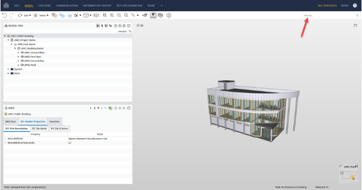
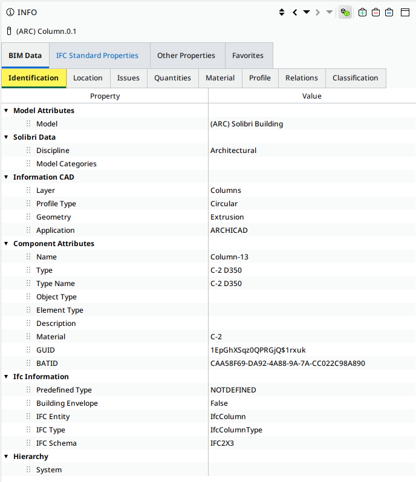
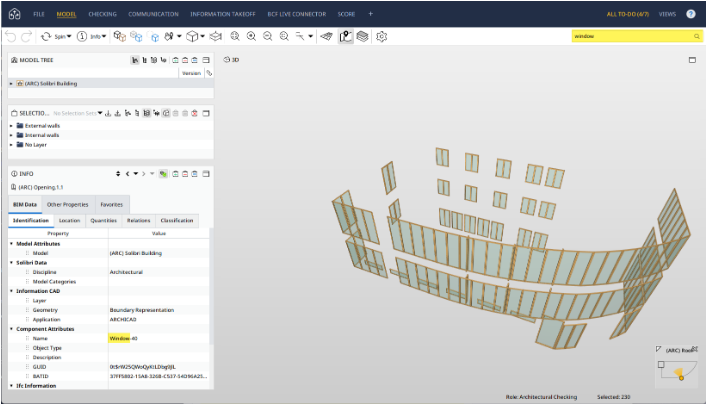
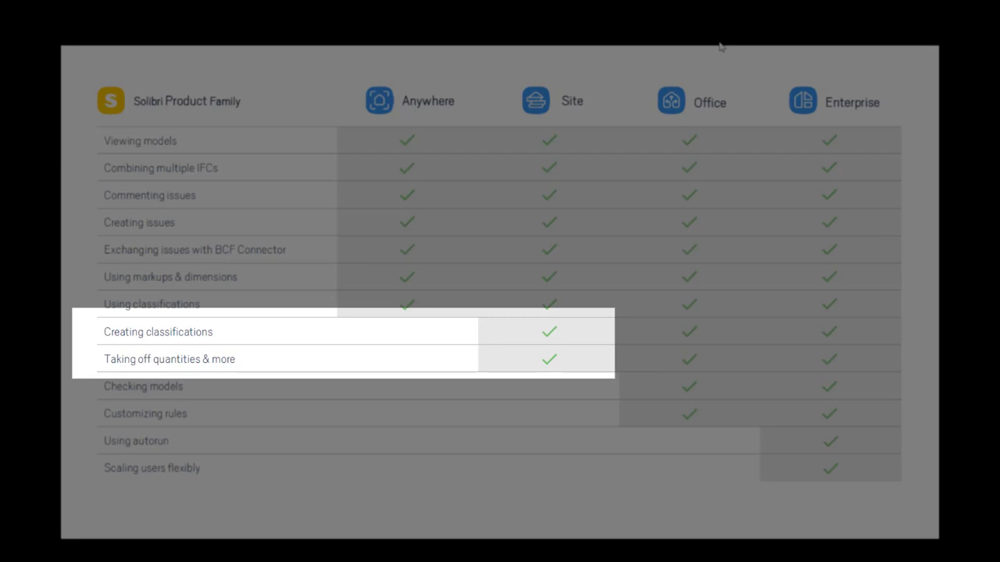

# Feature: Model Search

Status: Search adapter and transient UI are implemented locally. Adapter unit coverage verifies basic case-insensitive, model-scoped matching. Result grouping, hidden-item actions, continuation within one model, and browser acceptance remain outstanding.

## Summary

Help a user find IFC elements across all loaded models by searching their names, GlobalIds, IFC classes, property/quantity field names, and available values. Results must preserve model-scoped identity, explain why an item matched, and remain actionable without changing visibility just because a query ran.

Use literal, case-insensitive substring matching with a visible 100-result page and continuation that works within and across models. Include hidden elements, mark them, and provide an explicit Unhide action. Keep search transient and local; do not add saved queries, fuzzy ranking, wildcard syntax, or a query language.

---

# Detailed Specification

## Problem

Users inspecting a construction model often know an element by name, IFC class, GUID, or a property value, but may not know where it appears in the spatial hierarchy. Searching must span all loaded IFC files and their exposed metadata while keeping identity unambiguous. It must also distinguish element search from file-list search, avoid silent result truncation, and avoid changing model visibility simply because a query matched a hidden element.

## Users

- Estimators and construction professionals locating a known element in a large or unfamiliar IFC model.
- Users working with multiple loaded models, including models that reuse express IDs or filenames.
- Users who want to navigate from a matching property value to a selected element and inspect it in the viewer or property pane.

## Goals

- Search element identity and exposed property/quantity data across every loaded model.
- Return actionable results with stable model-scoped identity and a visible match reason.
- Bound rendering cost while making continuation explicit and complete.
- Keep search local, reversible, and separate from filter/visibility state.

## Comparable Products (Research)

| Product | Feature name | Docs | Video | Notes |
| --- | --- | --- | --- | --- |
| Trimble Connect for Browser | Search Models | [Search Models](https://help.trimble.com/doc/trimble-connect/trimble-connect/connect-for-browsers-3d-viewer/models/models-listing/search-models) | No element-search video found. | Despite the title “Search Objects” in search snippets, the current help page says this feature filters files in the Models panel by filename or extension; it is not IFC element search. |
| Solibri Anywhere | Searching Components | [Searching Components in Solibri](https://help.solibri.com/hc/en-us/articles/1500006907602-Searching-Components-in-Solibri) | [Solibri Anywhere: Navigation and Component Handling Tools](https://www.youtube.com/watch?v=_me6LNVbqhI) | Free-text search uses the Identification tab (for example names and GUIDs), not property sets. `*` and `?` are supported; multiple terms must occur in one field. Ctrl/Cmd-click or Enter adds matches to the Selection Basket. The video is a third-party desktop walkthrough; frames are included, but it has no captions and is not cited for exact query semantics. |
| Autodesk Platform Services Viewer | Model property database search | [Model API](https://aps.autodesk.com/en/docs/viewer/v7/reference/Viewing/Model/) | No search-specific video verified. | `searchAsync` is case-insensitive, accepts optional attribute names, and returns matching database IDs. The API does not document UI pagination or a result cap. |

## What Good Looks Like (Findings)

- Distinguish files from model elements. Trimble's Browser Models search filters the loaded-file list by filename/extension only; it does not search element properties [S1].
- Make the searchable data surface clear. Solibri's component search checks its Identification tab (names/GUIDs) and explicitly says property sets are not searched [S2]. This app's broader property search is a deliberate requirement, not an assumption that all comparable search bars do it.
- Search properties as structured data. APS supports case-insensitive property-database search with optional attribute restrictions and returns object IDs; its API separates search from display and selection [S3].
- Do not silently drop large result sets. Solibri adds matches to its Selection Basket, while this app's approved baseline uses explicit pages and a Load more action [S2, A1].
- Keep query semantics predictable. Solibri supports wildcard characters and requires multiple terms in one field; this app keeps simpler literal substring semantics and does not adopt that syntax [S2, A1].
- Property-set search has separate product-specific contexts. Solibri's v9.7.15 announcement added wildcard property-set use in search/sorting columns for model checking; that does not contradict its component-search article, which says the component search bar itself does not search property sets [S4].

## User Feedback (Forums)

- No reliable, feature-specific user forum thread about IFC element search, result limits, or hidden search results was found in the accessible sources. Search pages were intermittently blocked by anti-bot challenges; absence of a forum result is not evidence that no user pain exists.
- Solibri's help article reports that 1 of 6 readers found it helpful, but this small article rating is not representative user feedback [S2].
- The clearest product limitation in the reviewed material is Solibri's explicit exclusion of property sets from its component-search bar. Solibri's later wildcard property-set announcement is a product-change signal for richer property search in a different workflow [S2, S4].

## User Flow

1. The user opens Search and enters a name, GUID, IFC class, property/quantity field name, or value. Leading/trailing whitespace is ignored; an empty query clears results [A1].
2. The system searches every loaded model's exposed element metadata and properties. Results are grouped by model, with the matched-field priority name, GlobalId, IFC class, then property/quantity.
3. Each result shows the model name plus a disambiguator when names collide, element label/class, express ID, matched field, and hidden status. The first 100 results are shown; Load more continues the same deterministic order, including further matches within a single model.
4. The user selects a result. The app publishes the model-scoped identity through the shared selection capability; optional fit-to-element uses an injected viewer command [A1].
5. If the result is hidden, the user may explicitly choose Unhide. The action unhides the complete current query result set, while merely searching does not change visibility [A1].
- Error / edge paths: no matches show an explicit empty state; rapid edits cannot allow stale results to replace the current query; removing a model removes its results; a query never treats express IDs as globally unique; loading/failed models are not searched.

## Wireframe / Sketch

```text
+-----------------------------------+
| Search loaded models              |
| [door fire rating 60 min       x] |
|                                   |
| Model A (3)                       |
| [IfcDoor  D-102]  Pset_DoorCommon |
| [IfcDoor  D-119]  Name            |
| [IfcDoor  D-205]  FireRating      |
|                                   |
| Model B (1)                       |
| [IfcDoor  D-007]  Pset_DoorCommon |
|                                   |
| [Load more]                       |
+-----------------------------------+
```

## Requirements

- R1: Search loaded models in memory using trimmed, case-insensitive literal substring matching. Search element name, GlobalId, IFC class, exposed property/quantity field identities, and exposed text, enum, number, boolean, and list values [S2, S3, A1].
- R2: Search across every model whose state is `loaded`; do not search filenames as substitutes for element data. Express IDs and file names are not global identities [S1, A1].
- R3: Return model-scoped identity with every result. Group results by model, display model name and a disambiguator for duplicate names, and show element label/class and express ID [A1].
- R4: Show why each result matched using matched-field priority: name, GlobalId, IFC class, then property/quantity field or value. Stable order within each model follows that priority [S2, S3, A1].
- R5: Show no more than 100 results per page and provide Load more until the full result set is consumed. Continuation must work when a single model has more than 100 hits as well as when results span multiple models; never silently truncate at a per-model cap [A1].
- R6: Include hidden elements in search results. Mark each hidden result and provide an explicit Unhide action that unhides the full current result set. Searching and selecting a result do not otherwise change visibility [A1].
- R7: Selecting a result publishes its exact `(modelId, expressId)` through `SelectionCapability`; optional fit-to-element is injected through a viewer command. Search does not import parser or renderer internals [A1].
- R8: Clear query/results on empty input. Model removal or load-state changes invalidate affected results. Rapid edits cancel or discard stale work before it can update the UI [S3, A1].
- R9: Exclude wildcard operators, fuzzy matching, ranking, boolean/query-language syntax, saved searches, and cross-session persistence [S2, A1].
- R10: Search is local-only: no model or property content is sent over the network or stored outside current in-memory session state [A1].

## Acceptance Criteria

- [ ] AC1: Given a loaded element, when searching by case-insensitive substring in name, GlobalId, IFC class, property/quantity field name, scalar value, or list value, then its result is returned with the correct matched-field label.
- [ ] AC2: Given two loaded models with the same express ID and duplicate filenames, when both contain matching elements, then results remain separate, grouped under disambiguated model labels, and select the correct identity.
- [ ] AC3: Given hidden and visible matching elements, when searching, then both appear with hidden status, and visibility changes only after the explicit Unhide action; Unhide affects the complete current result set.
- [ ] AC4: Given more than 100 matches in one model and more across multiple models, when the user chooses Load more repeatedly, then every match is available exactly once in stable model/field order.
- [ ] AC5: Given a query with no results or an empty query, then the UI shows an explicit no-match message or clears the result list, respectively.
- [ ] AC6: Given rapid query edits, then stale results never replace the newest query's results; removing a model during a query removes its matches and prevents later selection of its elements.
- [ ] AC7: Given a result is selected, then the shared selection identity matches its `(modelId, expressId)`; search itself does not alter visibility.
- [ ] AC8: Given search is used, then no IFC data is transmitted or persisted and reload clears query/results.

## Test Cases (for developers)

| ID | Type | Precondition | Steps | Expected result |
| --- | --- | --- | --- | --- |
| T1 | Adapter unit | Fixture has name, GUID, IFC type, Pset/Qto fields, typed values, and two models | Search case variants and substrings in each supported field/value kind | Correct identities and matched-field categories; lists are searched element-wise |
| T2 | Adapter/browser | Two models reuse express IDs and filenames | Search a value common to both and inspect results | Both appear under separate model identities; selecting either selects only its model-scoped element |
| T3 | Adapter/browser | One model has more than 100 matches; another also has matches | Load successive pages | No per-model truncation or duplicate/missing results; deterministic ordering |
| T4 | Browser | Query matches visible and hidden elements | Search, then use Unhide | Both results show; query has no visibility side effect; explicit Unhide applies to the complete current result set |
| T5 | Browser/race | Search adapter can be delayed; model can be removed | Enter queries rapidly and remove a model before completion | Stale generations and removed-model results are discarded |
| T6 | Browser | Search panel open and accessible | Enter no-match, then clear query | Distinct no-match state and cleared state; keyboard focus and result announcement are correct |
| T7 | Privacy/reload | IFC model is loaded and results are visible | Inspect network/storage, then reload | No upload or model-derived persistence; query/results are cleared |

## Assumptions

- A1: The approved [Phase 1 baseline](../plans/Phase_1_MVP.md) and [cross-cutting property contract](cross-cutting-contracts.md) define model identity, property field identities, supported typed values, and local-only processing.
- Search matches the underlying scalar text representation, not a formatted unit suffix; unset values can be found by their field name but do not match an invented empty/zero value [A1].
- “Load more” is one global result stream across models, grouped visually by model; the adapter may use cursor/offset paging internally [A1].

## Out of Scope

- Search by filename or extension (model-list search), saved searches, query syntax, wildcards, fuzzy matching, relevance ranking, or persistent history.
- Search results that calculate quantities, modify model data, or automatically change visibility.
- Replacing the separate structured [Model filtering](model-filtering.md) feature with a free-text query language.

## Open Questions

- None for the approved Phase 1A search behavior. The missing continuation/model-label/hidden-state behavior is an implementation gap, not an unresolved product decision.

## Dependencies

- [Element selection](element-selection.md), [Element properties](element-properties.md), [IFC loading](ifc-loading.md), [model filtering](model-filtering.md), [cross-cutting contracts](cross-cutting-contracts.md), and [overall architecture](../architecture.md).
- The IFC adapter provides model-scoped, bounded search over parsed metadata and property data; the UI owns query/result state and stale-query protection.

## Module Contract

- Public entrypoint: `mountModelSearch` in [src/features/model-search/index.ts](../../src/features/model-search/index.ts).
- Owns query input, result list, query-local state, and request/stale-result protection. It receives search and selection capabilities through explicit contracts; fit-to-element is optional and injected.
- Disposal invalidates outstanding work, unsubscribes, and removes handlers and DOM.

## Sources

1. Trimble Help, “Search Models” — https://help.trimble.com/doc/trimble-connect/trimble-connect/connect-for-browsers-3d-viewer/models/models-listing/search-models (modified 4 Nov 2026; searches files by name or extension in the Models panel, then filters the file list).
2. Solibri Help Center, “Searching Components in Solibri” — https://help.solibri.com/hc/en-us/articles/1500006907602-Searching-Components-in-Solibri (updated about six months before retrieval on 8 Nov 2026; searches the Identification tab; property sets are not searched; supports `*`/`?`; multiple terms must be in one field; Ctrl/Cmd or Enter adds matches to Selection Basket; article rating 1/6 helpful).
3. Autodesk Platform Services, “Model API” — https://aps.autodesk.com/en/docs/viewer/v7/reference/Viewing/Model/ (`searchAsync` is case-insensitive, optionally restricted to attribute names, and returns object IDs; `findProperty` is case-sensitive).
4. Solibri, “Expanded Wildcard Search of Property Set Data” — https://www.solibri.com/articles/expanded-wildcard-search-of-property-set-data (announces wildcard search across Pset data in Solibri Model Checker v9.7.15 for search/sorting columns, a separate workflow from the component search bar).
5. Cadventure Ltd, “Solibri Anywhere - Navigation and Component Handling Tools” — https://www.youtube.com/watch?v=_me6LNVbqhI (8:07; public desktop product walkthrough; direct YouTube watch page opened in Chrome via Playwright; four stills extracted at 00:45, 02:00, 04:00, and 06:00. An English auto-caption file with 383 timestamped cues was downloaded, but none discuss search/find/identification; exact search behavior is sourced from [S2]).
6. Capture commands: `node docs/feature/model-search/assets/_capture.mjs` for official-help screenshots and `python docs/feature/model-search/assets/_capture_video.py` for video download, English auto-caption retrieval, and ffmpeg frame extraction. The full 720p video is temporary and deleted after extraction; the VTT and stills are retained under `docs/feature/model-search/assets/`.
7. Browser access validation: Playwright 1.64.1 with Chrome and `ignoreHTTPSErrors: true` returned HTTP 200, loaded the 8:07 video stream (`readyState: 4`), and exposed English captions. The embedded VS Code browser page returned YouTube Error 153; Playwright's in-page caption request returned an empty body, while yt-dlp successfully downloaded the VTT.
8. User feedback search: Bing/Trimble Community and Solibri forum queries returned no attributable, search-specific user complaint in this research pass; state this as a search limitation, not absence of user pain.

---

# Research

## Trimble Connect for Browser

- The current official guide says Search is in the Models panel, accepts a search word, then filters the file list. Its searchable fields are model filename and extension; it is not element search [S1]. The page is text-only, so no product screenshot was available from this guide.
- This distinction informs the feature's terminology: “Search loaded models” means search elements inside loaded model data, not filter the loaded-model list.

## Solibri Anywhere










- Search is a free-text field at the top right of the desktop application. It matches content in the Identification tab, including names and GUIDs; the help article explicitly says Property Sets are not searched [S2].
- Wildcards `*` and `?` are supported. Multiple query words must occur together in a single field. Matches are added to the Selection Basket; Ctrl/Cmd-click or Enter adds additional components [S2].
- A separate Solibri Model Checker article announces wildcard Pset search/sort in model-checking columns. Keep this distinct from the component search contract [S4].
- The video is a broad third-party walkthrough of navigation/component handling. The frames above were extracted from the downloaded MP4 with ffmpeg. Its auto-caption transcript contains 383 timestamped cues, but none mention search/find/identification, so the video and transcript are context only; query semantics come from the official help article [S2, S5].

## Autodesk Platform Services Viewer

- `Model.searchAsync` searches the property database, is case-insensitive, can restrict searched attribute names, and returns matching database IDs. The API documentation does not prescribe a visible result cap or UI paging behavior [S3].
- No search-specific public video or official search screenshot was verified in this research pass.