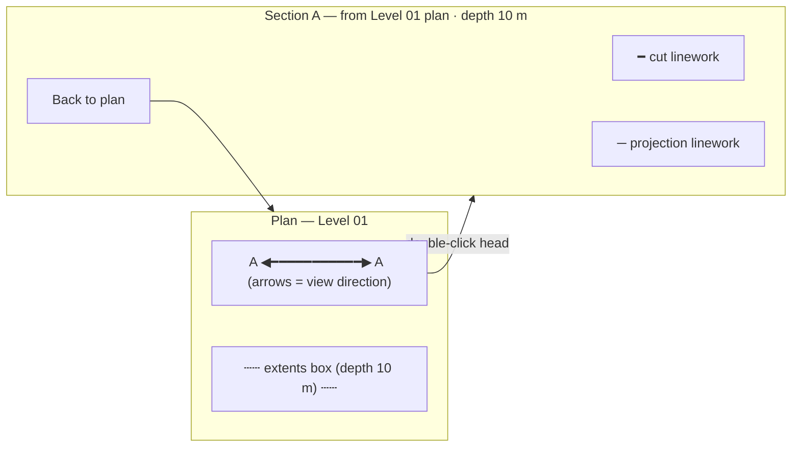
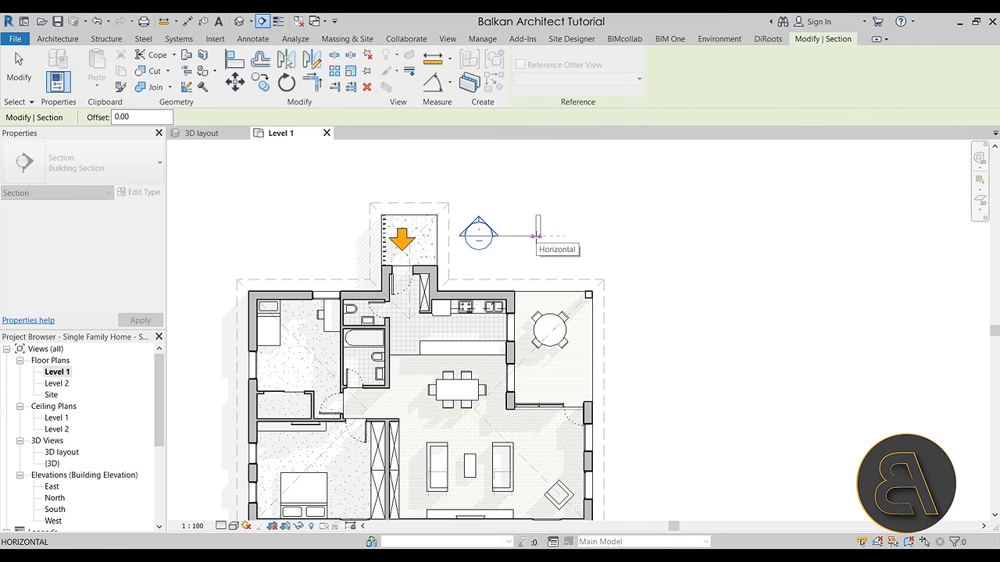
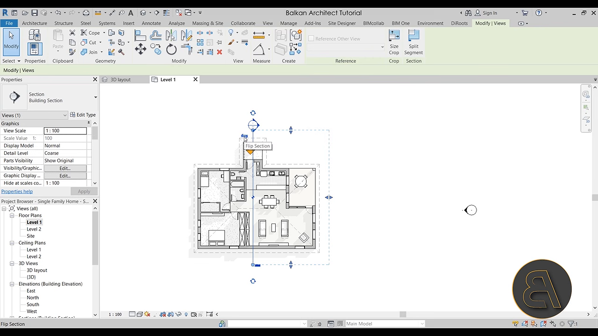
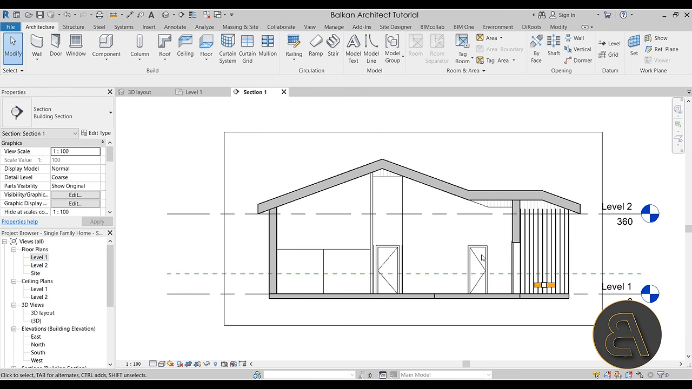
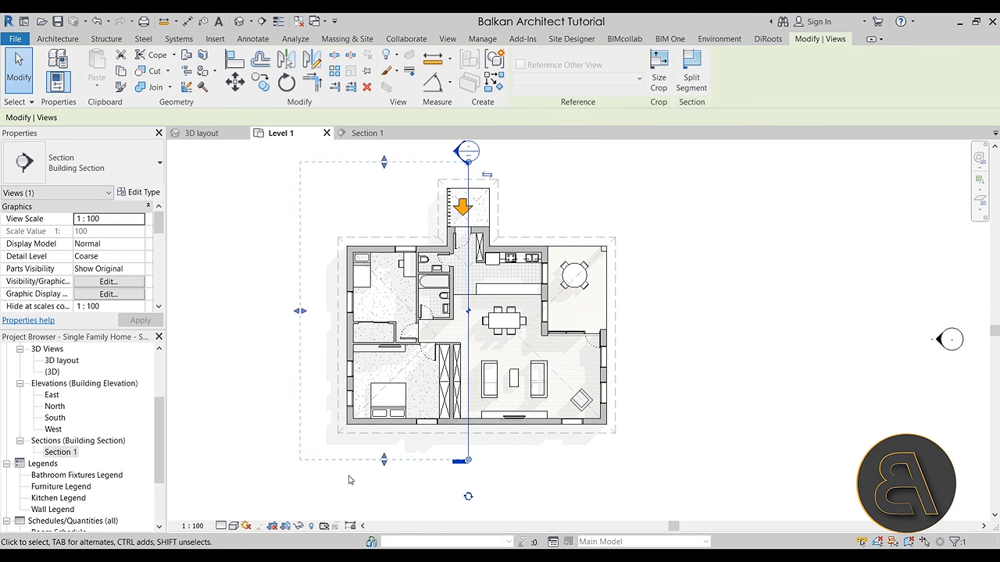
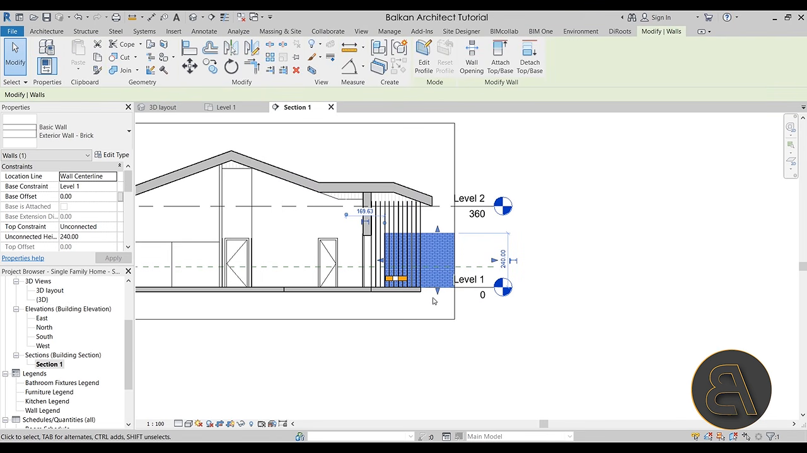

# Feature: Plan Section Lines and Views

Status: Assigned to Phase 1B, dependent on plan-view feasibility. Governed by the [Unattended Execution Policy](../plans/Phase_1_MVP.md#unattended-execution-policy); a failure is a non-blocking no-go. A local prototype in `src/features/drawings/` draws a horizontal section at a typed elevation (`sectionSegments`), which is not a plan-placed vertical section; there is no marker, direction, depth, or plan↔section link. `tests/unit/drawings.test.ts` covers the crossing-segment math only.

## Summary

In a generated plan, let users draw a section line by two clicks, see an arrowed marker with a label (A, B, …) showing the view direction, adjust its depth (far clip) and flip it, and open the linked 2D section drawing. The section shows **cut** linework where the vertical plane crosses visible geometry and **projection** linework for visible geometry behind it, up to the depth. Each section links back to its plan and marker. Markers and drawings are session-only and are invalidated when source models change [A1].

**Recommendation.** Follow Revit's section workflow — click-drag placement where drag direction sets the view direction, a flip control, a dashed extents box with depth, and double-click on the head to open the view [S1]. Reuse the plan view's cut/projection classification so plan and section drawings agree [A1]. A 3D clipping plane is not a substitute [A1].

---

# Detailed Specification

## Problem

Estimators need vertical sections to read storey heights, slab build-ups, ceiling voids, and wall heights. The 3D clipping plane shows a cut but not a drawing, and the current prototype only slices horizontally at a typed elevation [A1].

## Users

- Estimators and reviewers who read sections to check heights and build-ups before takeoff.

## Goals

- Place, orient, and size a section in plan with two clicks and simple adjustments.
- Open a correct, readable section drawing linked to its marker.
- Support several markers at once and keep links unambiguous.
- Invalidate safely when models change; keep everything in memory.

## Comparable Products (Research)

| Product | Feature name | Docs | Video | Notes |
|---|---|---|---|---|
| Autodesk Revit | Section tool | Help page not loaded | [Sections in Revit](https://www.youtube.com/watch?v=L-L7tkGUCZM) | Two-point placement; direction from drag; flip; clickable head; dashed extents box with far clip [S1]. |
| That Open | `TechnicalDrawing` (custom orientation) | [TechnicalDrawing.ts](https://github.com/ThatOpen/engine_components/blob/main/packages/core/src/drawings/TechnicalDrawings/src/TechnicalDrawing.ts) | n/a | `orientTo` supports the six standard axes only; `far` capture depth; visible/hidden layers [S2]. Not adopted [A1]. |

## What Good Looks Like (Findings)

- **Direction from placement.** "When you click first and then when you pull out a section basically the direction where the section is looking … if you go from the top down it's going to be looking to the right but if you go from the down up it's going to be looking left" (02:45–03:13) [S1].
- **Flip.** Flip arrows on the placed section: "click there it says flip section" (04:07–04:17) [S1].
- **Open from the head.** Double-clicking the section head opens the section view (04:57–05:12) [S1].
- **Extents and depth.** Selecting the section shows a dashed rectangle with grips; objects outside it are not shown in the section; widening the box brings a wall into view (06:40–08:36) [S1].
- **Axis-only orientation in That Open.** `orientTo` warns when "direction does not match any of the 6 standard axes", so arbitrary-angle sections need custom work [S2].

## User Feedback (Forums)

- No accessible feature-specific forum thread was found in this pass. The Revit tutorial itself shows the common surprise that an element just outside the extents box is missing from the section until the box is widened (07:30–08:24) [S1]. → R4: always show the extents box in plan and state depth in the section header.
- **Re-evaluation.** The existing requirements hold; research makes placement direction, flip, depth, and extents concrete.

## User Flow

1. **Entry point.** With a plan open, the user chooses **Section line**. The pointer becomes a crosshair; Escape cancels.
2. **Place.** First click sets the start; the second sets the end. The marker appears labelled with the next free letter, with arrows showing the view direction (left of the start→end vector) and a dashed extents box with default depth.
3. **Adjust.** The user flips the direction, drags the far edge to change depth (0.5–50 m), or edits depth in the marker panel. Vertical extent defaults to the visible models' height range.
4. **Open.** Double-clicking the marker head (or **Open section** in its panel) opens the section drawing titled "Section A — from Level 01 plan". Cut linework is heavy; projection is thin.
5. **Return.** **Back to plan** returns to the originating plan with marker A highlighted.
6. **Manage.** Markers can be renamed, deleted, or re-opened; several can coexist.
- **Error / edge paths:** zero-length line (< 0.1 m) → ignored; no visible geometry in extents → "Nothing within section extents"; model hidden/removed/loaded → open section shows "Out of date — regenerate" and regenerates on request; unsupported geometry → counted and reported; budget exceeded → partial-result notice.

## Wireframe / Sketch

## Requirements

- **R1 — Two-click placement.** In an open plan, a section tool places a line from two points in plan coordinates; lines shorter than 0.1 m are rejected. The view direction is perpendicular to the line, to the left of start→end; a flip control reverses it [S1].
- **R2 — Marker identity.** Markers are labelled sequentially (A, B, …) and renamable; the plan shows marker heads, direction arrows, and the extents box [S1].
- **R3 — Depth and extents.** Depth (far clip) defaults to 10 m and is adjustable from 0.5 to 50 m; horizontal extent equals the line length; vertical extent defaults to visible geometry's Y range. Elements outside the extents are excluded [S1, S2].
- **R4 — Section drawing.** Cut linework comes from triangles crossing the vertical plane; projection linework from visible geometry between the plane and the depth, using the same edge rules and styles as the plan view. The header shows marker, source plan, and depth [A1].
- **R5 — Navigation link.** Opening from a marker (double-click head or Open) shows its section; Back returns to the originating plan with the marker highlighted [S1].
- **R6 — Multiple markers.** Several markers coexist; each opens its own section; deleting a marker closes its section.
- **R7 — Invalidation.** Model load/removal or visibility change marks open sections "out of date" until regenerated; removing a model that leaves no geometry in the extents shows the empty state [A1].
- **R8 — Honest limits.** Unsupported geometry and budget overruns are reported; a partial section is labelled partial [A1].
- **R9 — Tool arbitration.** The section tool is an exclusive pointer tool; Escape cancels placement first.
- **R10 — Session-only.** Markers and linework are in memory, released on deletion, model removal, and disposal [A1].

## Acceptance Criteria

- [ ] AC1: Given a plan of a synthetic box room, when a line is drawn left→right across it, then the section looks "up" the plan (left of the vector) and shows the cut walls at their true heights.
- [ ] AC2: Given a placed marker, when Flip is used, then the section shows the opposite side.
- [ ] AC3: Given depth 2 m, then a wall 3 m behind the line is absent; at depth 5 m it appears as projection.
- [ ] AC4: Given markers A and B, then each opens its own section and Back returns to the right plan and marker.
- [ ] AC5: Given an open section, when a model is hidden, then the section is marked out of date and regenerates without it.
- [ ] AC6: Given unsupported geometry, then the limitation is reported and the drawing is labelled.
- [ ] AC7: Given Escape during placement, then no marker is created.
- [ ] AC8: Given disposal or reload, then markers and sections are gone. *(Partial: `tests/unit/drawings.test.ts` proves crossing segments preserve element identity, 4 tests passing locally on 2026-11-08; no vertical-section, marker, or lifecycle test.)*

## Test Cases (for developers)

| ID | Type | Precondition | Steps | Expected result |
|---|---|---|---|---|
| T1 | Unit | Line start/end | Compute view direction; flip | Left normal; flipped normal. |
| T2 | Unit | Box room triangles | Vertical cut along line | Cut segments at wall positions/heights. |
| T3 | Unit | Geometry at 3 m behind | Depth 2 vs 5 m | Excluded vs projection. |
| T4 | Unit | Line < 0.1 m | Place | Rejected. |
| T5 | Chrome E2E | Plan open | Place A and B; open each; Back | Correct drawings and links. |
| T6 | Chrome E2E | Section open | Hide model | "Out of date"; regenerated without it. |
| T7 | Chrome E2E | Placement in progress | Escape | No marker. |

## Module Contract

- Proposed public entrypoint: `mountPlanSectionViews` under `src/features/plan-section-views/`.
- Uses plan-view state (open plan, plan transform) and `src/core/drawings.ts` for vertical cut/projection math; renders on `src/components/drawing-surface.ts`.
- Owns markers `{id, label, start, end, flipped, depth}` and section linework. Disposal removes markers, sections, listeners, and UI.

## Dependencies

- [Plan view](plan-view.md) (must pass first), [cross-cutting contracts](cross-cutting-contracts.md) (tool arbitration, Escape order, coordinates), [model controls](model-controls.md), [model hierarchy](model-hierarchy.md), and [section clipping](section-clipping.md) (explicitly not a substitute).

## Assumptions

- Section lines are straight; jogged/segmented sections are excluded.
- Section drawings use the plan's scale and units (metres).

## Out of Scope

- Jogged sections, callouts, elevations, detail views, annotations, dimensions, hatching, and export [S1].
- Placing sections from the 3D view.
- Adopting That Open / Fragments [A1].

## Open Questions

- None. Linked plan sections are approved for Phase 1B subject to the `1B_04` feasibility gate [A1].

## Sources

- **[S1]** Balkan Architect — "Sections in Revit - Beginner to PRO Tutorial" — https://www.youtube.com/watch?v=L-L7tkGUCZM. Published 2021-01-19, 17:22. Captions: 02:45–03:13 placement direction from drag; 04:07–04:17 flip section; 04:57–05:12 double-click head opens the section; 06:40–08:36 dashed extents box with grips, elements outside not shown, widening includes them.
- **[S2]** That Open `engine_components` — `TechnicalDrawing.ts` — https://github.com/ThatOpen/engine_components/blob/main/packages/core/src/drawings/TechnicalDrawings/src/TechnicalDrawing.ts. `orientTo` supports six standard axes; `far` capture depth; visible/hidden projection layers. Accessed 2026-11-08.
- **[S3]** Capture commands — `plan-section-views/assets/_capture_video.py`; runs `yt-dlp` (720p cap, English auto-captions) and `ffmpeg` frame extraction at 02:55, 04:17, 05:10, 07:05, and 08:14 for [S1]. The full MP4 was held in a temporary directory and deleted; the VTT transcript and stills are retained. Frames were checked for nonblank pixels with Pillow and matched to caption timestamps; in-tool image viewing was unavailable in this session.
- **[A1]** Approved decisions and local implementation (not external evidence): [Phase 1 MVP](../plans/Phase_1_MVP.md) (1B_04 linked plan-section implementation; 3D clipping not a substitute), [plan view](plan-view.md), `src/features/drawings/index.ts`, `src/core/drawings.ts`, and `tests/unit/drawings.test.ts`.

---

# Research

## Autodesk Revit

- Placement direction, flip, open-from-head, and extents behaviour (02:45–08:36) [S1]; basis for R1–R5.
- Transcript: [revit-sections-transcript.en.vtt](plan-section-views/assets/revit-sections-transcript.en.vtt).

## That Open

- Orientation limited to standard axes; capture depth and layered visible/hidden edges [S2]. Not adopted [A1].
