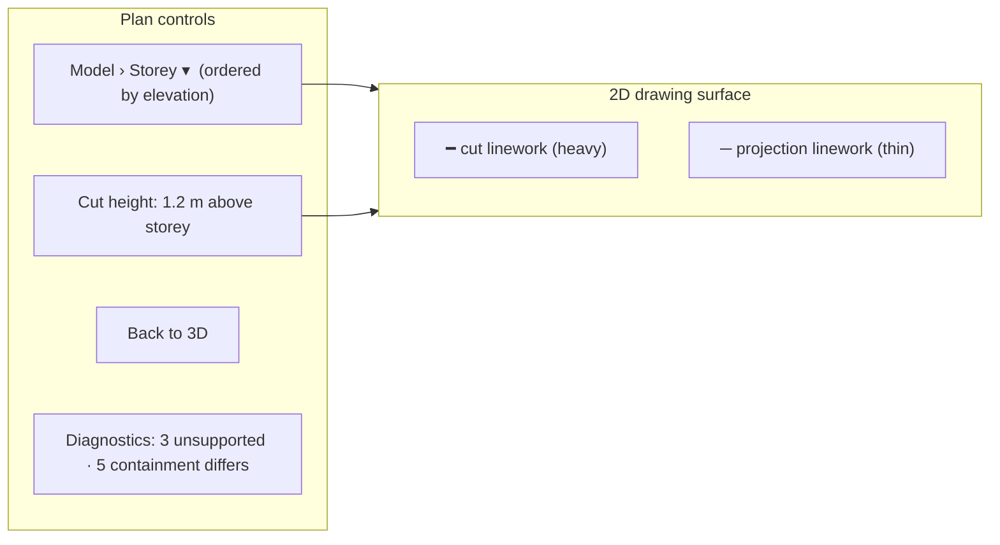
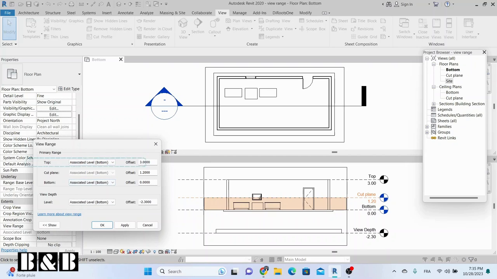
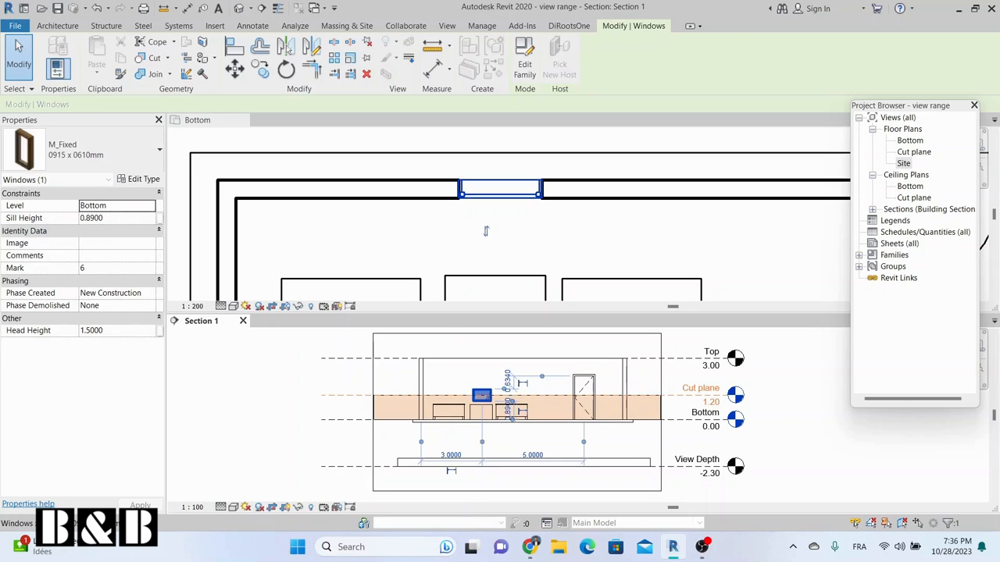
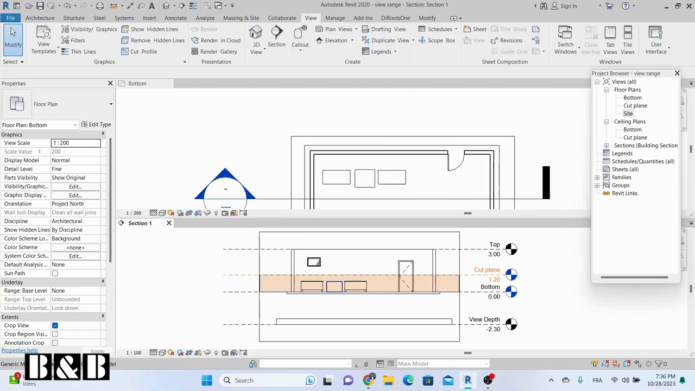
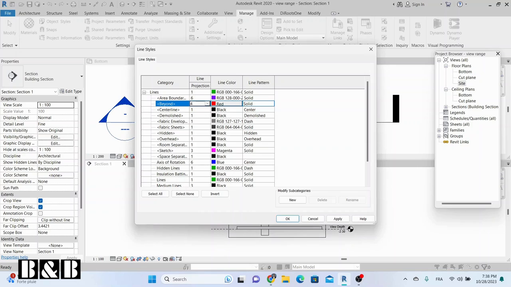
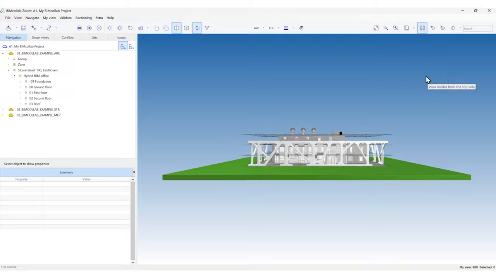
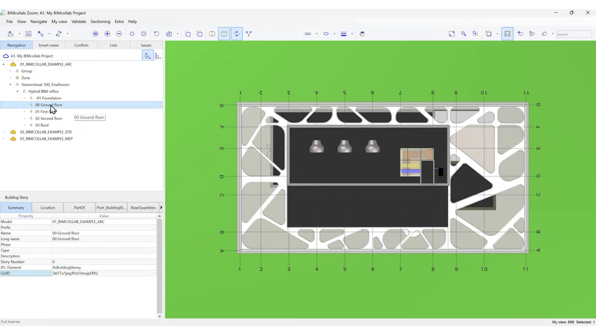
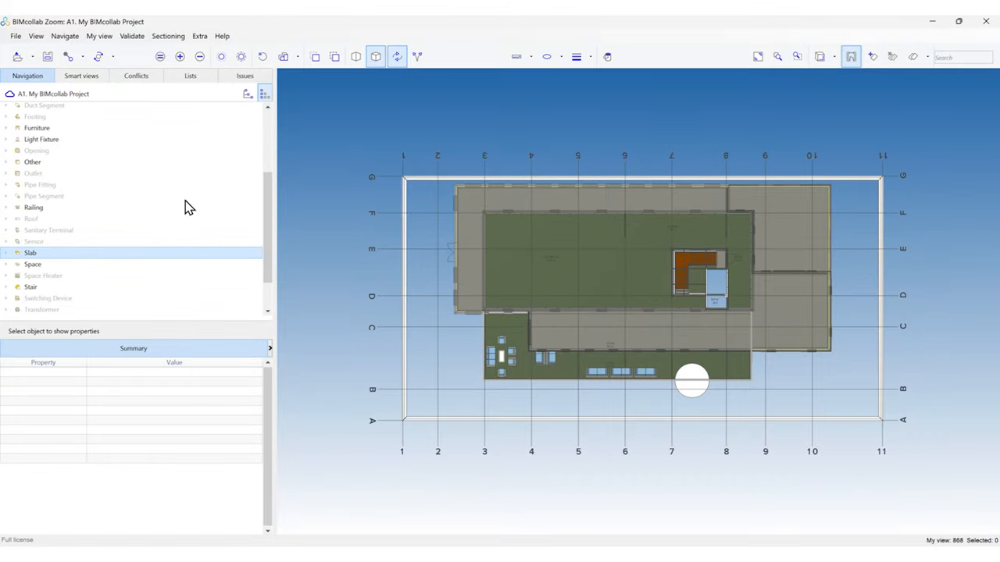

# Feature: 2D Architectural Plan View

Status: Assigned to Phase 1B. User-approved **Go** to build linework from the app's in-app triangle geometry (no That Open / Fragments); see the [research recommendation](../research/phase-1-viewer-market-research.md#phase-1b-drawing-gono-go-recommendation-pre-run) and the [Unattended Execution Policy](../plans/Phase_1_MVP.md#unattended-execution-policy). A prototype exists locally: `src/features/drawings/` renders a "Plan view" button that projects **all** triangles top-down (`projectPlan`) onto the approved drawing-surface component, with no storey selection, cut height, cut/projection distinction, or visibility filtering. `tests/unit/drawings.test.ts` (4 tests) covers projection and section-segment math. The `1B_02` feasibility acceptance has not been run.

## Summary

Generate a real 2D floor plan for a chosen IFC storey: a horizontal cut at a storey-relative height (default 1.2 m), drawn as **cut** linework (heavy) for elements intersecting the cut plane and **projection** linework (thin) for visible geometry below it down to the storey floor. Only visible elements count. The plan is drawn on the shared 2D drawing surface, is visually distinct from a top-down 3D camera, never moves model geometry, and returns to 3D without changing 3D state. All linework is derived in memory [A1].

**Recommendation.** Adopt Revit's view-range convention (cut plane, bottom, view depth; cut elements shown sectioned, elements between cut and bottom as thin lines) as the drawing rule [S1]. Do not ship a top-down orthographic 3D camera as the plan, which is what BIMcollab Zoom calls an "automatic floor plan" [S2]; the approved requirement is real linework [A1]. Expect storey-containment problems in real IFC files (overlapping stairwells, shifted slabs) and surface them rather than hiding them [S4, S5].

---

# Detailed Specification

## Problem

Estimators need plan drawings to check areas, room layouts, and wall runs per storey. A top-down 3D view mixes floors, shows roofs over interiors, and has no cut convention. The current prototype flattens every triangle of every model into one image, so a multi-storey building becomes an unreadable overlay [A1].

## Users

- Estimators and reviewers reading per-storey layouts from local IFC models, without access to the authoring tool's sheets.

## Goals

- Pick a model storey and see a plan with cut and projection linework at a known height.
- Adjust cut height and see the drawing update.
- Respect visibility and hierarchy hides.
- Return to 3D without side effects; keep everything local and transient.

## Comparable Products (Research)

| Product | Feature name | Docs | Video | Notes |
|---|---|---|---|---|
| Autodesk Revit | Floor plan view range | Help page not loaded | [Revit View Range Explained](https://www.youtube.com/watch?v=gdDnZCreKJ4) | Top, cut, bottom planes and view depth; cut vs thin projection vs beyond line styles [S1]. |
| BIMcollab Zoom | Automatic floor plans | Docs page did not load | [Automatic floor plans](https://www.youtube.com/watch?v=vadN5ZJ1hwg) | Top view + orthographic + storey isolation + hide coverings/slabs; a 3D view, not linework [S2]. |
| That Open | `TechnicalDrawing` / `EdgeProjector` | [TechnicalDrawing.ts](https://github.com/ThatOpen/engine_components/blob/main/packages/core/src/drawings/TechnicalDrawings/src/TechnicalDrawing.ts) | n/a | Projects visible and hidden edges along the drawing's −Y axis within a `far` capture depth (default 10), into named layers [S3]. Not adopted [A1]. |
| xeokit SDK | `StoreyViewsPlugin` | [StoreyViewsPlugin](https://xeokit.github.io/xeokit-sdk/docs/class/src/plugins/StoreyViewsPlugin/StoreyViewsPlugin.js~StoreyViewsPlugin.html) | n/a | Per-`IfcBuildingStorey` orthographic plan images and storey-camera positioning; raster, not vector linework [S6]. |

## What Good Looks Like (Findings)

- **Explicit view range.** Revit defines "three horizontal planes the top plane the cut plane and the bottom plane" plus view depth (00:40–00:53) [S1].
- **Cut vs projection.** "Objects that intersect with the cut plane are displayed as sectioned or cut"; objects between cut and bottom that do not intersect "display as a thin line object without sectioning"; objects above the cut are not visible (01:10–01:37) [S1].
- **Beyond/depth styling.** Objects below the bottom plane within view depth are visible with "Beyond" line styles (01:40–02:08) [S1]; the app may treat this as a later enhancement.
- **Plan ≠ camera.** BIMcollab's workflow sets the view perpendicular to the top, activates orthographic mode, isolates the ground floor, and removes coverings and slabs (00:07–00:31) [S2]. That is a camera preset with manual hiding, confirming why the app needs cut-based linework.
- **Capture depth and layers.** That Open separates visible and hidden edges into layers within a bounded capture depth [S3].
- **Storey semantics.** xeokit builds plans per `IfcBuildingStorey` [S6].

## User Feedback (Forums)

- **Wrong objects per storey.** perssam42 reported storey plan images showing "too much or not enough objects", shifted by one storey and often involving `IfcSlab` (6 Mar 2024); the maintainer said results depend on correct `IfcBuildingStorey` containment and that elements like stairwells overlap storeys [S4]. → R3: use the storey elevation and the cut plane, not containment alone, to choose geometry; report elements with missing or inconsistent containment.
- **Storey ordering by bounds fails.** xeokit switched to sorting storeys by `IfcBuildingStorey.Elevation` because overlapping elements broke bounds-based order (24 Oct 2024) [S5]. → R2: list storeys by authored elevation with a bounds fallback.
- **Re-evaluation.** The existing requirements hold. Research makes the cut/projection rule concrete (Revit view range), rejects the top-down-camera shortcut, and adds containment diagnostics.

## User Flow

1. **Entry point.** The user opens **Plan view** from the drawings tool. Models with storeys are listed with their storeys ordered by elevation; models without storeys show "No storeys — use whole model" and an "Unassigned elements" group where relevant.
2. **Pick storey.** The user selects `Architecture.ifc › Level 01 (+3.00 m)`. The plan generates with cut height 1.2 m above the storey elevation.
3. **Read plan.** Cut linework is heavy; projection linework below the cut down to the storey floor is thin. The drawing fits the surface; pan/zoom work in 2D.
4. **Adjust.** The user changes cut height (0.1–3.0 m, step 0.1). The plan regenerates; the value is shown in the header.
5. **Respect visibility.** Hiding a model or elements in Model Controls/Hierarchy regenerates the plan without them.
6. **Return.** **Back to 3D** shows the unchanged 3D scene.
- **Error / edge paths:** no visible geometry at the storey → "Nothing to draw at this storey"; generation exceeds the time/segment budget → partial-result notice with counts, never a frozen UI; unsupported geometry (no triangles) → counted and reported; elements whose containment storey disagrees with their geometry height → counted as "containment differs" in a diagnostics line.

## Wireframe / Sketch

## Requirements

- **R1 — Storey plan.** Generate a plan for a selected `IfcBuildingStorey` of a loaded model; show model and storey names and the storey elevation [S6, A1].
- **R2 — Storey list.** Storeys are listed per model and ordered by `IfcBuildingStorey.Elevation` (converted to metres), falling back to contained-geometry minimum height [S5].
- **R3 — View range.** Cut plane = storey elevation + cut height (default 1.2 m, adjustable 0.1–3.0 m). Bottom = storey elevation. Geometry above the cut is excluded; triangles crossing the cut produce **cut** segments; visible triangles between bottom and cut produce **projection** edges (silhouette/feature edges, not every triangle edge) [S1, A1].
- **R4 — Linework styles.** Cut and projection linework use distinct, documented stroke weights from Fluent tokens and remain distinguishable in grayscale [S1].
- **R5 — Visibility.** Hidden models and hierarchy-hidden elements are excluded; regeneration follows visibility changes [A1].
- **R6 — Placement.** Linework uses authored scene coordinates in X/Z with the standard north-up convention; the plan never moves or transforms model geometry [A1].
- **R7 — Distinct surface.** The plan renders on the shared 2D drawing surface (vector), not as a 3D camera view, with 2D pan/zoom and fit [S2, A1].
- **R8 — Diagnostics.** Report counts of unsupported geometry, elements without storey, and elements whose geometry lies outside their contained storey's range [S4].
- **R9 — Budget.** Generation runs off the input path in chunks with a progress indicator; exceeding a configurable segment budget stops with a partial-result notice instead of blocking.
- **R10 — Lifecycle and privacy.** Linework and caches are in memory, released on storey change, model removal, and disposal; nothing is persisted or sent [A1].
- **R11 — Return to 3D.** Leaving the plan restores the 3D view without reloading models or changing camera, visibility, selection, clipping, or colours.

## Acceptance Criteria

- [ ] AC1: Given a multi-storey fixture, when storey 2 is selected, then only geometry between storey 2's floor and cut height appears; storey 1 and 3 geometry is absent.
- [ ] AC2: Given a wall crossing the cut and a table below it, then the wall is drawn as cut (heavy) and the table as projection (thin).
- [ ] AC3: Given cut height changed from 1.2 m to 0.5 m, then a window sill at 0.9 m moves from cut to absent/projection accordingly.
- [ ] AC4: Given a hidden model or hidden elements, then they are absent from the plan and reappear when shown.
- [ ] AC5: Given storeys with overlapping stair geometry, then storeys are ordered by elevation and the diagnostics line reports containment differences.
- [ ] AC6: Given unsupported or empty geometry, then counts are reported and generation completes.
- [ ] AC7: Given a large model, then the UI remains responsive and a partial-result notice appears if the budget is exceeded.
- [ ] AC8: Given Back to 3D, then camera, visibility, selection, clipping, and colours equal their pre-plan values and no model reloads.
- [ ] AC9: Given the plan surface, then it is visually distinct from a top-down 3D view (vector linework, no shading) in a screenshot comparison.
- [ ] AC10: Given reload or disposal, then no linework persists. *(Partial: `tests/unit/drawings.test.ts` proves `projectPlan` elevation filtering and `sectionSegments` crossing/identity math, 4 tests; storey, cut/projection, and lifecycle behaviour are untested.)*

## Test Cases (for developers)

| ID | Type | Precondition | Steps | Expected result |
|---|---|---|---|---|
| T1 | Unit | Box triangles spanning y 0–3 | Cut at 1.2 | Closed cut loop at y = 1.2 with element identity. |
| T2 | Unit | Triangles above/below cut | Classify | Above excluded; below → projection; crossing → cut. |
| T3 | Unit | Coplanar mesh triangles | Extract projection edges | Only feature/silhouette edges (shared-edge angle > threshold). |
| T4 | Unit | Storeys with/without elevation | Order | Elevation order; bounds fallback. |
| T5 | Unit/adapter | Hidden element set | Generate | Hidden elements excluded. |
| T6 | Chrome E2E | Multi-storey synthetic fixture | Select storeys; change cut height | AC1–AC3 hold. |
| T7 | Chrome E2E | Plan shown | Back to 3D | AC8 holds. |
| T8 | Perf | Large-model fixture | Generate | Input never blocked > 100 ms; partial notice if budget exceeded. |

## Module Contract

- Proposed public entrypoint: `mountPlanView` under `src/features/plan-view/` (today the prototype lives in `src/features/drawings/`).
- Uses `src/core/drawings.ts` (cut and projection math) and the approved `src/components/drawing-surface.ts`. Inputs: storey list and elevations, visible triangles with element identity and scene placement from the IFC/viewer adapters. Owns selected storey, cut height, and generated linework.
- Disposal releases linework and caches and leaves the 3D scene untouched.

## Dependencies

- [IFC loading](ifc-loading.md), [model hierarchy](model-hierarchy.md) (storeys, containment, hides), [model controls](model-controls.md), [3D navigation](viewer-navigation.md), [plan section views](plan-section-views.md), [cross-cutting contracts](cross-cutting-contracts.md) (units, coordinates, cut height default), and [Fluent 2 design system](fluent2-design-system.md).

## Assumptions

- Projection depth is limited to the storey floor (Revit "bottom" = storey level); "beyond" linework below the floor is excluded in Phase 1B.
- Openings appear as gaps where geometry is already voided in the IFC triangulation; no separate door-swing or window symbols are drawn.

## Out of Scope

- Annotations, dimensions, room tags, symbols, hatching/poché, line-weight standards, and export to DWG/PDF.
- Reflected ceiling plans and plan regions [S1].
- Hidden/dashed overhead lines and "beyond" depth styling [S1, S3].
- Adopting That Open / Fragments [A1].

## Open Questions

- None. The in-app approach and the 1.2 m default are approved; the `1B_02` acceptance decides go/no-go per the unattended policy [A1].

## Sources

- **[S1]** BIMandbeam — "Revit View Range Explained : Changing View Range Settings" — https://www.youtube.com/watch?v=gdDnZCreKJ4. Published 2023-11-04, 3:27. Captions: 00:40–00:53 top, cut, bottom planes and view depth; 01:00–01:37 cut plane controls what is shown as cut; above cut not visible; intersecting shown sectioned; between cut and bottom shown as thin lines; 01:40–02:08 view depth and "Beyond" line styles.
- **[S2]** BIMcollab — "Automatic floor plans in BIMcollab Zoom" — https://www.youtube.com/watch?v=vadN5ZJ1hwg. Published 2026-09-30, 0:49. Captions: 00:07–00:16 automatic floor plan + top view + orthographic; 00:19–00:31 show only the ground floor, remove coverings and slabs; 00:32–00:36 result shows model content and space information.
- **[S3]** That Open `engine_components` — `TechnicalDrawing.ts` — https://github.com/ThatOpen/engine_components/blob/main/packages/core/src/drawings/TechnicalDrawings/src/TechnicalDrawing.ts. Projects along local −Y; `far` capture depth default 10; `addProjectionFromItems` produces visible and hidden edge layers via `EdgeProjector` from Fragments item IDs. Accessed 2026-11-08.
- **[S4]** xeokit-sdk issue #1400 — "storeyViewPlugin images display too much or not enough objects" — https://github.com/xeokit/xeokit-sdk/issues/1400. perssam42, 6 Mar 2024; xeolabs: depends on IFC storey containment; stairwells overlap storeys; closed 19 Apr 2024.
- **[S5]** xeokit-sdk PR #1710 — "StoreyViewsPlugin sort on IfcBuildingStorey elevation" — https://github.com/xeokit/xeokit-sdk/pull/1710. Merged 24 Oct 2024; bounds-based ordering fails with overlapping elements.
- **[S6]** xeokit SDK — `StoreyViewsPlugin` — https://xeokit.github.io/xeokit-sdk/docs/class/src/plugins/StoreyViewsPlugin/StoreyViewsPlugin.js~StoreyViewsPlugin.html. Per-storey plan images, `gotoStoreyCamera` orthographic plan camera, storey lookup by position. Accessed 2026-11-08.
- **[S7]** Capture commands — `plan-view/assets/_capture_video.py`; runs `yt-dlp` (720p cap, English auto-captions) and `ffmpeg` frame extraction at the timestamps in the script for [S1] and [S2]. Full MP4s were held in a temporary directory and deleted; VTT transcripts and stills are retained. Frames were checked for nonblank pixels with Pillow and matched to caption timestamps; in-tool image viewing was unavailable in this session.
- **[A1]** Approved decisions and local implementation (not external evidence): [Phase 1 MVP](../plans/Phase_1_MVP.md) (Phase 1B assignment, drawing go/no-go), [research recommendation](../research/phase-1-viewer-market-research.md#phase-1b-drawing-gono-go-recommendation-pre-run), [cross-cutting contracts](cross-cutting-contracts.md) (plan-view default cut height 1.2 m above storey elevation), `src/features/drawings/index.ts`, `src/core/drawings.ts`, `src/components/drawing-surface.ts`, and `tests/unit/drawings.test.ts`.

---

# Research

## Autodesk Revit

- View range planes and the cut/thin/beyond rules (00:40–02:08) [S1]; basis for R3 and R4.
- Transcript: [revit-view-range-transcript.en.vtt](plan-view/assets/revit-view-range-transcript.en.vtt).

## BIMcollab Zoom

- "Automatic floor plan" = top view + orthographic + manual isolation (00:07–00:36) [S2]; supports R7 (plan must be a distinct drawing).
- Transcript: [bimcollab-automatic-floor-plan-transcript.en.vtt](plan-view/assets/bimcollab-automatic-floor-plan-transcript.en.vtt).

## That Open and xeokit

- That Open projects visible/hidden edges into layers with a bounded capture depth; it requires Fragments and is not adopted [S3, A1].
- xeokit generates per-storey raster plans and documents containment/ordering pitfalls [S4–S6]. No videos captured.
