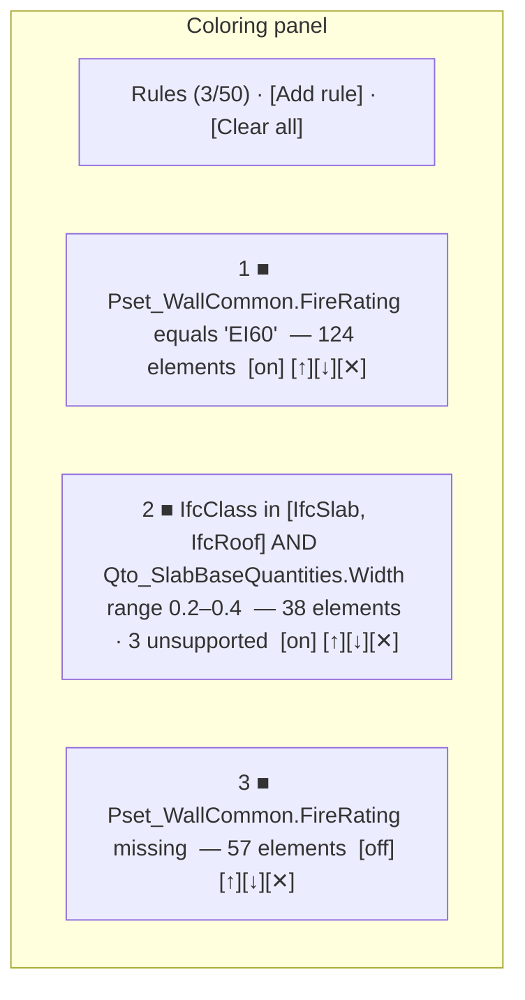
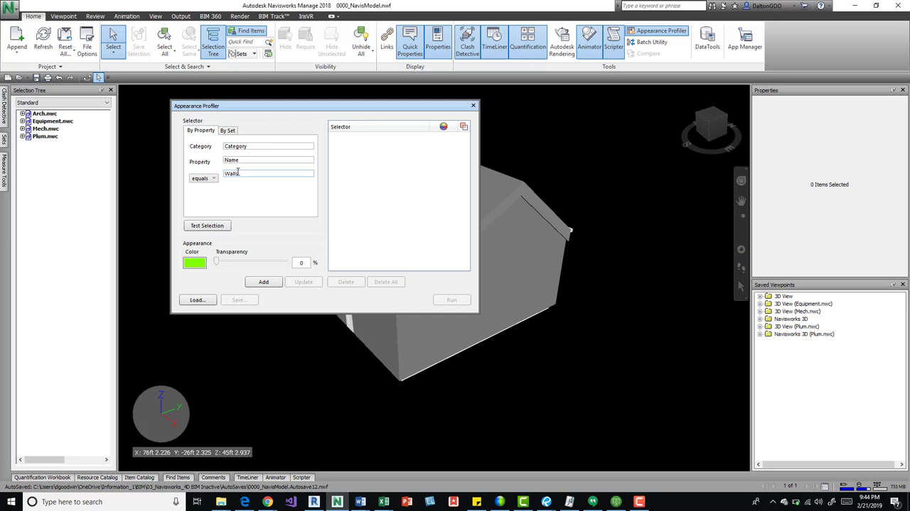
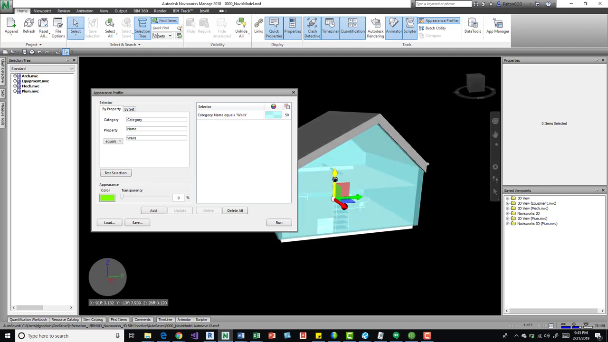
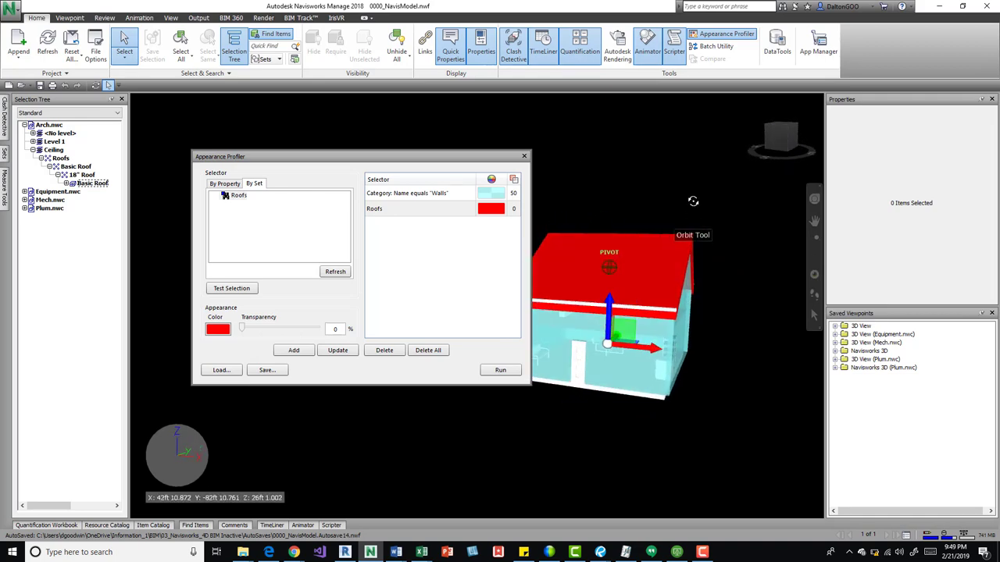
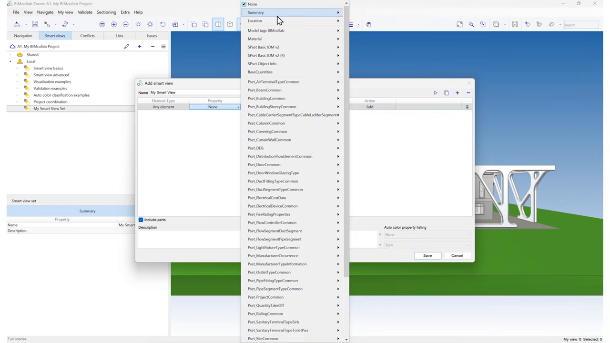
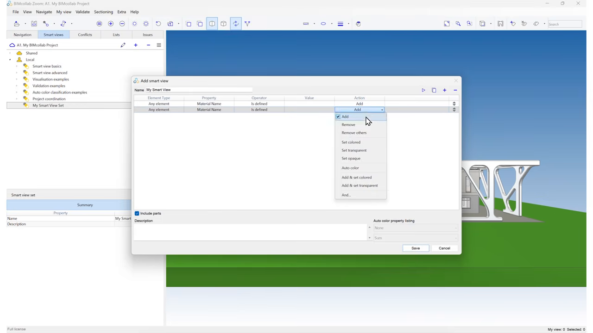
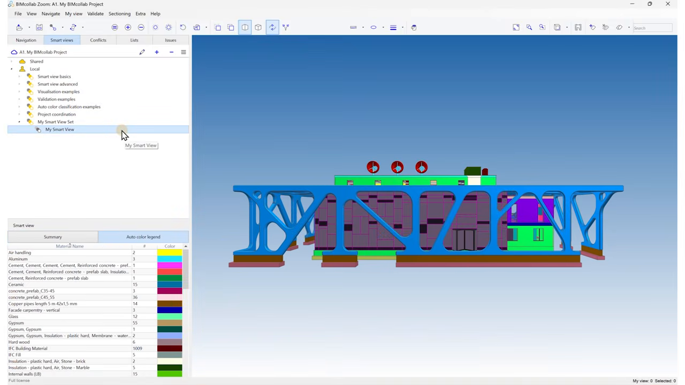

# Feature: Rule-Based Property Coloring

Status: Phase 1A, in progress locally. `mountPropertyColoring` lets users add single-condition `equals` rules (free-text field and value, colour swatch), reorder, delete, and clear; `matchColorRule` implements first-match over the shared predicate contract and has 4 passing unit tests. Multi-condition editing, other operators, enable/disable, the 50-rule cap, per-rule match counts, inspected-element rule display, and colour clean-up on disposal are not implemented. Missing built-in metadata is currently passed as empty text rather than `missing`. Browser acceptance is not verified.

## Summary

Let users colour elements across all loaded models with an ordered list of rules. Each rule has one or more conditions over IFC fields, combined with AND, and a colour. Enabled rules are evaluated top-down and the first match wins; unmatched elements keep their original colour. Selection highlight always sits above rule colours. Each rule shows its match count and any "unsupported value" count, and the property inspector shows which rule coloured an element. Rules are session-only, capped at 50 [A1].

**Recommendation.** Follow the Navisworks Appearance Profiler model (property condition → colour/transparency, run, see results) and BIMcollab Smart Views (ordered rules with colour actions and a colour legend) [S1, S2]. Reuse the cross-cutting predicate contract for fields and operators so search, filter, and colouring agree [A1]. Defer BIMcollab-style auto-colour-by-distinct-value, saved rule files, and transparency actions to later phases [S1, S2].

---

# Detailed Specification

## Problem

Estimators need to see at a glance which elements carry a property (for example material, fire rating, or classification), are missing it, or fall into a value range, without editing the IFC. The current UI only supports one free-text `equals` condition per rule, offers no feedback on how many elements matched, cannot disable a rule, and leaves colours applied after the feature is disposed [A1].

## Users

- Estimators and model reviewers checking data completeness and visualising categories across federated models before takeoff.

## Goals

- Build ordered, multi-condition rules with the shared operators.
- See immediately how many elements each rule coloured and which values were unsupported.
- Keep selection, display, and source materials correct; reset cleanly.
- Keep everything in memory.

## Comparable Products (Research)

| Product | Feature name | Docs | Video | Notes |
|---|---|---|---|---|
| Autodesk Navisworks | Appearance Profiler | Help page did not load | [Navisworks Appearance Profiler](https://www.youtube.com/watch?v=3z2PuJUD3W0) | By property or by search set; condition (equals / not equals); colour and transparency; Test selection; Run; save/load `.dat` [S1]. |
| BIMcollab Zoom | Smart Views (Color / Auto color) | Docs page did not load | [Smart Views: Auto color](https://www.youtube.com/watch?v=UswgkokdMmk) | Rule "material name is defined"; Auto color assigns a unique colour per value; legend listing [S2]. |
| Solibri | Classification colours | [Using Classification Colors](https://help.solibri.com/hc/en-us/articles/1500003953721-Using-Classification-Colors-for-Model-Visualization) | n/a | Colour map by any property; one classification at a time; unclassified components keep IFC colours; retained after Show All [S3]. |

## What Good Looks Like (Findings)

- **Condition → colour, then run.** Navisworks: the profiler "looks by property or by set … grabs it and it applies the color or transparency" (00:47–01:01); property "Name equals Walls", Test selection, choose colour/transparency, Run (02:35–03:37) [S1].
- **Ordered rules with colour actions.** BIMcollab: add a rule "where the material name is defined", duplicate it, change the action to auto colour, then check "the autocolor property listing" legend (00:08–00:37) [S2].
- **Unmatched keep original colours.** Solibri: "If no color is defined in the classification for the component, the default IFC colors will be used" [S3].
- **Colouring survives visibility resets.** Solibri classification colours are "retained even after using Show All" [S3]; the app keeps rule colours independent of visibility.
- **Saved profiles are a later need.** Navisworks saves profiles to `.dat` files for reuse across projects (07:56–08:32) [S1]; excluded from Phase 1 by the session-only boundary [A1].

## User Feedback (Forums)

- **Finding the right property is hard.** The Navisworks presenter says "by property it's difficult sometimes to come over here and really figure out what you need to put" and uses Find Items to discover category/property names (03:48–04:29) [S1]. → R3: field picker with type-ahead from the loaded models' fields, showing the value type.
- **Selections vs searches.** He warns that a saved *selection* "is not necessarily going to be looking at the updated elements", unlike a search set (06:35–06:50) [S1]. → R6: rules re-evaluate when models load, unload, or change visibility.
- **Switching colour schemes leaves stale colours.** Solibri's tip: switch off the previous classification and click Show All first, "otherwise the mapping of the previous classification might be retained in some places" [S3]. → R8: clearing or disposing removes every applied colour.
- **Re-evaluation.** The approved baseline holds. Research adds a field picker, match/unsupported counts, re-evaluation on model changes, and complete colour clean-up.

## User Flow

1. **Entry point.** The user opens **Coloring** in the feature dock. With no loaded model the panel shows an empty state.
2. **Add rule.** The user clicks **Add rule**, picks a field (type-ahead of `PsetName.PropName`, `QsetName.QuantityName`, and built-in fields with their value type), an operator valid for that type, a value, and a colour. **Add condition** appends AND conditions.
3. **Apply.** Rules apply immediately. Each rule row shows "N elements" and, if any, "M unsupported values".
4. **Order and toggle.** The user reorders rules (buttons and keyboard), disables or deletes rules; colours update.
5. **Inspect.** Selecting a coloured element shows the selection highlight; the properties panel shows "Coloured by rule 2: Fire rating equals EI60". Clearing selection restores the rule colour.
6. **Clear.** **Clear all** removes rules and all applied colours.
- **Error / edge paths:** 50 rules reached → Add disabled with a message; invalid numeric value → inline error, rule not applied; field absent on an element → `missing`, which matches only `missing`; IFC `$` → `unset`, which matches only `exists`/`equals unset` as defined by the contract; type mismatch → counted as unsupported, not matched; model loaded/removed/hidden → re-evaluated.

## Wireframe / Sketch

## Requirements

- **R1 — Ordered rule list.** Users can add, edit, reorder (buttons and keyboard), enable/disable, and delete rules. Maximum 50 rules per session [A1].
- **R2 — Conditions.** Each rule has ≥1 condition; conditions combine with AND. Operators: equals, in-list, contains, numeric range, exists, missing, as defined by the cross-cutting predicate contract; only operators valid for the field's value type are offered [A1].
- **R3 — Field picker.** Fields come from the loaded models' property/quantity sets and built-in fields, shown with their value type and unit, filterable by type-ahead; free text is not required [S1].
- **R4 — First match wins.** Enabled rules evaluate top-down; the first matching rule's colour applies; unmatched elements keep their original material colour [S3, A1].
- **R5 — Correct missing/unset handling.** Missing fields and IFC `unset` values are passed as such, never as empty text or zero; type mismatches count as "unsupported" per rule [A1].
- **R6 — Re-evaluation.** Rules re-evaluate on rule changes and on model load, removal, and visibility change; hidden elements are not counted [S1].
- **R7 — Counts and inspection.** Each rule shows matched and unsupported counts across visible loaded models; the properties panel shows the rule (index and summary) that coloured the inspected element.
- **R8 — Composition and clean-up.** Selection highlight overrides rule colour; rule colour composes with display opacity and wireframe; Clear all, disabling all rules, model removal, and feature disposal restore original colours exactly [S3, A1].
- **R9 — Non-destructive and session-only.** Colours are viewer-owned overrides; IFC data and parser materials are unchanged; rules are not persisted or transmitted [A1].
- **R10 — Accessibility.** Rule rows, colour swatches, and reorder controls are keyboard operable with names that include the rule number and summary; colour is never the only indicator (counts and summary text are shown).
- **R11 — Performance.** Evaluation is batched off the input path; a rule change on 100,000 elements completes without blocking input for more than 100 ms per chunk.

## Acceptance Criteria

- [ ] AC1: Given two rules matching the same element, then the first rule's colour applies; moving the second up changes the colour. *(Partial: `tests/unit/color-rules.test.ts` proves first-match and fall-through in `matchColorRule`, 4 tests passing locally on 2026-11-08; no UI/render assertion.)*
- [ ] AC2: Given a rule with two conditions, then only elements meeting both are coloured. *(Partial: unit test proves AND semantics; the UI cannot yet create multi-condition rules.)*
- [ ] AC3: Given numeric, text, enumeration, boolean, missing, and unset values, then each operator matches per the predicate contract and type mismatches are reported as unsupported.
- [ ] AC4: Given a disabled rule, then its colour is removed and lower rules apply.
- [ ] AC5: Given a coloured element, when it is selected, then the selection highlight shows; when cleared, the rule colour returns and the properties panel names the rule.
- [ ] AC6: Given rules applied, when Clear all is clicked or the feature is disposed, then every element shows its original colour.
- [ ] AC7: Given 50 rules, then Add rule is disabled with a message.
- [ ] AC8: Given a model loaded after rules exist, then its elements are coloured and counts update; removing it updates counts.
- [ ] AC9: Given a model at 40% opacity in wireframe, then rule colours appear with that opacity and on wireframe edges.
- [ ] AC10: Given reload, then no rules or colours persist.

## Test Cases (for developers)

| ID | Type | Precondition | Steps | Expected result |
|---|---|---|---|---|
| T1 | Unit | Rule set and lookups | Evaluate first-match, AND, disabled rules | Expected colour per element. |
| T2 | Unit | Typed values incl. missing/unset | Evaluate each operator | Contract results; mismatches counted unsupported. |
| T3 | Unit | Built-in metadata absent | Build lookup | Field is `missing`, not `''`. |
| T4 | Unit | 50 rules | Add another | Rejected. |
| T5 | Chrome E2E | Fixture with FireRating set/missing | Add "equals EI60" and "missing" rules | Counts match fixture; colours rendered. |
| T6 | Chrome E2E | Coloured element | Select, clear selection | Highlight, then rule colour; inspector names rule. |
| T7 | Chrome E2E | Rules applied | Clear all; dispose | Original colours restored. |
| T8 | Chrome E2E | Rules applied | Load second model; remove it | Recoloured; counts update. |
| T9 | Chrome E2E | Display opacity/wireframe | Apply rule | Composed rendering. |
| T10 | Accessibility | Panel | Keyboard-only add/reorder/toggle | Operable and named. |

## Module Contract

- Public entrypoint: `mountPropertyColoring` in `src/features/property-coloring/index.ts` (present locally).
- Uses `evaluateRule` from `src/core/predicate.ts` via `matchColorRule` in `src/core/color-rules.ts`; adds rule `enabled`, per-rule counts, and a `ruleFor(modelId, expressId)` query for the properties panel.
- Viewer command: `setElementColor(modelId, expressId, color | null)` (present) plus `clearElementColors()` for complete reset. Disposal calls `clearElementColors()` and removes listeners and DOM.

## Dependencies

- [Cross-cutting contracts](cross-cutting-contracts.md) §1–2 (fields, operators, property coverage), [element properties](element-properties.md), [element selection](element-selection.md), [display controls](display-controls.md), [model controls](model-controls.md), [model filtering](model-filtering.md) (shared condition editor), and [color swatch component](../../src/components/color-swatch-input.ts).

## Assumptions

- The condition editor is shared with Model Filtering to keep one UI for the predicate contract.
- Counts cover visible loaded elements only.

## Out of Scope

- Auto colour by distinct value with legend, transparency/hide actions per rule, and gradient/heat-map colouring [S1, S2].
- Saving, importing, or sharing rule sets [S1].
- Editing IFC data or writing colours back to files.

## Open Questions

- None. Ordered AND rules, first-match precedence, 50-rule cap, and session-only scope are approved [A1].

## Sources

- **[S1]** The BIM Coordinator — "Navisworks Appearance Profiler" — https://www.youtube.com/watch?v=3z2PuJUD3W0. Published 2019-02-22, 8:57. Captions: 00:39–01:01 profiler applies colour/transparency by property or by set; 02:35–03:37 "Name equals walls", test selection, colour, transparency 50, run; 03:48–04:29 hard to know which property to enter; 06:35–06:50 selection vs search set staleness; 07:56–08:32 save/load `.dat`.
- **[S2]** BIMcollab — "Smart Views in BIMcollab Zoom: Visualize materials with Auto color" — https://www.youtube.com/watch?v=UswgkokdMmk. Published 2026-09-30, 0:50. Captions: 00:08–00:14 rule "material name is defined"; 00:19–00:31 duplicate and set action to auto colour, unique colour per material; 00:33–00:37 auto-colour property listing.
- **[S3]** Solibri Help — "Using Classification Colors for Model Visualization" — https://help.solibri.com/hc/en-us/articles/1500003953721-Using-Classification-Colors-for-Model-Visualization. Colour by any property; one classification at a time; retained after Show All; unclassified components use IFC colours; switch off previous classification to avoid retained mapping. Accessed 2026-11-08.
- **[S4]** Capture commands — `property-coloring/assets/_capture_video.py`; runs `yt-dlp` (720p cap, English auto-captions) and `ffmpeg` frame extraction at the timestamps in the script for [S1] and [S2]. Full MP4s were held in a temporary directory and deleted; VTT transcripts and stills are retained. Frames were checked for nonblank pixels with Pillow and matched to caption timestamps; in-tool image viewing was unavailable in this session. The BIMcollab Smart Views basics video (0IRth0u2Oq8) returned HTTP 429 for captions and was not used.
- **[A1]** Approved Phase 1 decisions and local implementation (not external evidence): [Phase 1 MVP](../plans/Phase_1_MVP.md) ("coloring uses ordered AND rules with first-match precedence, below selection highlighting"), [cross-cutting contracts](cross-cutting-contracts.md) (predicate contract, 50 colour rules), `src/features/property-coloring/index.ts`, `src/core/color-rules.ts`, `src/core/predicate.ts`, and `tests/unit/color-rules.test.ts`.

---

# Research

## Autodesk Navisworks

- Property condition → colour/transparency → run (00:39–03:37) [S1]; supports R2, R4.
- Property discovery pain and selection staleness (03:48–06:50) [S1]; drives R3, R6.
- Transcript: [navisworks-appearance-profiler-transcript.en.vtt](property-coloring/assets/navisworks-appearance-profiler-transcript.en.vtt).

## BIMcollab Zoom

- Ordered rules with colour actions and a legend (00:08–00:37) [S2]; supports R1, R7 (visible results); auto colour is out of scope.
- Transcript: [bimcollab-smart-view-autocolor-transcript.en.vtt](property-coloring/assets/bimcollab-smart-view-autocolor-transcript.en.vtt).

## Solibri

- Classification colours: one active scheme, unmatched keep IFC colours, retention after Show All, and stale-mapping caveat [S3]; support R4 and R8. No video was captured.
