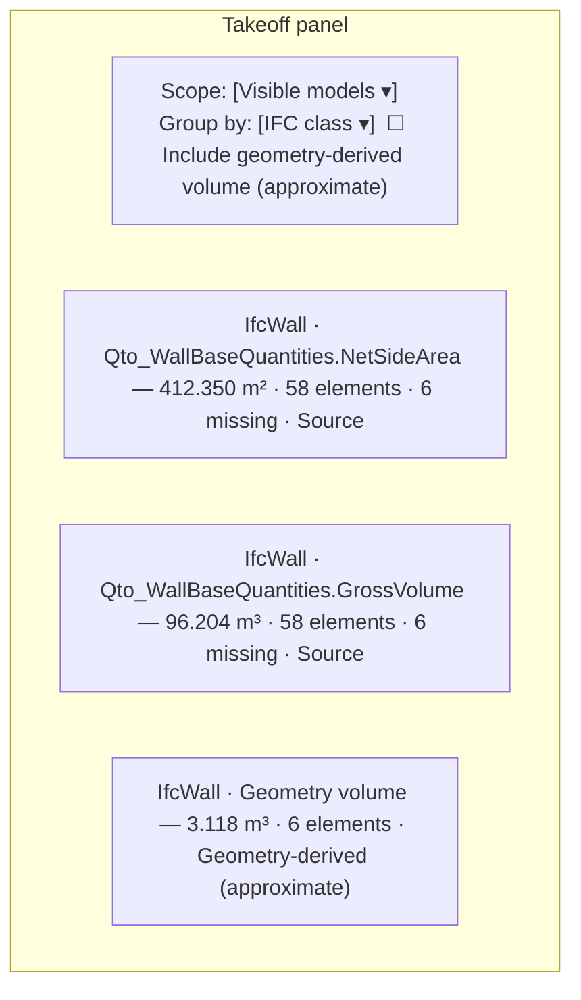
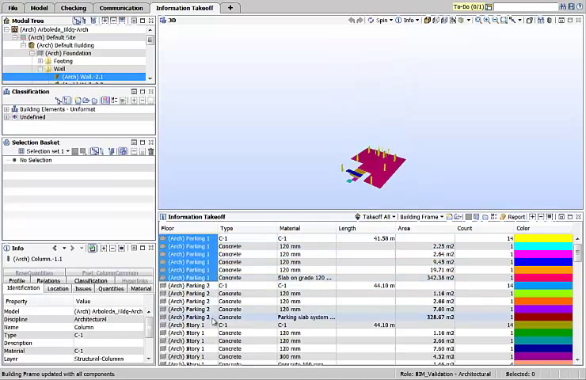
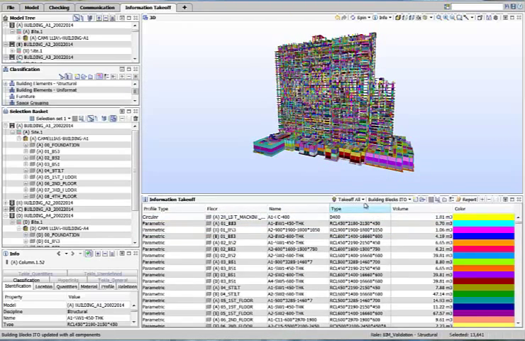
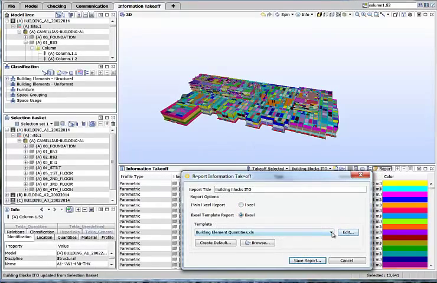
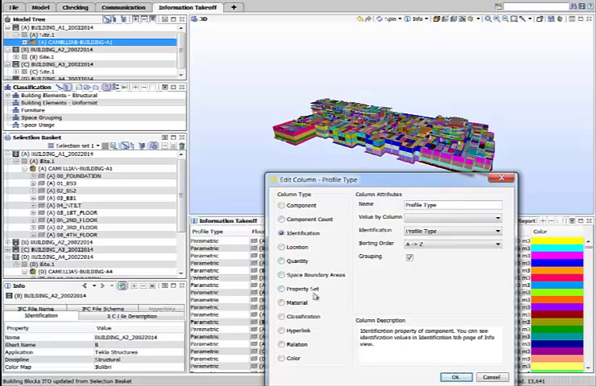

# Quantity Takeoff

Status: In progress locally (Phase 1C). `collectTakeoff` groups IFC `qto` quantities by class, type, or storey, converts units to metric, keeps model-scoped identities, and optionally adds a geometry-derived volume for elements with no source quantity; `mountQuantityTakeoff` renders one button per group with scope, grouping, and fallback controls. 7 unit tests across `quantity-takeoff.test.ts` and `units.test.ts` pass. Gaps: quantities without a unit or with an unknown unit are silently skipped instead of listed; there is no missing-quantity list or count kind; grouping lacks material, classification, and property-value options; the filter scope is missing; and clicking a group selects only its first element. Market basis: [Phase 1C research](../research/phase-1c-cost-estimation-market-research.md).

## Summary

Turn the IFC quantity sets in loaded models into a grouped takeoff table that estimators can trust. For a chosen scope (all models, visible models, one model, or the current filter result), group elements by a user-chosen field and show, for each group and each quantity name (for example `Qto_WallBaseQuantities.NetSideArea`), the metric total, the contributing element count, and the number of elements **missing** that quantity. Source values and geometry-derived approximations are kept in separate rows and never mixed. Every number traces back to model-scoped elements, and selecting a row highlights all its elements. Nothing is persisted [A1].

**Recommendation.** Follow Solibri's Information Takeoff pattern: takeoff for the whole model or selected parts (for example specific floors), grouped definitions, visualisation in 3D, and Excel output via the separate export feature [S1]. Treat missing quantities as a first-class result, because IFC quantities depend on the author enabling "Export base quantities" and on correct mappings [S2, S3]. Use quantity names exactly as exported, such as `NetSideArea` and `GrossVolume`, so net and gross are never summed together [S3].

---

# Detailed Specification

## Problem

Estimators receive IFC files from authoring tools with inconsistent or absent quantity sets. Without an explicit missing-quantity count, a total that silently omits elements looks complete. The current implementation drops any quantity without a recognised unit and selects only one element per group, so totals cannot be audited [A1].

## Users

- Quantity surveyors and estimators producing first-pass quantities from local IFC models before costing.

## Goals

- Grouped, metric quantity totals with counts and explicit missing counts.
- Full traceability from every total to its elements.
- Clear separation of source and geometry-derived values and of net and gross quantities.
- Responsive aggregation on the supported fixture sizes.

## Comparable Products (Research)

| Product | Feature name | Docs | Video | Notes |
|---|---|---|---|---|
| Solibri | Information Takeoff (ITO) | Help page not loaded | [Solibri Snapshot — Information Takeoff](https://www.youtube.com/watch?v=jzQf8GaicdY) | Role-based ITO definitions; whole-model or selected-floor takeoff; Excel report; visualise definitions in 3D [S1]. |
| Autodesk Assemble | Model Inventory | Phase 1C research | n/a | Inventory grouped/sorted by user-defined parameters; Excel export [S4]. |
| RIB CostX | BIM takeoff | [RIB CostX](https://www.rib-software.com/en/rib-costx) | Captions rate-limited | Model takeoff with live-linked estimate; multiple breakdown structures [S4]. |
| Navisworks Quantification | Model takeoff | n/a | Captions rate-limited (HTTP 429) | Not used as evidence [S5]. |

## What Good Looks Like (Findings)

- **Scope to parts of the model.** Solibri: "the ability to run information takeoff for the whole model or then selected model parts … the quantity surveyor can select the specific floors as well as the entire building" (01:02–01:28) [S1].
- **Definitions and grouping.** Users choose a role and ITO definitions such as building frames or slabs (00:49–01:00, 01:52–01:58) [S1]; Assemble groups by user-defined parameters [S4].
- **Visual traceability.** Solibri can "visualize these chosen definitions in 3D" (01:58–02:03) [S1]. → row selection highlights all elements.
- **Spreadsheet output.** ITO results are "a regular Excel document" (01:34–01:41) [S1]; export lives in [Estimate Excel export](estimate-excel-export.md).
- **Quantity semantics.** A Revit-exported `BaseQuantities` set carries `Height`, `Length`, `Width`, `GrossFootprintArea`, `GrossVolume`, `GrossSideArea`, `NetSideArea`, and `NetVolume`, with length values in millimetres (e.g. `Length` 6830.0) and volumes in m³ [S3]. → keep quantity names distinct and normalise each value by its own unit.

## User Feedback (Forums)

- **Quantities often missing or inconsistent.** In "Which Software to create lists of quantities of the used building materials" (Feb–Apr 2024), DerekHunter said customers send "more or less random exports from Revit that contain all kinds of different elements with no consistency at all" (5 Mar 2024); jwouellette said results depend "on the quality of the IFC export" and correct mappings (4 Mar 2024) [S3]. → R3, R4: count and list missing quantities and unknown units per group.
- **Base quantities must be enabled at export.** stefkeB: the author "should activate 'Export base quantities' with the IFC export", and exact per-material quantities are not exported this way (11 Mar 2024) [S3]. → R9: the empty state explains that the file may lack exported base quantities; material-layer quantities are out of scope.
- **Users want Excel lists.** lucapfeiffer found Solibri Office "worked quite well … I could also export it to Excel" (28 Feb 2024) [S3]. → export handled by the Excel export feature.
- **Re-evaluation.** The existing requirements hold. Research makes missing-quantity reporting central and confirms per-quantity unit normalisation.

## User Flow

1. **Entry point.** The user opens **Takeoff**. With no loaded model: "Load an IFC model to take off quantities."
2. **Scope and grouping.** The user picks scope (All models, Visible models, a model, Current filter result) and **Group by** (IFC class, Type name, Storey, Material, Classification reference, or any `Pset.Property` field).
3. **Read results.** A table lists group → quantity name → total (metric unit), element count, missing count, and source (Source / Geometry-derived). Unknown-unit values appear as a separate "unit unknown" count.
4. **Inspect.** Selecting a row highlights all contributing elements; the missing count opens the list of elements lacking that quantity.
5. **Fallback.** Enabling **Include geometry-derived volume (approximate)** adds separate approximate rows for elements without a source volume, flagged with mesh-quality warnings.
6. **Model changes.** Loading, removing, or hiding models (in visible scope) recomputes the table.
- **Error / edge paths:** no quantity sets at all → "This model has no IFC base quantities. The exporting tool may not have included them."; model with unknown length unit → its values are excluded from totals and counted as "unit unknown"; open/non-manifold mesh in fallback → flagged and excluded from the approximate total; large model → progress indicator, input not blocked.

## Wireframe / Sketch

## Requirements

- **R1 — Scope.** All models, visible models, a single model, or the current filter result; scope changes recompute the table [S1, A1].
- **R2 — Grouping.** IFC class, type name, storey, material, classification reference, or any `PsetName.PropName` field from the predicate contract; elements without the grouping field go to "Unassigned <field>" [S4, A1].
- **R3 — Per-quantity rows.** One row per group and quantity name (`QsetName.QuantityName`) with metric total, contributing count, missing count (elements in the group whose quantity set lacks that name), and unknown-unit count. Net and gross names are never combined [S3, A1].
- **R4 — Units.** Each value is normalised from its own IFC unit (or the model's project unit when the quantity has none) to metric; unknown units are excluded from totals and counted [S3, A1].
- **R5 — Count kind.** Element count per group is available as a `count` quantity for costing.
- **R6 — Identity.** Every row keeps the full list of `{modelId, expressId}`; duplicate express IDs across models never merge [A1].
- **R7 — Selection.** Selecting a row highlights all its elements (multi-element highlight, not first-only); the missing count lists elements lacking the quantity.
- **R8 — Geometry fallback.** Optional, off by default, volume only, separate rows labelled "Geometry-derived (approximate)", computed only for closed meshes; open/non-manifold meshes are flagged and excluded; validated against fixture solids [A1].
- **R9 — Empty and help states.** When no quantity sets exist, explain that base quantities may not have been exported [S3].
- **R10 — Performance and lifecycle.** Aggregation runs off the input path; results are in memory and recomputed on model load/removal/visibility (visible scope); nothing is persisted [A1].
- **R11 — Output contract.** Exposes `TakeoffRow { group, quantityName, kind, unit, total, count, missing, unknownUnit, source, identities }` to [Cost breakdown and mapping](cost-breakdown-mapping.md) and [Estimate Excel export](estimate-excel-export.md).

## Acceptance Criteria

- [x] AC1: Given the multistorey fixtures, when grouped by class, then source quantities are summed per group and converted to metric with element counts. *(Proven by `tests/unit/quantity-takeoff.test.ts` "groups source quantities by class, converts units, and counts contributing elements"; 7 tests across takeoff and units passed locally on 2026-11-08.)*
- [x] AC2: Given duplicate express IDs in two models, then identities stay model-scoped. *(Proven by "preserves model-scoped identities for every contributing element".)*
- [ ] AC3: Given elements in a group lacking a quantity, then the missing count and list are shown. *(Partial: "excludes elements without source quantities rather than treating them as zero" proves exclusion only.)*
- [ ] AC4: Given a quantity with no unit or an unknown unit, then it is counted as "unit unknown" and excluded from the total.
- [ ] AC5: Given `NetVolume` and `GrossVolume` on the same elements, then they appear as separate rows.
- [ ] AC6: Given a group row is selected, then all its elements are highlighted.
- [ ] AC7: Given the fallback enabled on a closed box and an open mesh, then the box volume matches 12 m³ ± 1% and the open mesh is flagged and excluded.
- [ ] AC8: Given scope = Current filter result, then only filtered elements contribute.
- [ ] AC9: Given model removal, then rows update and owned data is released.
- [ ] AC10: Given the Duplex fixtures, then totals compute without blocking input and missing quantities are reported.

## Test Cases (for developers)

| ID | Type | Precondition | Steps | Expected result |
|---|---|---|---|---|
| T1 | Unit | Multistorey fixture lookups | Group by class/storey/material | Correct totals, counts, Unassigned group. |
| T2 | Unit | Mixed mm/m quantities | Collect | Metric totals; unknown units counted. |
| T3 | Unit | Group with some elements lacking `NetSideArea` | Collect | `missing` equals lacking element count. |
| T4 | Unit | Net and gross quantities | Collect | Separate rows. |
| T5 | Unit | `box.ifc` triangles (4×1×3 m) | Fallback | 12 m³ ± 1%. |
| T6 | Unit | Open mesh | Fallback | Flagged, excluded. |
| T7 | Chrome E2E | Loaded fixtures | Select a group row | All elements highlighted. |
| T8 | Chrome E2E | Filter active | Scope = filter | Only filtered elements. |
| T9 | Chrome perf | Duplex MEP | Collect | No input blocking > 100 ms. |

## Module Contract

- Public entrypoints: `collectTakeoff(session, options)` and `mountQuantityTakeoff(target, session, selection)` in `src/features/quantity-takeoff/index.ts` (present).
- Reads properties and quantities only through the IFC adapter and units only through `src/core/units.ts`; selection through the selection capability (extended to multi-element highlight). Exposes `TakeoffRow[]` per R11.

## Dependencies

- [Element properties](element-properties.md), [cross-cutting contracts](cross-cutting-contracts.md) (fields, units §7), [model filtering](model-filtering.md), [element selection](element-selection.md), [large-model performance](large-model-performance.md), [cost breakdown and mapping](cost-breakdown-mapping.md), and [estimate Excel export](estimate-excel-export.md).

## Assumptions

- Quantities come from `IfcElementQuantity` sets (IFC4 `Qto_*`, IFC2x3 `BaseQuantities`); IFC2x3 `BaseQuantities` names are mapped by element class to the IFC4 names where unambiguous.
- Aggregate parent/child elements are not double-counted: if a parent and its children both carry the same quantity, only the children contribute (per the aggregate fixture) [A1].

## Out of Scope

- Material-layer quantities derived from layer thickness × area [S3].
- Version comparison between model revisions [S4].
- 2D takeoff from drawings.

## Open Questions

- None. Takeoff scope, metric normalisation, and the approximate-fallback rule are approved [A1].

## Sources

- **[S1]** Solibri Inc. — "Solibri Snapshot Video - Information Takeoff" — https://www.youtube.com/watch?v=jzQf8GaicdY. Published 2014-06-03, 2:22. Captions: 00:49–01:00 role and ITO definitions; 01:02–01:28 whole model or selected floors; 01:34–01:49 Excel report and templates; 01:52–02:03 new definitions for slabs, visualise in 3D.
- **[S2]** buildingSMART forum search "quantity takeoff" — https://forums.buildingsmart.org/search?q=quantity%20takeoff. Threads on QTO coverage, beam formwork quantities, and base-quantity export. Accessed 2026-11-08.
- **[S3]** buildingSMART forum — "Which Software to create lists of quantities of the used building materials" — https://forums.buildingsmart.org/t/which-software-to-create-lists-of-quantities-of-the-used-building-materials/5181. lucapfeiffer (26 Feb 2024, 28 Feb 2024), DerekHunter (27 Feb, 5 Mar 2024), jwouellette (4 Mar, 6 Mar 2024), stefkeB (11 Mar 2024, with a Revit-exported `BaseQuantities` example including `GrossSideArea`, `NetSideArea`, `GrossVolume`, `NetVolume`, and millimetre lengths).
- **[S4]** Project research — [Phase 1C cost estimation market research](../research/phase-1c-cost-estimation-market-research.md) (Autodesk Assemble inventory grouping and Excel export; RIB CostX BIM takeoff). Marketing-level evidence, as noted there.
- **[S5]** Capture commands — `quantity-takeoff/assets/_capture_video.py`; downloads [S1] (720p cap) without subtitles and extracts frames at 00:58, 01:25, 01:40, and 02:01 with `ffmpeg`; the English auto-caption VTT was fetched separately with `yt-dlp --skip-download --write-auto-subs`. YouTube returned HTTP 429 for Navisworks Quantification and RIB CostX captions, so those videos were not used. The full MP4 was held in a temporary directory and deleted. Frames were checked for nonblank pixels with Pillow and matched to caption timestamps; in-tool image viewing was unavailable.
- **[A1]** Approved decisions and local implementation (not external evidence): [Phase 1 MVP](../plans/Phase_1_MVP.md) (Phase 1C scope), [cross-cutting contracts](cross-cutting-contracts.md), `src/features/quantity-takeoff/index.ts`, `src/core/units.ts`, `tests/unit/quantity-takeoff.test.ts`, `tests/unit/units.test.ts`, and `tests/fixtures/1a/`.

---

# Research

## Solibri

- Whole-model or per-floor takeoff, definitions, Excel output, and 3D visualisation (00:49–02:03) [S1]; supports R1, R2, R7.
- Transcript: [solibri-information-takeoff-transcript.en.vtt](quantity-takeoff/assets/solibri-information-takeoff-transcript.en.vtt).

## buildingSMART community

- Quantity completeness depends on export settings and mappings; a real `BaseQuantities` example shows distinct net/gross names and mm lengths [S3]; supports R3, R4, R9.
