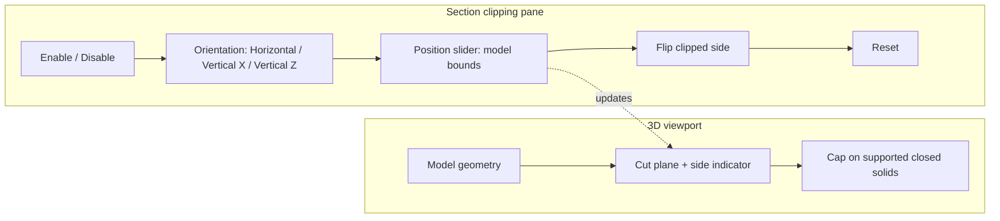
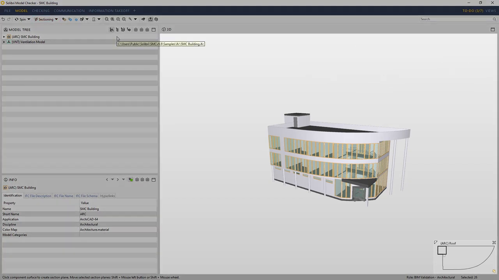
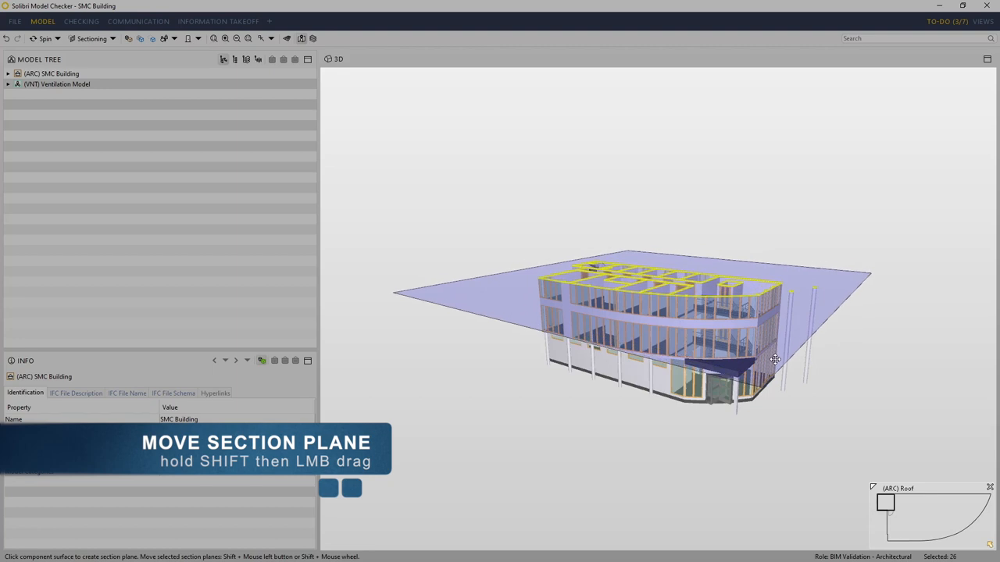
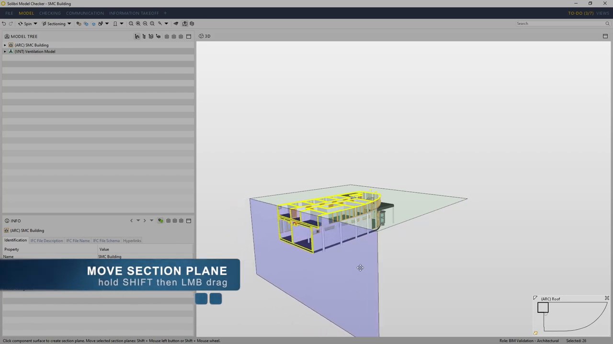
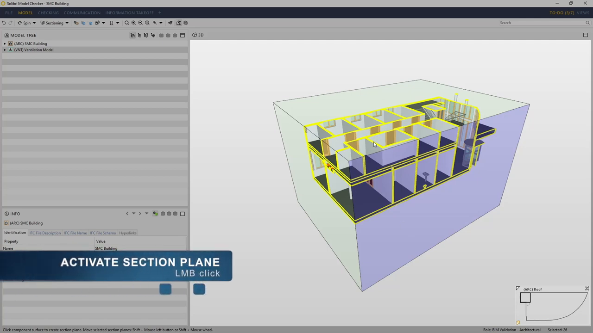
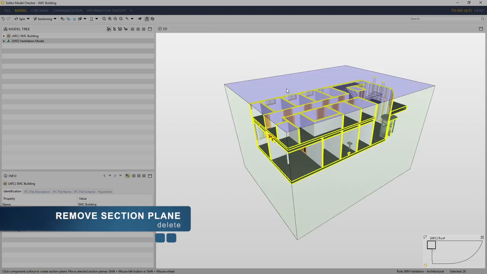

# Feature: 3D Section and Clipping

Status: Planned for Phase 1A. A basic orientation/offset pane and renderer clipping setter exist locally; cap faces, clip-aware picking, model-bound controls, lifecycle acceptance, and browser verification remain incomplete.

## Summary

Let users temporarily inspect loaded IFC models through one adjustable clipping plane. Provide horizontal and principal vertical orientation presets, a model-relative position control, a visible indication of the clipped side, and reset/disable. Closed supported solids should receive viewer-owned cap faces; unsupported or open meshes use an explicit uncapped fallback. Separate pick geometry preserves model-scoped selection and measurement where supported. The plane and its rendering resources are session-local [A1].

**Recommendation.** Keep Phase 1 to one shared plane applied across loaded models. Solibri offers multiple planes and section boxes, and Autodesk supports plane and box modes, but those broaden the baseline. Keep arbitrary camera alignment to a cut plane out of scope; a Trimble forum thread reports that gap for oblique buildings, but it is a separate navigation capability [S1, S2, S4, A1].

---

# Detailed Specification

## Problem

Users need to inspect interior geometry without hiding individual elements or editing the IFC. A clipping plane must clearly communicate which half-space is removed, remain adjustable over the actual model extent, and leave the source geometry and identity intact. Clipping also needs a deliberate cap/picking strategy: rendering-only clipping can leave solids visually open or make the visible cut surface impossible to select. The current local pane exposes three axis-aligned normals, a fixed-range offset slider, enable/disable, and reset; the viewer adapter applies a renderer plane to mesh materials. No feature-specific clipping tests or cap generation were found [A1].

## Users

- Estimators and reviewers inspecting one or more local IFC models who need to reveal internal components with a reversible cut.

## Goals

- Create, reposition, orient, reverse, reset, and disable one clipping plane.
- Apply the cut consistently across loaded models without changing their placement or IFC source data.
- Preserve element identity and selection/measurement behavior on supported cut surfaces.
- Make unsupported cap geometry and empty-scene behavior explicit rather than showing fabricated surfaces.
- Release all feature-owned scene resources when clipping is cleared or the feature is disposed.

## Comparable Products (Research)

| Product | Feature name | Docs | Video | Notes |
|---|---|---|---|---|
| Solibri Desktop | Sectioning Tool / Sectioning View | [The Sectioning Tool](https://help.solibri.com/hc/en-us/articles/1500003939981-The-Sectioning-Tool) | [#GetToGrips 06: Sectioning Tool](https://www.youtube.com/watch?v=76ujuIL4_KU) | Current docs cover one active plane, up to six stored planes, section boxes, visibility/restore, and the newer Sectioning View. The 2019 video is legacy UI evidence. |
| Autodesk Platform Services Viewer | `Autodesk.Section` extension | [SectionExtension API](https://aps.autodesk.com/en/docs/viewer/v7/reference/Extensions/SectionExtension/) | No section-specific video verified in this pass. | API provides X/Y/Z planes or a box, direct plane placement, activation/deactivation, and viewer-state restore. |

## What Good Looks Like (Findings)

- **Make plane creation direct.** Solibri creates a plane by clicking a component surface, then repositions it with Shift-drag; the active plane is visually distinct and its cut side can be flipped [S2, S3].
- **Make cut direction reversible and visible.** Solibri documents Backspace to flip the active half-space and Delete to remove that plane; a single-plane Phase 1 UI should provide equivalent explicit controls without adopting its multi-plane stack [S2, S3].
- **Bounded scope is a product choice.** Solibri supports up to six planes and section boxes; APS exposes X/Y/Z and box styles and state restoration. Phase 1 deliberately selects one plane and no section-box editing [S1, S2, A1].
- **Caps and picks are distinct concerns.** The comparator docs describe hiding one side of geometry but do not establish that every cut is capped or pickable. The app must specify cap generation limits and route supported cut-face hits back to the source element [A1].
- **Avoid implying arbitrary camera alignment.** A Trimble Connect user with a 45-degree building asked for a view perpendicular to the section cut; a reply said the web viewer's surface-align shortcut did not work on the cut plane at that time. This is a navigation request, not evidence that arbitrary plane rotation is part of the approved clipping scope [S4].

## User Feedback (Forums)

- Pia Nithi asked how to align the view perpendicular to a section cut because the building was oriented 45 degrees from standard views (20 Nov 2024). Marko Myllymaa replied that Alt-double-click aligns to a surface, not a section plane, in Trimble Connect Web; he noted that the plane interaction worked in the Windows app (21 Nov 2024). Tero Laine requested similar alignment to grid lines (26 Nov 2024) [S4].
- Implication: expose the plane's axis and clipped-side state clearly. Do not silently add camera-to-plane alignment or oblique grid workflows to this feature; they belong to navigation and are not approved in the Phase 1 clipping scope [A1].
- Solibri Society search loaded but ignored the requested term, so it yielded no attributable clipping feedback [S5]. No recurring cap-quality complaint was verified in the accessible sources.

## User Flow

1. **Entry point.** User opens **Section clipping**. With no model loaded, controls remain safely disabled or show an empty-state prompt.
2. **Enable.** User activates **Enable clipping**. The first model-relative plane is placed at the default offset and the clipped half-space is indicated by the plane normal/side label.
3. **Orient and position.** User selects Horizontal, Vertical X, or Vertical Z, then adjusts a slider bounded by the aggregate loaded-model extents. The adapter updates the one plane across all current models; newly loaded models inherit the active plane [A1].
4. **Inspect/reverse.** User reviews the cut. **Flip side** reverses the normal at the same plane position. Supported closed solids show a cap tied to the source element; unsupported geometry remains uncapped and is not assigned fabricated faces.
5. **Reset or disable.** **Reset** returns orientation/offset to defaults and disables clipping; **Disable** clears the plane and restores full geometry. Escape exits the active clip-edit tool per input arbitration [A1].
6. **Continue session.** The user may select/measure a visible cap or use separate pick geometry to retain model-scoped identity. Removing a model or disposing the feature removes its owned clipping/cap resources.
- **Error / edge paths:** empty scene produces no invalid plane; a zero/invalid model extent disables position adjustment safely; open/non-manifold geometry uses the uncapped fallback; removing all models clears active plane resources; hidden state remains owned by Model Controls and is not changed by clipping.

## Wireframe / Sketch

## Requirements

- **R1 — One active plane.** Create and maintain one adjustable plane shared by all currently loaded models. New models inherit the active plane. Do not expose stacks, section boxes, or generated 2D drawings [A1].
- **R2 — Orientation and position.** Provide horizontal, X-normal vertical, and Z-normal vertical presets in scene axes (scene Y is up). Position range is derived from loaded model bounds, not fixed raw coordinates. Reset returns to the documented default state [A1].
- **R3 — Cut-side feedback.** Identify the clipped half-space and provide a Flip side action that reverses the plane normal without changing its location.
- **R4 — Adapter boundary.** The feature owns UI and plane state; the viewer adapter applies/clears renderer clipping across model materials. Clipping does not translate or mutate source geometry, IFC data, or model-scoped IDs [A1].
- **R5 — Caps.** Generate viewer-owned cap faces for supported closed solids. Cap faces carry the originating `{modelId, expressId}` for picking and are excluded from IFC data and model bounds. Open/non-manifold or unsupported meshes use an uncapped fallback with no guessed fill [A1].
- **R6 — Clip-aware picking.** Keep separate pick geometry so visible cut caps and supported visually clipped-away source geometry resolve to the original model-scoped element for selection and measurement. Unsupported geometry must not claim this behavior [A1].
- **R7 — Composition and lifecycle.** Empty scenes and invalid extents do not create NaN planes. Model-level hidden state remains controlled by Model Controls. Removing a model, disabling/resetting clipping, or disposing the feature clears owned planes, caps, listeners, and GPU resources without disposing shared renderer resources [A1].
- **R8 — Session-local operation.** Clipping state is temporary and is not persisted or sent over the network. The feature does not create a plan view, section drawing, issue, or saved clipping state [A1].
- **R9 — Accessible controls.** All controls are keyboard reachable, named, and visibly focused; the clipped-side indicator is available as text/state and not only color [A1].

## Acceptance Criteria

- [ ] AC1: Given a loaded model, when the user enables clipping and selects each preset, then one plane cuts the intended scene half-space and displays the selected orientation and cut side. *(No section-clipping E2E test found.)*
- [ ] AC2: Given models with different extents, when the plane-position control is adjusted to either limit, then the plane traverses the loaded bounds without a fixed-coordinate range failure. *(Current UI uses -100..100; bounds-aware behavior is not implemented or tested.)*
- [ ] AC3: Given active clipping, when Flip side is activated, then the normal reverses while the plane position stays constant and the indicator updates. *(Not implemented or tested.)*
- [ ] AC4: Given supported closed-solid geometry, when the plane intersects it, then a cap renders, is model-scoped for picking, and does not affect model bounds or IFC data. *(No cap generator or test found.)*
- [ ] AC5: Given open/non-manifold geometry, when it is clipped, then no invalid cap is fabricated and the documented uncapped fallback renders without an error. *(Not tested.)*
- [ ] AC6: Given clipped geometry, when the user selects/measures a supported cap or clipped-away source point, then the original `{modelId, expressId}` is returned. *(Not tested.)*
- [ ] AC7: Given an empty scene, model removal, or feature disposal, when clipping is disabled or resources are removed, then no stale planes, caps, listeners, NaN values, or render errors remain. *(The pane calls `setClipping(null)` on dispose, but no feature lifecycle test exists.)*
- [ ] AC8: Given a hidden model or a model loaded while clipping is enabled, then clipping does not reveal a hidden model and the newly loaded model receives the active plane. *(Adapter inheritance is code-visible; hidden-state composition is not browser-tested.)*
- [ ] AC9: Given clipping is active, when the user inspects persistence and network behavior, then no clipping state or model-derived geometry is persisted or transmitted. *(No privacy E2E evidence found.)*
- [ ] AC10: Given the clipping pane is used by keyboard, then every control has an accessible name and visible focus, and cut-side meaning is available without relying only on color. *(Not accessibility-tested.)*

## Test Cases (for developers)

| ID | Type | Precondition | Steps | Expected result |
|---|---|---|---|---|
| T1 | Unit/adapter | Synthetic box in scene coordinates | Apply each preset and known offsets | Correct single-plane normal, constant, and clipped side. |
| T2 | Adapter/browser | Small and large models with different bounds | Adjust position to both slider limits | Plane spans each aggregate model extent; values remain finite. |
| T3 | Unit/E2E | Active plane with known normal/position | Flip side | Normal sign reverses; plane location is unchanged; status updates. |
| T4 | Adapter/render | Closed box fixture | Clip through center and select cap | Cap is visible, maps to source model-scoped ID, and is excluded from bounds/IFC. |
| T5 | Adapter/render | Open and non-manifold fixtures | Clip each fixture | No invalid cap; uncapped fallback; no renderer exception. |
| T6 | Chrome E2E | Loaded model and selection/measurement tools | Clip, then pick cap and supported clipped-away mesh | Picks return correct source IDs; tool arbitration remains correct. |
| T7 | Unit/E2E | Empty scene, active plane, then remove models/dispose | Enable, remove, reset, dispose | No stale plane/cap/listener; finite renderer state; full geometry restored. |
| T8 | Chrome E2E | One hidden model and one newly loaded model | Enable clipping; load model; inspect visibility | Hidden model stays hidden; new model inherits plane. |
| T9 | Chrome E2E | Clipping active | Inspect storage/network and reload | No clipping persistence or model-derived transmission. |
| T10 | Accessibility | Clipping pane mounted | Keyboard-tab and activate controls; inspect accessible state | Controls are named/focusable; cut side is announced/textually indicated. |

## Module Contract

- Entrypoint: `mountSectionClipping` in `src/features/section-clipping/` (already present locally).
- The feature owns control state and one plane's parameters. The viewer adapter owns applying clipping, cap/pick geometry, and renderer/GPU resources.
- Disabling, resetting, or disposing clears only this feature's resources; it does not dispose shared scene or renderer resources.

## Dependencies

- [IFC loading](ifc-loading.md), [3D navigation](viewer-navigation.md), [model measurement](model-measurement.md), [element selection](element-selection.md), [cross-cutting contracts](cross-cutting-contracts.md), and [overall architecture](../architecture.md).
- Viewer adapter support for clipping planes, model bounds, model-scoped picking, separate clipped pick geometry, cap generation, and owned-resource cleanup.

## Assumptions

- Preset normals use scene axes: Horizontal normal is scene Y; Vertical X/Z use the scene principal axes, consistent with the coordinate contract [A1].
- Plane offset is interpreted in the viewer's normalized scene coordinates; the slider maps to loaded model bounds instead of assuming models occupy a fixed `[-100,100]` interval.
- Cap support is limited to meshes whose topology can be closed reliably; unsupported topology is left visibly uncapped and reported without changing source geometry [A1].

## Out of Scope

- Multiple simultaneous planes, section boxes, sections around floors/spaces/selection baskets, and saved clipping state.
- Generated plan or orthographic section drawings; these are separate Phase 1B features and a clipping plane is not a substitute [A1].
- Camera alignment perpendicular to an arbitrary cut, grid-aligned camera views, and arbitrary oblique plane rotation; these need a separate navigation decision [S4].
- IFC authoring, source-mesh modification, persisted caps, and geometry repair for open/non-manifold meshes.

## Open Questions

- None within the approved one-plane Phase 1 scope. Oblique camera/plane controls are intentionally not added based on the single Trimble request [S4].

## Sources

Accessed 2026-11-08 unless noted.

- **[S1]** Autodesk Platform Services Viewer v7 — `SectionExtension` — https://aps.autodesk.com/en/docs/viewer/v7/reference/Extensions/SectionExtension/. Plane and box modes, X/Y/Z presets, direct normal/point placement, activation/deactivation, and state capture/restore.
- **[S2]** Solibri — The Sectioning Tool — https://help.solibri.com/hc/en-us/articles/1500003939981-The-Sectioning-Tool. Current help states one active plane at a time, up to six planes per model, shift/drag repositioning, flip/delete/hide controls, restoration, and issue-based save behavior; also describes newer Sectioning View features.
- **[S3]** Solibri UK Ltd — “#GetToGrips 06: Sectioning Tool” — https://www.youtube.com/watch?v=76ujuIL4_KU. Published 2019-02-15. Captions: 00:23 says up to six planes; 00:31–00:43 describes adding at a surface and Shift-drag reposition; 01:26–01:46 identifies the active plane, Backspace flip, and Delete removal; 02:03–02:12 describes turning planes off and saving through an issue. This is legacy UI, not the current Sectioning View.
- **[S4]** Trimble Connect User Forum — “Align the view with section cut” — https://community.trimble.com/discussion/align-the-view-with-section-cut. Pia Nithi, 20 Nov 2024, asks for perpendicular view alignment for a 45-degree building; Marko Myllymaa, 21 Nov 2024, says the web surface-align shortcut did not work on a section plane while the Windows app could; Tero Laine, 26 Nov 2024, asks for grid-line alignment.
- **[S5]** Solibri Society search for “clip plane” — https://society.solibri.com/search?q=clip%20plane. Accessed 2026-11-08; page loaded but ignored the query and returned 452 results matching an empty term, so it yielded no attributable clipping feedback.
- **[S6]** Capture commands — `section-clipping/assets/_capture_video.py`; invokes `yt-dlp` capped at 720p with English auto-captions, then `ffmpeg` extracts frames at 00:31, 00:43, 01:06, 01:28, and 01:41. The full MP4 is held in a temporary directory and deleted after extraction; only VTT, stills, and the script remain in the feature assets directory.
- **[A1]** Approved Phase 1 decisions and local implementation: [Phase 1 MVP](../plans/Phase_1_MVP.md), [cross-cutting contracts](cross-cutting-contracts.md), `src/features/section-clipping/`, and `src/adapters/viewer/` (not external evidence).

# Research

## Solibri

- The transcript and frames support the legacy workflow: add on a surface, Shift-drag to reposition, distinguish the active plane, reverse its half-space, and delete or hide planes [S3].
- Current help adds the Sectioning View and issue-based restoration; these capabilities are documented but intentionally excluded from the one-plane transient app scope [S2, A1].
- Captions, frames, and the capture script are retained under this feature's assets; the full downloaded video was removed after frame extraction [S6].

## Autodesk Platform Services

- The API reference describes three axis-plane styles or a box, direct plane placement, and viewer-state capture/restore. It does not establish cap-face or separate-pick behavior for this app [S1]. No product-specific video was verified.

## Trimble Connect

- The forum discussion records a web-viewer gap aligning the camera perpendicular to an oblique section cut, plus a request for grid-line alignment [S4]. That request informs the explicit navigation non-goal; no clipping implementation requirement was inferred from it.