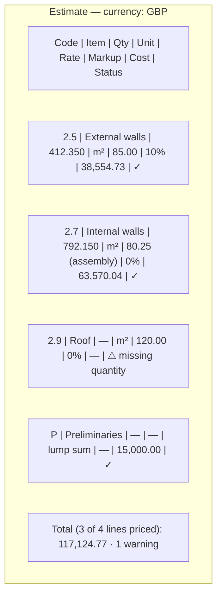
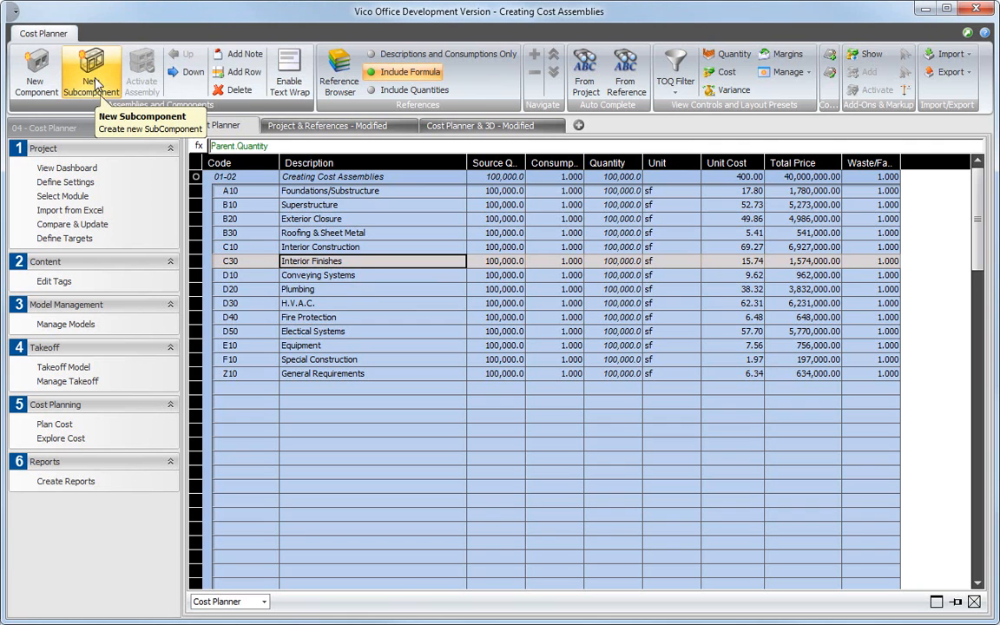
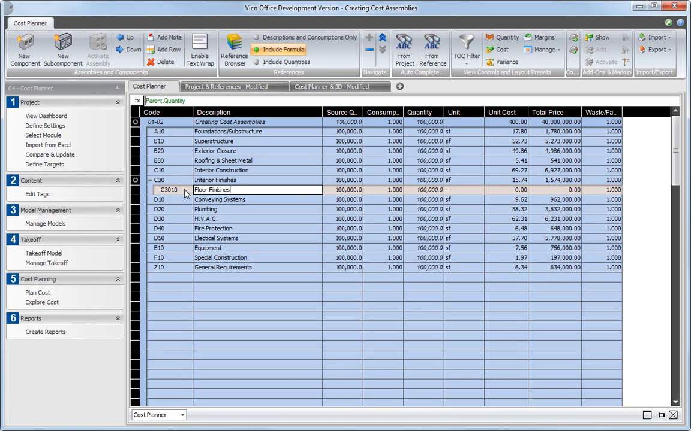
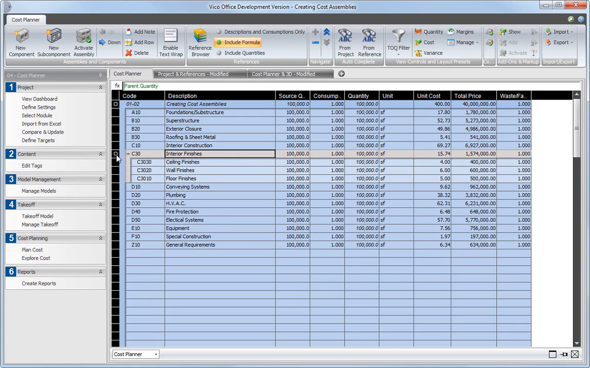
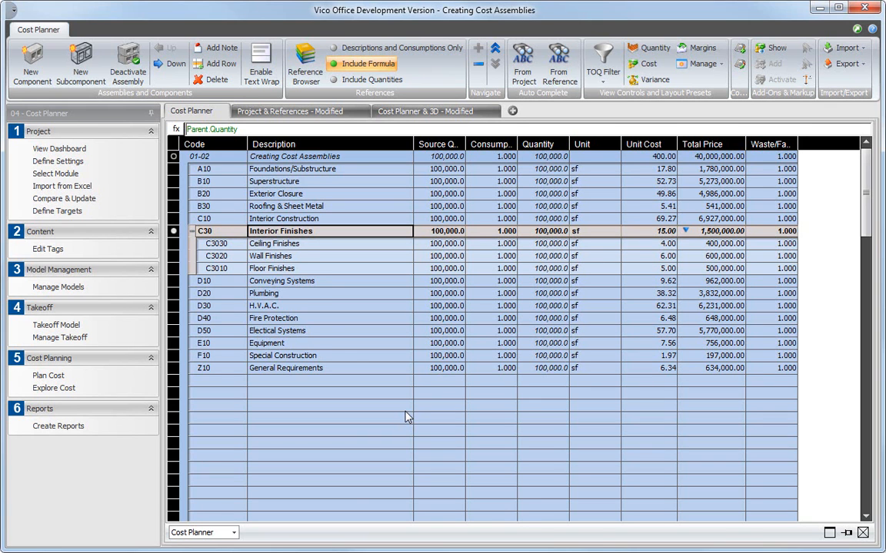

# Unit Rates, Assemblies and Cost Calculation

Status: In progress locally (Phase 1C). `src/core/costing.ts` provides `calculateCost` (quantity × rate × (1 + markup %), lump sums, missing-input and unit-mismatch warnings) and `assemblyRate` (Σ quantity × rate × (1 + waste %)); `tests/unit/phase1c.test.ts` "calculates markup and flags missing inputs" passes. **Defect against the approved requirement:** arithmetic uses binary floating point (`Math.round` with `Number.EPSILON`), not a fixed-precision decimal type, so half-way values can round incorrectly: the current rounding returns 1,234,567.00 for 1,234,567.005 (expected 1,234,567.01), and `0.1 × 3 = 0.30000000000000004` in Node. The estimate panel costs a single line whose quantity is the number of loaded models, not CBS items. Per-CBS-item rates, assembly editing, hierarchy and location roll-up, and change warnings are not implemented. Market basis: [Phase 1C research](../research/phase-1c-cost-estimation-market-research.md).

## Summary

Each CBS item gets a unit, a unit rate (typed, or derived from an assembly), optional markup %, and its linked takeoff quantity; cost = quantity × rate × (1 + markup). Assemblies are one level of component lines (code, description, unit, rate, quantity per assembly unit, waste %) whose total per assembly unit becomes the item's rate. Lump-sum and allowance lines have no model quantity. Costs roll up through the CBS hierarchy and the location breakdown. All arithmetic is exact decimal with documented per-line rounding (money 2 dp, quantity 3 dp, half away from zero), and missing inputs produce visible warnings, never zero [A1].

**Recommendation.** Follow the Vico Cost Planner model: unit cost × quantity per line, assemblies whose cost is the sum of their components and whose unit price is that sum divided by the assembly quantity, and clear status when detail lines are not yet included [S1, S2]. Replace the floating-point rounding with a decimal implementation before acceptance, because the approved requirement and the Excel-parity requirement depend on exact display-precision totals [A1].

---

# Detailed Specification

## Problem

Quantities only become useful to estimators once priced. Users need rates per CBS item, simple assemblies (e.g. a wall build-up), markup, and totals that match the exported workbook to the cent. Binary floating point cannot guarantee that, and the current panel does not price CBS items at all [A1].

## Users

- Estimators producing a first-pass priced estimate from IFC takeoff with their own rates.

## Goals

- Price every CBS item from its linked quantity and a typed or assembly-derived rate.
- Exact, documented rounding that the Excel export reproduces.
- Visible warnings for missing quantities, missing rates, and unit mismatches.
- Roll-ups by CBS hierarchy and by location.

## Comparable Products (Research)

| Product | Feature name | Docs | Video | Notes |
|---|---|---|---|---|
| Trimble Vico Office | Cost Planner components and assemblies | Phase 1C research | [Creating Cost Assemblies](https://www.youtube.com/watch?v=xdh_kX1SU8w), [Adding a Cost Line Item](https://www.youtube.com/watch?v=D_p7Jc89n5Q) | Line cost = quantity × unit cost; quantity = source × consumption × waste; assembly cost = Σ components; unit price = Σ / assembly quantity; inactive subcomponents excluded [S1, S2]. |
| RIB CostX | Estimating workbooks | [RIB CostX](https://www.rib-software.com/en/rib-costx) | n/a | Spreadsheet estimates live-linked to model data [S3]. |

## What Good Looks Like (Findings)

- **Line maths.** "The quantity of the component is now calculated by multiplying source quantity by consumption by waste factor … the total price of the component is calculated by multiplying quantity by the entered unit cost" (02:37–02:59) [S2].
- **Assembly roll-up.** "The cost of the assembly is now calculated as the sum of the cost of all the components included" (02:00–02:04); "the unit price of the assembly is calculated by dividing the sum of the included component prices by the assembly's quantity" (04:23–04:29) [S1].
- **Component quantity defaults to the parent.** A new subcomponent's quantity defaults to `parent.quantity` (02:47–02:54) [S1]. → R3: component quantity is "per assembly unit" × item quantity.
- **No silent inclusion.** New subcomponents "are not included in the cost plan yet" until activated, shown by an open circle; a half circle marks partially active work (01:20–01:25, 03:37–03:46, 05:09–05:21) [S1]. → R7: incomplete lines are visibly excluded and flagged.
- **Change visibility.** When an assembly replaces a line's price, "the old price … is automatically compared to the new rolled-up cost … indicated by this arrow icon" (04:09–04:21) [S1]. → R8: show a changed-total indicator after model or rate changes.

## User Feedback (Forums)

- No accessible estimator forum thread on rate calculation was found in this pass (Stack Overflow returned a CAPTCHA earlier; vendor forums require sign-in). The approved requirement for decimal arithmetic is supported by a reproducible check: in Node, `0.1 * 3` evaluates to `0.30000000000000004` [A1]. → R5.
- **Re-evaluation.** The existing requirements hold. Research confirms assembly unit-price division, parent-quantity defaults, and visible exclusion of incomplete lines.

## User Flow

1. **Entry point.** In **Cost breakdown**, each CBS item shows a **Rate** column; with no CBS, the panel links to Cost breakdown.
2. **Set currency.** The user enters a free-text currency label (e.g. "GBP"); no conversion.
3. **Typed rate.** For item 2.5 External walls (quantity 412.350 m²), the user enters rate 85.00 per m² and markup 10%. Cost = 412.350 × 85.00 × 1.10 = 38,554.73.
4. **Assembly rate.** Alternatively the user opens **Assembly** and adds components: blockwork 1.000 m²/m² @ 45.00 (waste 5%), plaster 2.000 m²/m² @ 12.00, paint 2.000 m²/m² @ 4.50. Rate = 47.25 + 24.00 + 9.00 = 80.25 per m².
5. **Lump sum.** An allowance line "Preliminaries — 15,000.00" has no quantity.
6. **Totals.** Parent items and the project total roll up; **Group by location** splits totals by storey.
7. **Changes.** When models or mappings change, affected items recompute and show a changed indicator until acknowledged.
- **Error / edge paths:** missing rate → "missing rate" warning, cost blank, excluded from totals and counted; missing quantity → same; rate unit incompatible with quantity kind (e.g. per m³ on an area) → "unit mismatch", excluded; negative quantity or rate → rejected; markup outside −100…1000% → rejected.

## Wireframe / Sketch

## Requirements

- **R1 — Line inputs.** Each CBS item has unit, rate (typed or assembly), markup %, and its linked takeoff quantity (with optional manual override, badged); lump-sum lines have a fixed amount and no quantity [S2, A1].
- **R2 — Line formula.** cost = round₂(round₃(quantity) × rate × (1 + markup/100)); markup is additive per line; no compounding [A1].
- **R3 — Assemblies.** One level of components with code, description, unit, rate, quantity per assembly unit, and waste %; assembly rate = round₂(Σ component qty × rate × (1 + waste/100)); no nesting, so cycles are impossible [S1, A1].
- **R4 — Roll-up.** Parent item cost = Σ child costs; project total = Σ top-level costs; location roll-up splits by site/building/storey; totals report "N of M lines priced" [S1].
- **R5 — Exact decimal arithmetic.** Use a fixed-precision decimal type for all money and quantity operations; round half away from zero at the documented precision per line; document the rounding points so [Estimate Excel export](estimate-excel-export.md) reproduces them with `ROUND()` [A1].
- **R6 — Units.** Rates and quantities are metric; compatible non-metric rate units convert with exact factors and keep the original; incompatible units are flagged and excluded [A1].
- **R7 — Warnings, never zeros.** Missing quantity, missing rate, and unit mismatch produce per-line warnings, blank cost, exclusion from totals, and a warning count [S1, A1].
- **R8 — Change indicator.** After model, mapping, or rate changes, recomputed items show a changed marker with old and new cost until acknowledged [S1].
- **R9 — Validation.** Reject negative quantities and rates, non-numeric input, and markup outside −100…1000%.
- **R10 — Currency label and formatting.** Free-text label; money 2 dp, quantity 3 dp, English-locale grouping; no conversion and no bundled prices [A1].
- **R11 — Persistence boundary.** In memory; leaves the app only through explicit export [A1].

## Acceptance Criteria

- [ ] AC1: Given quantity 412.350 m², rate 85.00, markup 10%, then cost is 38,554.73. *(Partial: `tests/unit/phase1c.test.ts` "calculates markup and flags missing inputs" covers markup and missing inputs, 5 tests passing locally on 2026-11-08; values are computed with floating point.)*
- [ ] AC2: Given the three-component assembly in the user flow, then the rate is 80.25 and a 792.150 m² item costs 63,570.04.
- [ ] AC3: Given values that round half-way at 2 dp (e.g. 1.005, 2.675, 1,234,567.005), then results round half away from zero exactly (1.01, 2.68, 1,234,567.01).
- [ ] AC4: Given a missing rate or quantity, then the line shows a warning, has no cost, and is excluded and counted in the total.
- [ ] AC5: Given a per-m³ rate on an area item, then "unit mismatch" is shown and the line is excluded.
- [ ] AC6: Given parent and child items, then parent and project totals equal the sum of children; location roll-up sums match the item total.
- [ ] AC7: Given a model change altering a quantity, then the item recomputes and shows the changed indicator.
- [ ] AC8: Given the exported workbook recalculated, then every line and total equals the app at displayed precision (see export spec).

## Test Cases (for developers)

| ID | Type | Precondition | Steps | Expected result |
|---|---|---|---|---|
| T1 | Unit | Line inputs | Compute AC1 | 38,554.73 exactly. |
| T2 | Unit | Assembly | Compute AC2 | 80.25; 63,570.04. |
| T3 | Unit | Half-way values | Round | Half away from zero, exact. |
| T4 | Unit | Missing/mismatch | Compute | Warnings; excluded; counted. |
| T5 | Unit | CBS tree with costs | Roll up | Parent/project sums. |
| T6 | Unit | Invalid input | Validate | Rejected. |
| T7 | Chrome E2E | Mapped CBS | Enter rates; change model | Totals update; change indicator. |
| T8 | Integration | Export workbook | Recalculate (headless) | Equal to app totals. |

## Module Contract

- Pure model in `src/core/costing.ts` (present), to be moved onto a decimal type; consumes `CbsItemTotal[]` from [Cost breakdown and mapping](cost-breakdown-mapping.md); exposes `CostLine` and roll-up results to `src/features/estimate/` and [Estimate Excel export](estimate-excel-export.md).

## Dependencies

- [Quantity takeoff](quantity-takeoff.md), [cost breakdown and mapping](cost-breakdown-mapping.md), [estimate Excel export](estimate-excel-export.md), [estimate data files](estimate-data-files.md), and [cross-cutting contracts](cross-cutting-contracts.md) §7 (units).

## Assumptions

- A small, MIT/BSD/Apache-licensed, same-origin decimal library or a minimal in-repo fixed-point implementation is acceptable for R5; selecting one is an implementation decision, not a scope change.
- Consumption factors (Vico's "consumption") are expressed as assembly component "quantity per assembly unit".

## Out of Scope

- Currency conversion, tax/VAT, escalation, nested assemblies, compounding markups, and resource/labour-hour breakdowns [S1].
- Bundled price books.

## Open Questions

- None. Formulas, rounding, assemblies without nesting, and the currency label are approved; the decimal-arithmetic gap is an implementation defect to fix, not an open decision [A1].

## Sources

- **[S1]** FridaysWithVico (presented by Vico Software's director of product management, per captions 00:00–00:04) — "CP-L1-02 Creating Cost Assemblies in Vico Office Cost Planner" — https://www.youtube.com/watch?v=xdh_kX1SU8w. Published 2011-04-21, 5:48. Captions: 00:08–00:15 assemblies group components; 01:00–01:25 active/inactive status, new components not included until activated; 02:00–02:04 assembly cost = sum of components; 02:47–02:54 subcomponent quantity defaults to `parent.quantity`; 03:37–03:46 open-circle indicator; 04:09–04:29 old vs rolled-up price arrow; unit price = sum ÷ assembly quantity; 05:09–05:21 half-circle partial state.
- **[S2]** FridaysWithVico — "CP L1 01 Adding a Cost Line Item to Vico Office Cost Planner" — https://www.youtube.com/watch?v=D_p7Jc89n5Q. Published 2011-04-21, 3:33. Captions: 02:12–02:59 quantity = source quantity × consumption × waste factor; total = quantity × unit cost. Transcript and frames are retained under [cost breakdown mapping assets](cost-breakdown-mapping/assets/).
- **[S3]** Project research — [Phase 1C cost estimation market research](../research/phase-1c-cost-estimation-market-research.md) (RIB CostX estimating spreadsheets live-linked to data). Marketing-level evidence.
- **[S4]** Capture commands — `unit-rates-costing/assets/_capture_video.py`; downloads [S1] (720p cap) without subtitles and extracts frames at 02:30, 02:50, 03:43, and 04:10; the English auto-caption VTT was fetched separately with `yt-dlp --skip-download --write-auto-subs`. The full MP4 was held in a temporary directory and deleted. Frames were checked for nonblank pixels with Pillow and matched to caption timestamps; in-tool image viewing was unavailable.
- **[A1]** Approved decisions and local implementation (not external evidence): [Phase 1 MVP](../plans/Phase_1_MVP.md) (Phase 1C), [cross-cutting contracts](cross-cutting-contracts.md), `src/core/costing.ts`, `src/features/estimate/index.ts`, `tests/unit/phase1c.test.ts`, and local Node checks on 2026-11-08 (`0.1*3` → `0.30000000000000004`; the `costing.ts` rounding function returns `[1.01, 2.68, 1234567]` for `[1.005, 2.675, 1234567.005]`).

---

# Research

## Trimble Vico Office

- Assembly creation, parent-quantity default, inactive exclusion, and roll-up/unit-price calculation (00:08–05:21) [S1]; basis for R3, R4, R7, R8.
- Transcript: [vico-cost-assemblies-transcript.en.vtt](unit-rates-costing/assets/vico-cost-assemblies-transcript.en.vtt).
