# Feature: 3D Navigation

Status: Phase 0 navigation (orbit, pan, zoom, fit visible models) is implemented locally; Phase 1A camera-control extensions (view cube, standard views, projection toggle, zoom window, Home) are planned and not implemented. Framing unit tests and Chrome tests exercise the existing fit behavior. Live deployment verification remains pending.

## Summary

Add the standard camera controls BIM reviewers expect on top of the existing orbit/pan/zoom and **Fit visible models**: a view cube with clickable faces, edges, and corners; keyboard-reachable standard views (Top, Bottom, Front, Back, Left, Right, Isometric); a perspective/orthographic toggle that keeps the framed area; a rectangle **zoom window** tool; and a **Home** button that equals fit-visible-models from the isometric direction. Every command frames only visible loaded models, produces finite cameras, resets the orbit target to the framed centre, and never changes model placement or visibility [A1].

**Recommendation.** Follow the shared pattern of xeokit, Autodesk Platform Services (APS), Navisworks, and OpenProject: put the cube in a reserved viewport corner with Home next to it, and make cube clicks fit the scene along the chosen axis or diagonal [S1, S2, S5, S7]. Keep Home fixed to the approved fit-visible behavior. Navisworks' "Set current view as Home", the compass ring with a user-adjustable north offset, and pivot-on-picked-point are excluded from Phase 1; user reports show that pivot behavior and post-viewpoint cube fitting are common sources of confusion, so they are specified explicitly [S6, S8, S11, A1].

---

# Detailed Specification

## Problem

The viewer offers free orbit/pan/zoom and one **Fit visible models** button only. Users cannot return to a predictable orthogonal view, compare elevations without perspective distortion, zoom into a specific region, or quickly recover orientation after free orbiting. The viewer adapter already owns a perspective camera, an orthographic camera used for saved views, and visible-only framing (`frameModels`), but none is exposed as navigation UI [A1].

## Users

- Estimators and reviewers inspecting one or more local IFC models on desktop browsers, who need repeatable views for quantity review and screenshots.

## Goals

- Reach any principal or diagonal view in one click or one keyboard action.
- Switch projection without losing the framed region.
- Zoom to a user-drawn region and return Home in one action.
- Keep all controls accessible, non-overlapping, and consistent with the tool-arbitration and Escape rules.

## Comparable Products (Research)

| Product | Feature name | Docs | Video | Notes |
|---|---|---|---|---|
| xeokit SDK | `NavCubePlugin` | [NavCubePlugin](https://xeokit.github.io/xeokit-sdk/docs/class/src/plugins/NavCubePlugin/NavCubePlugin.js~NavCubePlugin.html) | Not captured (API docs and issues only) | Face = axis view, edge/corner = diagonal; fit all vs visible only; jump or fly (0.5 s default); sets pivot to fitted centre [S1]. |
| Autodesk Platform Services Viewer | `ViewCubeUi`, `ZoomWindow`, `GoHome` | [ViewCubeUi](https://aps.autodesk.com/en/docs/viewer/v7/reference/Extensions/ViewCubeUi/), [ZoomWindow](https://aps.autodesk.com/en/docs/viewer/v7/reference/Extensions/ZoomWindow/), [GoHome](https://aps.autodesk.com/en/docs/viewer/v7/reference/Extensions/GoHomeExtension/) | See Navisworks | Home button beside cube; named face combinations; optional compass; rectangle zoom extends the dolly tool [S2–S4]. |
| Autodesk Navisworks | ViewCube | Help page did not load | [Navisworks ViewCube](https://www.youtube.com/watch?v=oOx8rvFFHrg) | Face/corner clicks, compass ring, ortho/perspective in cube menu, Home, "Set current view as Home" [S7]. |
| Solibri | Navigation presets / modes | Help page did not load | [#GetToGrips 04: Basic Model Navigation](https://www.youtube.com/watch?v=I30WFdEDCfw) | Preset-position buttons; orbit pivot depends on the last clicked component [S6]. |
| OpenProject BIM | IFC viewer toolbar | [IFC viewer](https://www.openproject.org/docs/bim-guide/ifc-viewer/) | Docs GIFs only | View Cube, Reset view, Orthographic view, Fit view as separate actions [S5]. |

## What Good Looks Like (Findings)

- **Cube clicks fit, not just rotate.** xeokit moves the camera to "look at the entire Scene" along the chosen axis or diagonal and can restrict this to visible objects; APS addresses faces by combinations such as `front top right` [S1, S2]. The app reuses visible-only framing so cube, standard views, Home, and Fit agree [A1].
- **Home lives next to the cube.** APS shows a Home button beside the ViewCube and animates to the home view; Navisworks shows Home on the cube (02:27) [S2, S4, S7].
- **Projection is a first-class toggle.** OpenProject documents the orthographic view as widely used in engineering; Navisworks switches ortho/perspective from the cube menu (02:20) [S5, S7].
- **Zoom window is a mode of zoom.** APS adds a rectangle-zoom tool to the dolly button and returns to the navigation tool on deactivate [S3].
- **Pivot follows framing.** xeokit sets the orbit pivot to the centre of fitted objects after cube clicks; Solibri's pivot "remembers the last point" when the user clicks empty space, which makes the model "harder to control" (01:37–01:52) [S1, S6].
- **Differences.** Navisworks allows a user-defined Home and compass-driven north; OpenProject's Reset also restores hidden elements [S5, S7]. The app keeps Home camera-only and fixed to fit-visible [A1].

## User Feedback (Forums)

- **Cube fit after restored viewpoints.** DB-EC-Hamburg-BIM reported that after zooming to a BCF viewpoint, clicking a NavCube face did not zoom back to the model (15 Sep 2022); the maintainer could not reproduce it and suspected placement or up-axis differences [S8]. → R2/R10: compute framing from current visible bounds on every command, including after viewpoint restore.
- **Fixed face meanings.** Jongonzale asked to make the NavCube front view the initial camera (24 May 2023); xeolabs replied that custom face camera locations are not configurable [S9]. → Faces have fixed scene-axis meanings; no per-face customization.
- **Camera inversion.** PR #1839 (merged 15 Apr 2025) limited flipping upside-down and fixed issues #1737 "Gimbal lock can be bypassed" and #1020 "sudden camera inversion"; a reviewer found the model disappearing after rotating from the cube Top view until the fix [S10]. → R3: Top/Bottom use a defined non-degenerate up vector and subsequent orbit must not invert or produce non-finite values.
- **North alignment.** xeolabs added project/true-north alignment and noted top/bottom clicks initially lost alignment (11 May 2023) [S11]. → The cube follows the contract's project-north convention with no user-adjustable offset; tests must cover Top/Bottom keeping that orientation.
- **Projection-switch zoom.** The three.js forum search returned recurring threads titled "Switch camera (Orthographic <=> Perspective) with OrbitControls and keep all view parameter" (Dec 2022) and "How to Maintaining consistent viewport size when switching between perspective and orthographic cameras" (May 2024) [S12]. → R5: preserve target, direction, and visible extent across projection switches.
- **Re-evaluation.** The original request (view cube, standard views, projection, zoom window, Home) holds. Research adds explicit pivot reset, degenerate up-vector handling, and post-viewpoint robustness, and confirms Home must not be user-settable or touch visibility under the approved baseline [A1].

## User Flow

1. **Entry point.** With at least one visible loaded model, the view cube and Home appear in the reserved viewport corner; the Navigation group shows Fit, Standard views, Projection, and Zoom window. With no visible model, commands are disabled.
2. **Cube click.** The user hovers a face, edge, or corner (highlight) and clicks it. The camera frames all visible models along that axis or diagonal; the orbit target moves to the framed centre; the cube rotates to match (see Navisworks face and corner frames).
3. **Free orbit.** Orbiting rotates the cube in sync. Orbiting from Top/Bottom does not flip the camera.
4. **Standard view by keyboard.** The user opens **Standard views** and selects Front; the result equals clicking the cube's Front face.
5. **Projection.** The user toggles **Orthographic**. Direction and target are preserved and the visible extent at the target matches. Toggling back restores perspective with the same framing.
6. **Zoom window.** The user activates **Zoom window** (it cancels any other pointer tool), drags a rectangle, and releases. The camera centres on the rectangle and zooms so it fills the viewport; the tool returns to the default navigation. Escape cancels before release.
7. **Home.** The user clicks Home. The camera fits all visible models from the isometric direction and keeps the current projection; visibility, selection, and placement are unchanged.
- **Error / edge paths:** all models hidden → commands disabled or no-op with finite camera; rectangle smaller than 4 px or outside the canvas → treated as cancel; resize during zoom-window drag → drag cancelled; walkthrough active → cube and commands disabled and walkthrough keeps perspective; restored viewpoint followed by cube click → frames current visible bounds.

## Wireframe / Sketch

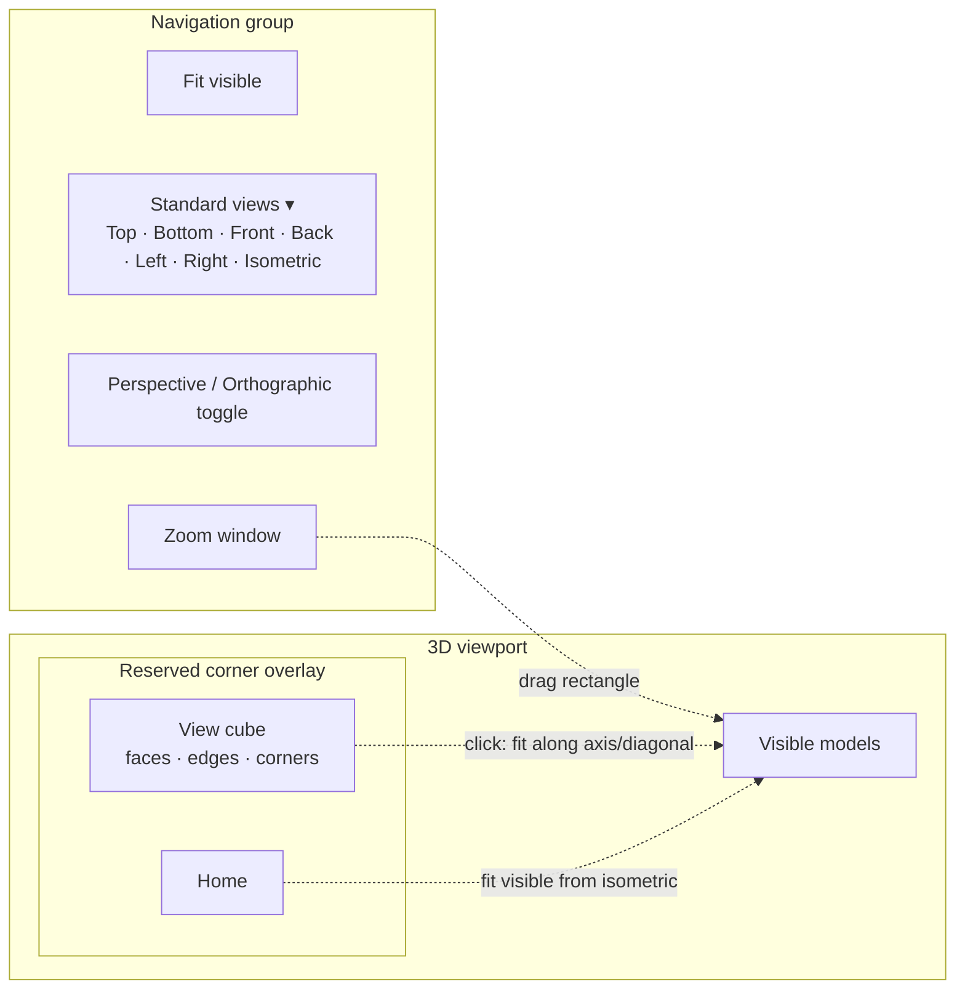

## Requirements

Phase 0 baseline (implemented locally):

- **R1 — Orbit, pan, zoom.** Provide orbit, pan, and zoom for the shared scene with the supported desktop input.
- **R2 — Fit visible models.** An explicit fit control frames all visible loaded models and excludes hidden or removed models. Framing is computed from current visible bounds on every invocation, including after a viewpoint is restored [S8].
- **R3 — Safe empty state.** With no visible model, fit and every Phase 1A command are disabled or harmless no-ops; no command produces non-finite camera values, near/far planes, or an error.
- **R4 — Placement invariance.** Navigation and framing never change authored relative model placement, model visibility, element visibility, or selection.
- **R5 — Resize.** The camera aspect and viewport follow container resizing without stretching, and controls do not overlap.

Phase 1A additions (planned):

- **R6 — View cube.** A view cube overlay in the reserved viewport corner has 6 labelled faces (Top, Bottom, Front, Back, Left, Right), 12 edges, and 8 corners oriented by the standard-view convention in [cross-cutting contracts §5](cross-cutting-contracts.md#5-coordinate-and-view-conventions) (scene Y up; project north when available, otherwise world axes). Hover highlights the target region. Clicking a face frames visible models along that axis; clicking an edge or corner frames along the diagonal [S1, S2]. The cube's orientation follows the camera during orbit [S1]. Face meanings are fixed and not user-configurable [S9].
- **R7 — Standard views.** A keyboard-reachable Standard views menu offers Top, Bottom, Front, Back, Left, Right, and Isometric. Each result equals the corresponding cube target.
- **R8 — Stable orientation.** Top and Bottom use a defined, non-degenerate up vector (looking along ∓Y with the Front side at the bottom of the screen) that preserves the project-north orientation. Orbiting after any standard view does not invert the camera or produce non-finite values [S10].
- **R9 — Pivot reset.** Every cube, standard view, Home, Fit, and zoom-window command sets the orbit target to the centre of the framed region so subsequent orbit stays predictable [S1, S6].
- **R10 — Projection toggle.** A toggle switches between perspective and orthographic. It preserves camera direction and target, and matches the visible extent at the target: orthographic half-height = distance × tan(fov/2), and the inverse on return [S5, S7, S12]. Commands framed while orthographic stay orthographic. While walkthrough is active the toggle is disabled and perspective is enforced [A1].
- **R11 — Zoom window.** Zoom window is an exclusive pointer tool under the one-active-tool contract. The user drags a rectangle; on release the camera centres on the rectangle's centre at the target depth and zooms so the rectangle fills the limiting viewport dimension, in either projection. The tool then deactivates. Escape cancels an in-progress drag first; rectangles smaller than 4 CSS px are treated as cancel [S3, A1].
- **R12 — Home.** Home sits next to the cube and fits all visible loaded models from the isometric direction (1, 0.7, 1), matching Fit visible models. It keeps the current projection and is camera-only: it does not unhide elements, clear selection, or reset clipping. Home is not user-settable in Phase 1 [S2, S4, S7, A1].
- **R13 — Transitions.** Commands may jump or animate. Any animation must finish within 0.5 s, be skipped when `prefers-reduced-motion: reduce` is set, and result in the same final camera as a jump [S1].
- **R14 — Adapter boundary.** UI invokes injected commands only; the viewer adapter owns cameras, controls, and framing. No UI module mutates camera state directly [A1].
- **R15 — Accessibility and layout.** Every control, including cube faces and Home, has an accessible name, tooltip, keyboard activation, and visible focus. Fluent 2 controls are used for the menu, toggle, and buttons. Fluent 2 has no view-cube control (Fluent buttons and menus cannot represent clickable 3D faces, edges, and corners), so the cube is a user-approved custom component (2026-11-08) under `src/components/` that consumes the Fluent tokens in `src/app/fluent2.css` [A1]. Like the other approved custom components it is compliant rather than a deviation; when implemented, add it to the design-system specification's list of approved custom components. Overlays do not overlap first-person controls, the minimap, or the feature dock [A1].

## Acceptance Criteria

- [ ] AC1: Given two representative models, when the user orbits, pans, and zooms, then both models keep their relative placement. *(Partial: Phase 0 Chrome canvas tests exercise movement; no placement-invariance assertion after navigation.)*
- [ ] AC2: Given two visible models, when Fit is invoked, then both are framed; after hiding one, a subsequent Fit uses only the remaining model. *(Partial: `tests/unit/framing.test.ts` proves visible-only bounds, hidden-model exclusion, and authored-position preservation; no browser assertion.)*
- [ ] AC3: Given an empty scene or all models hidden, when any navigation command is invoked, then there is no error and all camera values are finite. *(Partial: framing unit test proves the empty/hidden/invalid-viewport no-op; Phase 1A commands are unimplemented.)*
- [ ] AC4: Given a resized viewport, then the scene is not stretched and controls remain usable and non-overlapping.
- [ ] AC5: Given visible models, when each of the 6 faces, 12 edges, and 8 corners is clicked, then the view direction matches the target, all visible models are inside the frustum, the orbit target equals the framed centre, and values are finite.
- [ ] AC6: Given each Standard views menu item, when it is activated by keyboard, then the camera equals the matching cube target.
- [ ] AC7: Given Top or Bottom view, when the user orbits 360° horizontally, then the camera never inverts and values stay finite.
- [ ] AC8: Given a framed perspective view, when projection is toggled twice, then direction and target are unchanged and the visible extent at the target differs by less than 1%.
- [ ] AC9: Given the zoom-window tool, when a rectangle is dragged over part of a model, then that region fills the viewport; Escape mid-drag cancels without moving the camera; activating another tool cancels zoom window.
- [ ] AC10: Given any prior camera, hidden elements, a selection, and an active clip plane, when Home is clicked, then the camera equals Fit visible from the isometric direction in the current projection and visibility, selection, clipping, and placement are unchanged.
- [ ] AC11: Given a restored viewpoint, when a cube face is clicked, then the camera frames current visible bounds.
- [ ] AC12: Given `prefers-reduced-motion: reduce`, when a cube face is clicked, then the camera jumps directly to the final state.
- [ ] AC13: Given walkthrough is active, then the cube, standard views, projection toggle, and zoom window are disabled and the camera stays perspective.
- [ ] AC14: Given keyboard-only use, then every navigation control is reachable, named, tooltipped, and visibly focused.

## Test Cases (for developers)

| ID | Type | Precondition | Steps | Expected result |
|---|---|---|---|---|
| T1 | Unit | Synthetic bounds; perspective and orthographic cameras | Compute all 26 cube targets | Correct direction, target = bounds centre, bounds inside frustum, finite near/far. |
| T2 | Unit | Top/Bottom targets | Inspect up vector; simulate horizontal orbit steps | Non-degenerate up; no inversion; finite values. |
| T3 | Unit | Perspective camera at distance d | Toggle to ortho and back | Ortho half-height = d·tan(fov/2); round-trip extent error < 1%. |
| T4 | Unit | Camera + screen rectangle | Compute zoom-window camera (both projections) | Rectangle centre maps to viewport centre; limiting dimension fills viewport; < 4 px → no-op. |
| T5 | Unit | Empty, all hidden, zero-size bounds | Invoke every command | No-op; finite camera; no exception. |
| T6 | Chrome E2E | Two fixtures loaded | Click cube faces/corners; capture camera via test hook | Matches T1; models' world matrices unchanged. |
| T7 | Chrome E2E | Hidden element, selection, clip plane | Click Home | Camera = Fit from isometric; visibility/selection/clipping unchanged. |
| T8 | Chrome E2E | Measure tool active | Activate zoom window; drag; press Escape mid-drag on a second attempt | Measure cancelled; first drag zooms; Escape cancels without camera change. |
| T9 | Chrome E2E | Restored viewpoint | Click Front face | Frames current visible bounds. |
| T10 | Chrome E2E | Reduced-motion emulation | Click a face | Final camera reached in the next frame. |
| T11 | Chrome E2E | Walkthrough active | Inspect navigation controls | Disabled; camera perspective. |
| T12 | Accessibility | Navigation mounted | Tab through controls; activate with Enter/Space | Names, tooltips, focus rings; no overlap with minimap/first-person controls at 1280×720 and 800×600. |

## Module Contract

- Public entrypoint: `mountNavigation` in [src/features/viewer-navigation/index.ts](../../src/features/viewer-navigation/index.ts).
- Today it owns the fit button and session/availability subscriptions and requires visible-model summaries and an injected fit command. Disposal removes the handler, both subscriptions, and owned DOM [A1].
- Phase 1A adds injected commands: `standardView(target)` for the 26 cube targets plus `iso`, `setProjection('perspective' | 'orthographic')`, `startZoomWindow()` / `cancelZoomWindow()`, and `home()`, plus a camera-orientation subscription that drives the cube. The viewer adapter owns camera, controls, framing, and animation; the existing fit path stays available when the new controls are unavailable.

## Dependencies

- [Overall architecture](../../Readme.md), [Phase 1 plan](../plans/Phase_1_MVP.md), and [cross-cutting contracts](cross-cutting-contracts.md) (one active pointer tool, Escape order, reserved overlay corners).
- [IFC loading](ifc-loading.md) and [model controls](model-controls.md) for bounds and visibility; [first-person walkthrough](first-person-walkthrough.md) and [minimap](first-person-minimap.md) for mode exclusivity and layout; [viewpoints](viewer-viewpoints.md) for restored cameras; [Fluent 2 design system](fluent2-design-system.md) for controls and deviations.

## Assumptions

- Cube labels and standard views follow [cross-cutting contracts §5](cross-cutting-contracts.md#5-coordinate-and-view-conventions): Top looks down −Y, Front looks from +Z toward −Z, Side looks along +X, project-north based where the model defines it and world axes otherwise. The adapter owns that mapping [A1].
- The isometric direction for Home is the existing `frameModels` direction (1, 0.7, 1) with the 1.15 margin [A1].

## Out of Scope

- User-settable Home ("Set current view as Home"), per-face custom cameras, and Home persistence [S7, S9].
- Compass ring, true-north display, and a user-adjustable north offset [S2, S7, S11]. The contract's fixed project-north mapping still applies.
- Pivot on picked point, Ctrl+Shift pivot relocation, roll, and look/walk modes in this feature [S6, S7]; first person is a separate feature.
- Camera alignment perpendicular to an arbitrary cut or grid; see [section clipping](section-clipping.md).
- Touch-specific cube gestures; the desktop input baseline applies.

## Open Questions

- None. On 2026-11-08 the user approved a custom 3D view-cube component under `src/components/` per the [Fluent 2 design policy](fluent2-design-system.md#design-policy), choosing it over a menu-only or flat button-grid alternative [A1]. Home behavior is fixed by the approved Phase 1A baseline ("Home fits currently visible models"); the other choices are resolved by research and existing contracts [A1].

## Sources

- **[S1]** xeokit SDK — `NavCubePlugin` API — https://xeokit.github.io/xeokit-sdk/docs/class/src/plugins/NavCubePlugin/NavCubePlugin.js~NavCubePlugin.html. Face = axis view of the entire scene, edge/corner = diagonal; `fitVisible` (default false), `cameraFly` (default true), `cameraFlyDuration` 0.5 s, `cameraFitFOV` 45; cube rotates with camera; clicking sets the pivot to the fitted centre. Accessed 2026-11-08.
- **[S2]** Autodesk Platform Services Viewer v7 — `ViewCubeUi` — https://aps.autodesk.com/en/docs/viewer/v7/reference/Extensions/ViewCubeUi/. `setViewCube('front top right')` face combinations, Home button next to the ViewCube, optional triad and compass with rotation. Accessed 2026-11-08.
- **[S3]** APS Viewer v7 — `ZoomWindow` — https://aps.autodesk.com/en/docs/viewer/v7/reference/Extensions/ZoomWindow/. Extends the dolly button with a rectangle-zoom tool; `activate('zoomwindow' | 'dolly')`; deactivate resets the navigation tool. Accessed 2026-11-08.
- **[S4]** APS Viewer v7 — `GoHomeExtension` — https://aps.autodesk.com/en/docs/viewer/v7/reference/Extensions/GoHomeExtension/. `activate()` animates the camera back to its default home view; no UI of its own. Accessed 2026-11-08.
- **[S5]** OpenProject — IFC viewer (BIM feature) — https://www.openproject.org/docs/bim-guide/ifc-viewer/. View Cube for rotation; Reset view resets rotation/zoom/cut and also re-shows hidden elements; Orthographic view described as widely used in engineering; Fit view centres the entire model. Accessed 2026-11-08.
- **[S6]** Solibri UK Ltd — "#GetToGrips 04: Basic Model Navigation" — https://www.youtube.com/watch?v=I30WFdEDCfw. Published 2019-02-08, 3:35. Captions: 00:24–00:28 pan/spin/walk/game modes; 00:51–01:01 preset positions ("if I click the top front left you'll see the model spins to this new position"); 01:30–01:52 pivot "remembers the last point you used if you don't click on a fresh component".
- **[S7]** The BIM Coordinator — "Navisworks ViewCube" — https://www.youtube.com/watch?v=oOx8rvFFHrg. Published 2018-06-06, 4:26. Captions: 00:11–00:22 face and corner clicks; 00:32–00:36 compass ring; 02:16–02:22 "change it to ortho view … back to perspective"; 02:25–02:40 Home; 03:01 "right-click set current view as home".
- **[S8]** xeokit-sdk issue #927 — "NavCube is not working correct after zoom to BCF" — https://github.com/xeokit/xeokit-sdk/issues/927. DB-EC-Hamburg-BIM, 15 Sep 2022; xeolabs could not reproduce (16 Sep 2022); closed 3 Jan 2023.
- **[S9]** xeokit-sdk issue #1057 — initial camera as NavCube front view — https://github.com/xeokit/xeokit-sdk/issues/1057. Jongonzale, 24 May 2023; xeolabs: custom face camera locations are not configurable.
- **[S10]** xeokit-sdk PR #1839 — "Limit users from flipping the model upside-down" — https://github.com/xeokit/xeokit-sdk/pull/1839. ijlal99, 24 Mar 2025; paireks reproduced model disappearing after rotating from cube Top (25 Mar 2025); merged 15 Apr 2025; fixes #1737 and #1020.
- **[S11]** xeokit-sdk issue #1042 — "Add NavCubePlugin option to align with project/true North" — https://github.com/xeokit/xeokit-sdk/issues/1042. xeolabs, 11 May 2023; notes top/bottom clicks lost north alignment before a follow-up fix.
- **[S12]** three.js forum search "switch perspective orthographic camera same view" — https://discourse.threejs.org/search?q=switch%20perspective%20orthographic%20camera%20same%20view. Lists "Switch camera (Orthographic <=> Perspective) with OrbitControls and keep all view parameter" (Dec 2022) and "How to Maintaining consistent viewport size when switching between perspective and orthographic cameras using orbitControls?" (May 2024). Accessed 2026-11-08.
- **[S13]** Capture commands — `viewer-navigation/assets/_capture_video.py`; runs `yt-dlp` (720p cap, English auto-captions) and `ffmpeg` frame extraction at the timestamps listed in the script for [S6] and [S7]. Full MP4s were held in a temporary directory and deleted; VTT transcripts and stills are retained. Frames were checked for nonblank pixels with Pillow and matched to caption timestamps; in-tool image viewing was unavailable in this session.
- **[A1]** Approved Phase 1 decisions and local implementation (not external evidence): [Phase 1 MVP](../plans/Phase_1_MVP.md) ("Home fits currently visible models"), user approval of the custom view-cube component (2026-11-08), [cross-cutting contracts](cross-cutting-contracts.md), `src/features/viewer-navigation/index.ts`, `src/adapters/viewer/framing.ts`, `src/adapters/viewer/index.ts`, and `tests/unit/framing.test.ts` (3 tests passing locally on 2026-11-08).

---

# Research

## Solibri

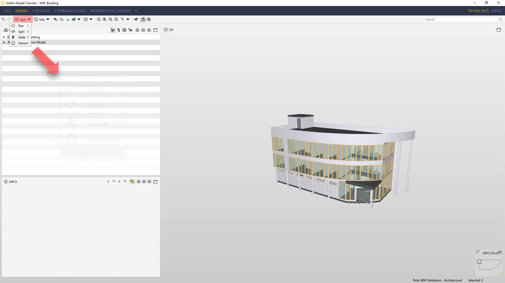
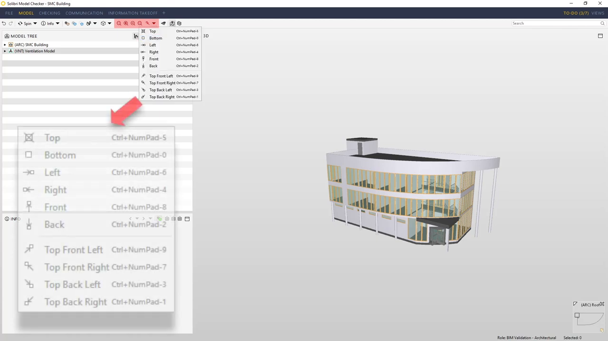
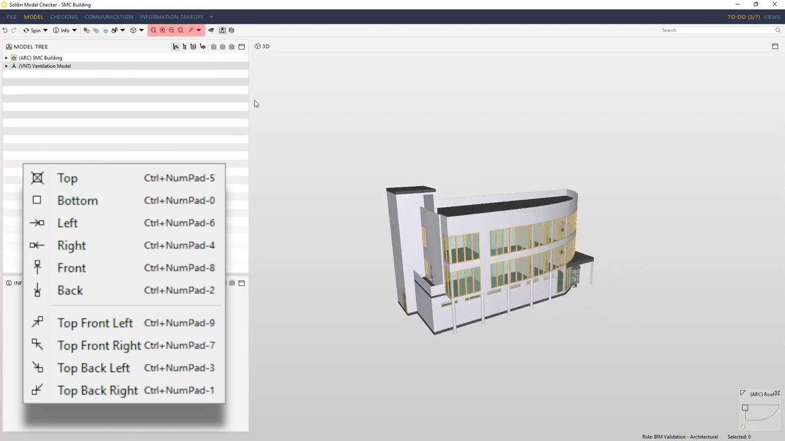
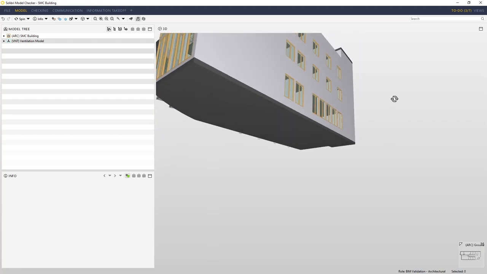
- Preset-position buttons jump the model to named diagonals such as top-front-left (00:56–01:05) [S6]; supports R6/R7.
- Orbiting from empty space reuses the last pivot and is "harder to control" (01:35–01:52) [S6]; supports R9.
- Transcript: [solibri-navigation-transcript.en.vtt](viewer-navigation/assets/solibri-navigation-transcript.en.vtt).

## Autodesk Navisworks

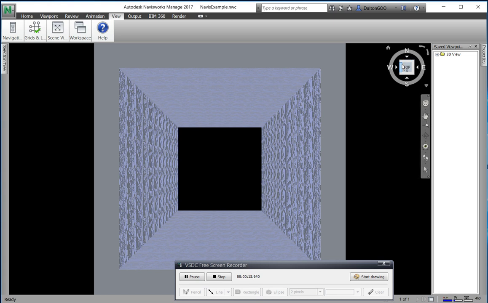
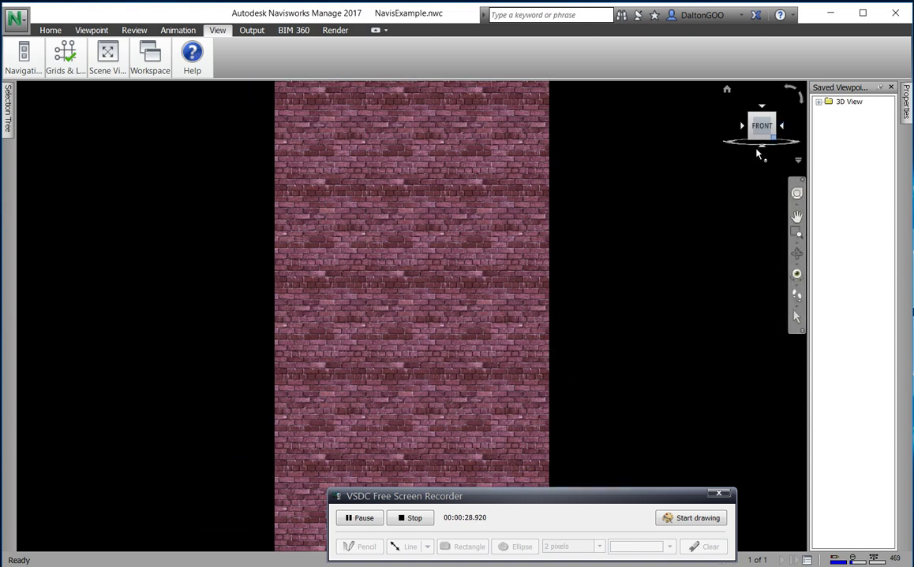
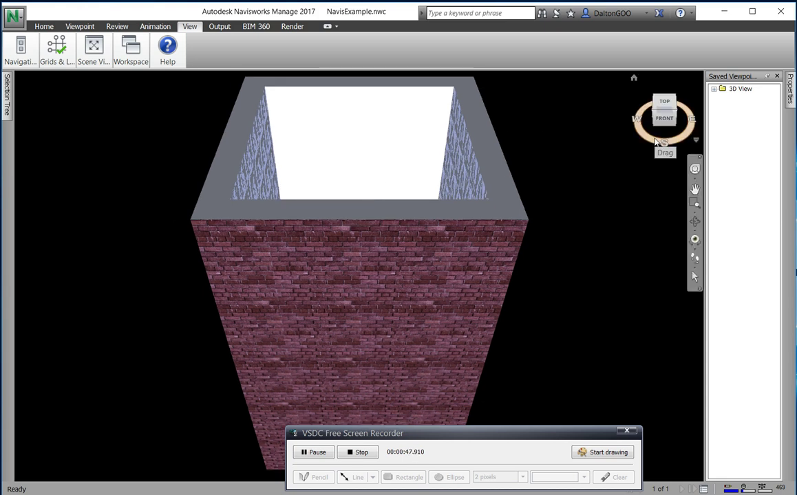
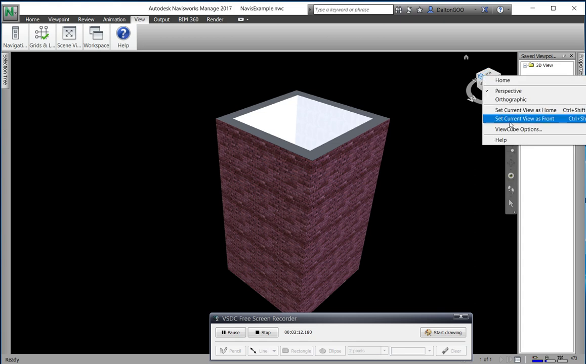
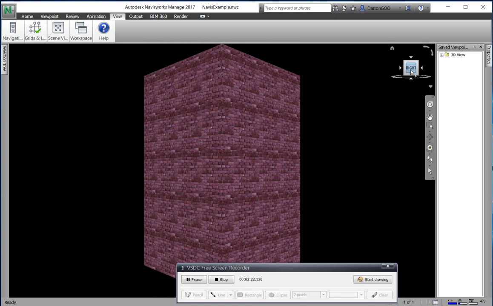
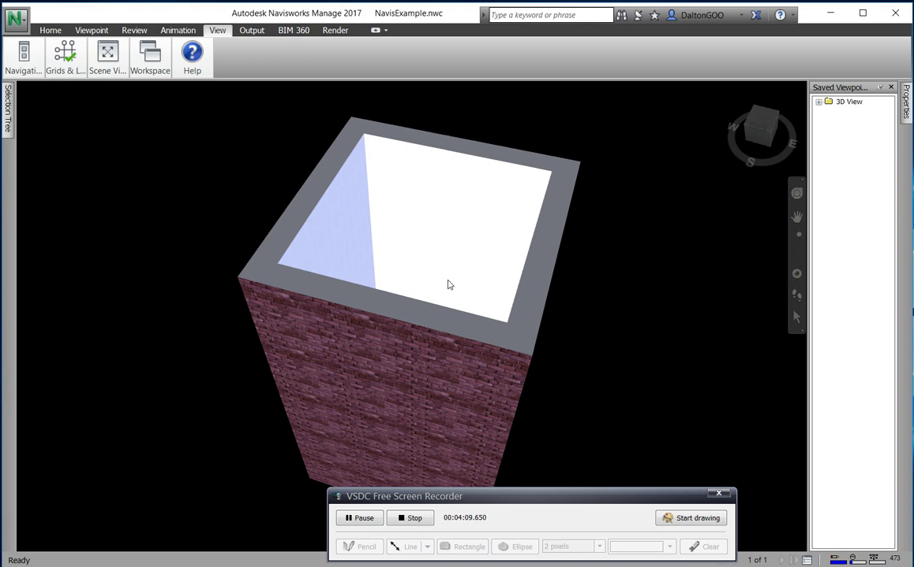
- Face and corner clicks move to axis/diagonal views (00:11–00:22) [S7]; supports R6.
- Projection is switched from the ViewCube settings (02:16–02:22) [S7]; supports R10.
- Home returns to the home view; a user-defined Home exists (02:25–03:05) [S7]; Home is fixed in this app (R12, Out of Scope).
- Transcript: [navisworks-viewcube-transcript.en.vtt](viewer-navigation/assets/navisworks-viewcube-transcript.en.vtt).

## xeokit SDK

- API documents fit-entire-scene vs fit-visible, jump vs fly, and pivot reset [S1]. Issues show post-viewpoint fitting, camera inversion, and north-alignment problems [S8–S11]. No video was captured; the API docs and issue threads are the evidence.

## Autodesk Platform Services Viewer

- ViewCube, Home, and ZoomWindow are separate extensions; Home animates and has no UI of its own; zoom window is a mode of the dolly tool [S2–S4]. No APS-specific video was captured; Navisworks [S7] shows the comparable Autodesk ViewCube interaction.

## OpenProject BIM

- Separate toolbar actions for Reset view, Orthographic view, and Fit view alongside a View Cube; Reset also re-shows hidden elements, which this app intentionally avoids for Home [S5]. The docs GIFs were not downloaded.
