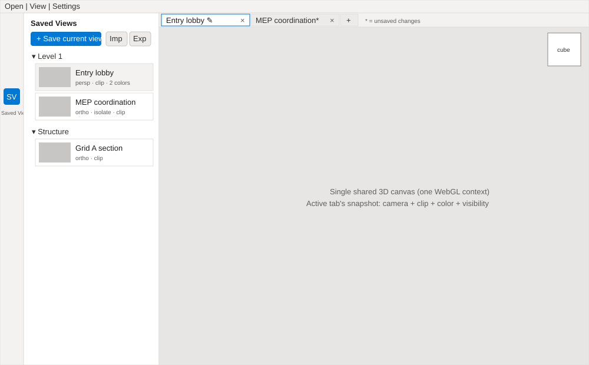
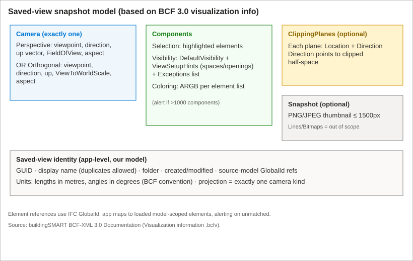
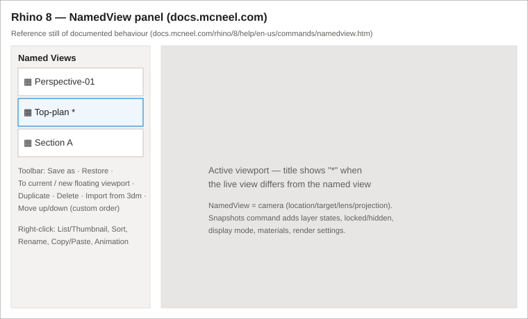
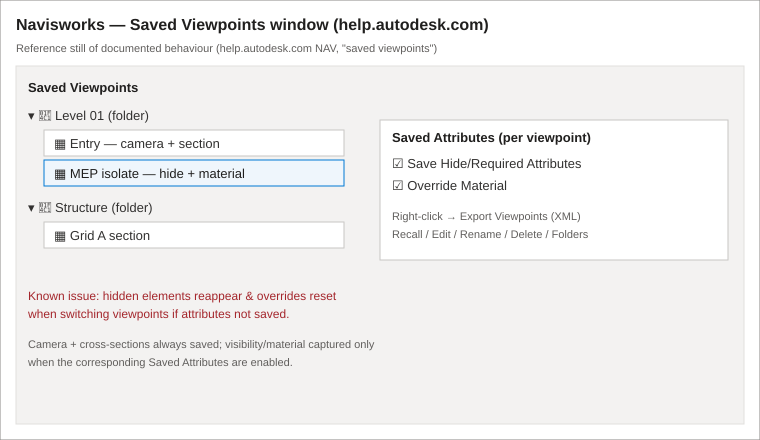

# Feature: Saved Views and View Tabs

Status: Implemented (local). Supersedes and replaces the previous "Temporary Viewpoints" proposal (camera-only, in-memory, cleared on reload); the old `src/core/viewpoints.ts` and `src/features/viewpoints/` module were removed in place. Local unit tests and browser rendering pass; deployed-site verification remains a deferred human step per the plan.

## Summary

Let users capture the current 3D view as a persistent, named **saved view** — a full scene snapshot of camera angle/projection, section-clipping planes, property/appearance coloring, and element visibility/isolation/selection — so they can return to it later, after reloading, or on another machine via file export. Saved views live in a persistent **library** (browser local storage, with import/export for portability) organised into optional folders. Separately, the viewer gains a **view-tab strip** (as in Revit, Navisworks, and Rhino): each tab is one open view swapped into a single shared 3D canvas (one WebGL context at a time); double-clicking a library entry opens it as a tab, tabs show an unsaved-changes marker, and changes can be saved back to the library.

The design follows the **BCF 3.0 viewpoint** data model (the buildingSMART standard for exactly this snapshot) so the captured fields and their export format are interoperable and well-specified. Research across Navisworks, Rhino, and BCF confirms the key risk this spec must eliminate: **a saved view that does not reliably restore visibility and appearance overrides** — the single most common user complaint for this feature class.

**Recommendation:** build the two-level model (library + tabs) with a BCF-aligned snapshot, local-storage persistence, and BCF-ZIP (or JSON) import/export. Make snapshot scope explicit and the restore deterministic.

---

# Detailed Specification

## Problem

Reviewing an IFC model for cost takeoff requires repeatedly returning to the same carefully set-up views: a particular camera angle with a section cut through a storey, specific trades isolated, and cost/appearance coloring applied. Today the viewer's viewpoints are camera-only and discarded on reload, so users must manually rebuild clipping, coloring, and isolation every session and cannot hand a colleague "the view I'm talking about." This is slow, error-prone, and blocks review/handover workflows.

## Users

- **Estimators / QS reviewers** who set up recurring views (per storey, per trade) and return to them across sessions.
- **Coordinators** who want to capture and share a specific problem view (camera + isolation + section) with a colleague.
- **All viewer users** who open several views and want to switch between them quickly via tabs, like Revit/Rhino/Navisworks.

Context: desktop Chrome, minimum 1280×720, no backend (client-only app); metric units; one shared 3D scene.

## Goals

- Capture the current view as a **persistent, named saved view** that survives reload and return visits.
- Capture a **full scene snapshot**: camera (angle + projection), section/clipping planes, property/appearance coloring, and element visibility/isolation/selection.
- **Restore deterministically**: applying a saved view puts the scene into exactly the captured state, including visibility and overrides, without silent drift.
- Provide a **library** of saved views with folders, rename, duplicate, delete, and reorder.
- Provide **import/export** so saved views are portable between devices and shareable with others.
- Provide a **view-tab strip** so multiple open views can be switched quickly in one shared canvas, with an unsaved-changes indicator and save-back.

## Scope

Capture, persist (local storage), import/export, list/organise, restore, and tab between full-scene saved views. Tabs swap into one shared WebGL canvas (one active view at a time). Exclude: simultaneous side-by-side/split live viewports (multiple WebGL contexts), server-side/account storage, animation/fly-through between views, 3D redline markup and 2D bitmaps/text annotations (BCF Lines/Bitmaps), and BCF topics/comments/issue tracking. These are explicitly out of scope (see Out of Scope).

## Comparable Products (Research)

| Product | Feature name | Docs | Video | Notes |
|---------|--------------|------|-------|-------|
| Autodesk Navisworks | Saved Viewpoints | [help.autodesk.com (search)](https://help.autodesk.com/view/NAV/2024/ENU/?query=saved+viewpoints) | [Autodesk "Set the Default View Attributes"](https://help.autodesk.com/cloudhelp/2025/ENU/Navisworks/files/GUID-B38175F1-AEB0-45D7-969C-A192CE4840D2.htm) (steps page) | Saves camera + cross-sections; optionally **Hide/Required attributes** and **Override Material** per viewpoint; organise into **folders**; **export viewpoints** (right-click) to XML for reuse/CAD. |
| McNeel Rhino | Named Views + Snapshots | [NamedView](https://docs.mcneel.com/rhino/8/help/en-us/commands/namedview.htm), [Snapshots](https://docs.mcneel.com/rhino/8/help/en-us/commands/snapshots.htm) | [Rhino 8 Named Views (McNeel)](https://docs.mcneel.com/rhino/8/help/en-us/commands/namedview.htm) demo; Rhino Design Hacks short | NamedView = camera (location/target/lens/projection); **Snapshots** add layer states, locked/hidden, display mode, materials, render settings. Restore to current/new/floating viewport; rename/duplicate/delete/reorder; thumbnails; **import from 3dm**; viewport title shows `*` when view differs from the named view. |
| buildingSMART | BCF Viewpoint (visualization info) | [BCF-XML 3.0 Documentation](https://github.com/buildingSMART/BCF-XML/tree/release_3_0/Documentation) | n/a (spec) | Standard snapshot: one Perspective/Orthogonal camera, Components (Selection, Visibility w/ DefaultVisibility + ViewSetupHints + Exceptions, Coloring ARGB), ClippingPlanes (location + direction), optional Snapshot image ≤1500px. Lengths in metres, angles in degrees. |
| Autodesk Revit / Navisworks | View tabs / tabbed views | (product UI) | (product UI) | Tab strip over one drawing area; one active view; open/close/reorder tabs; right-click tab context menu. Model for Q4(a) single-canvas tabs. |

## What Good Looks Like (Findings)

- **Separate the library from what's open.** Navisworks has a Saved Viewpoints window (library, with folders) distinct from the active view; Rhino has a Named Views panel with restore-to-current/new/floating. This validates the two-level model (library + tab strip).
- **Make snapshot scope explicit.** Rhino deliberately splits camera-only (NamedView) from full state (Snapshots); Navisworks exposes per-viewpoint checkboxes for Hide/Required and Override Material. Users must know what a view will and won't restore.
- **Deterministic restore of visibility + overrides is the make-or-break behaviour.** The dominant complaint (below) is views that fail to restore hidden items/overrides. Restore must be all-or-nothing and reported.
- **Thumbnails + rename + duplicate + reorder + folders** are expected library affordances across both products.
- **Import/export for portability** is standard (Navisworks export viewpoints XML; Rhino import named views from 3dm). Using BCF-ZIP makes exports interoperable with other IFC tools.
- **Unsaved-changes affordance:** Rhino shows a `*` on the viewport title when the live view diverges from the named view — directly reusable for the tab strip.
- **Scale guardrails:** BCF advises alerting when selection/visibility/coloring lists exceed ~1000 components for performance.

## User Feedback (Forums)

- **"Hidden elements reappear and overrides reset when switching between viewpoints"** (Autodesk Community / Autodesk Help article). → **Requirement:** restore must deterministically re-apply visibility and coloring; switching tabs/views must not leak prior state (R4, R5, R12).
- **"Saved Viewpoints: Not Override"** / "Set the Default View Attributes" — users miss that Save Hide/Required Attributes and Override Material must be enabled to capture those. → **Requirement:** capture full snapshot by default and show exactly what is captured (R1, R3, UI chips).
- **Bulk delete / reset is awkward** ("Reset Appearance in Saved Viewpoints list", AUGI) — selecting the whole list to clear it. → **Requirement:** multi-select delete and a clear-all affordance (R7).
- **Rhino:** "when I save a named view or use snapshot, the display style doesn't…"; "clipping plane active settings lost when adjusting named view camera". → **Requirement:** clipping and appearance are first-class snapshot fields, captured/restored together with the camera, not lost by camera edits (R3, R4).
- **Non-goal implication:** heavy per-element coloring/selection lists hurt performance → cap and alert (R11); do not attempt simultaneous live split viewports in-browser (Out of Scope).

## User Flow

1. **Entry point.** User opens the **Saved Views** pane from the tool rail (see [viewer tool sidebar](viewer-tool-sidebar.md)). The pane shows the saved-view library (folders + entries with thumbnails) and the view-tab strip sits above the 3D canvas.
2. **Save current view.** User sets up the scene (camera, section clip, coloring, isolation) and clicks **Save current view**. A dialog proposes a name, shows a thumbnail, and lists what will be captured (camera + projection, clipping, coloring, visibility/selection) with the option to exclude any category. On confirm, a new saved view is added to the library and opened as the active tab. (See `assets/wireframe-saved-views-and-tabs.svg`.)
3. **Open as tab.** Double-clicking a library entry opens it as a tab (or activates its existing tab) and restores its snapshot into the shared canvas.
4. **Switch tabs.** Clicking another tab restores that view's snapshot; the previous view's transient edits remain marked unsaved on its tab.
5. **Modify + save back.** Editing camera/clip/coloring/visibility while a tab is active marks the tab with an unsaved-changes indicator (`*`). **Save** updates the library entry; **Save as new** creates another entry.
6. **Organise.** User renames, duplicates, reorders, moves into/creates folders, multi-selects and deletes entries, and clears all.
7. **Export / import.** User exports selected views (or all) to a file (BCF-ZIP, or JSON fallback) and later imports them on another device; the app matches saved-view element references to loaded models and reports unmatched references.
8. **Success state.** Restoring a view reproduces the captured camera, projection, clipping, coloring, and visibility/selection exactly; the tab is marked saved (no `*`).
- **Error / edge paths:** empty scene (save disabled or camera-only no-op, no invalid values); referenced model not loaded (restore camera/clip; skip missing-element visibility/coloring and show a clear "N elements not found" notice); walkthrough active (restoring exits to orbit); local-storage full or unavailable (warn and keep the view in memory, offer export); import of malformed/unknown-version file (reject with a clear message; ignore unknown fields per BCF rules); oversized component lists (alert and allow proceed).

## Wireframe / Sketch

Snapshot data model (BCF 3.0-aligned):

## Requirements

1. **Create a saved view** from the current scene capturing, by default, the full snapshot: camera pose + projection (perspective/orthographic, incl. ortho extent / FOV), section/clipping planes, property/appearance coloring, and element visibility (isolate/hidden) and selection. The save dialog shows what is captured and lets the user exclude any category.
2. **Library management:** list saved views with thumbnails; rename, duplicate, reorder, delete (including multi-select delete and clear-all); organise into optional folders. Duplicate display names are allowed; identity is a stable GUID, independent of names, filenames, and element IDs.
3. **Snapshot model:** store the snapshot in a BCF 3.0-aligned shape — exactly one Perspective or Orthogonal camera; Components (Selection, Visibility = DefaultVisibility + ViewSetupHints + Exceptions, Coloring in ARGB); ClippingPlanes (location + direction, direction pointing at the clipped half-space). Lengths in metres, angles in degrees. Element references use IFC GlobalId mapped to loaded model-scoped elements.
4. **Deterministic restore:** applying a saved view sets camera, projection, clipping, coloring, and visibility/selection to exactly the captured state, replacing (not merging with) the prior transient state for the categories the view covers. No silent drift of visibility or overrides when switching views.
5. **View tabs:** a tab strip over the single shared 3D canvas; one active view at a time (one WebGL context). Double-click a library entry to open/activate its tab; switching tabs restores that view's snapshot. Tabs can be closed and reordered; closing a tab does not delete the library entry.
6. **Unsaved-changes indicator:** when the active view's live scene diverges from its saved snapshot, mark the tab (and library entry) with a `*`/modified state. Provide **Save** (update entry) and **Save as new**.
7. **Clear/reset:** multi-select delete and clear-all in the library; closing a tab returns its space to the canvas without unloading models or changing the camera of other tabs.
8. **Persistence:** persist the library (and open-tab set) in browser local storage so it survives reload and return visits on the same device/browser. Persisted data is app state only (snapshot parameters + GlobalId references + thumbnails); it is not source geometry.
9. **Import/export:** export selected views or the whole library to a portable file — **BCF-ZIP** (markup minimal + `.bcfv` visualization info + snapshot PNG) as the interoperable default, with a documented JSON fallback. Import reads these files, matches element references to loaded models, and reports unmatched references and files/models that must be matched (per BCF header guidance). Unknown/extra fields are ignored, not errored.
10. **Projection & walkthrough:** capture and restore both perspective and orthographic cameras. Walkthrough/first-person pose is not a saved-view camera kind; restoring a saved view while in walkthrough exits to orbit mode first (see [input arbitration](cross-cutting-contracts.md#3-input-arbitration)).
11. **Scale guardrails:** when a view's selection/visibility/coloring exception list exceeds a documented threshold (default 1000 components, aligned with BCF), warn the user; never silently drop elements. A documented maximum number of saved views per library applies with a clear message at the limit.
12. **Safety:** handle empty scenes, hidden models, and model removal without invalid camera values or stale clipping/selection references. Restoring a view whose source model is absent restores camera/clipping and skips missing-element visibility/coloring with a clear notice.
13. **Non-destructive:** saving and restoring never changes authored IFC coordinates, properties, or source geometry; coloring/visibility are display-only overrides (consistent with [property coloring](property-coloring.md) and [section clipping](section-clipping.md)).

## Dependencies

- [Cross-cutting contracts](cross-cutting-contracts.md) (input arbitration, coordinate/view conventions, metric units, numeric defaults, unsaved-work warnings).
- [3D navigation](viewer-navigation.md) (camera pose/projection capture & restore), [section clipping](section-clipping.md) (clip plane state), [property coloring](property-coloring.md) (color overrides), [element selection](element-selection.md) and [model filtering](model-filtering.md) / model visibility (visibility/isolation), [IFC loading](ifc-loading.md) (GlobalId identity), [viewer tool sidebar](viewer-tool-sidebar.md) (pane host), and [overall architecture](../architecture.md).
- Viewer adapter exposes validated, serialisable capture/restore for camera, clipping, coloring, and visibility/selection without leaking mutable render objects.
- [Fluent 2 design system](fluent2-design-system.md) for all controls (pane, dialog, tab strip, buttons, list).

## Module Contract

- Public entrypoint (implemented): `mountViewerViewpoints(target, capabilities, options)` under `src/features/viewer-viewpoints/`.
  - `capabilities`: `{ scene: ViewpointScene; session: ModelSession; selection: SelectionCapability; exitWalkthrough(): void }` (see `src/features/viewer-viewpoints/scene-capture.ts`).
  - `options`: `{ tabStripHost?: HTMLElement; storage?: LibraryStorage; notice?(message): void }`.
- `ViewpointScene` (in `src/core/contracts.ts`, implemented by the viewer adapter) is the serialisable capture/restore boundary: `captureCamera`/`applyCamera` (perspective or orthographic), `captureClipping`/`applyClipping`, `captureColoring`/`applyColoring` (replace, never merge), `captureHidden`/`applyHidden` (deterministic, all-or-nothing), and `captureThumbnail(maxSize)`.
- The pure domain model, library operations, dirty detection, scale guardrails, and JSON (de)serialisation live in `src/core/saved-views.ts`; BCF-ZIP and `.bcfv` read/write live in `src/core/bcf-zip.ts` (dependency-free store-only ZIP). Local-storage persistence and file import/export live behind `src/features/viewer-viewpoints/persistence.ts`.
- Owns the saved-view library model, the library/list UI, the save/rename/import/export dialogs, and the view-tab strip. It requests capture/restore through the injected typed capabilities; it does not own camera, renderer, coloring, or clipping internals.
- The application shell owns where the tab strip (`[data-slot="tab-strip"]`) and pane (`[data-slot="viewpoints"]`) render; the feature owns their content and state (consistent with [viewer tool sidebar](viewer-tool-sidebar.md)).
- Disposal clears the dirty-detection timer, removes the import handler, and removes both the pane and the tab-strip DOM; library and open-tab state are persisted on every mutation.

## Acceptance Criteria

Verified by local unit tests (`tests/unit/saved-views.test.ts`, `bcf-zip.test.ts`, `saved-views-persistence.test.ts`, `scene-capture.test.ts`, `viewer-viewpoints.test.ts`) and a browser render check; deployed-site verification is deferred.

- [x] AC1: Given a scene with a set camera, a section clip, a color rule, and an isolated set, when the user saves a view and later restores it, then camera, projection, clipping, coloring, and visibility/selection all match the captured state. (scene-capture, viewer-viewpoints tests)
- [x] AC2: Given two saved views A (hides set X, red color) and B (shows all, no color), when the user switches A→B→A via tabs, then no hidden items from A leak into B and A's overrides are fully re-applied on return. (scene-capture test; the viewer `applyColoring`/`applyHidden` replace rather than merge.)
- [x] AC3: Given the library, when the user renames, duplicates, reorders, multi-selects and deletes, and organises views into folders, then the operations behave correctly and duplicate display names are allowed without overwriting another entry. (saved-views test)
- [x] AC4: Given saved views, when the user reloads the app, then the library and its folders persist from local storage; when local storage is unavailable/full, then the user is warned and offered export instead of silent loss. (persistence, viewer-viewpoints tests)
- [x] AC5: Given saved views, when the user exports to BCF-ZIP and imports the file, then views are recreated, element references are matched to loaded models, and unmatched references/models are reported; unknown fields do not cause errors. (bcf-zip, persistence tests)
- [x] AC6: Given a perspective and an orthographic saved view, when each is restored, then the correct projection and framing are reproduced; restoring while in walkthrough first exits to orbit. (saved-views, scene-capture tests; the viewer swaps an `OrthographicCamera` and `setFirstPerson` forces perspective.)
- [x] AC7: Given an active tab whose scene is then edited, when the scene diverges from the saved snapshot, then the tab shows the unsaved-changes marker; Save updates the entry and clears the marker, Save-as-new adds an entry. (saved-views dirty detection; feature Save/Save-as-new.)
- [x] AC8: Given a view whose source model is not loaded, when restored, then camera/clipping restore and missing-element visibility/coloring are skipped with a clear "N elements not found" notice and no invalid camera values. (scene-capture test; verified in-browser notice.)
- [x] AC9: Given a view whose component list exceeds the configured threshold, when saving, then the user is warned and no elements are silently dropped. (saved-views `exceedsComponentThreshold`; feature warns on save.)
- [x] AC10: Given any save/restore/import, then authored IFC coordinates, properties, and geometry are unchanged (display-only overrides). (coloring/visibility are display-only viewer overrides; snapshots store only parameters + GlobalId references.)

## Test Cases (for developers)

| ID | Type | Precondition | Steps | Expected result |
|----|------|--------------|-------|-----------------|
| T1 | E2E (Chrome) | Model loaded; clip + color + isolate set | Save view; move camera, clear clip/color; restore | Scene matches captured camera, projection, clip, color, visibility |
| T2 | E2E | Two saved views A/B as in AC2 | Switch A→B→A via tabs | No visibility/override leak; A fully re-applied |
| T3 | Unit | Library model | Rename, duplicate, reorder, multi-delete, clear-all, folder add/move | Operations correct; GUID identity stable; duplicate names allowed |
| T4 | Unit/E2E | Several saved views | Reload app | Library + folders restored from local storage |
| T5 | Unit | Local storage disabled/quota exceeded | Save view | Warn; keep in memory; offer export; no crash |
| T6 | Unit/E2E | Library with views | Export BCF-ZIP, reimport | Views recreated; refs matched; unmatched reported; snapshot PNG round-trips |
| T7 | Unit | BCF file with unknown/extra fields | Import | Imported successfully; unknown fields ignored |
| T8 | Unit | Perspective + ortho views | Restore each | Correct projection/extent/FOV restored |
| T9 | E2E | In walkthrough mode | Restore a saved view | Exits to orbit, then restores |
| T10 | Unit | Active tab diverged from snapshot | Edit scene | Unsaved marker shown; Save/Save-as-new behave per R6 |
| T11 | Unit/E2E | View references unloaded model | Restore | Camera/clip restore; missing-element overrides skipped with notice; finite camera |
| T12 | Unit | Component list > threshold | Save/restore | Warn; nothing silently dropped |
| T13 | Unit | Any operation | Save/restore/import | IFC coordinates/properties/geometry unchanged |
| T14 | Unit | Empty scene | Save | Disabled or safe no-op; no invalid camera values |

## Assumptions

- The viewer and feature adapters can expose serialisable capture/restore for camera, clipping, coloring, and visibility/selection (these features exist or are planned in Phase 1A).
- IFC GlobalId is a stable, available identity for element references (per [cross-cutting contracts](cross-cutting-contracts.md)).
- Local storage is acceptable primary persistence for MVP; thumbnails are small PNGs sized to stay within quota.
- BCF-ZIP is the preferred interoperable export; a JSON fallback is acceptable where a full BCF writer is heavier than needed for MVP.

## Out of Scope

- Simultaneous side-by-side / split **live** viewports (multiple WebGL contexts) — Q4(a) chose single-canvas tabs.
- Server-side or account-based storage/sharing (no backend in scope).
- Animated transitions / fly-throughs / viewpoint animations between views (Rhino/Navisworks have these; deferred).
- 3D redline markup, 2D bitmaps/text annotations (BCF Lines/Bitmaps), and BCF topics/comments/issue tracking.
- Capturing walkthrough/first-person pose as a distinct camera kind.

## Open Questions

- Export format priority: ship BCF-ZIP first, or JSON first with BCF-ZIP as a fast-follow? (Recommendation: JSON internally for local storage; BCF-ZIP for export.)
- Maximum saved-view count and thumbnail resolution defaults (propose reuse of the 50-item convention and ≤1500px BCF snapshot cap, downscaled for storage).
- Whether open tabs persist across reload or only the library does (Recommendation: persist both; restore last-active tab).

## Sources

1. buildingSMART BCF-XML 3.0 Technical Documentation (visualization info: cameras, Components Selection/Visibility/Coloring, ClippingPlanes, Snapshot) — https://github.com/buildingSMART/BCF-XML/tree/release_3_0/Documentation
2. Rhino 8 NamedView command (save/restore/rename/duplicate/reorder, thumbnails, import from 3dm, restore to current/new/floating, `*` title marker) — https://docs.mcneel.com/rhino/8/help/en-us/commands/namedview.htm
3. Rhino 8 Snapshots command (saves named views, named positions, layer states, locked/hidden, display mode, materials, render settings) — https://docs.mcneel.com/rhino/8/help/en-us/commands/snapshots.htm
4. Navisworks Help — Saved Viewpoints (save/recall/edit/delete, organise into folders, export viewpoints; per-viewpoint Hide/Required and Override Material) — https://help.autodesk.com/view/NAV/2024/ENU/?query=saved+viewpoints
5. Navisworks — "Set the Default View Attributes" / "Hidden elements reappear and overrides reset when switching between viewpoints" (restore-of-overrides pain point) — Autodesk Community / Autodesk Help (via search).
6. McNeel Discourse — "Problem with named views & snapshots" and "Clipping plane active settings lost when adjusting named view camera" (clipping/display not restored) — https://discourse.mcneel.com

---

# Research

## buildingSMART BCF 3.0 (authoritative snapshot model)

- A viewpoint (`.bcfv` visualization info) specifies **exactly one** camera: `PerspectiveCamera` (viewpoint, direction, up vector, FieldOfView, aspect ratio) or `OrthogonalCamera` (viewpoint, direction, up vector, ViewToWorldScale, aspect ratio). Numeric values are in **metres** (length) and **degrees** (angle).
- `Components` carries **Selection** (highlighted elements), **Visibility** (`DefaultVisibility` + `ViewSetupHints` for spaces/space-boundaries/openings + `Exceptions` list), and **Coloring** (ARGB per element list). Spatial containment is not implied by visibility.
- `ClippingPlanes` is optional; each plane is Location + Direction, where the direction points into the clipped (invisible) half-space. Near/far planes are not standardised.
- Optional `Snapshot` image (PNG/JPEG, longest side ≤ 1500px). Optional Lines/Bitmaps for markup (out of scope here).
- Optimization guidance: alert when selection/visibility/coloring lists exceed ~1000 components.
- The BCF **Header** matches BIM files to loaded models by filename/date/reference and expects the importing tool to let the user match files — directly informs our import-matching requirement.

## McNeel Rhino — Named Views + Snapshots

- **NamedView** saves the camera (location/target/lens/projection). Panel supports list/thumbnail view, sort/custom order (drag to reorder), rename, duplicate, delete, copy/paste between models, and **Import from 3dm file**. Restore by double-click, drag onto a viewport, **to current viewport**, or **to new floating viewport**. Viewport title shows a `*` when the live view differs from the named view.
- **Snapshots** is the fuller mechanism: saves and restores Named Views, Named Positions, Layer States, render settings, and object settings including locked/hidden state, display mode, and material — the precedent for capturing a complete scene snapshot (our Q2(c) choice).
- Forum signal: display style / clipping not always carried by a named view, and "clipping plane active settings lost when adjusting named view camera" — reinforces making clipping and appearance explicit snapshot fields.

## Autodesk Navisworks — Saved Viewpoints

- Saved Viewpoints window is a **library** separate from the active view; viewpoints can be **organised into folders**, recalled, edited, renamed, and deleted; the current sectioned view can be saved from the Sectioning Tools tab.
- Per-viewpoint **Saved Attributes** control whether **Hide/Required attributes** and **Override Material** are captured (Options → Interface → Viewpoint Defaults, or per-viewpoint Edit). This is the direct analogue of our "choose what to capture" and the root of the most common complaint when left off.
- **Export Viewpoints** (right-click in the Saved Viewpoints window) writes an XML that can be reused (e.g., to set up the same viewpoints in a CAD application) — precedent for portable import/export.
- Dominant pain point (Autodesk Community/Help): **hidden elements reappear and overrides reset when switching between viewpoints** — the behaviour this spec must guarantee against (AC2, R4, R12).

## Revit / Navisworks — view tabs

- Both present a **tab strip** over a single drawing/model area with one active view; tabs can be opened, closed, reordered, and have right-click context menus. This is the interaction model for Q4(a): tabs swap the active view into one shared canvas rather than rendering multiple live scenes at once.
